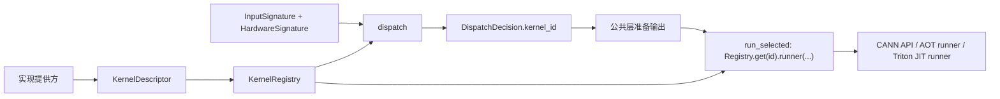

# 算子接入指南：统一接口与多后端交付

> 面向接入 CANN/第三方 API、Ascend C AOT、Triton JIT 实现的开发者。
> §0 给出共同接入流程与交付清单；§1–7 详述自研 Ascend C 的实现与构建。
> Ascend C 历史交付件对照表见
> `docs/reports/custom-operator-onboarding.md` §4（native v2 / catlass v2 双列，33 项），
> 契约字段语义见 `docs/reports/ascendc-contract-v2.md`。
>
> 已有两个可照抄的范本：
> - **native v2**：`matmul_bias_silu`（`silu(A@B+bias)`，BF16）
> - **catlass v2**：`flash_attention`（迁自 catlass `49_ascend950_flash_attention_infer`）

## 0. 多后端接入流程与必交件

### 0.1 先确定是新增算子，还是给已有算子增加后端

新增算子要交付公共接口、元数据规则、Torch schema/FakeTensor、后端实现及验收。
给已有算子增加后端时，复用同一个公共接口、输出准备和 Tensor 调用约定；
增加描述记录和 runner，不再复制一套 facade 或在 facade 中按 backend 写执行分支。
模型调用方始终使用 `flashinfer.<op>(..., backend=...)`。

以 Matmul 为例，公共层统一处理 `(a, b, out)` 的 shape、dtype、device、layout、
输出分配和重叠检查。各 runner 使用原始输入及同一个输出对象，负责自己的
host tiling、workspace、加载/编译和 kernel launch。不能为适配某个 backend
悄悄转换输入、重新分配用户输出或复制另一份计算结果。



`dispatch` 先查决策缓存；未命中时，按同一 `op` 取得候选，完成 backend、能力、
硬件与 JIT 策略过滤，再用有效 tuning 或确定性规则选择来源栈及栈内实现。
登记顺序不决定选型顺序，指定 backend 也不等于指定某个唯一 kernel；需要锁定实现时用
`kernel_id`，仍须通过兼容性检查。执行入口见 `flashinfer/runtime/runner.py`。

### 0.2 三类后端共同交付件

| 交付件 | 必须明确或实现的内容 | Matmul 范本 / 验收位置 |
| --- | --- | --- |
| 数学与输入/输出契约 | 语义、参数顺序、支持的 shape/dtype/layout/SoC、输出与 alias/mutation 规则、误差容差 | `docs/matmul-backends.md`、`flashinfer/_matmul.py` |
| 公共入口与元数据 | 公共 API、顶层导出、`InputSignature`，未提供 out 时的预期输出元数据；合法选型后统一准备输出 | `flashinfer/gemm.py`、`flashinfer/__init__.py` |
| Torch 适配 | 新算子交付具名 schema、PrivateUse1 实现及 FakeTensor 规则；已有算子加后端复用既有适配，避免回调 facade 造成递归 | `flashinfer/aclnn/_ops.py`；其他域沿用各自已有的 Torch 接入口 |
| 描述记录与汇总入口 | 唯一 `kernel_id`、共同 `op`、`backend`、`capability`、`compile_mode`、可调用的 `runner`；按需补 source、target、workspace、constraints 和 ABI | `flashinfer/runtime/schema.py`、`flashinfer/runtime/registry.py` |
| 执行适配 | 与同 op 的其他实现使用相同 Tensor/输出约定；正确的 device、当前 stream、workspace 和资源生命周期；缺依赖明确失败 | 下表所列的 backend runner；不另造 Registry 或通用 loader |
| 路由与元数据 UT | 显式/自动路由、非法输入、未选中后端不执行、不支持输入在分配/编译前拒绝、FakeTensor 不执行 kernel | `tests/test_matmul.py` |
| 设备验收脚本与测试 | 同一输入/shape/out 逐后端调用，独立 golden、误差统计、stream/队列、编译与缓存证据；子进程退出码也必须为零 | `tests/matmul_acceptance.py`、`tests/test_matmul_real.py` |
| 安装与使用说明 | 包内代码/产物齐全，干净安装后的调用或 selftest、支持边界与未验证项；原始测试输出放 build/ 或 CI | `flashinfer/selftest.py`、`README-wheel-conda.md` |

这些是交付职责，不要求每次都新建对应文件。已有公共入口、Torch schema、执行器、
构建/缓存/加载器和依赖解析应直接复用。仅新增源码文件或仅登记 descriptor 均未完成接入。

### 0.3 每个后端分别交付什么

| 内容 | CANN / 已有第三方 API 直通 | 本仓 Ascend C AOT | Triton JIT |
| --- | --- | --- | --- |
| 实现源码 | 薄 runner，调用已安装的 `torch`/`torch_npu` API；说明依赖与适用环境 | `csrc/kernels/<domain>/<name>/op_host/`、`op_kernel/`、`include/`；host/device 共享布局、OpDef、tiling/workspace 回调 | `flashinfer/triton/<domain>/<name>/` 内的 lazy runner 与 `@triton.jit` kernel 源码 |
| 注册来源 | `flashinfer/cann/<domain>/<name>/implementation.py` | `flashinfer/ascendc/<domain>/<name>/implementation.py` | `flashinfer/triton/<domain>/<name>/implementation.py` |
| 构建与身份 | 本仓 `compile_mode=NONE`；CANN 使用厂商预编译包，第三方说明其真实构建/运行依赖 | v2 `csrc/recipes/<name>.json`、源码/依赖摘要、`ascendc_specs.json` 冻结声明；`compile_mode=AOT` | `SourceRef` 及源码摘要、目标 SoC、`JitSpec`、signature/constexpr/options、编译环境与缓存身份；`compile_mode=JIT` |
| runner 绑定 | descriptor 直接绑定 Python callable | `ascendc_descriptors()` 调用 `bind_aot_kernel()` 绑定 `AotKernelRunner`；包加载后由 factory 创建 Tensor runner | descriptor 绑定可调用的 lazy runner，执行时通过共享 build store 编译/加载并缓存模块 |
| 安装交付 | Python 包及明确的 CANN/TorchNPU/第三方依赖 | 随 wheel 提供经过验证的 op_package、元数据及原生 TorchNPU 桥；只有源码的 wheel 无法满足 AOT-only 运行 | 随 Python 包提供 kernel 源码，运行环境具备匹配的 Triton/CANN 工具链；JIT 缓存留在本地 |
| backend 专项验收 | 真实 API 及数值、依赖缺失明确失败、本仓编译计数为零 | AOT 命中且编译器不可见；缺包/损坏、ABI、workspace、队列与发布包安装验证 | 真实冷编译、进程内复用、新进程校验后磁盘命中、源码/配置身份变化拒绝旧缓存或重新编译、冷缓存缺工具链明确失败 |

`compile_mode=NONE` 仅表示本仓无构建步骤，不能据此推断第三方 API 内部没有 JIT。
自研算子使用本仓 `Backend.ASCENDC` 时按上述 AOT 流程登记；名称中的“自定义”不代表
必须使用 `Backend.CUSTOM`。后者是运行时用户扩展入口，要求 `custom/` 命名空间与
`register_custom()`，普通 auto 路由还受 custom opt-in 策略控制。
独立第三方仓若以 `Backend.EXTERNAL` 接入，交付其自有命名空间及 runner，使用
`register_external()`；已冻结 Registry 不能再用普通 `register()` 追加内置项。

### 0.4 Descriptor 如何进入同一个 Registry

| 路线 | 作者需要接上的登记链路 |
| --- | --- |
| CANN | `flashinfer/cann/<domain>.py` 的 descriptors 函数 → `flashinfer/cann/__init__.py:cann_descriptors()` → `_builtin_descriptors()` |
| Triton | 按域/算子的实现声明 → 随包实现索引 → 统一 KernelRegistry |
| Ascend C AOT | `flashinfer/data/kernels/` 下的 registry/spec JSON → `flashinfer/ascendc/_catalog.py:_contracts()` 按 kernel_id 关联并校验 → `ascendc_descriptors()` 绑定 runner |

`get_global_registry()` 首次构造 `_builtin_descriptors() + ascendc_descriptors()`，统一登记后冻结。
CANN 和 Triton 各有一个 `gemm_descriptors()`，它们是不同模块的函数；共同的
`op="gemm.matmul"` 使记录参与同一次选型，唯一 `kernel_id` 区分具体实现。
新增领域文件时要显式接入上表汇总函数，仅存在同名函数不会自动发现。
已有领域只需向已有返回集合增加记录，通常无需改 Registry 核心代码。
登记阶段应保持 import-safe：不导入可选设备 provider，不探测编译器或创建设备 Tensor；
这些动作延迟到选中 runner 后按需执行。

AOT 的 JSON 无法保存 Python callable，因此由绑定层补齐 `runner`；最终进入 Registry
的仍是同一种 `KernelDescriptor`。recipe 负责**怎么构建**，registry manifest 负责
**运行时可选择的实现与能力**，冻结 spec 负责**构建与产物身份**，三者不能互相替代。
改源码/头文件要更新摘要，改 descriptor/recipe 也要重新冻结；命令见 §1.4。
新增 kernel 如触及既有精确清单，先按 `AGENTS.md` 取得确认，再保持精确集合更新断言。

可以先检查记录是否进入同一个 op 的目录；`callable` 仅证明已绑定，不能证明产物存在或数值正确：

```python
from flashinfer.runtime.registry import get_global_registry

for descriptor in get_global_registry().descriptors(op="gemm.matmul"):
    print(descriptor.kernel_id, descriptor.backend.value,
          descriptor.compile_mode.value, callable(descriptor.runner))
```

### 0.5 路由、编译与执行的验收边界

复杂功能不再只写为 dtype/shape 标签。先按
[推理场景与能力组合](runtime-and-compilation-design.md#推理场景与选择维度) 梳理精度、
逐 Tensor 量化、Attention/KV/mask、融合/输出、MoE 等调用事实；公共入口提供
`InferenceSpec`，descriptor 用 `CapabilitySpec.dtype_signatures/cases` 声明连贯支持域。
case 内 AND、case 间 OR，未声明的新语义拒绝。需要交付这些声明、真实参数到特征的映射、
各 case 的通过/拒绝用例和实际设备数值；本机制不自动扩大现有 kernel 的能力。

常用功能按 [通用功能分类全表](runtime-and-compilation-design.md#通用功能特性全量分类) 选择，
新增标量功能采用 `InferenceSpec.features` / `FeatureConstraint`，不要继续给公共 schema 添加算子专用字段。
量化、融合顺序及辅助输出仍分别交付完整 `QuantSpec`、`fusion_ops`、`auxiliary_outputs`；
shape/stride 等约束保留在 Tensor/recipe 契约及既有护栏中。接入前可运行
`tools/routing_capability_demo.py --functional` 核对 Attention/GEMM 的功能组合选型边界。

| 验收面 | 通过条件 |
| --- | --- |
| 指定 backend / kernel_id | 兼容时选择对应记录，不兼容明确报错；不会静默换 backend，runner 执行异常也不会按 fallback_chain 逐个重试 |
| 缺省 backend | 测试要明确全局策略；`backend=None` 读取配置，显式 `auto` 使用自动选型。BF16/FP16 分流先按 capability 过滤，多个兼容候选再调优/排序 |
| shape×dtype 级联 | 在兼容性阶段通过契约、signature 特化和 constraints 表达，在 tuning/排序之前拒绝；字段不足时先扩契约及校验，不能选中后才修输入 |
| 公共能力域 | 公共入口、输出元数据和相应 runner 都实际支持新增输入。仅把 descriptor 改为 FP16 不构成 FP16 接入；当前 Matmul 三后端共同域仍为 BF16 |
| AOT-only | recipe 设 `allow_jit_fallback=false`；缺包时即使全局允许 JIT 也明确失败，真实编译计数为零。允许 miss 后 JIT 的算子才验收对应回落场景 |
| Triton 缓存 | 分别验证冷编译、进程内命中、新进程磁盘命中。禁用实际编译器证明复用缓存；`FLASHINFER_NPU_JIT_DISABLE=1` 会排除普通 `compile_mode=JIT` 选型，不能混为一种测试 |
| Tensor 与提交 | 相同调用保留输入/输出指针，核对数值及调用方的当前 device/stream；支持 TorchNPU 队列的路径验证相应队列模式。共享 stream 不等于相同 RTS 入口或物理队列 |
| 图与性能 | 未验证 capture/replay 的实现保持 `NOT_CAPTURABLE`；torch.compile、异步、autograd 分别提供证据。没有同口径测量时不宣称性能优势 |

交付前按“契约 → 后端源码/适配 → 描述与汇总 → 构建/打包 → 路由 UT → 真机数值与缓存/错误路径
→ 干净安装 → 回归”完成验收。支持域、源码与测试应同时审查；实际命令、退出码、JUnit、
skip 原因和未验证项保存到 `build/` 或 CI，不再复制多份时点报告到 docs。
可执行例子见 [Matmul 接口与构建验收](matmul-backends.md)，核心字段定义见
[Dispatcher 数据结构参考](generated/dispatcher-data-models.md)。以下详细步骤针对 Ascend C。

### 0.6 迁移实例：GroupedMatmulSwigluQuant 走本仓 AOT

本例移植 `vllm-ascend: csrc/gmm/grouped_matmul_swiglu_quant/` 的设备计算与 host tiling，
不调用已安装的 vLLM 扩展。来源提交统一记录在根目录 `THIRD_PARTY_NOTICES.md`，
许可文本集中在 `LICENSES/` 并随包交付；版权头保留，算子目录不维护 `LICENSE` 或 `provenance.json`。
当前本地源码摘要由框架生成的 recipe 记录，无需手写另一份 JSON。
生产身份是 `op=gemm.grouped_matmul_swiglu_quant`、`backend=ascendc`，kernel 为
`ascendc/gemm/grouped_matmul_swiglu_quant/native/op_package/Ascend910B`。
这里的 SoC 是本次接入的 Ascend910B；不能从原目录的产品声明推导其他 SoC 已完成迁移或数值验收。

计算链为 grouped integer GEMM → 反量化 → SwiGLU → 逐 token INT8 量化。
本仓公共函数返回 `(output, output_scale)`，分别为 `[M,N/2]` INT8 与 `[M]` FP32。
原 Torch wrapper 的第三项 `output_offset` 没有对应的设备输出写入，本例不将它暴露为有效结果；
A8W8 的 bias 和 offset 不属于有效计算语义，显式拒绝。A8W4 的 `bias` 参数实际承载 FP32 权重辅助矩阵。
前缀 `group_list` 可含空专家，必须非负、非递减并以 M 结束；本例在同步 eager 边界读取并检查其值，
dispatcher 和 host tiling 不读取该 Tensor 的内容。该路径保持 `NOT_CAPTURABLE`。

| 接入层 | 本例文件与必须核对的内容 |
| --- | --- |
| host/device 源码 | `csrc/kernels/gemm/grouped_matmul_swiglu_quant/`；独立 OpDef、共享 tiling、混合核同步与动态 workspace。ACLNN 调用不能假设 GE 的 `TilingParse` 已执行，tiler 显式查询本次平台的核数与 UB。 |
| 构建声明 | `csrc/recipes/grouped_matmul_swiglu_quant.json`；v2、完整源闭包、目标、输入/输出顺序、可选 Tensor、标量属性及存储解释；`allow_jit_fallback=false`。 |
| 能力与冻结身份 | `build/generated/flashinfer/data/kernels/registry.json`、`build/generated/flashinfer/data/kernels/ascendc_specs.json`；`flashinfer/ascendc/gemm/grouped_matmul_swiglu_quant/implementation.py:capability()` 给出 authoring cases，发布时冻结成 JSON，公共调用构造相同语义的 `InferenceSpec`。 |
| 公共函数与导出 | `flashinfer/operators/catalog.py`、`flashinfer/operators/runtime.py`；从随包目录声明暴露接口，接收原始 Tensor 与两个 out buffer，合法选型后分配输出；领域与顶层文件不再逐算子接线。 |
| Torch 注册 | `flashinfer/operators/runtime.py:torch_declarations()` 生成 functional/out、PrivateUse1 与 FakeTensor 接线；`flashinfer/aclnn/_ops.py` 统一收集。Torch 2.9 的 custom_op 不接受 keyword-only Tensor，生成器自动调整 Torch 参数位置，保留可选标量的原 Torch 位置参数 ABI，Python 门面保留作者的关键字约定。 |
| 执行 ABI | `flashinfer/jit/aclnn_contract.py`、`flashinfer/jit/recipe.py`、`flashinfer/jit/tensor_adapter.py`、`flashinfer/aclnn/_native.py`、`csrc/aclnn_torch_adapter/adapter.cpp`；显式扩展 ABI，原有必选 Tensor/ND 入口与护栏保留。 |
| 校验、打包与自检 | `flashinfer/jit/op_package.py` 校验 native dtype、格式、可选性和属性顺序；`setup.py`、`MANIFEST.in` 带入源码与许可；`flashinfer/selftest.py` 登记独立 CPU 数值检查。 |
| 测试 | `tests/test_grouped_matmul_swiglu_quant.py`、`tests/grouped_matmul_swiglu_quant_acceptance.py`、`tests/test_operator_packages_real.py`；另更新受影响的精确登记集合断言，不能改成下界或包含关系。 |

**能力绑定必须表达完整组合。** 本例分别声明 A8W8 的三种权重 scale dtype，以及 A8W4 的
ND/NZ、per-channel/per-group cases；case 内联合检查存储 dtype、形状/对齐、INT32 累加、
逐 Tensor `QuantSpec`、融合顺序和辅助输出。per-group 的 `group_size=K/G` 来自真实输入，
由显式 `quantization_group_size_ranges` 限定；该字段只允许对应 operand 的 group size 变化，
其余量化字段仍精确匹配。裁剪开关使用 `activation.clamp`，具体 `swiglu_limit` 进入 signature。
分组计算不等于提供路由、专家并行或分布式 MoE。

数值用例必须让所验功能真正生效。本例使用会实际触发裁剪的 `swiglu_limit`，发现原 A8W4
postprocessor 没有消费该属性；本仓补齐与 A8W8 一致的裁剪后再验收。阈值大于全部输入的
“带参数调用成功”无法证明裁剪语义正确。修改设备源码后重新更新头文件摘要并冻结 spec。

**存储解释也是契约。** `TensorDtypeConversion` 只声明 INT32 carrier → INT4、INT64 carrier → UINT64
等位解释，不执行数值 cast 或重排。NZ INT4 必须已经采用 native INT4 的块内字节顺序：
先把未打包权重转成 NZ，再用 `npu_quantize(..., torch.quint4x2, ...)` 打包。
先在 ND 中打包成 int32、再 `npu_format_cast(...,29)` 会按 int32 lane 排列，不能当作同一权重；
两者可能有相同的 Torch shape/dtype/format 元数据。ND 路线则使用低 nibble 优先的 int32 打包。
权重 scale 的 INT64 carrier 保存 UINT64 位模式，也不能用普通数值转换替代位打包。

v2 配方新增字段均显式声明、缺省不进入旧序列化：`TensorParameter.optional` / `optional_for_dtypes`、
`physical_layouts`、`shape_alternatives`、`native_conversions`，以及有类型和范围的 `attributes`。
本例辅助矩阵只允许在 A8W8 下缺省；A8W4 缺失时在执行前拒绝。
生成的 ACLNN 第一阶段顺序是 **输入 Tensor → 属性 → 输出 Tensor → workspace-size/executor 指针**；
设备 GM 参数仍为输入/输出、workspace 和 tiling，属性由 host tiling 消费。
新增参数类型时必须同步声明、包校验、native 转换、FakeTensor、负例与真机数值，不能只扩 Python schema。

按下列顺序复现；命令使用已具备匹配 TorchNPU/CANN 的 Python：

```bash
KERNEL=ascendc/gemm/grouped_matmul_swiglu_quant/native/op_package/Ascend910B
# 从算子目录生成声明和摘要、冻结 spec，再复用本仓 AOT 构建/缓存。
python -B -m flashinfer.operators build --kernel-id "$KERNEL" \
  --cache-dir build/grouped-gmm-cache --output-dir build/grouped-gmm-release
python -B -m flashinfer.aclnn.build --output-dir build/grouped-gmm-adapter
FLASHINFER_AOT_PREBUILT=build/grouped-gmm-release \
FLASHINFER_ACLNN_ADAPTER_PATH=build/grouped-gmm-adapter python -B setup.py bdist_wheel
```

这一 PREBUILT 示例只携带所选算子的 AOT，不能称为全部生产算子已打包。
也可使用 `examples/ascendc_aot_grouped_matmul_swiglu_quant.json` 选择 CONFIG 构建。
工具链不匹配时重新准备相应发布声明；不能直接改 spec 指纹或取消版本门禁。
bisheng 与 host C++ 选择不同标准头时，公共驱动从选定 host compiler 查询标准库路径，
并将头文件内容摘要纳入工具链身份；不通过环境 include 或 recipe 编译选项绕过源闭包护栏。

在干净环境安装 wheel 后，从源码树外断言导入位置并执行：

```bash
REPO="$(pwd)"
cd "$(mktemp -d)"
python -B -c 'import flashinfer,sys; from pathlib import Path; assert Path(flashinfer.__file__).is_relative_to(Path(sys.prefix))'
python -B -m flashinfer selftest \
  --kernel-id ascendc/gemm/grouped_matmul_swiglu_quant/native/op_package/Ascend910B
python -B -m flashinfer.operators.testing grouped_matmul_swiglu_quant installed
cd "$REPO"
python -B tools/run_regression.py --profile quick
python -B tools/run_regression.py --profile compile tests/test_operator_packages_real.py
# 跨层交付再执行一次 full；它已包含 real_compile，不紧接着重复同一编译矩阵。
```

`installed` 验收和 selftest 均随 wheel 提供，从源码树外运行，不需要 checkout 中的测试脚本。
默认不带 `--kernel-id` 的 selftest 仍检查整个生产登记集合，任何失败、缺包或跳过均不算通过。
验收应同时保留七种数值组合、两个输出与 out 身份、非默认 stream、队列 0/1/2、
AOT 命中时编译计数为零、全局 JIT 开启/关闭时缺包均失败、损坏拒绝的证据。
测试实现和产物验收记录不等于所有合法 shape、其他 SoC、图模式或性能已验证。

安装产物后的 A8W8 调用示例（A8W4 的两种存储准备见验收脚本）：

```python
import torch
import torch_npu
import flashinfer

torch.npu.config.allow_internal_format = True
x = torch.randint(-5, 6, (17, 256), dtype=torch.int8, device="npu")
weight = torch.randint(-5, 6, (3, 256, 256), dtype=torch.int8, device="npu")
weight = torch_npu.npu_format_cast(weight, 29)
weight_scale = torch.full((3, 256), 0.002, device="npu")
x_scale = torch.full((17,), 0.01, device="npu")
group_list = torch.tensor([8, 8, 17], dtype=torch.int64, device="npu")
output, output_scale = flashinfer.grouped_matmul_swiglu_quant(
    x, weight, weight_scale, x_scale, group_list, backend="ascendc")
```

#### 0.6.1 最初迁移的文件职责与整改方向

最初迁移涉及 51 个仓库文件（22 个新增、29 个修改），以下保留当时的职责分析；整改后的实际入口见 §0.6.3。这些公共文件不应由后续算子作者重复修改。
“由编码代理写出”不等于“框架能重新生成”。最初可重跑生成的是冻结声明、构建请求、
CANN API/二进制、产物清单和 wheel；公共接口、Torch 声明、能力声明及测试当时仍有手工接线。

| 本例文件组 | 本次实际来源与职责 | 后续作者应承担的部分 |
| --- | --- | --- |
| `csrc/kernels/gemm/grouped_matmul_swiglu_quant/op_kernel/`（8 个文件） | 从上游复制设备计算；手工适配入口并修复 A8W4 裁剪 | 核心计算、同步及数值正确性 |
| 同目录 `op_host/`（5 个文件） | tiling/infer/共享布局来自移植；OpDef 聚合与诊断兼容头为手工适配 | 动态 tiling、workspace、特殊 infer；通用注册外壳应由框架提供 |
| 原同目录 `LICENSE`、`provenance.json`（已移除） | 许可及来源归入根目录 `LICENSES/`、`THIRD_PARTY_NOTICES.md`；本地摘要由框架生成 | 保留版权头；不重复维护许可副本或 JSON 摘要 |
| `csrc/recipes/grouped_matmul_swiglu_quant.json` | 手工组织源闭包、ABI、类型/形状与编译选项；SHA256 经计算填入 | 声明真实编译输入/依赖；不应逐文件维护 SHA256 |
| 整改前的 `flashinfer/_grouped_matmul_swiglu_quant.py`（已移除） | 手写能力、输出元数据、属性映射，同时混入 dispatch/分配/fake 样板 | 保留量化/融合语义、输出推导、特殊校验和属性映射；执行样板应下沉 |
| `flashinfer/gemm.py`、`flashinfer/__init__.py`、`flashinfer/aclnn/_ops.py` | 手写门面、导出、functional/out schema 与回调接线 | 在一个算子声明中注册接口；不应逐个修改公共汇总文件 |
| `flashinfer/data/kernels/registry.json` | 本例先组织并序列化 descriptor/capability；freeze 只刷新其中 source 身份 | 作者声明能力，框架汇总；现有 freeze 不会调用本例的 `capability()` 来新增记录 |
| `flashinfer/data/kernels/ascendc_specs.json` | `flashinfer/aot/declarations.py:freeze_production_kernels()` 生成冻结 recipe/spec | 运行框架工具，不手改冻结指纹 |
| `flashinfer/jit/aclnn_contract.py`、`flashinfer/jit/recipe.py` | 手写通用契约扩展：可选 Tensor、格式、存储解释、标量属性 | 框架维护者职责；同类契约后续应直接复用 |
| `flashinfer/jit/tensor_adapter.py`、`flashinfer/aclnn/_native.py`、`csrc/aclnn_torch_adapter/adapter.cpp` | 手写通用执行扩展：原始 Tensor、ACLNN 参数顺序、当前 stream/workspace/生命周期 | 框架维护者职责；作者只声明 ABI 或提供受支持的适配钩子 |
| `flashinfer/jit/ascendc.py`、`flashinfer/jit/op_package.py` | 手写工具链头身份、目标映射与包 ABI 校验扩展 | 框架维护者职责 |
| `flashinfer/runtime/schema.py`、`flashinfer/runtime/features.py` | 手写有界 group size 与裁剪特征的通用能力表达 | 框架维护者职责；作者使用能力声明，不修改调度核心 |
| `setup.py`、`MANIFEST.in`、`flashinfer/cli.py`、`flashinfer/selftest.py` | 手写许可打包、selftest 选择器及新算子 CPU oracle 接线 | 通用打包/CLI 由框架负责；作者提供样例及独立 oracle，框架收集运行 |
| `tests/test_grouped_matmul_swiglu_quant.py`、`tests/grouped_matmul_swiglu_quant_acceptance.py`、`tests/test_operator_packages_real.py` | 手写元数据/路由 UT、数值样例、CPU golden 和 AOT/队列验收 | 作者提供语义样例、golden、容差；AOT 命中/缺包/损坏/out/队列等公共场景应复用测试工具 |
| 本次调整的 10 个既有测试文件 | 登记精确集合、分栈数量、CLI/selftest 与批量发布断言；全部为手改 | 发布审核及框架维护者职责；可生成候选清单 diff，但仍审核独立的精确预期，不能让被测登记表自动充当自身预期 |
| `examples/ascendc_aot_grouped_matmul_swiglu_quant.json`、`README.md`、本文 | 构建选择示例、清单说明及接入案例，均为手写 | 算子使用说明；标准目录/接口清单可以由声明派生 |

运行期已有通用部分并未在本例修改：现已由 `flashinfer/ascendc/_catalog.py` 与 `_runtime.py` 按 kernel_id 关联冻结记录、绑定
`AotKernelRunner`，`flashinfer/runtime/registry.py` 汇总后冻结登记表；dispatch、AOT 发现/缓存与
通用 CMake 也复用原实现。本例没有新增独立的缓存、loader 或按算子分支的 Registry。

#### 0.6.2 作者入口的职责边界

期望作者只在自己的算子目录交付：设备实现及必要 host 回调、一份接口/能力注册声明、
可选的算子级 CMake 配置，以及独立 golden/样例。接口声明要明确输入/属性/输出、输出推导、
dtype/layout/SoC 与完整量化/融合语义；本例的 `N/2` 输出、INT4 存储解释、bias 到辅助矩阵的映射、
`group_list` 值校验等不能从“源码能编译”自动推断。框架负责让这些事实只声明一次。

框架应由该声明完成目录发现、公共导出、Torch functional/out/FakeTensor 接线、通用校验、
descriptor 汇总、源摘要、recipe/spec 派生与冻结、AOT 构建/验证、runner 绑定、wheel 收集及
公共验收矩阵。已有能力不足时，由框架维护者扩展通用协议，后续作者复用，而非每个算子修改核心文件。
数值 golden 和“支持 capture/replay”等能力证据仍需作者提供并实测，不能由代码生成替代。

整改前不支持在算子目录放一个 `CMakeLists.txt` 就自动接入：`flashinfer/jit/recipe.py:_build_inputs()`
绑定固定的公共 CMake 输入，`flashinfer/jit/ascendc.py:compile_recipe()` 生成 `recipe.cmake` 后调用
`csrc/CMakeLists.txt`；现有编译选项来自 recipe 的 `compile_options/definitions/include_dirs/link_options`。
算子级 CMake 入口应分别控制 host/device target，并将该 CMake、其 include
文件、依赖及最终生效选项纳入构建身份，继续使用现有 op_package 输出校验、缓存和发布链路；
不能只 include 一份不参与指纹的脚本。以上职责已由下述新入口实现；原有显式 recipe 路径继续保留。

#### 0.6.3 已实现的目录接入入口

新入口按 [统一组织规范](operator-layout.md) 分开逻辑定义与后端实现。公共文件位于
`flashinfer/operators/<domain>/<name>/`，后端声明与 runner 位于
`flashinfer/<backend>/<domain>/<name>/`，Ascend C 原生源码位于
`csrc/kernels/<domain>/<name>/`。作者交付：

| 作者文件 | 必须表达的内容 |
| --- | --- |
| `op_kernel/`、`op_host/` | 计算、OpDef、tiling/workspace 及必要 infer；声明真实 native 参数与回调 |
| 公共 `operator.py` | 导出 `OPERATOR: OperatorDefinition`；只定义公共 schema、语义、输出推导与校验 |
| 后端 `implementation.py` | 导出实现声明；分别绑定 Descriptor、Capability、runner 和必要构建输入。Ascend C 使用 `AscendCImplementation`、`NativeBinding` 与 `BuildConfig` 声明 ABI 和构建输入 |
| 后端 `runner.py` | 接收逻辑参数，在选型之后完成原生参数和启动适配；标准适配可复用框架工厂 |
| `cases.py` | 独立 `sample(torch, torch_npu, **configuration)` 返回输入、关键字参数及 CPU golden；声明 `CASE_PARAMETERS`、逐输出 `TOLERANCES`，可提供语义效果检查 `verify_effect` |
| 可选 `CMakeLists.txt`/`.cmake` | 在 `BuildConfig(cmake="CMakeLists.txt", ...)` 中启用；分别配置 host 与 kernel，所有本地 CMake 文件进入摘要闭包 |
| 许可与来源 | 保留版权/许可；移植时记录来源 commit。源码摘要由框架计算 |

`flashinfer/operators/definition.py` 是公共作者协议，`authoring.py` 发现并生成声明；
`catalog.py` 在源码发现声明、在安装环境校验随包目录，`runtime.py` 提供通用调用流程，`testing.py` 提供公共验收驱动。
这些是框架维护者编写的通用实现，不是每个算子生成一份执行器。

作者的 `infer(arguments, layouts)` 返回 `Invocation(inputs, outputs, attributes, inference)`：
`inputs` 按公共逻辑约定排列，`attributes` 是公共属性；后端原生参数映射放在所选 runner 内。
`outputs` 使用 `OutputSpec` 描述，框架决定何时分配或校验 out。
`layouts` 在真实调用时提供物理格式，在 FakeTensor 时为 `None`；infer 只能读取元数据。
可选 `validate_values(arguments)` 在成功选型后检查本算子的 Tensor 值，本例用来检查专家前缀。
作者钩子不调用 dispatch、分配输出、启动 kernel 或探测编译器；这些由通用 runtime 执行。
图能力属于具体实现；未做 capture/replay 验证的实现保持 `NOT_CAPTURABLE`。

本例的自定义 CMake 使用以下真实接口：

```cmake
function(flashinfer_configure_host target)
  target_compile_options(${target} PRIVATE -Wno-deprecated-declarations)
endfunction()

function(flashinfer_configure_kernel target)
  flashinfer_kernel_compile_options(${target} -O2 --cce-auto-sync=on)
endfunction()
```

host hook 接收已创建的 CMake target；kernel hook 接收 CANN kernel library 的逻辑 handle。
使用 `flashinfer_kernel_compile_options` 追加选项，框架与必要宏/头路径合并后只向 CANN 提交一次；
直接重复调用 CANN 的 options setter 会覆盖已有选项。这个 CMake 是框架项目的扩展配置，
构建入口、输出校验、缓存和发布仍由框架管理。新路径使用 `csrc/cmake/operator/`，
旧公共 CMake 的字节保持不变，避免改写历史冻结声明。

在源码 checkout 中只做生成或检查时，不需要 Torch、CANN 或设备：

```bash
python -B -m flashinfer.operators generate
python -B -m flashinfer.operators check
```

`build` 一次完成发现 → 校验 → 生成 → freeze → 现有 AOT 构建/导出，见 §0.6 的实测命令。
生成器只向 `build/generated/csrc/recipes/` 和 `build/generated/flashinfer/data/` 输出 recipe、
Descriptor 与目录索引；Python 定义直接随包，
目录索引与源码摘要由框架派生，不再复制成第二份运行模块。freeze 继续生成 `ascendc_specs.json`。这些文件只审阅 diff，
不要手改；改作者目录后重新执行 `build`。`check` 拒绝过期资源，wheel 构建会重新生成资源并为编译模式冻结身份。
CMake、Python 钩子、本地头及声明依赖内容都绑定到构建身份，变化后不能复用旧 spec。

公共导出和 Torch 注册从随包目录收集，新增作者目录不需要修改 `gemm.py`、`__init__.py`、
`aclnn/_ops.py` 或 `selftest.py`。其他领域通过相同的 `install_exports(..., domain=...)`
挂接领域出口，顶层导出无需逐领域修改。装后 selftest 自动收集作者的第一个数值样例。
`tests/test_operator_packages_real.py` 自动枚举提供通用数值样例的登记目录；已有算子的专项测试继续执行，复用队列 0/1/2、out 身份、非默认流、
缺包 JIT 策略与损坏拒绝矩阵；作者不再复制子进程/构建/加载脚本。

发布预期集中在独立审核的 `tests/production_inventory.py`；原有测试继续比较精确数量和集合。
生成工具不会改写该文件，新增生产项仍需按 `AGENTS.md` 审核该预期，不能把运行时登记表
直接当作自身的测试答案。旧配方探针与既有公共接口继续保留；现有 47 个逻辑定义和
85 个全局实现已按此目录规范组织，另有 1 个显式启用的实验实现。既有富接口通过
`public_entry` 引用原有前端，保留签名、plan/run 和资源协议。目录迁移不表示所有形状/SoC、
其他构建协议或图模式已验收，当前验证结果见 [迁移验收记录](reports/operator-layout-migration.md)。

### 0.7 类型化作者接口与构建资源落点

全部既有 `implementation.py` 已采用后端声明类型；普通 Python 调用使用 `runner=`，
需要 Descriptor 或原生产物的适配工厂使用 `runner_factory=`。能力用 `Support` 声明，
具名维度通过公共 `OperatorDefinition.tensor_shapes` 映射到 Tensor 轴，`DimRange` 的单位为元素。
常见字段、完整文件树与生成职责见 [作者声明与资源交付](authoring-and-resources.md)。

```python
from flashinfer.operators import Support, DimRange, TritonImplementation, PythonKernel

IMPLEMENTATION = TritonImplementation(
    operator=OPERATOR,
    name="bf16_nd",
    support=Support(soc="Ascend950", dtype="bfloat16", layout="ND",
                    dimensions={name: DimRange(16, 256, 16) for name in ("M", "N", "K")}),
    source=PythonKernel(file="kernels.py"),
    runner_factory=make_runner,
)
```

既有 kernel ID 保持显式原值；新实现缺省 ID 为 `<backend>/<domain>/<name>/<实现名>`。
作者不填写源码 digest、spec 指纹、空默认字段或安装产物路径。原生参数顺序、可选输入、
属性类型、存储转换、workspace 与同步规则仍是实际 ABI，必须准确声明。
CANN/Triton/Ascend C 各自注册 Descriptor，共享一个逻辑 `op`；runner 始终在自己的后端目录。

源码树没有 `flashinfer/data/`。下文历史示例中的生成 JSON 路径，在源码环境均对应
`build/generated/` 下同名布局；wheel 内仍使用 `flashinfer/data/`，手写对标与外部 API
契约位于 `tools/metadata/` 并随构建复制。`csrc/recipes/matmul_probe.json` 是显式探针输入，
继续独立保留。源码注册不要求生成文件或 SDK；原生执行须有匹配的冻结元数据和产物。
源码变更后旧冻结身份会被拒绝，安装资源损坏也不会回退到源码扫描。

## 1. 先明确接入契约与实现

### 1.1 对外只提供统一 v2 契约

`schema_version=1/2` 是本仓 `BuildRecipe` 的序列化与能力校验版本，不是 Ascend C 的两种编译方式。所核对的 flashinfer-ori 接入链路没有这套 Ascend C recipe 档位；它通过 generator 参数、模板源码和 FFI 导出定义 CUDA 编译单元。

所有公开配方（生产与探针）统一按 v2 接入；`BuildRecipe`、配方读取/解析、配置选择与新发布入口会拒绝 v1。shape 驱动的 host 动态 tiling 是已有能力。旧 v1 仅用于内部 artifact 解析和冻结测试，不是新作者可选的接入方式。

内部兼容 reader 继续保持旧 v1 护栏，排查旧产物时仍可见以下诊断：

```
tiling_schema_version != 1 或 workspace_bytes != 0 或 task_type != "aic_only"
  → SchemaError("Ascend C v1 supports explicit fixed tiling, AIC-only, no workspace")
```

统一契约显式描述以下能力：

- 用到 AIV（向量核），或 AIC/AIV 混合 + 跨核同步
- 需要非零 workspace（哪怕是固定大小）
- tiling 要在 host 按 shape 算，而不是编译期写死
- 参数不是恰好三个 aclTensor

固定 shape、三个 Tensor、零 workspace、AIC-only 同样可用 v2 表达，无需另选一个档位。五条 ACLNN 探针已按该方式迁移；两条裸指针探针及旧源码闭包移入 `tests/fixtures/legacy_ascendc/`，不再作为公开构建输入。内部 v1 的序列化、校验及既有产物身份保持原样。

版本号应按所属对象分别理解：recipe 的 `schema_version=2` 描述接入字段；`tiling_schema_version=2` 描述 host/device 共享的 tiling 布局；冻结声明外层与 `JitSpec` 的 schema 仍可为 1；`ascendc.op_package.v1` 是产物适配格式。这些数字不同不表示存在多套编译器。

FA 已使用 `host_dynamic`：`FiFlashAttentionTiling` 从实际 Q/K/V 的 shape 取得 S、T、heads，调用 tiler 并设置 block 数与 workspace。同一份二进制可覆盖其声明域内的多组 shape。它仍限 dense batch=1、D=128、S/T 为 128..512 的 128 倍数；不读取变长 length Tensor 的内容，不能外推为数据内容驱动 tiling 或任意变长 FA。MatmulBiasSiLU 也使用 shape 驱动 callback。

### 1.2 实现来源：native 还是 catlass

两者**共用**编译器、store、loader 与 op-package 流程，不是两套 runtime。差别只有一处：

- `native`：源码全在本仓，`dependencies: []`
- `catlass`：要在 recipe 里固定 catlass 的 Git revision 与头目录

```json
"dependencies": [{"name": "catlass", "revision": "41bf90da655bba3c66d0acd7e00abe33960ecfd6", "include_dir": "include"}]
```

**wheel 不自带 catlass 头树。**接入方要自己准备 checkout，并通过
`FLASHINFER_CATLASS_ROOT` 指向它；缺失时构建解析阶段会报
`catlass dependency headers are missing`。

### 1.3 统一使用 op_package

**公开构建只支持 v2 `op_package`。** `host_shared` 仅存在于内部旧协议测试设施；公开配置会明确拒绝。
想让算子能被 AOT 运行期自动发现并在无编译器环境命中，也必须是 `op_package`。该产物包含 ACLNN host API、tiling 库、设备二进制及索引元数据；AOT/JIT 共用同一包格式，源码仍按算子组织。

### 1.4 使用统一声明与批量入口

新算子提供公共定义、后端实现声明及 host/kernel 源码；实现声明明确能力、workspace、ABI 与构建引用。框架生成 descriptor 和 recipe，并按 kernel_id 关联；不需要修改中央登记入口或新增算子专属构建脚本。

在源码仓库与已初始化的构建环境中执行：

```bash
# 批量冻结声明，不编译设备代码。
python3 -B -m flashinfer.aot --freeze --all \
  --dependency-root catlass="$FLASHINFER_CATLASS_ROOT"

# 构建所有冻结生产项，逐 kernel 复用自己的缓存。
python3 -B -m flashinfer.aot --all \
  --dependency-root catlass="$FLASHINFER_CATLASS_ROOT" \
  --cache-dir build/aot-cache --output-dir build/aot-release
```

也可给 `--freeze` 同时传 `--output-dir`，完成冻结后构建；`--kernel-id` 可重复指定批量子集。冻结前会检查所选项的依赖与源码，批量构建也先完成全部所选项的源闭包/spec 校验，再开始编译；某项检查失败不会先编译前面的项。

`flashinfer/aot/declarations.py` 使用登记表中显式维护的 capability/workspace/ABI，更新 recipe 对应的 SourceRef，并生成 `ascendc_specs.json`。已有项保留显式的 specialization_fingerprint 和 spec 编译选项，新项以 recipe 身份生成默认特化标识；完整源码、配方、依赖和工具链摘要继续参与 spec 身份。descriptor 的能力和 ABI 不会被工具自动扩大。

依赖定位由 `flashinfer/jit/dependencies.py` 在 AOT 与 JIT 间复用：按声明名使用 `--dependency-root NAME=PATH` 或 `FLASHINFER_<NAME>_ROOT`，随后仍校验固定 revision 和实际头文件摘要。原 `--catlass-root` 与两个算子专用脚本仅保留兼容入口。公开 wrapper、Torch schema 和数值验收仍由算子作者提供，编译登记不代替这些交付件。

批量入口保留按 kernel 的 spec、缓存和 op_package；当前不会将多个算子合并到同一次 CMake 配置或同一个 vendor 包。

## 2. 按这个顺序做

顺序是有讲究的——先把**不支持的输入拒绝干净**，再谈扩大范围。

```
① 定义数学语义与 envelope
     明确 dtype / shape / layout / mask / batch 支持范围，以及数值容差
     ↓
② 写 kernel TU 与 host TU
     csrc/kernels/<domain>/<name>/op_kernel/    设备侧
     csrc/kernels/<domain>/<name>/op_host/      OpDef / InferShape / tiling / workspace 回调
     csrc/kernels/<domain>/<name>/include/      host/device 共享 tiling 布局
     ↓
③ 写 recipe 与集中 descriptor
     csrc/recipes/<name>.json          照抄 matmul_bias_silu.json 的字段
     flashinfer/data/kernels/registry.json   能力 / workspace / ABI
     ↓
④ 冻结 spec 并构建
     python -m flashinfer.aot --freeze --all  统一声明入口
     python -m flashinfer.aot --all --output-dir <release-dir>
     ↓
⑤ 自动绑定 + 接公共入口
     flashinfer/data/kernels/ascendc_specs.json   工具生成的冻结声明
     flashinfer/ascendc/_runtime.py    按 manifest 自动 lazy 绑定
     公共 wrapper（命名与同域现有接口一致）
     ↓
⑥ host 侧测试（不需要真机）
     recipe 校验 / dispatch 门禁 / 非法配置拒绝 / 依赖缺失
     ↓
⑦ 真机测试（@pytest.mark.real_compile）
     数值对 golden + §4 的七个验收场景
```

## 3. 这几轮实际踩到的坑

Ascend C 生产接口统一通过 Torch 算子接入，参考 [Torch/ACLNN 接入说明](aclnn-torch-adapter.md) 与 `flashinfer/aclnn/_ops.py`：登记具名 schema、`PrivateUse1` 实现和 FakeTensor 元数据函数，Python 公共 facade 仅自动注册并转发。PrivateUse1 实现负责 signature / dispatch / out / runner，不再回调公共 facade；选型参数通过 schema 的可选关键字传入，避免递归或绕过 Torch。完整 wheel 的 `package_tensor_runner` 再调用 `csrc/aclnn_torch_adapter/adapter.cpp`，完成 Tensor 描述符、workspace、stream 与 `OpCommand` 生命周期；不要另写一个绕过已验证 loader 的裸 `dlopen` 路径。该适配器当前覆盖完整档的有序 Tensor ABI，新增 scalar/attribute 等参数仍须单独扩展契约。

按踩中频率排，不是理论风险。

| 坑 | 症状 | 怎么避 |
|---|---|---|
| **改了源码没重算摘要** | 构建报 digest 不符，或命中了旧产物 | recipe 的 `sources`/`headers`/`host_sources` 都带 SHA256，**改源文件后重新执行生成/冻结；框架自动重算摘要** |
| **改了 descriptor 没重新冻结** | 产物身份对不上 | kernel fingerprint **包含能力与 ABI 元数据**，改 descriptor 同样要重冻 |
| **解释器用错** | `ModuleNotFoundError: torch` 或大批测试 skip | 必须用 `/root/miniforge3/envs/flashinfer-a5/bin/python`；默认 `python3` 和 `/usr/local/python3.12.14` **都没装 torch** |
| **把 skip 当 pass** | 真机用例静默跳过还以为通过 | 跑前自检 `torch.npu.is_available()` 应为 `True 8`；`-m real_compile` 应 **0 skipped** |
| **登记表计数断言被撞** | 新增生产条目后若干测试失败 | **这是设计如此**。断言钉死了精确集合，新增 kernel 必须被显式确认。更新时继续钉死精确集合，**不要放宽成 `>= 1` 或"包含"** |
| **虚报入图能力** | `graph_capability` 写了 `CAPTURE_SAFE` 却没验证 | 没做过捕获/重放验证就写 `NOT_CAPTURABLE`。类名带 `CUDAGraph`、参数带 `use_cuda_graph` **都不构成证据** |
| **同名注册替换** | 同 vendor 的新 generation 或跨 vendor 的重复 op/API 被拒 | 首次激活前组装完整 vendor 集合；同组不同算子可共存，同名升级或追加 vendor 须新进程 |
| **CANN 路径含点** | vendor 注册找不到 JSON | CANN 9.2 的 `NnopbaseReadJsonConfig` 按路径**第一个 `.`** 推导 JSON 名（`.objects`、`~/.cache` 都会中招）。loader 已用 `/proc` 目录 fd 别名绕开，接入方不必自己处理 |
| **传 `--timeout`** | pytest 报 unrecognized arguments | `pytest-timeout` **未安装** |
| **把 tiling 的数据依赖当 shape** | 契约表达不了 | `shape_constraints` 绑定的是 **shape 符号**。tiling 若依赖张量**内容**（如 `actual_seq_lengths`），当前契约**无法表达**——要么缩范围，要么另扩一档契约并写独立校验。**不要硬编码常量绕过** |

## 4. 验收门槛

七个场景是硬门槛，可直接照 `tests/test_flash_attention_real.py` 的结构套用：

其中“产物缺失 + 允许 JIT”仅适用于 recipe 允许 JIT 回落的实现；AOT-only 实现
必须验收“全局 JIT 允许/禁止时，缺包均失败且不编译”，参照 `tests/test_matmul_real.py`。

| # | 场景 | 期望 |
|---|---|---|
| 1 | 数值对 golden | 多组 shape，给出误差与容差 |
| 2 | AOT 命中 + 禁 JIT + 编译器不可见 | `source=aot`、`compiler_calls=0`，数值正确 |
| 3 | 产物缺失 + 允许 JIT | 回落真实编译，数值正确 |
| 4 | 产物缺失 + 禁 JIT | 明确报错，`fallback=false` |
| 5 | 产物损坏（JIT 仍开启） | **拒绝**，`compiler_calls=0`。损坏**不得**被当成缺失而静默重编译 |
| 6 | 超出 envelope | 在 **dispatch 阶段**拒绝，不得静默算错 |
| 7 | 外部依赖缺失（catlass 场景） | 构建解析阶段明确报错 |

日常与交付回归分别使用下列入口，所有实际执行用例都须为零失败、零跳过：

```bash
python -B tools/run_regression.py --profile quick
python -B tools/run_regression.py --profile full
# full 已包含 real_compile；不紧接着重复相同编译矩阵。
```

## 5. 扩大 envelope 时

envelope 不是文档里的一句话，它同时落在**四个地方**，扩范围必须四处同步：

1. `csrc/recipes/<name>.json` 的 `shape_constraints`
2. descriptor 的 `capability`（`dtypes` / `soc_models` / `shape_ranges`）
3. host 侧 tiling / OpDef 的实际支持
4. dispatch 门禁与对应的拒绝测试

**漏掉任何一处，结果都是"声明支持但算错"或"能算却被拒"。**
扩完要补对应的数值用例，不能只放开约束。

### 5.1 扩展 dtype：以 FP16/BF16 FlashAttention 为例

`InputSignature` 逐参数记录本次调用的真实 dtype/shape；它不是支持组合清单。公开 v2 recipe 可用可选的 `dtype_signatures` 声明 **按 `tensor_parameters` 顺序排列的完整合法组合**。省略时保持原来逐参数固定 dtype 的契约及序列化身份；显式声明必须完整、无重复，并包含 `tensor_parameters` 的基础 dtype 组合。

```json
"dtype_signatures": [
  ["float16", "float16", "float16", "float16"],
  ["bfloat16", "bfloat16", "bfloat16", "bfloat16"]
]
```

上述顺序为 Q/K/V/out，只接受全 FP16 或全 BF16，不会展开成可任意混用的笛卡尔积。其他算子可以显式声明自己的混合组合；该契约能力不等于相应设备 kernel 已实现或验证。

| 接入层 | FA 扩展时的具体修改 |
| --- | --- |
| 测试脚本 / 公共入口 | 同一脚本循环两种 dtype；输出元数据和真实分配使用输入 dtype，Torch FakeTensor 规则同步；FP16 原容差保留，BF16 使用单独容差及精确量化输入的 CPU 参考 |
| recipe / 登记 / spec | recipe 声明完整 dtype 组合，capability 声明 dtype 集合，manifest constraints 保留整组组合；更新源码摘要并重新冻结 spec，调用 signature 无需手写枚举 |
| op_host / op_kernel | OpDef 的 dtype 与 format 列表按组合对齐，InferType 保持输入 dtype；设备模板使用 CANN 的 `DTYPE_Q` 编译特化 |
| 构建 / 包校验 | 一个 FA op_package 携带两种 dtype 的设备二进制，CANN 按实际 dtype 匹配；校验器逐 binary 验证完整组合，并拒绝缺少任一声明组合的包 |
| 回归 / wheel | 验证双 dtype、多 shape、缺省/显式 out、混合 dtype 拒绝、Torch functional/FakeTensor；安装 wheel 后无参数执行 `python3 flash_attention_acceptance.py`，selftest 的 FA 项也覆盖两种 dtype |

FA 的公共函数、kernel_id、ACLNN Tensor 参数顺序和 tiling 数据布局保持一致。扩展 dtype 不要求新增 kernel_id；同一 dtype 的多组 shape 仍可复用二进制，由 host tiling 处理。该路径依然是同步 eager，图能力仍为 `NOT_CAPTURABLE`。实际验证范围见 [FA 双 dtype 验证](reports/fa-dual-dtype-2026-10-29.md)。

## 6. 相关文档

| 文档 | 用途 |
|---|---|
| [FA 完整调用链与多后端接入](flash-attention-call-chain.md) | facade → 注册与分发 → AOT/JIT → ACLNN → 设备执行，以及同一实现复用两种构建时机的接法 |
| `docs/reports/ascendc-contract-v2.md` | v1→v2 契约 diff、字段语义、通用 ABI 参数约定 |
| `docs/reports/custom-operator-onboarding.md` | 33 项交付件对照表、FA 迁移实录、七场景实际输出 |
| `docs/aot-runtime-discovery.md` | AOT 发现/匹配/绑定/回落机制 |
| `docs/reports/call-stack-layering.md` | wrapper→generator→JIT/AOT→调用 ABI 分层，与上游对比 |
| `docs/reports/graph-mode-delivery.md` | 图模式接口与资源归属（接入可入图算子时看） |
| `docs/ascendc-compile-options.md` | 当前生产编译选项、驱动/SDK 的参数边界，以及 vLLM-Ascend 自定义算子接入对照 |

## 7. 当前尚未支持的

这些不是"你没做对"，是契约本身还没有：

- **数据内容驱动的 host tiling**（依赖张量里的值，如变长 `actual_seq_lengths`）
- **已激活包的同名热替换或追加 vendor**（须新进程；首次激活前声明的互不冲突包可共存）
- **CANN 运行时版本兼容校验**（只校验 target/spec，不比较当前 CANN 版本）
- **生产算子的 aclgraph 入图**（目前仅 single-decode 一条，且口径很窄）

需要其中任何一项，先扩契约并写独立校验，再接算子——
参照 `_validate_v2()` 的写法，**放开限制的同时必须补上对应约束**。
