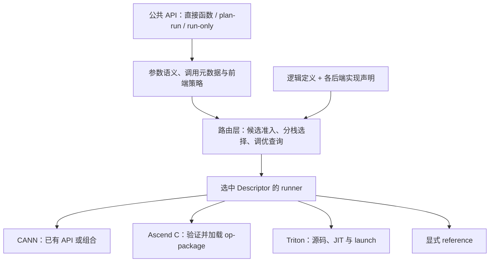

# 架构与术语

面向推理框架集成者和算子开发者：本页说明公共 API、路由器与后端的职责，并沿一次 Matmul 调用定位实现文件。

## 定位与边界

`flashinfer` 在 FlashInfer 风格 API 下接入 CANN、Ascend C、Triton 和显式 reference。公共 API 名称、逻辑算子和具体实现分别建模；同名接口不保证与上游所有参数、设备或执行模式等价。

一个逻辑 op 可绑定多个后端和物理 SoC 的 Descriptor，也可以只提供 reference。运行 `python -m flashinfer list-kernels --all` 查看当前绑定。分芯片 wheel 的原生目录与随包产物一致，运行、图模式与性能分别验收。

## 分层



前端策略也属于实际调用路径：普通 batch Attention 的 Tensor 分支在 plan 中固定请求 `cann`；single Attention 会先把 `auto` 映射到全局默认策略。路由器解释的是传入它的请求，不能假定每个 facade 原样转发覆盖参数。

## 术语

| 术语 | 本仓含义 |
| --- | --- |
| API / facade | 用户调用的函数或 wrapper；可有别名、functional/out 等形式 |
| 逻辑 `op` | 计算语义的登记键，例如 `gemm.matmul` |
| backend | 实现来源类别；不是单个 kernel，也不等同于构建时机 |
| Descriptor | 一个实现的身份、能力、构建方式、准入与 runner 绑定 |
| `kernel_id` | 具体实现的唯一选择键；不按调用顺序推断 |
| `InputSignature` | 本次调用的 dtype、shape、布局、语义与特化事实；不含 Tensor 数据内容 |
| wheel family | 交付分组：910B 包覆盖 A2/A3，950 包覆盖 A5；不替代编译或路由的物理 SoC |
| source architecture | arch22 为 A2/A3 共用源码架构，arch35 为 A5；同架构不表示二进制可互换 |
| `HardwareSignature` | 探测得到的 SoC 系列、核数及可用资源信息；不是完整设备功能清单 |
| capability / admission | 声明能力组合与实现特有的元数据准入检查 |
| runner | 选中后执行公共参数到后端 ABI 的适配、资源准备及提交 |
| 来源栈 | registry 按实现来源分组的候选集合；内部仍可有多份实现 |
| AOT / JIT | 发布前构建与受控按需构建；二者不表示不同数学语义 |
| recipe / `JitSpec` / artifact | 构建规则、完整编译身份、经验证的产物，三者不能互相替代 |
| fallback | 选择后备的诊断顺序，或已授权的 AOT missing → JIT；不是执行失败重试 |
| plan/run | wrapper 持有可复用计划，再消费运行 Tensor；直接函数和 run-only 不增加不适用的 plan |

## 一次调用

以 `flashinfer.matmul(a, b, backend=..., kernel_id=...)` 为例：

1. `gemm.matmul` 幂等启用 Torch 注册，进入 `torch.ops.flashinfer.matmul` 或 `_out`。
2. 逻辑目录的 Torch 声明转到 `gemm._matmul_impl`；公共层检查元数据、生成预期输出与 signature。
3. `dispatch` 读取实现目录，按请求、硬件、capability、target 和 admission 过滤。
4. 有效 tuning 记录或确定性排序给出 `DispatchDecision`；公共层随后分配或复用 out。
5. `run_selected` 查找选中的 runner，原样传入输入和输出对象。
6. CANN runner 调用已有 `torch.mm`；Ascend C Matmul runner 验证并加载 AOT op-package，再走 ACLNN 桥；Triton runner 准备模块、grid 并启动设备 kernel。当前 Ascend C Matmul 是 AOT-only，缺包不进入 JIT。
7. 选中实现发生构建、加载或执行错误时，异常传播；不会遍历 fallback_chain 重新执行其他后端。

这一输出分配顺序适用于 Matmul 与 schema 通用路径；`activation._run`、`gemm.bmm_fp8` 等现有门面会先分配输出再 dispatch。公共框架没有“所有 API 均在分配前拒绝”的统一保证。

代码：[matmul](../../flashinfer/gemm.py#L175)、[_matmul_impl](../../flashinfer/gemm.py#L202)、[torch_declarations](../../flashinfer/operators/gemm/matmul/operator.py#L48)、[run_selected](../../flashinfer/runtime/runner.py#L7)。

## 作者目录与框架职责

```text
flashinfer/operators/<domain>/<op>/
  operator.py                公共 schema/语义/输出推导；既有富接口引用 public_entry
  cases.py                   独立 golden、样例、容差（新 schema 直接算子必需）
flashinfer/ascendc/<domain>/<op>/
  implementation.py          Support、NativeBinding、BuildConfig
  runner.py                  原生适配；ABI 一致的多目标实现可共享
flashinfer/cann/<domain>/<op>/
  implementation.py          能力与 runner 绑定
  runner.py                  已安装厂商 API 或组合调用
flashinfer/triton/<domain>/<op>/
  implementation.py          能力、源码与 JIT 绑定
  runner.py                  特化、缓存和启动
  kernels.py                 实际 Triton kernel
csrc/kernels/<domain>/<op>/
  op_kernel/<entry>.cpp       统一设备入口
  op_kernel/arch22/           实际提供的 A2/A3 分支
  op_kernel/arch35/           实际提供的 A5 分支
  op_host/                   OpDef、推形、tiling/workspace
  CMakeLists.txt              可选编译配置
build/generated/             生成 recipe、索引、Descriptor 与冻结 spec
```

目录发现、公共 schema 的 functional/out/FakeTensor、源摘要、生成资源、构建缓存、包验证和 wheel 收集由框架承担。计算本体、真实 ABI/能力、必要 runner、可选 CMake、独立 golden 由作者承担；原生绑定不自动推断硬件支持。

源码从 Python 声明发现，安装包从 `flashinfer/data/` 校验索引与冻结身份。安装资源缺失或损坏不会偷偷扫描相邻源码。CANN/Triton/Ascend C 各自注册 Descriptor，共享逻辑 op，不把所有后端 ABI 塞进公共定义。

代码：[OperatorDefinition](../../flashinfer/operators/definition.py#L80)、[generate](../../flashinfer/operators/authoring.py#L124)、[execute](../../flashinfer/operators/runtime.py#L84)、[AscendCImplementation](../../flashinfer/ascendc/definition.py#L76)、[data_root](../../flashinfer/_resources.py#L28)。

## 特殊路径

- 多目标 Ascend C 通过 `for_targets(...)` 为每个 SoC 派生独立 Descriptor/recipe/spec/产物，ABI 相同则共享 runner；当前 CATLASS prefill、GMM/SwiGLU/量化和 SFA 均声明 A2/A3，共用 arch22 源码与 runner。硬件名 `Ascend910_93xx` 归一为 `Ascend910C`，不归一为 `Ascend910B`；加载仍按各自 SoC 校验。910B wheel 同时携带两套产物，A3 真机数值未验证。
- `QuantSpec`、CapabilityCase 和 NativeBinding 表达量化组合；没有独立 `flashinfer/quantization/` 目录并不意味着没有量化能力，也不等于已实现上游量化转换 API。
- 直接算子 schema 的 `domain="operator"` 能力绑定与 AttentionPlan 的 profile/POD 协议分开。后者的 Host 合同、trace、量化 KV 和资源租约不自动提供可运行 provider；默认 provider 集成目录为空。

具体选择规则见 [后端路由](backend-routing.md)，逐算子范围见 [后端支持矩阵](../backends/overview.md)，符号差异见 [上游兼容性](../upstream-compatibility.md)。

相关说明：[文档导航](../README.md)、[规划与差距](../roadmap.md)。
