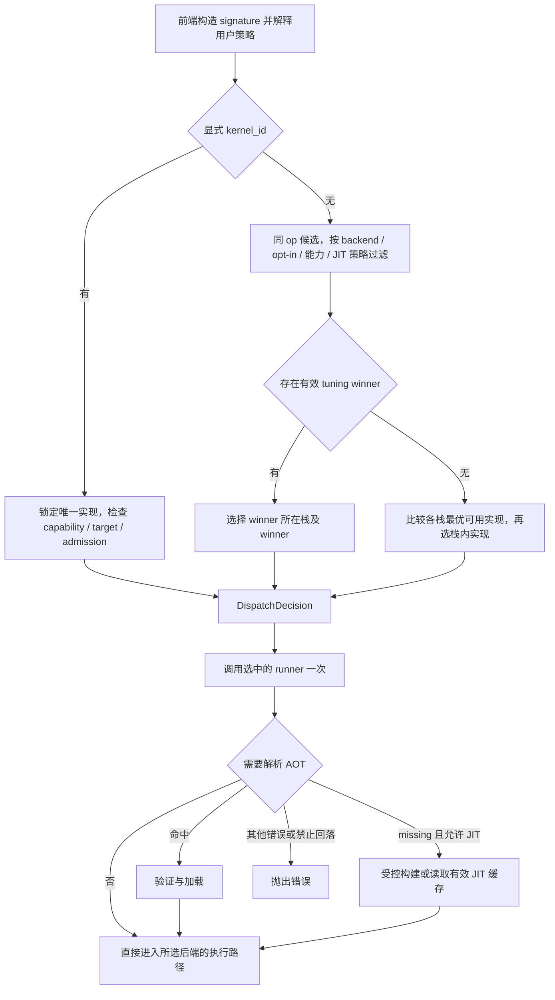

# 后端路由

面向集成者和算子开发者：本页说明一次请求如何获得具体实现、如何查看和覆盖选择结果，以及失败时实际发生的行为。

## 目标与范围

路由器选择已经登记且兼容的实现，不生成新算法，也不把执行失败解释为换后端的指令。规则基于 `InputSignature`、`HardwareSignature`、实现能力与用户策略；不同 facade 对策略的预处理见下表。

## 路由流程



## 选择规则

1. `kernel_id` 锁定实现，仍检查 capability、target、admission。它不把 backend 当第二个筛选条件，且跳过普通 auto 的 custom/reference opt-in 与 JIT 候选过滤；backend 值本身仍先做合法性解析。编译策略由 runner 继续执行。
2. 未锁定 ID 时，先按同一个 `op` 查候选。指定 backend 缩小候选集，不改变组内算法。custom 默认不进 auto，reference 需要显式 backend 或 `allow_reference=True`。
3. 检查 dtype、shape、逻辑/物理布局、具名维度、语义能力组合、SoC、target 和实现 admission。普通 dispatcher 主要消费 CapabilitySpec 与 admission；KernelRegistry.select 消费完整 KernelConstraints 的 manifest 路径不等同于这个入口。
4. `FLASHINFER_NPU_JIT_DISABLE=1` 排除普通候选中的 `compile_mode=JIT`。AOT 记录的缺包策略另由其 runner 检查。
5. 仅在准入之后查询有效 tuning。查询本地记录与随包记录；winner 无法复活已经被过滤的候选。
6. 无 winner 时，默认档位是 `external → cann → aot → jit → reference`；可用 `FLASHINFER_NPU_DISPATCH_ORDER` 重新排列完整五档。档内按 priority 降序，再按 kernel_id 字典序，先确定来源栈，再选栈内实现。这是确定性策略，不是实测性能排名。

代码：[dispatch](../../flashinfer/runtime/dispatch.py#L130)、[_dispatch_uncached](../../flashinfer/runtime/dispatch.py#L193)、[_sort_key](../../flashinfer/runtime/dispatch.py#L118)。

## 查看与覆盖

```python
from flashinfer.runtime import get_global_registry, explain_dispatch

registry = get_global_registry()
for descriptor in registry.descriptors(op="gemm.matmul"):
    print(descriptor.kernel_id, descriptor.backend.value,
          descriptor.compile_mode.value)

# signature / hardware 是对应前端生成的调用事实和硬件签名。
# print(explain_dispatch(signature, hardware, backend="auto"))
```

`explain_dispatch` 返回含逐候选拒绝原因和分栈选择的字符串；`DispatchDecision` 包含最终 ID、reason、reports、stack_reports 和 cache_hit。`fallback_chain` 只说明其他合法候选的顺序。

已有接口的覆盖面如下；不能给未声明这些参数的 API 任意补 kwargs：

| 调用入口 | 实际覆盖方式 |
| --- | --- |
| `runtime.dispatch` | `backend=None` 读取全局默认；显式 `auto` 使用自动策略；`kernel_id` 锁定 |
| `matmul`、norm、普通 GEMM、schema 直接算子 | 接口声明的 `backend` / `kernel_id`；默认值按具体签名 |
| activation、sampling、page、`merge_states` | 保留上游签名；内部以 `backend=None` 读取全局默认，无统一逐调用 ID 参数 |
| single Attention 的真实 Tensor 分支 | 将 `backend="auto"` 解释为全局默认，再进入 dispatcher；无统一 kernel_id 参数 |
| 普通 batch Attention 的真实 Tensor 分支 | 非 reference 路径在 plan 中固定 `backend="cann"`；构造参数不会原样成为 dispatcher policy |
| CATLASS 独立 prefill | 默认显式 `auto`，支持 backend / kernel_id；不使用 single Attention 的 auto 预处理 |

代码：[single_attention](../../flashinfer/_single_attention.py#L20)、[PublicBatchWrapper._publish_plan](../../flashinfer/attention/public_batch.py#L379)、[_run](../../flashinfer/activation.py#L13)、[single_prefill_with_kv_cache_catlass](../../flashinfer/attention/catlass_prefill.py#L12)。

## 配置面

所有值按具体读取点和对象生命周期生效；不是所有 API 都即时响应每一项环境变量。

| 配置 | 实际作用 |
| --- | --- |
| `FLASHINFER_NPU_BACKEND` | 仅被 dispatcher 的 None 分支或主动读取默认值的 facade 消费 |
| `FLASHINFER_NPU_DISPATCH_ORDER` | 五档完整逗号分隔排列；缺项、重复或未知项抛 ValueError |
| `FLASHINFER_NPU_ALLOW_CUSTOM_KERNELS` | 为 1 时让 custom 参与普通 auto 候选 |
| `FLASHINFER_NPU_JIT_DISABLE` | 为 1 时禁用 miss 编译及普通 JIT 候选；不抹除已绑定产物 |
| `FLASHINFER_NPU_DISABLE_DISPATCH_CACHE` | 为 1 时不使用决策缓存 |
| `FLASHINFER_NPU_CACHE_DIR` | 编译缓存根目录；与决策缓存分开 |
| `FLASHINFER_NPU_JIT_CACHE_SIZE` | JIT 模块 loader 创建时的 LRU 容量，不是决策缓存容量 |
| `FLASHINFER_NPU_TUNING_DB` / `XDG_CACHE_HOME` | 当前调优存储的数据库路径；空值关闭本地与随包两层调优查询 |
| `FLASHINFER_NPU_TUNING_DIR` | config 中可读取和显示；当前数据库定位函数不使用它 |
| `FLASHINFER_NPU_ONLINE_TUNING` | config 中可读取和显示；当前路由没有自动在线采样路径 |
| `FLASHINFER_AOT_PATHS` | AOT 搜索目录，按路径分隔符分开；仍检查完整 spec 和目标 |
| `FLASHINFER_ACLNN_ADAPTER_PATH` | 原生 TorchNPU 桥目录；仍校验桥 manifest |
| `FLASHINFER_AOT_ALL` / `FLASHINFER_AOT_CONFIG` / `FLASHINFER_AOT_PREBUILT` | 构建时互斥模式；详见编译与交付，不是运行期选型优先级 |
| `FLASHINFER_AOT_SOCS` / `FLASHINFER_AOT_CACHE_DIR` | CONFIG 的构建目标与构建缓存；不扩大实现能力 |

代码：[dispatch_order](../../flashinfer/config.py#L42)、[_db_path](../../flashinfer/tuning/store.py#L40)、[build_and_load](../../flashinfer/jit/build.py#L123)、[_list_kernels](../../flashinfer/cli.py#L76)。CLI 的 `show-config` 只显示 config 暴露的子集，`list-kernels` 实际只列 Ascend C 生产声明；完整全局目录使用上述 registry 查询。

## 回退与失败语义

| 情况 | 实际结果 |
| --- | --- |
| 没有兼容候选或显式 ID 不兼容 | DispatchError，包含拒绝原因 |
| 已选 runner 抛错 | 原异常传播，不遍历 fallback_chain |
| AOT missing | 仅在实现有 JIT factory 且 policy=ENABLED 时进入 JIT |
| AOT-only 缺包 | 即使全局允许 JIT 也失败；Matmul、GMM、SFA 采用此边界 |
| AOT corrupt / load error / 身份冲突 | 拒绝，不当作缺包重编 |
| 所有 AOT 候选 incompatible | 索引汇总成 missing；之后仍按 missing policy 处理 |
| 依赖或硬件探测失败 | 硬件探测可返回 unknown，表现为无候选；runner 内未处理的依赖异常继续传播 |
| 需要参考结果 | 显式选择 reference；不存在普通执行失败自动回退 CPU 的策略 |

代码：[AotKernelRunner.resolve](../../flashinfer/jit/runtime.py#L108)、[run_selected](../../flashinfer/runtime/runner.py#L7)、[_probe](../../flashinfer/runtime/hardware.py#L80)。

## 扩展点

内建实现按 `operators/<domain>/<op>/operator.py` 和各后端 `implementation.py/runner.py` 发现。OperatorDefinition 定义公共语义，Support/NativeBinding/BuildConfig 或 Python 后端声明定义能力、ABI 与构建输入。生成器负责索引、摘要与公共接线。

运行期扩展用 `register_custom_kernel`、`register_external_kernel`；普通内建 register 在冻结后拒绝新增，扩展入口另行校验命名空间与 revision。它们不是 Torch schema 的 `register_custom_op`。

Ascend C 的多目标实现可用 `for_targets(...)` 共享 ABI 一致的 runner，每个目标仍拥有独立 spec 与产物。直接 schema 的能力绑定不代替 AttentionPlan 的 profile/POD 证据。

代码：[register_custom_kernel](../../flashinfer/runtime/registry.py#L326)、[register_external_kernel](../../flashinfer/runtime/registry.py#L331)、[direct_operator_binding](../../flashinfer/operators/capability.py#L7)。

## 限制

- 调度元数据能拒绝声明范围外的输入，不能证明声明范围全部通过真机数值测试；runner 与厂商运行时仍可拒绝。
- HardwareSignature 由可见设备 0 探测并进程内缓存；没有按每个输入 Tensor 的 device 自动建立完整设备能力表。
- batch 固定 CANN、single 的 auto 预处理和部分门面先分配输出，是当前实际前端行为。
- 决策缓存绑定 registry revision、调用与策略等身份；外部 tuning 数据变更用 `reload_tuning_records()` 或新进程刷新，不保证跨进程文件修改自动可见。
- 图能力、动态量化组合、跨 CANN/Torch 版本和目标 SoC 必须逐实现核对；框架没有同口径性能优越性结论。

参见 [术语与调用路径](architecture.md)、[后端支持矩阵](../backends/overview.md) 和 [API 兼容范围](../upstream-compatibility.md)。

相关说明：[文档导航](../README.md)、[规划与差距](../roadmap.md)。
