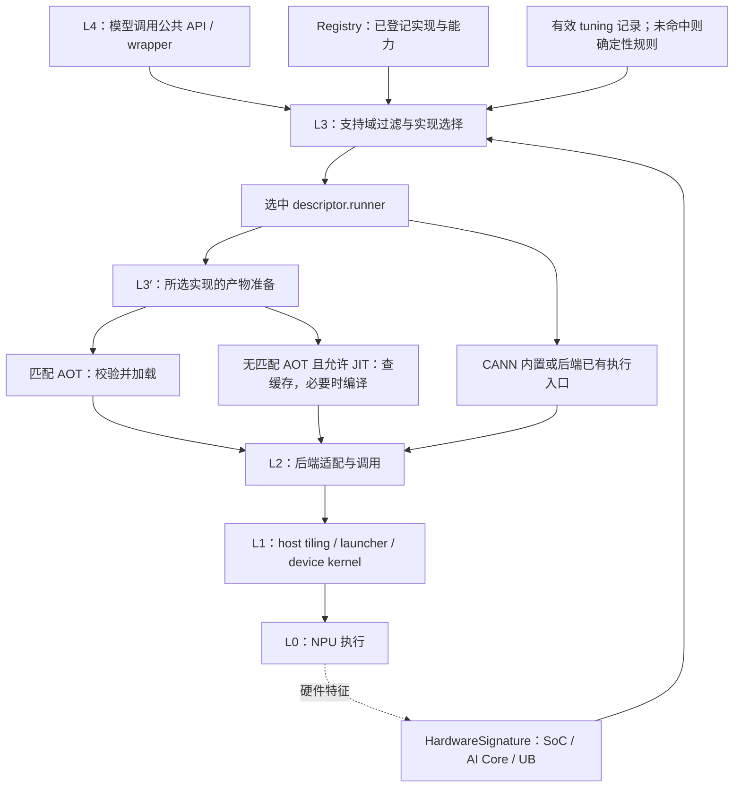
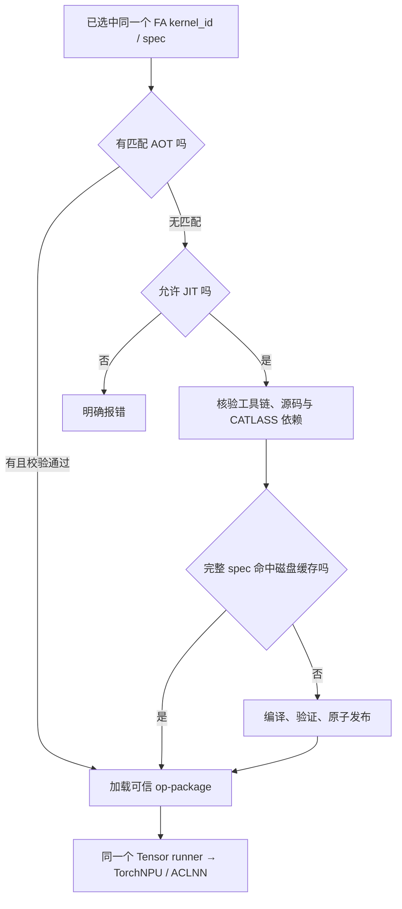

# 面向专家的项目定位与架构讲解

本文按“定位 → AOT/JIT 的价值 → 总体架构 → 关键概念 → FA 源码调用 → 新增 JIT 实现”展开，适合作为技术介绍的讲稿。能力描述以当前实现为准；扩展方案明确标为设计示意。源码行号对应撰写时的工作树，后续可结合函数名查找。

## 1. 先说明我们在做什么

可以这样开场：

> 我们希望让模型通过 FlashInfer 风格的接口使用昇腾推理算子。一个逻辑算子可以接入不同实现，由框架检查输入和硬件是否匹配，再选择实现。对于本仓编译的算子，AOT 与 JIT 共用构建和产物契约：常用配置提前编译交付，缺失产物在策略允许时按需构建并缓存。

| 定位 | 面向专家的解释 | 当前实现边界 |
| --- | --- | --- |
| 对标 FlashInfer | 对齐算子分类、接口语义及适用接口的 plan/run 生命周期，让模型接入方式保持一致 | 逐接口对标，尚未覆盖上游全部算子和参数；直接函数也属于正常使用方式 |
| 一个接口、多个 backend | 模型表达计算需求，由框架在兼容实现中选择，或允许调用方锁定实现 | FA 的隔离 registry 已接入 CATLASS AOT 与 Triton JIT；默认生产登记仍保留原集合 |
| 多种实现技术栈 | 接入 CANN 内置算子、Ascend C/CATLASS 源码和 Triton 实现 | Ascend C 与 Triton 是不同编程/编译方式，CANN 是已有算子库；并非每个 op 都具有这三种实现 |
| AOT/JIT 共存 | 同一计算实现可以提前构建，也可以在部署后按策略补建 | 当前生产 Ascend C 优先 AOT，缺失时可 JIT；不自动生成任意新 dtype/head_dim 的源码 |
| 按负载选择合适实现 | 支持域过滤后，使用有效测量记录选择该负载下的胜者 | 当前随包 tuning 记录为空，未命中时使用确定性规则；不能宣称已经总能选到最快实现 |

“选择最优”需要三个前提：**存在多个语义兼容的实现、都有可执行接入、有适用的测量证据**。测量记录反映特定条件与被测候选集合，不是所有实现、所有时刻的全局最优证明。只具备统一接口和 registry，不能直接推出性能优势。当前能力全集见 [算子覆盖](operator-coverage.md)。

## 2. 为什么需要 AOT 和 JIT 共存

推理配置很多：dtype、head dimension、mask/variant、tile 配置和目标设备都可能影响编译结果。例如，假设一个算子有 2 种 dtype、4 种 head dimension、2 种 variant，完整预编译矩阵就可能有 16 种组合；实际模型可能只用其中少数几种。

JIT 允许把部分构建工作延后到具体配置明确时完成，只构建实际需要的组合，并缓存复用。它提供的价值包括：

1. 按需交付特化组合，控制提前编译的规模与产物数量。
2. 支持 generator 将明确的配置变成编译常量，调用模板化实现；源码与契约必须已支持这些配置。
3. 新实现或编译输入变化后，可以增量构建和验证对应产物，复用其余合法缓存。

特化能力来自 generator、源码和编译器。**AOT 同样可以构建特化 kernel；构建时机本身不决定 kernel 执行速度。** 相同编译输入不能仅因标为 JIT 就获得性能结论。

| 问题 | AOT | JIT |
| --- | --- | --- |
| 什么时候编译 | 发布或部署准备阶段 | 配置明确后的加载、预热或首次使用阶段 |
| 首次使用 | 校验、加载已有产物 | 有合法缓存则加载；缺失且允许编译时构建 |
| 构建依赖放在哪里 | 构建环境 | JIT 构建环境；当前本仓 JIT 入口即使命中磁盘缓存，也先准备工具链与源码依赖 |
| 主要取舍 | 提前承担编译与交付组合 | 承担冷构建延迟、构建依赖和缓存管理 |
| 当前仓库的协同 | wheel 打包已登记生产算子 | 相同实现缺少匹配 AOT 时补建既定 spec |

两种模式共用源码、recipe/spec、校验和底层编译流水线。其区别主要在触发时机和产物交付位置，而不是维护两份计算逻辑。公共构建点为 [`_build_record`](../flashinfer/jit/build.py#L75)：发布侧 [`_publish`](../flashinfer/aot/build.py#L98) 与运行侧 [`build_and_load`](../flashinfer/jit/build.py#L123) 都使用它。

当前 FA 的具体情况是：FP16/BF16 已在冻结契约中声明，支持域内的 S/T/H 变化由 host 动态 tiling 处理。它们会改变调用 signature，但不要求每次生成新二进制。JIT 目前主要补建已有契约对应的产物；面向任意模型配置的通用模板物化仍需扩展。

JIT 缓存复用的是编译产物和已加载代码，plan/run 复用的是具体 wrapper 约定的元数据、资源与准备结果，两者解决不同问题。

## 3. 自顶向下的总体架构

保留 L4～L0 的介绍方式，但将“实现分类”“产物准备”和“硬件探测”分别说明：

| 层级 | 负责什么 | 当前源码 |
| --- | --- | --- |
| L4 对外 API | 表达算子语义、组织参数；有状态接口管理 plan/run；生产 Ascend C 薄封装进入 Torch schema | `flashinfer/decode.py`、`prefill.py`、`norm.py`、`attention/catlass_prefill.py`、`aclnn/_ops.py` |
| L3 调度与选型 | 形成负载和硬件信息，过滤支持域，查询 tuning，选择 kernel_id | `flashinfer/runtime/`、`flashinfer/tuning/` |
| L3′ 产物准备与编译 | 已选实现需要产物时，发现 AOT、查询缓存、按策略构建并校验加载；AOT 发布也使用公共构建流水线 | `flashinfer/jit/`、`flashinfer/aot/` |
| L2 后端适配与执行 | 将统一调用转换成具体后端的调用参数和执行协议，处理 Tensor、workspace、stream 与资源生命周期 | `flashinfer/cann/`、`flashinfer/jit/tensor_adapter.py`、`flashinfer/aclnn/`、`csrc/aclnn_torch_adapter/`、Triton launcher |
| L1 算子实现 | host infer/tiling 与 device 计算代码，或已安装 CANN 算子实现 | `csrc/kernels/ascendc/<op>/op_host/`、`op_kernel/`；`flashinfer/triton/` |
| L0 硬件 | 真正执行设备计算；硬件信息作为上层选择和 tiling 的输入 | 昇腾 NPU；探测入口 `flashinfer/runtime/hardware.py` |

`flashinfer/jit/` 虽然名称包含 JIT，内部也有 AOT discovery、公共产物校验和加载器。目录名不意味着每次调用都会编译。



图中的产物准备分支描述当前生产 Ascend C 路线。Triton 有自己的 JIT launcher，CANN 内置路线不进入本仓 Ascend C 构建流程。L1 目录同时存放 host 与 device 源码，并非整个目录都运行在 AI Core 上。

硬件探测不应描述为调用链的最后一步：它为 L3 提供选择条件，也为 host tiling 提供设备参数；计算最终才由 L0 执行。[`current_hardware`](../flashinfer/runtime/hardware.py#L101) 进程内缓存 SoC、AI Core 数与可查询的 UB 信息，未知项保留未知值。

## 4. 概念为什么存在，能不能精简

可以先用六个问题串起来：

**算什么 → 本次输入是什么 → 有哪些实现能算 → 选择哪一个 → 如何得到可执行产物 → 如何安全执行。**

下面的“必要性”指解决这类问题需要相应信息，并不意味着每项都必须设计成独立类。单一固定 AOT 算子可以直接绑定调用；本仓采用这些对象，是为了让多实现、编译与加载遵守共同规则。

### 4.1 选择实现需要的信息

| 概念 | 通俗解释 | 本次调用中的作用 | 为什么需要，什么情况下可精简 |
| --- | --- | --- | --- |
| `op` | 要完成哪种计算 | 将语义兼容的实现放入同一个候选集合 | 没有共同语义身份，就无法比较实现；可用字符串表达，不要求额外对象 |
| `InputSignature` | 本次订单 | 记录实际 dtype、shape、逻辑/物理布局及特化条件，供过滤、调优查询和决策缓存使用 | 只按函数名选实现无法识别非法输入；不记录 Tensor 内容或地址 |
| `HardwareSignature` | 在哪种机器上执行 | 提供 SoC、AI Core、UB 等选择条件 | 同一输入在不同设备上可能不适用；只有固定硬件的简化系统才可把它作为常量 |
| `backend` | 实现的来源分类 | 例如 cann、ascendc、triton；用于筛选候选和来源策略 | 允许显式选择与解释；不能唯一标识某一份实现 |
| `kernel_id` | 某一实现的唯一编号 | 锁定实现、关联 recipe/spec、记录调优胜者与执行来源 | 同一 backend 可以有多个实现；只记 backend 无法定位或复现选择 |
| `CapabilitySpec` | 这个实现能接哪些订单 | 用 dtype、shape、布局、特化和硬件条件判断合法性 | “函数参数相同”不等于支持范围相同；合法性检查必须先于性能选择 |
| `KernelDescriptor` | 一份实现的说明卡 | 汇集 op、kernel_id、backend、capability、compile_mode、源码/产物/ABI 与 runner | 它主要是信息聚合；这些字段可以换组织方式，但不能省略各自约束 |
| `KernelRegistry` | 实现目录 | 按 op 查询 descriptor；以 revision 反映登记变化，供缓存失效使用 | 单一实现可用直接引用；多实现需要一致的目录，避免各 wrapper 私自维护候选列表 |
| `ImplementationStack` | 按来源分组的目录视图 | 同一来源可以包含多个 kernel_id 和 AOT/JIT 分类，调度先选择来源栈，再选栈内实现 | 分组来自同一 registry 快照，不再维护一份候选事实源；单一来源可不需要这个视图 |
| `dispatcher / dispatch` | 选型规则 | 过滤后使用有效 tuning 或确定性排序，返回选择结果 | 将规则集中，才能保证不同 API 的选择可解释、可复现；它不编译或执行 kernel |
| `DispatchDecision` | 选型结果及理由 | 携带 kernel_id、backend、候选报告、来源栈与原因 | kernel_id 是执行所需结果；详细报告属于诊断，可按需求精简 |

定义位置：[signature](../flashinfer/runtime/signature.py#L14)、[capability](../flashinfer/runtime/schema.py#L689)、[descriptor](../flashinfer/runtime/schema.py#L914)、[registry](../flashinfer/runtime/registry.py#L61)、[dispatcher](../flashinfer/runtime/dispatch.py#L130)、[decision](../flashinfer/runtime/dispatch.py#L61)。

[ImplementationStack](../flashinfer/runtime/registry.py#L39) 只是来源分组视图；两级选择复用现有排序键，不另设来源的“性能分数”。当前 FA 的完整参数组合先由 recipe 校验，再通过 `tensor_contract` 特化条件进入通用 capability 过滤；Tensor adapter 在执行边界再次检查。构建契约与调度支持域有重叠信息，需要一致性校验，不能各自扩张成不同的合法范围。

`backend` 并不是纯粹的“语言枚举”：external/custom 还表达来源与接入策略。`SourceRef.language` 和编译器的 `JitBackend.backend_id` 才表达源码语言及构建驱动。历史枚举中的 ascendc_aot/ascendc_jit 仍为兼容契约保留，新介绍应优先采用“实现来源 + 编译模式”的分开表达。

### 4.2 编译和产物复用需要的信息

| 概念 | 通俗解释 | 实际作用 | 为什么需要，是否进入每次计算 |
| --- | --- | --- | --- |
| `SourceRef` | 源码位置与版本凭据 | 绑定源码路径、语言与摘要 | 相同文件名不能证明源码相同；准备构建时核对，不在已绑定调用中逐次读取源码 |
| `BuildRecipe` | 这份实现的构建配方 | 描述 host/device 源码、头文件、依赖、宏、选项、Tensor 顺序、shape/dtype 契约与包格式 | 让 native/CATLASS 等实现共用构建框架，不靠逐算子 Python 特判 |
| `ResolvedBuildRecipe` | 已核实依赖的配方 | 将声明依赖与实际 revision、头文件树摘要和工具链身份绑定 | 有声明不代表本机文件正确；构建前完成核验 |
| generator / `JitBackend` | 将实现配置变成编译单元并调用编译器 | 声明 JitSpec，必要时物化输入、执行 compile | Ascend C 当前主要绑定已有源码、宏和 recipe，尚非任意模板自动生成器 |
| `JitSpec` | 某个编译单元的规范身份 | 汇集 descriptor、源码/配方、特化、环境、选项和入口，形成缓存指纹 | kernel_id 只标识实现，不能单独证明二进制仍匹配当前编译输入；AOT 也使用该 spec |
| `ArtifactRef / manifest` | 编译结果的身份与内容清单 | 校验目标、入口、文件和摘要，再交给 loader | spec 是“应该构建什么”，artifact 是“实际得到了什么”，二者不能互相替代 |
| launch/binary ABI | native 调用的参数与类型约定 | 约束符号、参数顺序、传递方式和二进制调用契约 | 加载到同名函数不保证能正确调用；跨 native 边界必须对齐，公共 Python 参数由 adapter 转换 |
| `compile_mode` | 实现登记时的编译分类 | 用于选择策略、JIT 禁用过滤和确定性排序 | 不是“这次一定从哪里拿到了二进制”的运行结果 |
| `JitCompilationPolicy` | 本次是否允许构建 | 区分允许构建、禁编译或仅缓存等策略 | 能编译不代表获准在部署环境编译；当前 AOT 优先入口在 AOT 缺失且为 CACHE_ONLY 时仍拒绝 JIT 回落 |

定义位置：[recipe](../flashinfer/jit/recipe.py#L362)、[resolved recipe](../flashinfer/jit/recipe.py#L494)、[JitSpec](../flashinfer/jit/core.py#L57)、[编译驱动协议](../flashinfer/jit/backends.py#L27)、[ArtifactRef](../flashinfer/runtime/schema.py#L297)。

BuildRecipe 与 JitSpec 可以在其他设计中合并，但本仓将“作者配方”和“用于缓存/加载的规范身份”分开：前者便于扩展构建输入，后者为 AOT/JIT 提供共同身份和校验边界。它们的必要性来自可复现构建和安全复用，不是为了增加一次运行期调度。

### 4.3 得到实现后如何运行

| 概念 | 通俗解释 | 实际作用与精简边界 |
| --- | --- | --- |
| `runner` | 统一的可调用入口 | dispatcher 无需知道 CANN 参数、包位置或编译器；wrapper 按约定参数调用它。可以是函数，也可以是有状态 callable |
| `AotKernelRunner` | 首次准备产物的执行入口 | 当前生产 Ascend C 使用它：优先 AOT、缺失时按策略 JIT，成功后持有模块和 Tensor runner；名字不代表它只能 AOT |
| loader | 把可信产物变成进程内模块 | 校验文件、目标、符号及包身份，处理动态库/CANN 包激活；不能把任意 .so 都当作已支持算子 |
| Tensor/backend adapter | 不同执行协议的转换层 | 将统一调用转换成具体 Tensor ABI、stream、workspace 和后端调用，隔离上层与 native 参数细节 |
| Torch schema / FakeTensor | 对 Torch 声明调用和元数据语义 | 声明参数、返回、输出修改及元数据推导；与“本次真实输入”的 InputSignature 不同 |
| `provenance.source` | 运行后留下的来源记录 | 当前懒加载 runner 记录 aot/jit 及实际目录/spec；属于诊断和验收信息，不参与“选择谁”的基本计算 |
| tuning record | 某负载下的比较证据 | 只有支持域和身份有效时才可指导选择；未命中时回到确定性规则。无多实现或无测量证据时可以不提供 |
| graph/workspace/ABI 契约 | 调用合法性和资源边界 | 有图、资源复用或 native 交付需求时必须明确；本次 FA 不借此声明图捕获能力 |

定义位置：[lazy runner 与 provenance](../flashinfer/jit/runtime.py#L27)、[Tensor adapter](../flashinfer/jit/tensor_adapter.py#L32)、[Torch 声明](../flashinfer/aclnn/_ops.py#L76)、[调优查询](../flashinfer/tuning/store.py#L316)。

`provenance`、候选报告和 `explain_dispatch` 可以按产品需求精简，它们的价值是定位和审计。**不能把所有辅助对象都解释为执行 kernel 的必要条件。** 即使没有 JIT，多实现仍需要逻辑语义、支持域、候选目录与选择规则；JIT 额外引入构建身份、缓存、编译策略和产物准备。

### 4.4 四种“注册”分别回答不同问题

| 注册或声明 | 回答的问题 |
| --- | --- |
| Torch schema | Torch 看见什么参数、返回和修改行为，如何分发到 PrivateUse1 / FakeTensor |
| KernelDescriptor → KernelRegistry | 同一逻辑 op 有哪些可选择的实现，各自支持什么 |
| recipe / JitSpec 声明 | 选定实现对应什么源码、特化和编译身份；声明本身不产生二进制 |
| CANN OpDef / op-package | CANN 如何 infer、tiling 并关联 host API 与设备实现 |

它们可以由工具协同生成，但不应合并成一个没有边界的“注册成功即能运行”状态。

## 5. 不同接入方式如何收敛

| 接入方式 | 需要作者交付 | 上层共同看到什么 |
| --- | --- | --- |
| torch_npu/CANN 已有算子 | 参数与语义适配、capability、descriptor、调用已有算子的 runner | 同一逻辑 op 下的可调用实现；不由本仓重编 CANN |
| 本仓 Ascend C 源码 | op_host/op_kernel、recipe、descriptor、冻结 spec、Torch/执行适配与数值验证 | 所选 runner 首次解析 AOT/JIT，完成后接受统一参数 |
| 已有 op-package | 可信 descriptor/spec、匹配 manifest/摘要/ABI、适配 runner；可通过 PREBUILT 打包 | 经统一 verifier/loader 后的实现；不能只有一个匿名 kernel 包路径 |
| Triton 源码 | Triton kernel、支持域、descriptor 与对应 launcher/runner；需要时接入公共构建接口 | 同一 op 的候选，但不用 Ascend C 的 ACLNN Tensor adapter 强行执行 |

不同实现的 native ABI 可以不同，**参与同一公共入口时，runner 必须对齐该入口的计算语义、参数和输出约定**。相同名称或相同 shape 不足以证明可替换。

L3 的主要顺序为：capability/目标/策略过滤 → 查询有效 tuning → 来源栈与栈内实现选择 → 返回 decision。当前查询 tuning 位于 [dispatch.py:311](../flashinfer/runtime/dispatch.py#L311)，实际测量由 [collect_tuning_record](../flashinfer/tuning/benchmark.py#L162) 单独执行，调度热路径不现场跑一轮比赛。

`DispatchDecision.fallback_chain` 是候选顺序信息；当前 FA 公共执行代码不会在 launch 失败后自动逐个尝试它。仅当前选中实现的 AOT missing 可以进入其受控 JIT 分支；损坏、加载和执行错误明确传播。

## 6. 用真实 FA 源码走一遍

### 6.1 先固定这个例子

入口为 `flashinfer.single_prefill_with_kv_cache_catlass`，计算 `softmax(Q @ K.T / sqrt(128)) @ V`。当前为 Ascend950、连续 ND / NHD、batch=1、D=128、H=1..8，S/T 为 128..512 的 128 倍数；Q/K/V/out 全部 FP16 或全部 BF16，非 causal、无 mask，保持同步 eager、NOT_CAPTURABLE。

下面只展示一组合法调用，不把它作为其他 FA 参数域已支持的证据：

```python
import torch
import torch_npu
import flashinfer

q = torch.randn(128, 2, 128, dtype=torch.float16, device="npu")
k = torch.randn(256, 2, 128, dtype=torch.float16, device="npu")
v = torch.randn(256, 2, 128, dtype=torch.float16, device="npu")
out = flashinfer.single_prefill_with_kv_cache_catlass(q, k, v)
```

它对应的身份信息为：

```text
op                     = ascendc.single_prefill_catlass
backend                = ascendc
kernel_id              = ascendc/t4/flash_attention/catlass/op_package/Ascend950
descriptor.compile_mode = aot
InputSignature.dtypes  = (float16, float16, float16, float16)
InputSignature.shapes  = ((128,2,128), (256,2,128), (256,2,128), (128,2,128))
provenance.source      = 尚未绑定；首次成功后为 aot 或 jit
```

### 6.2 构建与发布阶段

| 顺序 | 源码位置 | 发生什么 |
| --- | --- | --- |
| 1 | [FA recipe:1](../csrc/recipes/flash_attention.json#L1)、[生产 descriptor:132](../flashinfer/data/kernels/registry.json#L132) | 作者声明源码、依赖、支持域与执行 ABI |
| 2 | [freeze_production_kernels:41](../flashinfer/aot/declarations.py#L41)、[冻结 FA 记录:174](../flashinfer/data/kernels/ascendc_specs.json#L174) | 关联声明、解析输入身份并冻结 spec，不在冻结动作中编译 |
| 3 | [build_production_packages:110](../flashinfer/aot/build.py#L110) → [_publish:98](../flashinfer/aot/build.py#L98) → [_build_record:75](../flashinfer/jit/build.py#L75) | 批量入口先预检，再复用缓存或构建；每个 kernel 独立产物 |
| 4 | [AscendCBackend.compile:257](../flashinfer/jit/backends.py#L257) → [compile_recipe:102](../flashinfer/jit/ascendc.py#L102) | 使用公共 CANN/CMake driver 构建 op-package，校验并发布 |

普通 wheel 包含算子包与 TorchNPU C++ 桥；运行期无需重新打 wheel。当前进入 JIT 解析分支（包括随后命中磁盘缓存）需要匹配的构建环境和外部头文件，AOT 命中不需要这些构建条件。

### 6.3 首次实际调用阶段

| 顺序 | 具体源码位置 | 作用与向下一步交付的内容 |
| --- | --- | --- |
| 1 | [catlass_prefill.py:15](../flashinfer/attention/catlass_prefill.py#L15)，转发在 [43](../flashinfer/attention/catlass_prefill.py#L43) | Python 薄封装自动注册，转发到 Torch functional 或 out schema；保留 backend/kernel_id |
| 2 | [_ops.py:76](../flashinfer/aclnn/_ops.py#L76)、[enable:93](../flashinfer/aclnn/_ops.py#L93) | 注册 Torch schema/PrivateUse1/FakeTensor；不编译或加载算子包 |
| 3 | [_attention:48](../flashinfer/aclnn/_ops.py#L48) → [_single_prefill_impl:48](../flashinfer/attention/catlass_prefill.py#L48) | Torch NPU 分发进入私有实现，不回调公共封装 |
| 4 | [catlass_prefill.py:65](../flashinfer/attention/catlass_prefill.py#L65)、[tensor_contract_specialization:107](../flashinfer/ascendc.py#L107)、[build_signature:104](../flashinfer/runtime/signature.py#L104) | 校验 recipe、选项及 out 别名；构造 Q/K/V/out 元数据签名，未提供 out 时先使用预期输出元数据 |
| 5 | [current_hardware:101](../flashinfer/runtime/hardware.py#L101)、[get_global_registry:304](../flashinfer/runtime/registry.py#L304)、[ascendc_descriptors:88](../flashinfer/ascendc.py#L88) | 获得硬件和候选目录；首次登记全部内置元数据及 lazy runner，不编译其他算子 |
| 6 | [dispatch:130](../flashinfer/runtime/dispatch.py#L130)，调用点在 [catlass_prefill.py:58](../flashinfer/attention/catlass_prefill.py#L58) | 过滤候选、查询 tuning、返回 kernel_id；默认生产 registry 中该 op 只有上述 Ascend C 候选；隔离 registry 可追加 Triton FA |
| 7 | [catlass_prefill.py:59](../flashinfer/attention/catlass_prefill.py#L59) → [公共 run_selected](../flashinfer/runtime/runner.py#L7) | 成功选型后分配 out，调用该 descriptor.runner |
| 8 | [AotKernelRunner.resolve:108](../flashinfer/jit/runtime.py#L108)、[AotPackageIndex.find:235](../flashinfer/jit/discovery.py#L235) | 匹配 spec/目标/身份；加载 AOT，或在无匹配 AOT 且策略允许时进入 JIT |
| 9 | [package_tensor_runner:32](../flashinfer/jit/tensor_adapter.py#L32)、[TorchOpPackageRunner.__call__:60](../flashinfer/jit/tensor_adapter.py#L60) | 将已验证模块适配为 Tensor callable，再检查 dtype、shape、NPU、ND 和重叠 |
| 10 | [_native.prepare:73](../flashinfer/aclnn/_native.py#L73)，调用内部算子在 [91](../flashinfer/aclnn/_native.py#L91) | 首次登记已验证 ACLNN API 地址并保持模块存活，后续复用绑定；Tensor 进入 C++ 内部 Torch 算子 |
| 11 | [adapter.cpp execute:103](../csrc/aclnn_torch_adapter/adapter.cpp#L103)、[RunOpApi:180](../csrc/aclnn_torch_adapter/adapter.cpp#L180) | 使用 TorchNPU 当前 stream 和框架队列策略，提交 callback；当前同步 eager 返回 |
| 12 | [adapter.cpp:163](../csrc/aclnn_torch_adapter/adapter.cpp#L163) → [FiFlashAttentionTiling:26](../csrc/kernels/ascendc/flash_attention/op_host/flash_attention.cpp#L26) | 调用生成的 ACLNN GetWorkspaceSize，执行 host tiling，得到 workspace 大小和 executor |
| 13 | [adapter.cpp:169](../csrc/aclnn_torch_adapter/adapter.cpp#L169)、[launch:174](../csrc/aclnn_torch_adapter/adapter.cpp#L174) | 分配实际 workspace，调用 ACLNN launch，持有 Tensor/描述符等到同步完成 |
| 14 | [catlass.cpp:9](../csrc/kernels/ascendc/flash_attention/op_kernel/catlass.cpp#L9) → [FAInferTla:547](../csrc/kernels/ascendc/flash_attention/op_kernel/fai_kernel.h#L547) | CANN 提交 device kernel，按 DTYPE_Q 实例执行 CATLASS FA；结果写回 out |

ACLNN 的 `aclnnFiFlashAttentionGetWorkspaceSize` / launch host API 由 CANN 构建生成，不应在仓库里寻找一份同名手写实现。[op_host:94](../csrc/kernels/ascendc/flash_attention/op_host/flash_attention.cpp#L94) 登记 dtype、格式、infer 与 tiling；[catlass.cpp:19](../csrc/kernels/ascendc/flash_attention/op_kernel/catlass.cpp#L19) 是设备模板调用点。

运行中先进入 RunOpApi，callback 再执行两段式 ACLNN。上表按源码控制流说明职责，不能把 GetWorkspaceSize 画成绕开 TorchNPU 队列的独立默认执行路线。

### 6.4 再次调用时究竟复用了什么

| 内容 | 复用与失效边界 |
| --- | --- |
| 硬件信息 | 进程缓存探测结果 |
| 调度决定 | 相同 signature/硬件/策略/registry revision/tuning token 可命中决策缓存；结果变化时重新选择 |
| 编译产物 | 完整 spec 匹配的磁盘缓存可复用；当前 JIT 入口仍先核实构建条件 |
| 已加载模块与 API 绑定 | 已绑定 runner 直接复用模块、调用和已准备的 native 签名，不逐次重新编译或加载 |
| 每次计算 | 仍校验输入并进行 Tensor 转换、ACLNN host tiling/workspace 查询及 launch；未提供 out 时仍分配输出 |

shape 或 dtype 变化可以使 InputSignature 变化，同时仍命中同一个已冻结 FA spec。这里没有承诺已实现 executor/tiling 结果缓存，也没有将该直接 eager 接口改为 plan/run。

## 7. 重点：FA 如果有一个 JIT 实现

先确认这里的“一个 JIT 实现”指哪一种情况。

### 7.1 同一份 CATLASS FA 在运行期编译：当前已实现

只改变产物获得方式，不新增算法实现，不必为 AOT/JIT 各登记一个 kernel_id：



真实 JIT 分支为 [runtime.py:140](../flashinfer/jit/runtime.py#L140) → [_jit_backend:66](../flashinfer/ascendc.py#L66) → [build_and_load:123](../flashinfer/jit/build.py#L123) → [_build_record:75](../flashinfer/jit/build.py#L75) → [compile:258](../flashinfer/jit/backends.py#L258) → [compile_recipe:102](../flashinfer/jit/ascendc.py#L102)。

磁盘命中时不再调用 compile；未命中时持锁二次检查、构建、验证并发布。JIT 默认 loader 在 [loading.py:390](../flashinfer/jit/loading.py#L390) 也加载同类 op-package，适配后与 AOT 收敛到 `package_tensor_runner`。

此时 descriptor 的 `compile_mode` 仍为 AOT；成功补建后的 `provenance.source` 为 JIT。这不是身份冲突：前者是登记策略，后者是实际产物来源。不能用 backend 或编译分类代替运行证据。

`FLASHINFER_NPU_JIT_DISABLE=1` 禁止该 AOT 缺失分支补建；产物损坏、加载失败和 launch 错误不授权 JIT。JIT 仍受冻结工具链、源码和支持域约束，不会自动补齐不支持的 D=64、causal 或混合 dtype。

### 7.2 独立 Triton FA：已完成隔离接入

当前隔离 registry 中已有 Ascend C/CATLASS FA 与独立 Triton FA，二者通过原 FA 公共接口接入同一 op。FP16/BF16 数值及实际执行已验证；默认生产登记集合不变。以下示意说明这类独立实现的选择与产物准备关系：

```text
同一公共语义 / 同一 op（设计示意）
  ├─ 实现 A：Ascend C/CATLASS，kernel_id=A，AOT 优先、可按策略 JIT 补建
  └─ 实现 B：新 Ascend C 或 Triton FA，kernel_id=B，按其策略准备 JIT 产物

InputSignature + HardwareSignature
  → 先过滤 A/B 的合法支持范围
  → 有有效测量记录：选择记录中的合法胜者
  → 无有效记录：按确定性策略选择
  → 仅执行所选 runner 的产物准备和计算
```

| 作者需要交付什么 | 对框架意味着什么 |
| --- | --- |
| 对齐计算语义、输出、mask/layout/out/精度等契约 | 才能放入同一逻辑 op；不同语义不能仅因都叫 FA 就比较 |
| 新 kernel_id、descriptor 与 capability | 让新实现进入候选池，旧实现保持独立身份和支持域 |
| 对应语言的源码、特化生成与构建身份 | 可复用现有 build/store 基础设施；不能靠 kernel_id 自动推导实现 |
| 对应 runner 与参数适配 | 保持公共调用协议一致；Triton 不使用 Ascend C ACLNN adapter 作为通用 launcher |
| 同口径数值验证和有效 tuning 记录 | 验证可替换性，再为具体负载建立选择证据；注册本身不证明运行或性能 |
| JIT 策略与冷启动准备 | 保证禁止编译时明确失败，避免把服务请求的冷构建成本隐含为零 |

有两个当前接入限制需要直接说明：

1. 当前生产 Ascend C freezer 在 [declarations.py:74](../flashinfer/aot/declarations.py#L74) 只接受 `backend=ascendc、compile_mode=AOT`，现有 [bind_aot_kernel](../flashinfer/jit/runtime.py#L186) 同样为 AOT 优先路径。新增“只走 JIT”的生产 descriptor，不能仅修改 JSON 的 compile_mode；还需交付对应 JIT runner/登记接线，或复用已有 Triton launcher 模式。公共 `build_and_load` 与 compiler backend 已可复用，这与“当前已有生产纯 JIT FA 闭环”是不同结论。
2. 当前 CATLASS 入口的支持域校验仍绑定本份 recipe，[catlass_prefill.py:76](../flashinfer/attention/catlass_prefill.py#L76)。未来实现支持域不同，应分开公共语义检查与各实现 capability，而不是让某份 backend recipe 决定整个接口的能力上限。

现有 CANN `attention.single_prefill` 与 CATLASS `ascendc.single_prefill_catlass` 是不同 op，且前者属于已有 Attention 调用/ABI 契约。若要在一个通用 FA 接口中共同选择，须统一公共语义并适配各自 runner；只改 op 字符串不足以完成接入。当前 CATLASS 公共入口在既有限定契约内接入 CATLASS/Triton，不代表已覆盖通用 FA 的全部参数和布局。

现有真实 JIT backend 的简单例子是 [Triton Gemma norm descriptor:29](../flashinfer/triton/norm.py#L29)：descriptor 登记 JIT，runner 在首次执行时延迟导入对应 Triton kernel。它可以说明“选型与执行适配如何拆分”，不能当作 Triton FA 已实现的证据。

Triton FA 自身的实现与执行证据见 [FA runner](../flashinfer/triton/attention.py#L24) 和 [隔离验证报告](reports/triton-fa-isolated-2026-10-29.md)。

### 7.3 策略细节：锁定实现不等于授权编译

普通自动选择会过滤已禁用的 JIT descriptor，见 [dispatch.py:283](../flashinfer/runtime/dispatch.py#L283)。显式 `kernel_id` 分支则锁定实现，检查 capability/目标，并跳过 auto 选择和排序策略，见 [dispatch.py:202](../flashinfer/runtime/dispatch.py#L202)。

因此，新写的纯 JIT runner 仍必须在准备产物时独立执行编译策略校验，不能仅依赖 dispatcher。当前 AOT 优先 runner 在解析阶段已有相应策略门禁；本篇不更改这些既有覆盖规则。

### 7.4 演示：通过同一 FA 接口强制调用 Triton

[完整可运行示例](runtime-and-compilation-design.md#95-显式选择-triton-fa) 展示环境开关、Q/K/V 创建及 `kernel_registry_scope(flash_attention_registry())` 内的公共接口调用。在该作用域内，`backend="triton"` 限定来源，`kernel_id="triton/attention/dense_prefill_v1/Ascend950"` 锁定具体实现；两种方式均无需调优冠军，已通过真机强制执行验证。退出作用域恢复默认登记。

省略这两个参数才进入自动选择。三次采集共 12 条记录均未产生显著冠军，自动选择仍按确定性规则使用 CATLASS；这不是 Triton 更慢的结论。当前记录是包含下发与同步的调用耗时，纯设备 kernel 耗时尚未单独测量。演示时应区分“已能指定并执行两种实现”和“已有实测证据支持按 shape 自动选择不同胜者”。

## 8. 汇报时可以怎样收束

可以用三句话结束技术介绍：

> 第一层统一“表达什么计算”，第二层统一“怎样选择合法实现”，第三层统一“怎样准备并执行所选实现”。AOT/JIT 的共存发生在产物准备中，多后端竞争发生在实现选择中。二者通过稳定的实现身份、编译身份和执行适配连接起来。
>
> 我们希望接口选择有依据：先证明能算对，再在可比实现中使用有效测量结果。当前已完成 FA 双实现的隔离接入及强制调用验证；依据真实测量实现跨 shape 双后端自动选型尚未达成，通用任意模板生成和所有生产算子的图模式验证仍待补齐。

不要把以下几组信息混为一谈：

| 容易混淆的概念 | 介绍时明确的区别 |
| --- | --- |
| 一个接口与一个 op | 入口可以有 alias、functional/out 或 wrapper；共同语义与调用契约才决定候选关系 |
| backend 与 AOT/JIT | 前者是实现来源，后者是构建时机/策略分类 |
| signature 与 JitSpec | 前者描述本次负载，后者描述编译单元；动态 shape 可以共享 spec |
| 编译与 tuning | 编译得到可执行产物，tuning 比较可比实现；JIT 不会自动选出更快算法 |
| AOT/JIT 与 plan/run | 前者准备代码，后者组织相应接口的可复用执行准备 |
| 注册、能编译、已验证 | 分别需要声明、构建证据和实际数值/生命周期验证 |

详细执行边界见 [FA 调用链](flash-attention-call-chain.md)，新增算子流程见 [接入指南](adding-a-custom-operator.md)，总体约束见 [框架设计](framework_design.md)。
