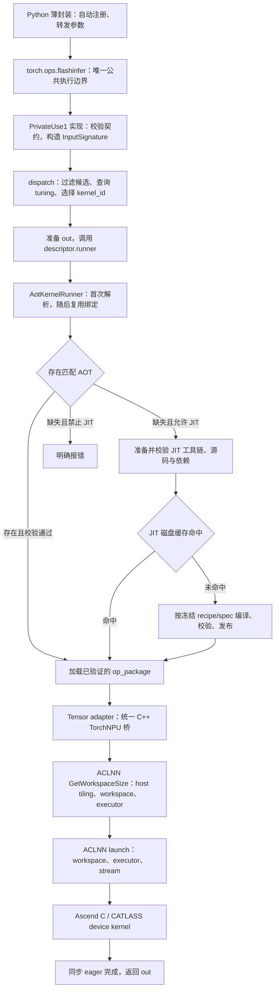

# FlashAttention 调用链与多后端接入

以 `single_prefill_with_kv_cache_catlass` 为例，说明公共适配入口、注册、分发、AOT/JIT 解析、ACLNN 下发和设备执行之间的关系，并作为新增算子或实现的接入参考。

当前 Ascend C 生产链已经支持同一个 kernel 优先使用 AOT、缺失时按策略使用 JIT。多后端选择发生在产物解析之前；这个 CATLASS FA 入口目前只有 Ascend C 候选，尚未接通 FA 的跨后端选择。

## 1. 调用身份与支持范围

| 对象 | 职责 | 当前 FA 示例 |
| --- | --- | --- |
| `op` | 逻辑算子，决定哪些实现共同参与选择 | `ascendc.single_prefill_catlass` |
| `InputSignature` | 本次调用的实际 dtype、shape、格式与特化条件 | 按 Q/K/V/out 顺序记录 |
| `backend` | 实现来源分类 | `ascendc`；框架另有 CANN、Triton 等来源 |
| `kernel_id` | 唯一实现身份，用于登记、锁定与追踪 | 见下方生产登记 |
| `BuildRecipe / JitSpec` | 编译输入、特化、依赖与环境身份 | 当前使用随包冻结声明 |
| `provenance.source` | 已绑定产物的实际来源 | `aot` 或 `jit`，绑定前为空 |

当前生产登记为：

```text
op           = ascendc.single_prefill_catlass
backend      = ascendc
compile_mode = aot
kernel_id    = ascendc/t4/flash_attention/catlass/op_package/Ascend950
```

其数学语义是 `softmax(Q @ K.T / sqrt(128)) @ V`。当前支持 Ascend950 上连续 ND Tensor，逻辑布局 NHD，Q 为 `[S,H,128]`，K/V 为 `[T,H,128]`；S/T 是 128..512 范围内的 128 倍数，H 为 1..8，隐含 batch=1，Q/K/V/out 全部为 FP16 或全部为 BF16。仅支持非 causal、无 mask，不接收运行期长度 Tensor。

支持域来自 [recipe](../csrc/recipes/flash_attention.json) 和 [生产声明](../flashinfer/data/kernels/registry.json)。`kernel_id` 中的路径文字不替代 descriptor 的 backend、能力或编译身份检查。

## 2. 从公共入口到设备的调用图



图中的产物解析是首次绑定路径。已经绑定的 runner 直接复用模块；AOT 损坏、加载失败和身份冲突会报错，不进入缺失后的 JIT 分支。

## 3. 逐层调用与源码位置

### 3.1 Python 与 Torch 适配入口

公共 Python 函数自动注册并转发到同名 Torch 算子；直接使用 `torch.ops` 时也可在初始化阶段先注册。两者始终走同一原生桥。下面假设 Q/K/V 已按支持范围准备在同一 NPU：

```python
import flashinfer
import torch
from flashinfer.aclnn import enable_aclnn

# Python 薄封装：自动注册并进入 Torch 算子。
result = flashinfer.single_prefill_with_kv_cache_catlass(q, k, v)

# 直接 Torch 写法；重复注册安全，不切换执行模式。
enable_aclnn()
result = torch.ops.flashinfer.single_prefill_with_kv_cache_catlass(q, k, v)
out = torch.empty_like(q)
flashinfer.single_prefill_with_kv_cache_catlass(q, k, v, out=out)
```

[Torch 声明](../flashinfer/aclnn/_ops.py) 的 `_attention / _attention_out` 进入同一个 [PrivateUse1 实现](../flashinfer/attention/catlass_prefill.py) `_single_prefill_impl`，不回调公共封装，避免递归。四个生产 Torch schema 支持关键字 `backend="auto"`、`kernel_id=None`；Python 封装原样传递选型参数。Torch schema、PrivateUse1 实现和 FakeTensor 推导在这里登记，不另外建立一套 AOT/JIT 流程。FakeTensor 仅处理元数据。

`enable_aclnn()` 不编译或提前加载算子包；原生桥在真实调用时加载。`enable_aclnn()` 只负责注册；Python 封装与直接 Torch 调用都必须使用原生桥。完整安装流程见 [wheel 编译与直接调用](../README-wheel-conda.md)。

### 3.2 校验 Tensor 契约并构造 signature

Torch 的 PrivateUse1 实现使用 `tensor_contract_specialization(FLASH_ATTENTION_KERNEL_ID, tensors)` 检查 recipe 的 dtype 组合、shape 符号及边界，并检查同设备和连续性。提供 out 时，还检查输出与其他参数的地址范围是否重叠。随后检查 causal、kv_layout、custom_mask 等选项。

没有提供 out 时，先用 Q 的 shape、dtype、device 构造输出元数据。dispatch 成功后才通过 `torch.empty` 分配真实输出，避免为不支持的调用提前分配输出。

以下输入：

```text
Q:   [128, 2, 128], FP16
K/V: [256, 2, 128], FP16
out: [128, 2, 128], FP16
```

对应 [InputSignature](../flashinfer/runtime/signature.py) 的主要内容为：

```text
op = "ascendc.single_prefill_catlass"
dtypes = ("float16", "float16", "float16", "float16")
shapes = ((128, 2, 128), (256, 2, 128), (256, 2, 128), (128, 2, 128))
layouts = ("", "", "", "")
physical_layouts = ("ND", "ND", "ND", "ND")
specializations = (("tensor_contract", "supported"),)
```

该入口的逻辑 NHD 条件在 facade 中检查，`layouts` 当前为空串；物理 ND 由元数据查询或预期输出格式记录。causal 等选项的支持结果被合并为 `tensor_contract`，不是各自独立的签名字段。非法契约的诊断也进入该字段，使正常 dispatcher 拒绝调用。

签名记录本次调用，不枚举全部支持组合，也不包含 Tensor 内容或内存地址。FP16/BF16 或 shape 变化会改变签名；支持域内的这些变化仍可使用同一个冻结 spec 和 op_package。

### 3.3 注册 descriptor 并绑定 lazy runner

[get_global_registry()](../flashinfer/runtime/registry.py) 首次访问时组合内置声明和 `ascendc_descriptors()`，完成初始化后冻结内置登记。生产 Ascend C 声明从 `flashinfer/data/kernels/registry.json` 与 `flashinfer/data/kernels/ascendc_specs.json` 读取，并校验 descriptor、recipe、spec 的相互绑定。

[ascendc_descriptors()](../flashinfer/ascendc.py) 通过 `bind_aot_kernel()` 为每个生产 descriptor 提供：

- 冻结 `spec`：要查找或构建哪个编译单元。
- `runner_factory`：用 `package_tensor_runner` 将已验证模块转成 Tensor callable。
- `jit_backend_factory`：在允许回落时准备编译工具链和解析后的 recipe。
- `package_peers`：已有可信 AOT 同组项，用于首次激活生产 vendor 集合。

登记和绑定不解析源码、不探测编译器，也不加载设备二进制。这里有不同的注册职责：descriptor 登记可选择的实现；编译声明绑定源码和特化身份；Torch schema 定义公共调用契约；CANN OpDef 登记 infer、tiling 和设备实现信息。

### 3.4 dispatcher 选择实现

[dispatch()](../flashinfer/runtime/dispatch.py) 的普通自动选择流程是：

1. 找出 `signature.op` 下的实现，并按来源栈分组。
2. 按 backend policy、capability、SoC/目标和 JIT 禁用策略过滤。
3. 查询有效的本地及随包 tuning 记录；记录不能恢复已经被过滤的实现。
4. 没有有效冠军时，使用配置的确定性阶梯，再按 priority 和 kernel_id 排序。栈间比较和栈内选择复用该规则。
5. 返回 `DispatchDecision`，包含选中 kernel_id、原因、候选报告和 fallback_chain。

默认阶梯为 `external → CANN/ACLNN → 自研 AOT → 自研 JIT → reference`；reference 默认需要显式启用。这是默认选择策略，不代表性能排名。`backend` 参数用于筛选候选；显式 `kernel_id` 则进入锁定实现的分支，能力或目标不满足时直接报错。

决策缓存包含 signature、硬件、策略、registry revision 和 tuning token 等影响因素。缓存命中复用的是选型决定，不代表已经存在可加载的二进制。当前产物的真实可用性在下一层 runner 解析时检查。

当前 CATLASS op 只有 Ascend C 候选，因此指定 `backend="cann"` 会报无候选。已有 CANN single-prefill 使用另一逻辑 op 和 runner 契约，不会被自动纳入这个入口。

### 3.5 选定实现后解析 AOT 或 JIT

facade 分配必要的 out，然后按 `decision.kernel_id` 取出 descriptor，调用 `runner(q, k, v, out)`。[AotKernelRunner.resolve()](../flashinfer/jit/runtime.py) 首次执行时处理产物：

| 发现结果或策略 | 当前行为 |
| --- | --- |
| 匹配且完整的 AOT | 加载模块，建立 Tensor runner |
| AOT missing，策略为 ENABLED 且已提供 JIT factory | 准备 JIT backend，再查询磁盘 store；命中则加载，未命中则编译 |
| AOT missing，策略为 DISABLED 或 CACHE_ONLY | 报 `AotMissingError`，不使用 JIT 缓存替代缺失的安装产物 |
| AOT 损坏、加载失败、注册身份冲突 | 传播错误，不转 JIT |
| 已绑定 runner 后发生 launch 错误 | 传播原始错误，不重新编译 |

[AotPackageIndex](../flashinfer/jit/discovery.py) 默认搜索安装包的 `flashinfer/data/op_packages/`，再搜索 `FLASHINFER_AOT_PATHS` 指定的位置。匹配包括 SoC、完整 spec、descriptor/ABI 身份；文件清单和摘要由既有 verifier 检查。

所有候选均不兼容时，当前会将拒绝原因汇总为 missing，因此 ENABLED 下仍可能进入 JIT。损坏与不兼容是不同错误类别，不能将两者混为普通缓存 miss。

JIT 分支先通过 `_jit_backend()` 检查冻结工具链身份、源码摘要和外部依赖，再进入 `build_and_load()`。这意味着即使随后命中 JIT 磁盘缓存，当前路径仍要求这些构建条件满足。`FLASHINFER_NPU_JIT_DISABLE=1` 禁止本入口缺失 AOT 后的 JIT 回落，不提供独立的纯缓存部署模式。

解析成功后保存模块、runner 及 `RuntimeProvenance`。实际来源为 `aot` 或 `jit`；descriptor 的 `compile_mode=AOT` 仍保留其登记和排序含义。后续调用复用已绑定模块，当前函数没有强制 JIT 或逐次切换来源的参数。

### 3.6 Tensor adapter 与 TorchNPU 下发

[package_tensor_runner()](../flashinfer/jit/tensor_adapter.py) 将 AOT 模块或 JIT 加载模块适配为 `TorchOpPackageRunner`。调用时再次检查有序 Tensor 参数、完整 dtype/shape 契约、NPU 设备、连续 ND 格式和输出重叠。

| 路径 | 实际下发 |
| --- | --- |
| 统一 TorchNPU 原生桥 | `_native.prepare()` 首次绑定已验证的 API 地址，随后调用 `torch.ops.flashinfer_aclnn._execute` |

[原生绑定](../flashinfer/aclnn/_native.py) 只向 [C++ adapter](../csrc/aclnn_torch_adapter/adapter.cpp) 登记已验证模块的函数指针和 Tensor 参数数量。公共 Torch schema 不接受任意库路径或裸函数地址。

C++ adapter 使用 TorchNPU 当前 stream，通过 `OpCommand::RunOpApi(..., true)` 提交 callback，按应用的队列配置下发。callback 创建描述符、查询 workspace/executor、分配实际 workspace 并 launch；Tensor、描述符和 workspace 保持存活到同步执行完成后再释放。已移除 Python ctypes 执行分支；缺失或损坏的桥明确失败。

当前支持有序 Tensor ABI，新增 scalar/attribute 等参数须扩展契约与适配器。当前路径是同步 eager；接入 TorchNPU 队列不提升图能力。

### 3.7 ACLNN host tiling 与设备执行

统一原生桥调用以下协议：

```text
aclnnFiFlashAttentionGetWorkspaceSize(q, k, v, out, ...)
    → infer / host tiling
    → workspace_bytes + executor
adapter 分配实际 workspace
aclnnFiFlashAttention(workspace, workspace_bytes, executor, stream)
    → CANN 提交设备计算
```

[FiFlashAttentionTiling](../csrc/kernels/ascendc/flash_attention/op_host/flash_attention.cpp) 从实际 shape 读取 S/T/H，设置 batch、heads、scale，计算 tiling、blockDim 和 CANN 系统 workspace。它不读取运行期长度 Tensor 的内容。实际 workspace 大小取 ACLNN 返回值，调用方不直接使用 descriptor 的静态 workspace 声明替代它。

tiling 数据由 CANN executor 传递为设备 kernel 的隐式末尾 GM 参数，不是额外的公共 Tensor。设备入口接收 `q, k, v, out, workspace, tiling`，进入 [FAInferTla 模板](../csrc/kernels/ascendc/flash_attention/op_kernel/catlass.cpp)。一个 op_package 携带 FP16、BF16 两种设备特化，由 CANN 根据实参匹配。

当前 adapter 每次发起 ACLNN 两段式调用，没有公共可复用的 plan/executor 缓存；该 FA 的图能力保持 `NOT_CAPTURABLE`。

## 4. generator 与提前编译的位置

当前生产 FA 使用已提供的 C++ 模板源码、recipe 和编译宏绑定编译单元；没有在每次调用时运行一个通用模板 generator。

[统一声明入口](../flashinfer/aot/declarations.py) 的 `freeze_production_kernels()` 按 kernel_id 关联集中 descriptor 和 recipe，解析源码与依赖，使用 `declare_kernel()` 形成 JitSpec。已有显式特化标识和 spec 编译选项在重新冻结时保留；完整 recipe、源码、依赖和环境身份仍约束实际编译结果。动态 tiling 能处理的 shape 变化无需自动产生新 spec。修改源码、能力或依赖时仍须更新摘要并重新冻结。

`python3 -B -m flashinfer.aot --freeze --all` 批量冻结而不编译；同时提供 `--output-dir` 可接着构建。普通 `--all` 只构建已有冻结声明，`--kernel-id` 可重复选择子集。新算子提供 recipe 和集中 descriptor 后即可进入同一流程，不需要新增构建脚本；原 [FA 发布脚本](../tools/build_flash_attention.py) 仅保留兼容选择入口。依赖定位由 [共享解析器](../flashinfer/jit/dependencies.py) 处理，AOT/JIT 不再各自维护 CATLASS 专用定位逻辑。

提前编译和打包的实际路径为：

```text
setup.py 的 BuildPy
    → build_production_packages
    → _build_record：查询缓存，必要时构建、校验、原子发布
    → AscendCBackend.compile → compile_recipe → CANN CMake 构建
    → export_op_package
    → wheel 的 flashinfer/data/op_packages/<spec-fingerprint>/
```

[AOT 发布](../flashinfer/aot/build.py) 与 [运行期 JIT](../flashinfer/jit/build.py) 共用 `_build_record` 和 [Ascend C 编译驱动](../flashinfer/jit/ascendc.py)。store 使用 per-spec 锁、私有 staging、不可变 generation 和原子发布。产物包含 ACLNN host API、tiling 库、设备 binary 与索引/完整性元数据；AOT/JIT 的区别是触发时机和交付位置。

批量构建先校验所有所选项，再逐 kernel 构建或复用缓存。当前保留独立 op_package，不合并 CMake 工程或 vendor 包。`ascendc.py` 中两个既有 kernel_id 常量和无参 `load_contract()` 是存量 facade 的兼容接口，不参与通用构建流程的算子选择；新增算子不需要增加对应分支。

AOT 命中无需源码或编译器。JIT 补建仍受冻结环境与依赖约束；完整 wheel 不自带 CATLASS 头树。

## 5. 同一 kernel 的 AOT 与 JIT 接入

### 同一实现使用两种构建时机

维护一份实现、recipe 和冻结 spec，登记一个 kernel_id，并通过 `bind_aot_kernel()` 同时提供 runner_factory 与 jit_backend_factory。发布时预编译进 wheel，运行时优先发现 AOT，缺失时按策略进入 JIT；现有 [ascendc_descriptors()](../flashinfer/ascendc.py) 即为这类接法。

不需要因为提前编译或运行期编译而复制 kernel_id。`backend="ascendc"` 表示实现来源，不表示强制 JIT；历史 `ascendc_jit` backend 值也不会将当前 AOT descriptor 切成 JIT。首次绑定后保留该产物，索引刷新不会替换已加载的 generation。

### 不同实现分别使用 AOT 或 JIT

算法、模板特化或支持范围不同的实现使用不同 kernel_id，登记在同一个逻辑 op 下，分别声明 capability、compile_mode 和 runner。公共 runner 调用约定须一致，底层 ABI 差异由各自 adapter 处理。dispatcher 再按能力、有效 tuning 记录和确定性策略选择。

registry 支持这种候选组合，但登记 source 和 compile_mode 不会自动生成 runner。`bind_aot_kernel` 当前要求 Ascend C AOT descriptor；纯 JIT、CANN 和 Triton 实现各自须接好对应的加载与执行路径。

多个 Ascend C 自定义包并存时，vendor、op type 和 ACLNN 符号必须满足唯一性要求，并在首次激活前准备完整集合。当前已绑定 generation 不可替换，也不能在 CANN vendor 集合激活后追加新 vendor；多个冷 JIT 包需预先构建后统一激活。

## 6. FA 扩成多后端的可行性与缺口

框架已有同 op 多 descriptor、能力过滤、来源栈与栈内选择、显式锁定、tuning 查询和选型解释。将 FA 扩成多后端可复用这些机制，接入工作集中在公共语义和每个实现的执行适配。

当前需要补齐的部分为：

1. **统一公共语义与实现约束。** 当前 op 名含 Ascend C 来源，facade 在选择前按 CATLASS recipe 校验，其他实现支持的更大范围也会被提前拒绝。通用输入约束与实现专属范围应分开表达。
2. **适配既有 Attention 契约。** 当前 CATLASS 使用独立 Tensor ABI；已有 Attention 框架的 POD/provider 调用契约不同。接入统一 Attention 入口需要 adapter，不能只改 op 名。
3. **提供实际候选。** 当前没有 Triton FA 候选，已有 CANN single-prefill 也未加入此 CATLASS op。每个候选都需要实现、capability、runner 和公共数值验证。
4. **统一 Torch 入口策略。** 当前 Torch FA 实现固定 `backend="ascendc"`。面向多后端时应汇入统一语义入口和相应选择策略。
5. **定义失败后的行为。** 当前 facade 只执行选中 runner，不遍历 `fallback_chain`。选型不提前确认产物可用性；AOT 被选中但缺失且禁 JIT 时会报错，不自动改用其他后端。AOT→JIT 回落和跨实现重试是不同机制。
6. **采集调优证据。** tuning 的采集、store、查询机制已有，随包发布库仍为空。没有有效记录时使用确定性策略，不能声称自动选择最快 FA。软件栈身份的完整失效管理仍有缺口。

CANN 当前运行时版本与构建版本的兼容比较尚未接通。以上候选和生命周期接线不替代跨版本、其他 SoC、图捕获或模型集成验证。

## 7. 新增算子的交付对应关系

| 接入内容 | 参考位置 |
| --- | --- |
| 数学语义、公共参数、signature、输出组织 | [CATLASS facade](../flashinfer/attention/catlass_prefill.py) |
| host OpDef、infer、tiling 与设备实现 | [FA 算子目录](../csrc/kernels/ascendc/flash_attention/) |
| Tensor 顺序、dtype 组合、shape、源码摘要、编译配置 | [FA recipe](../csrc/recipes/flash_attention.json) |
| descriptor、冻结 spec 和 lazy runner | [集中声明与冻结](../flashinfer/aot/declarations.py)、[生产声明与绑定](../flashinfer/ascendc.py) |
| AOT/JIT 构建、导出与校验 | [共享构建](../flashinfer/jit/build.py)、[AOT 发布](../flashinfer/aot/build.py) |
| Torch schema、FakeTensor、原生下发 | [Torch 声明](../flashinfer/aclnn/_ops.py)、[Tensor adapter](../flashinfer/jit/tensor_adapter.py) |
| 非法输入、策略、数值和安装后验证 | [算子接入指南](adding-a-custom-operator.md)、[FA 双 dtype 验证](reports/fa-dual-dtype-2026-10-29.md) |

调用链机制的受影响 UT 可按以下范围执行：

```bash
python3 -B tools/run_regression.py --profile quick \
  tests/test_aot_runtime.py \
  tests/test_two_level_dispatch.py \
  tests/test_flash_attention_registration.py \
  tests/test_aot_discovery_index.py \
  tests/test_tuning.py
```

该范围验证登记、分发、AOT/JIT 策略和调优查询，不构成设备编译或数值验收。改动编译驱动、recipe、ACLNN 桥或设备源码时，应补受影响的 compile 用例及公共入口数值验证；具体交付门槛见 [新增算子指南](adding-a-custom-operator.md)，环境、wheel 和隔离安装见 [FA 上手流程](hands-on-flash-attention.md)。
