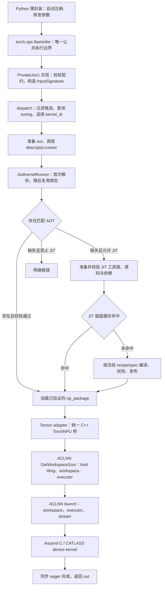
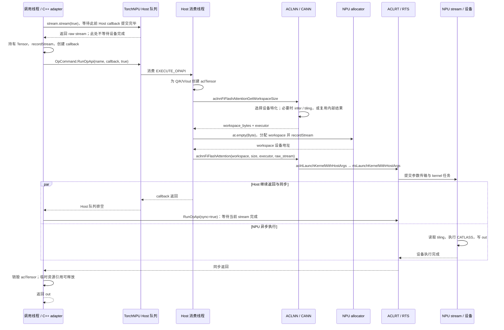
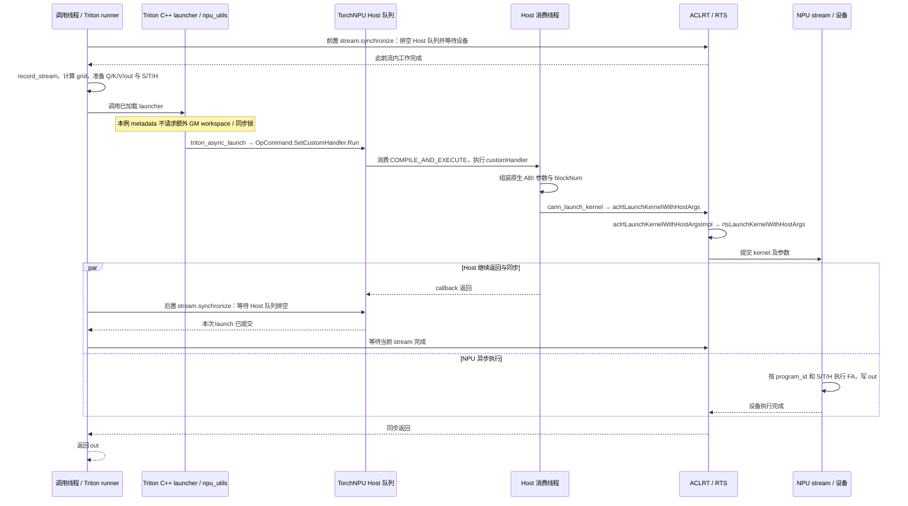

# FlashAttention 调用链与多后端接入

以 `single_prefill_with_kv_cache_catlass` 为例，说明公共适配入口、注册、分发、AOT/JIT 解析、ACLNN 下发和设备执行之间的关系，并作为新增算子或实现的接入参考。

当前 Ascend C 生产链已经支持同一个 kernel 优先使用 AOT、缺失时按策略使用 JIT。多后端选择发生在产物解析之前；默认生产 registry 中这个 FA 入口只有 Ascend C 候选，隔离 registry 已接入 Triton FA，可通过同一公共入口强制选择或查询调优记录。两条路径的内存、tiling、队列及同步时序见第 8 节。

## 1. 调用身份与支持范围

| 对象 | 职责 | 当前 FA 示例 |
| --- | --- | --- |
| `op` | 逻辑算子，决定哪些实现共同参与选择 | `ascendc.single_prefill_catlass` |
| `InputSignature` | 本次调用的实际 dtype、shape、格式与特化条件 | 按 Q/K/V/out 顺序记录 |
| `backend` | 实现来源分类 | `ascendc`；框架另有 CANN、Triton 等来源 |
| `kernel_id` | 唯一实现身份，用于登记、锁定与追踪 | 见下方生产登记 |
| `BuildRecipe / JitSpec` | 编译输入、特化、依赖与环境身份 | 当前使用随包冻结声明 |
| `provenance.source` | 已绑定产物的实际来源 | `aot` 或 `jit`，绑定前为空 |

当前生产登记为：

```text
op           = ascendc.single_prefill_catlass
backend      = ascendc
compile_mode = aot
kernel_id    = ascendc/t4/flash_attention/catlass/op_package/Ascend950
```

其数学语义是 `softmax(Q @ K.T / sqrt(128)) @ V`。当前支持 Ascend950 上连续 ND Tensor，逻辑布局 NHD，Q 为 `[S,H,128]`，K/V 为 `[T,H,128]`；S/T 是 128..512 范围内的 128 倍数，H 为 1..8，隐含 batch=1，Q/K/V/out 全部为 FP16 或全部为 BF16。仅支持非 causal、无 mask，不接收运行期长度 Tensor。

支持域来自 [recipe](../csrc/recipes/flash_attention.json) 和 [生产声明](../flashinfer/data/kernels/registry.json)。`kernel_id` 中的路径文字不替代 descriptor 的 backend、能力或编译身份检查。

## 2. 从公共入口到设备的调用图



图中的产物解析是首次绑定路径。已经绑定的 runner 直接复用模块；AOT 损坏、加载失败和身份冲突会报错，不进入缺失后的 JIT 分支。

## 3. 逐层调用与源码位置

### 3.1 Python 与 Torch 适配入口

公共 Python 函数自动注册并转发到同名 Torch 算子；直接使用 `torch.ops` 时也可在初始化阶段先注册。两者始终走同一原生桥。下面假设 Q/K/V 已按支持范围准备在同一 NPU：

```python
import flashinfer
import torch
from flashinfer.aclnn import enable_aclnn

# Python 薄封装：自动注册并进入 Torch 算子。
result = flashinfer.single_prefill_with_kv_cache_catlass(q, k, v)

# 直接 Torch 写法；重复注册安全，不切换执行模式。
enable_aclnn()
result = torch.ops.flashinfer.single_prefill_with_kv_cache_catlass(q, k, v)
out = torch.empty_like(q)
flashinfer.single_prefill_with_kv_cache_catlass(q, k, v, out=out)
```

[算子 Torch 声明](../flashinfer/operators/attention/single_prefill_catlass/operator.py) 的 `_attention / _attention_out` 进入同一个 [PrivateUse1 实现](../flashinfer/attention/catlass_prefill.py) `_single_prefill_impl`，不回调公共封装，避免递归。生产 Torch schema 支持关键字 `backend="auto"`、`kernel_id=None`；Python 封装原样传递选型参数。Torch schema、PrivateUse1 实现和 FakeTensor 推导在这里登记，不另外建立一套 AOT/JIT 流程。FakeTensor 仅处理元数据。

`enable_aclnn()` 不编译或提前加载算子包；原生桥在真实调用时加载。`enable_aclnn()` 只负责注册；Python 封装与直接 Torch 调用都必须使用原生桥。完整安装流程见 [wheel 编译与直接调用](../README-wheel-conda.md)。

### 3.2 校验 Tensor 契约并构造 signature

Torch 的 PrivateUse1 实现先检查公共 Tensor 元数据、同设备、causal、kv_layout、custom_mask 和输出别名，构造逻辑 signature。分派时，各实现的 Capability 及 `admission` 检查自己的 dtype 组合、shape 符号、边界和连续性；Ascend C recipe 只约束该原生候选。

没有提供 out 时，先用 Q 的 shape、dtype、device 构造输出元数据。dispatch 成功后才通过 `torch.empty` 分配真实输出，避免为不支持的调用提前分配输出。

以下输入：

```text
Q:   [128, 2, 128], FP16
K/V: [256, 2, 128], FP16
out: [128, 2, 128], FP16
```

对应 [InputSignature](../flashinfer/runtime/signature.py) 的主要内容为：

```text
op = "ascendc.single_prefill_catlass"
dtypes = ("float16", "float16", "float16", "float16")
shapes = ((128, 2, 128), (256, 2, 128), (256, 2, 128), (128, 2, 128))
layouts = ("", "", "", "")
physical_layouts = ("ND", "ND", "ND", "ND")
specializations = (("tensor_contract", "supported"),)
```

该入口的逻辑 NHD 条件在 facade 中检查，`layouts` 当前为空串；物理 ND 由元数据查询或预期输出格式记录。causal 等选项的支持结果被合并为 `tensor_contract`，不是各自独立的签名字段。非法契约的诊断也进入该字段，使正常 dispatcher 拒绝调用。

签名记录本次调用，不枚举全部支持组合，也不包含 Tensor 内容或内存地址。FP16/BF16 或 shape 变化会改变签名；支持域内的这些变化仍可使用同一个冻结 spec 和 op_package。

### 3.3 注册 descriptor 并绑定 lazy runner

[get_global_registry()](../flashinfer/runtime/registry.py) 首次访问时组合内置声明和 `ascendc_descriptors()`，完成初始化后冻结内置登记。生产 Ascend C 声明从 `flashinfer/data/kernels/registry.json` 与 `flashinfer/data/kernels/ascendc_specs.json` 读取，并校验 descriptor、recipe、spec 的相互绑定。

[ascendc_descriptors()](../flashinfer/ascendc/__init__.py) 通过 `bind_aot_kernel()` 为每个生产 descriptor 提供：

- 冻结 `spec`：要查找或构建哪个编译单元。
- `runner_factory`：用 `package_tensor_runner` 将已验证模块转成 Tensor callable。
- `jit_backend_factory`：在允许回落时准备编译工具链和解析后的 recipe。
- `package_peers`：已有可信 AOT 同组项，用于首次激活生产 vendor 集合。

登记和绑定不解析源码、不探测编译器，也不加载设备二进制。这里有不同的注册职责：descriptor 登记可选择的实现；编译声明绑定源码和特化身份；Torch schema 定义公共调用契约；CANN OpDef 登记 infer、tiling 和设备实现信息。

### 3.4 dispatcher 选择实现

[dispatch()](../flashinfer/runtime/dispatch.py) 的普通自动选择流程是：

1. 找出 `signature.op` 下的实现，并按来源栈分组。
2. 按 backend policy、capability、SoC/目标和 JIT 禁用策略过滤。
3. 查询有效的本地及随包 tuning 记录；记录不能恢复已经被过滤的实现。
4. 没有有效冠军时，使用配置的确定性阶梯，再按 priority 和 kernel_id 排序。栈间比较和栈内选择复用该规则。
5. 返回 `DispatchDecision`，包含选中 kernel_id、原因、候选报告和 fallback_chain。

默认阶梯为 `external → CANN/ACLNN → 自研 AOT → 自研 JIT → reference`；reference 默认需要显式启用。这是默认选择策略，不代表性能排名。`backend` 参数用于筛选候选；显式 `kernel_id` 则进入锁定实现的分支，能力或目标不满足时直接报错。

决策缓存包含 signature、硬件、策略、registry revision 和 tuning token 等影响因素。缓存命中复用的是选型决定，不代表已经存在可加载的二进制。当前产物的真实可用性在下一层 runner 解析时检查。

默认生产 registry 中 CATLASS op 只有 Ascend C 候选；隔离 registry 另外提供 Triton FA。两者均未登记该 op 的 CANN 候选，因此指定 `backend="cann"` 会报无候选。已有 CANN single-prefill 使用另一逻辑 op 和 runner 契约，不会被自动纳入这个入口。

### 3.5 选定实现后解析 AOT 或 JIT

facade 分配必要的 out，然后按 `decision.kernel_id` 取出 descriptor，调用 `runner(q, k, v, out)`。[AotKernelRunner.resolve()](../flashinfer/jit/runtime.py) 首次执行时处理产物：

| 发现结果或策略 | 当前行为 |
| --- | --- |
| 匹配且完整的 AOT | 加载模块，建立 Tensor runner |
| AOT missing，策略为 ENABLED 且已提供 JIT factory | 准备 JIT backend，再查询磁盘 store；命中则加载，未命中则编译 |
| AOT missing，策略为 DISABLED 或 CACHE_ONLY | 报 `AotMissingError`，不使用 JIT 缓存替代缺失的安装产物 |
| AOT 损坏、加载失败、注册身份冲突 | 传播错误，不转 JIT |
| 已绑定 runner 后发生 launch 错误 | 传播原始错误，不重新编译 |

[AotPackageIndex](../flashinfer/jit/discovery.py) 默认搜索安装包的 `flashinfer/data/op_packages/`，再搜索 `FLASHINFER_AOT_PATHS` 指定的位置。匹配包括 SoC、完整 spec、descriptor/ABI 身份；文件清单和摘要由既有 verifier 检查。

所有候选均不兼容时，当前会将拒绝原因汇总为 missing，因此 ENABLED 下仍可能进入 JIT。损坏与不兼容是不同错误类别，不能将两者混为普通缓存 miss。

JIT 分支先通过 `_jit_backend()` 检查冻结工具链身份、源码摘要和外部依赖，再进入 `build_and_load()`。这意味着即使随后命中 JIT 磁盘缓存，当前路径仍要求这些构建条件满足。`FLASHINFER_NPU_JIT_DISABLE=1` 禁止本入口缺失 AOT 后的 JIT 回落，不提供独立的纯缓存部署模式。

解析成功后保存模块、runner 及 `RuntimeProvenance`。实际来源为 `aot` 或 `jit`；descriptor 的 `compile_mode=AOT` 仍保留其登记和排序含义。后续调用复用已绑定模块，当前函数没有强制 JIT 或逐次切换来源的参数。

### 3.6 Tensor adapter 与 TorchNPU 下发

[package_tensor_runner()](../flashinfer/jit/tensor_adapter.py) 将 AOT 模块或 JIT 加载模块适配为 `TorchOpPackageRunner`。调用时再次检查有序 Tensor 参数、完整 dtype/shape 契约、NPU 设备、连续 ND 格式和输出重叠。

| 路径 | 实际下发 |
| --- | --- |
| 统一 TorchNPU 原生桥 | `_native.prepare()` 首次绑定已验证的 API 地址，随后调用 `torch.ops.flashinfer_aclnn._execute` |

[原生绑定](../flashinfer/aclnn/_native.py) 只向 [C++ adapter](../csrc/aclnn_torch_adapter/adapter.cpp) 登记已验证模块的函数指针和 Tensor 参数数量。公共 Torch schema 不接受任意库路径或裸函数地址。

C++ adapter 使用 TorchNPU 当前 stream，通过 `OpCommand::RunOpApi(..., true)` 提交 callback，按应用的队列配置下发。callback 创建描述符、查询 workspace/executor、分配实际 workspace 并 launch；Tensor、描述符和 workspace 保持存活到同步执行完成后再释放。已移除 Python ctypes 执行分支；缺失或损坏的桥明确失败。

当前支持有序 Tensor ABI，新增 scalar/attribute 等参数须扩展契约与适配器。当前路径是同步 eager；接入 TorchNPU 队列不提升图能力。

### 3.7 ACLNN host tiling 与设备执行

统一原生桥调用以下协议：

```text
aclnnFiFlashAttentionGetWorkspaceSize(q, k, v, out, ...)
    → infer / host tiling
    → workspace_bytes + executor
adapter 分配实际 workspace
aclnnFiFlashAttention(workspace, workspace_bytes, executor, stream)
    → CANN 提交设备计算
```

[FiFlashAttentionTiling](../csrc/kernels/attention/flash_attention/op_host/flash_attention.cpp) 从实际 shape 读取 S/T/H，设置 batch、heads、scale，计算 tiling、blockDim 和 CANN 系统 workspace。它不读取运行期长度 Tensor 的内容。实际 workspace 大小取 ACLNN 返回值，调用方不直接使用 descriptor 的静态 workspace 声明替代它。

tiling 数据由 CANN executor 传递为设备 kernel 的隐式末尾 GM 参数，不是额外的公共 Tensor。设备入口接收 `q, k, v, out, workspace, tiling`，进入 [FAInferTla 模板](../csrc/kernels/attention/flash_attention/op_kernel/catlass.cpp)。一个 op_package 携带 FP16、BF16 两种设备特化，由 CANN 根据实参匹配。

当前 adapter 每次发起 ACLNN 两段式调用，没有公共可复用的 plan/executor 缓存；该 FA 的图能力保持 `NOT_CAPTURABLE`。

## 4. generator 与提前编译的位置

当前生产 FA 使用已提供的 C++ 模板源码、recipe 和编译宏绑定编译单元；没有在每次调用时运行一个通用模板 generator。

[统一声明入口](../flashinfer/aot/declarations.py) 的 `freeze_production_kernels()` 按 kernel_id 关联集中 descriptor 和 recipe，解析源码与依赖，使用 `declare_kernel()` 形成 JitSpec。已有显式特化标识和 spec 编译选项在重新冻结时保留；完整 recipe、源码、依赖和环境身份仍约束实际编译结果。动态 tiling 能处理的 shape 变化无需自动产生新 spec。修改源码、能力或依赖时仍须更新摘要并重新冻结。

`python3 -B -m flashinfer.aot --freeze --all` 批量冻结而不编译；同时提供 `--output-dir` 可接着构建。普通 `--all` 只构建已有冻结声明，`--kernel-id` 可重复选择子集。新算子提供 recipe 和集中 descriptor 后即可进入同一流程，不需要新增构建脚本；原 [FA 发布脚本](../tools/build_flash_attention.py) 仅保留兼容选择入口。依赖定位由 [共享解析器](../flashinfer/jit/dependencies.py) 处理，AOT/JIT 不再各自维护 CATLASS 专用定位逻辑。

提前编译和打包的实际路径为：

```text
setup.py 的 BuildPy
    → build_production_packages
    → _build_record：查询缓存，必要时构建、校验、原子发布
    → AscendCBackend.compile → compile_recipe → CANN CMake 构建
    → export_op_package
    → wheel 的 flashinfer/data/op_packages/<spec-fingerprint>/
```

[AOT 发布](../flashinfer/aot/build.py) 与 [运行期 JIT](../flashinfer/jit/build.py) 共用 `_build_record` 和 [Ascend C 编译驱动](../flashinfer/jit/ascendc.py)。store 使用 per-spec 锁、私有 staging、不可变 generation 和原子发布。产物包含 ACLNN host API、tiling 库、设备 binary 与索引/完整性元数据；AOT/JIT 的区别是触发时机和交付位置。

批量构建先校验所有所选项，再逐 kernel 构建或复用缓存。当前保留独立 op_package，不合并 CMake 工程或 vendor 包。`ascendc.py` 中两个既有 kernel_id 常量和无参 `load_contract()` 是存量 facade 的兼容接口，不参与通用构建流程的算子选择；新增算子不需要增加对应分支。

AOT 命中无需源码或编译器。JIT 补建仍受冻结环境与依赖约束；完整 wheel 不自带 CATLASS 头树。

## 5. 同一 kernel 的 AOT 与 JIT 接入

### 同一实现使用两种构建时机

维护一份实现、recipe 和冻结 spec，登记一个 kernel_id，并通过 `bind_aot_kernel()` 同时提供 runner_factory 与 jit_backend_factory。发布时预编译进 wheel，运行时优先发现 AOT，缺失时按策略进入 JIT；现有 [ascendc_descriptors()](../flashinfer/ascendc/__init__.py) 即为这类接法。

不需要因为提前编译或运行期编译而复制 kernel_id。`backend="ascendc"` 表示实现来源，不表示强制 JIT；历史 `ascendc_jit` backend 值也不会将当前 AOT descriptor 切成 JIT。首次绑定后保留该产物，索引刷新不会替换已加载的 generation。

### 不同实现分别使用 AOT 或 JIT

算法、模板特化或支持范围不同的实现使用不同 kernel_id，登记在同一个逻辑 op 下，分别声明 capability、compile_mode 和 runner。公共 runner 调用约定须一致，底层 ABI 差异由各自 adapter 处理。dispatcher 再按能力、有效 tuning 记录和确定性策略选择。

registry 支持这种候选组合，但登记 source 和 compile_mode 不会自动生成 runner。`bind_aot_kernel` 当前要求 Ascend C AOT descriptor；纯 JIT、CANN 和 Triton 实现各自须接好对应的加载与执行路径。

多个 Ascend C 自定义包并存时，vendor、op type 和 ACLNN 符号必须满足唯一性要求，并在首次激活前准备完整集合。当前已绑定 generation 不可替换，也不能在 CANN vendor 集合激活后追加新 vendor；多个冷 JIT 包需预先构建后统一激活。

## 6. FA 扩成多后端的可行性与缺口

框架已有同 op 多 descriptor、能力过滤、来源栈与栈内选择、显式锁定、tuning 查询和选型解释。将 FA 扩成多后端可复用这些机制，接入工作集中在公共语义和每个实现的执行适配。

当前需要补齐的部分为：

1. **统一公共语义与实现约束。** 当前 op 名含 Ascend C 来源，facade 在选择前按 CATLASS recipe 校验，其他实现支持的更大范围也会被提前拒绝。通用输入约束与实现专属范围应分开表达。
2. **适配既有 Attention 契约。** 当前 CATLASS 使用独立 Tensor ABI；已有 Attention 框架的 POD/provider 调用契约不同。接入统一 Attention 入口需要 adapter，不能只改 op 名。
3. **生产登记范围。** Triton FA 已提供实现、capability、runner 和公共数值验证，通过 `flash_attention_registry()` 显式加入隔离 registry；尚未加入默认生产集合。已有 CANN single-prefill 也未加入此 CATLASS op。
4. **统一 Torch 入口策略。** Torch FA 已转发 `backend`、`kernel_id`，隔离 registry 下可从同一入口选择 Ascend C 或 Triton；公共支持域仍受现有 CATLASS 契约限制。
5. **定义失败后的行为。** 当前 facade 只执行选中 runner，不遍历 `fallback_chain`。选型不提前确认产物可用性；AOT 被选中但缺失且禁 JIT 时会报错，不自动改用其他后端。AOT→JIT 回落和跨实现重试是不同机制。
6. **采集调优证据。** tuning 的采集、store、查询机制已有，FA 隔离调优记录已绑定 spec、软件栈和 runner/桥身份；随包发布库仍为空。既有隔离测量未形成有效冠军，没有有效记录时使用确定性策略，不能声称自动选择最快 FA。

CANN 当前运行时版本与构建版本的兼容比较尚未接通。以上候选和生命周期接线不替代跨版本、其他 SoC、图捕获或模型集成验证。

## 7. 新增算子的交付对应关系

| 接入内容 | 参考位置 |
| --- | --- |
| 数学语义、公共参数、signature、输出组织 | [CATLASS facade](../flashinfer/attention/catlass_prefill.py) |
| host OpDef、infer、tiling 与设备实现 | [FA 算子目录](../csrc/kernels/attention/flash_attention/) |
| Tensor 顺序、dtype 组合、shape、源码摘要、编译配置 | [FA recipe](../csrc/recipes/flash_attention.json) |
| descriptor、冻结 spec 和 lazy runner | [集中声明与冻结](../flashinfer/aot/declarations.py)、[生产声明与绑定](../flashinfer/ascendc/__init__.py) |
| AOT/JIT 构建、导出与校验 | [共享构建](../flashinfer/jit/build.py)、[AOT 发布](../flashinfer/aot/build.py) |
| Torch schema、FakeTensor、原生下发 | [算子 Torch 声明](../flashinfer/operators/attention/single_prefill_catlass/operator.py)、[Tensor adapter](../flashinfer/jit/tensor_adapter.py) |
| 非法输入、策略、数值和安装后验证 | [算子接入指南](adding-a-custom-operator.md)、[FA 双 dtype 验证](reports/fa-dual-dtype-2026-10-29.md) |

调用链机制的受影响 UT 可按以下范围执行：

```bash
python3 -B tools/run_regression.py --profile quick \
  tests/test_aot_runtime.py \
  tests/test_two_level_dispatch.py \
  tests/test_flash_attention_registration.py \
  tests/test_aot_discovery_index.py \
  tests/test_tuning.py
```

该范围验证登记、分发、AOT/JIT 策略和调优查询，不构成设备编译或数值验收。改动编译驱动、recipe、ACLNN 桥或设备源码时，应补受影响的 compile 用例及公共入口数值验证；具体交付门槛见 [新增算子指南](adding-a-custom-operator.md)，环境、wheel 和隔离安装见 [FA 上手流程](hands-on-flash-attention.md)。

## 8. Triton 与 Ascend C 的完整执行生命周期

### 8.1 对比范围与执行边界

本节对比同一 `single_prefill_with_kv_cache_catlass` 接口下的两个现有实现：生产 Ascend C/CATLASS op-package，以及通过 `flash_attention_registry()` 加入隔离 registry 的 Triton FA。前者使用 ACLNN 两段式协议；后者使用 Triton 生成的 C++ launcher，不经过 ACLNN。**两者均进入 TorchNPU Host 任务队列，最终使用相同的 ACLRT/RTS launch 接口。** 这里描述的是当前接入方式，不能推广成所有 Ascend C 程序都必须使用 ACLNN。

需要区分三个执行边界：

| 边界 | 保存或执行的内容 | 完成的含义 |
| --- | --- | --- |
| TorchNPU Host 任务队列 | Host callback，以及执行 callback 所需的参数和资源引用 | callback 执行完毕，必要的设备任务已经提交；不代表设备计算完成 |
| Runtime/RTS stream 提交 | 接收 kernel、参数、必要的数据传输及其流依赖 | 异步 launch 接口成功返回；不代表 kernel 完成 |
| NPU 执行 | 按流依赖执行传输和设备计算 | 设备任务完成后，相应 stream synchronize 才能成功返回 |

本节的 Host 入队以 TorchNPU task queue 开启、Triton launcher 生成时启用 task queue 为前提，专项验证使用 `task_queue_mode=1`。关闭相应队列时，Host callback 可以在调用线程直接执行；这不改变底层 Runtime launch 的异步语义。Runtime 内部如何分配硬件 SQ/CQ、如何向驱动提交，未在本次追踪中验证，不能将 Host 队列或逻辑 stream 直接等同于某条物理队列。

### 8.2 公共入口与首次准备

两条路径都先经过 Python 薄封装、Torch schema、PrivateUse1 实现，再构造 signature 并选择 descriptor。Q/K/V 必须已经在 NPU 上；该入口不替用户分配输入、不执行隐式 `.npu()` 或格式转换。不支持的 dtype、布局、shape 或输出重叠直接拒绝。

未传 out 时，dispatch 成功后由公共实现分配输出，然后才进入所选 runner；传入 out 则复用用户输出。之后分别准备可执行代码：

| 阶段 | Ascend C/CATLASS | Triton FA |
| --- | --- | --- |
| 首次进入 runner | 查找并校验 AOT op-package；缺失时按策略查询 JIT 缓存或编译相同冻结 spec | 按 dtype 和设备准备 JitSpec，查询本仓构建缓存；未命中时调用 Triton 编译 |
| 加载与绑定 | 激活 vendor 包，解析已验证 ACLNN API，绑定 C++ adapter；CANN 还可在首次查询中延迟初始化 | 恢复编译 metadata、设备 binary 和 native launcher，保持模块存活 |
| 后续相同配置 | 复用已加载模块和 API 绑定 | 复用 `_modules[(dtype, device)]`；S/T/H 为运行期参数 |

因此，AOT/JIT 决定产物何时准备，ACLNN/Triton launcher 决定执行协议。Ascend C 经 JIT 得到的 op-package 仍走 ACLNN；Triton 命中磁盘缓存时也不需要重新编译。以下时序从可执行模块已就绪开始。

### 8.3 内存与资源归属

| 资源 | Ascend C/CATLASS | Triton FA | 生命周期与归属 |
| --- | --- | --- | --- |
| Q/K/V 的 GM 存储 | 使用原 Tensor 地址 | 使用原 Tensor 地址 | 调用方提供；框架保持引用并记录 stream |
| out 的 GM 存储 | 未传 out 时由公共入口 `torch.empty` 分配 | 相同 | 返回给调用方；out 形式复用现有存储 |
| Host Tensor 描述符 | callback 为 Q/K/V/out 创建 `aclTensor`，携带 shape、stride、dtype、storage offset 和地址 | launcher 提取指针和标量，不创建这些 ACLNN 描述符 | `aclTensor` 是 Host 元数据，不复制 Tensor 内容 |
| Host tiling 数据 | `FiFlashAttentionTiling` 填充 `FATilingData`，由 CANN 执行上下文管理 | 本实现没有 CANN `FATilingData`；tile 常量在编译时确定，运行期传 S/T/H 与 grid | 两种参数组织方式，均需匹配各自设备 ABI |
| 设备可读的 tiling 数据 | 随 HostArgs 的 placeholder 交给 Runtime 处理传输与设备地址填充 | 当前 FA 无对应的独立 tiling blob | adapter 不申请公共 tiling Tensor；Runtime 管理本次参数传递所需存储 |
| GM workspace | ACLNN 查询大小后，callback 内通过 `at::empty(..., Byte)` 分配并记录 stream | 当前 FA 编译 metadata 未请求额外 GM workspace 或同步锁 | Ascend C 本例实际为 16 MiB CANN 系统 workspace；不能据此推断其他算子或版本 |
| kernel 内部临时资源 | CATLASS 使用 L1/UB 等片上资源交换计算 tile | 编译器为 `tl.load/dot/softmax/store` 安排片上资源 | 与 Host 申请的 GM workspace 分开管理；本次未测量片上占用 |
| Host launch 参数区 | CANN 组装输入输出地址、workspace 地址和 tiling 等参数 | launcher 组装地址、标量、grid 及后端 ABI 参数 | 交给 Runtime 提交，不由 Python 调用者管理 |
| 设备 binary、模块、符号绑定 | loader/runner 持有 | loader/runner 持有 | 跨调用复用，与临时 workspace 分开 |

`torch.empty`/`at::empty` 是框架级申请，通常可以复用 NPU caching allocator 的块；不能将每次逻辑分配写成一次 `aclrtMalloc`。Tensor 引用释放也不等于立即 `aclrtFree`。`record_stream` 用于避免存储在相关 stream 使用完成前被过早复用，**不建立跨 stream 的生产者/消费者等待关系**。

Triton 不存在“永远没有 workspace”的限制。安装版本的 launcher 会按 metadata 选择生成 workspace 分配及同步锁代码；普通 workspace 的申请位置在 Host 入队前，同步锁的申请位置在 callback 内。本例没有触发这些分支。编译 metadata 的 `shared` 字段也不能直接解释为 GM workspace 字节数。

### 8.4 Ascend C：描述符、tiling、workspace、入队与执行



具体顺序与源码对应如下：

1. [adapter.cpp:117](../csrc/aclnn_torch_adapter/adapter.cpp#L117) 取得当前 stream，`stream.stream(true)` 先排空此前 Host 提交；[129](../csrc/aclnn_torch_adapter/adapter.cpp#L129) 记录 Tensor 使用的 stream。这里没有提前等待前一个设备 kernel 完成。
2. [adapter.cpp:180](../csrc/aclnn_torch_adapter/adapter.cpp#L180) 入队 callback。**创建描述符、查询 tiling/workspace、分配 workspace 都发生在 callback 内**，而非公共 Python 入口先做完再入队。
3. [adapter.cpp:144](../csrc/aclnn_torch_adapter/adapter.cpp#L144) 创建描述符，[163](../csrc/aclnn_torch_adapter/adapter.cpp#L163) 调用 ACLNN 第一段。首次查询实测进入 `NnopbaseExecutorRunForWorkspace → NnopbaseExecutorTilingAndUpdateBinInfo → FiFlashAttentionTiling`。相同 shape 第二次查询未再次进入该 tiling 回调；这是本次观测到的 CANN 内部复用，不是本仓提供的 plan 缓存契约。
4. [host tiling:26](../csrc/kernels/attention/flash_attention/op_host/flash_attention.cpp#L26) 从 shape 读取 S/T/H，生成 batch、heads、scale、分核范围和 blockDim；[67](../csrc/kernels/attention/flash_attention/op_host/flash_attention.cpp#L67) 声明 CANN 系统 workspace。本实现不读取运行期长度 Tensor，也不请求额外的算法 GM scratch。
5. [adapter.cpp:170](../csrc/aclnn_torch_adapter/adapter.cpp#L170) 按 ACLNN 返回值实际申请 workspace，[174](../csrc/aclnn_torch_adapter/adapter.cpp#L174) 调用第二段。`executor` 描述这次执行，workspace 则是独立的设备存储；二者不能等同。
6. CANN 的实际 launch 栈为 `aclnnFiFlashAttention → NnopbaseRunWithWorkspace → NnopbaseExecutorRunWithWorkspace → NnopbaseExecutorKernelLaunch → aclrtLaunchKernelWithHostArgs → aclrtLaunchKernelWithHostArgsImpl → rtsLaunchKernelWithHostArgs`。
7. [设备入口:9](../csrc/kernels/attention/flash_attention/op_kernel/catlass.cpp#L9) 接收 `q,k,v,out,workspace,tiling`；`SetSysWorkspace` 设置系统 workspace，随后进入 CATLASS。设备代码从 GM 中读取 `FATilingData`，分配各核工作并完成计算。
8. `RunOpApi(..., true)` 在调用线程等待 Host 提交和当前 stream 完成。[adapter.cpp:181](../csrc/aclnn_torch_adapter/adapter.cpp#L181) 随后显式销毁描述符，Tensor/workspace 的保留引用按其持有者生命周期释放。callback 内不调用 stream synchronize，避免等待自己所在的 Host 队列。

本例的 tiling 传输已追踪至 launch 参数：`argsSize=1000`，一项 placeholder 为 `addrOffset=40, dataOffset=64`。offset 40 是第六个设备参数 `tiling` 的地址槽，offset 64 起的内容按 `FATilingData` 解码为 S=128、T=256、H=1、D=128、coreNum=1，结构大小 904 字节。Runtime 按 placeholder 处理设备侧数据并更新地址；这与 [CANN HostArgs 接口定义](https://www.hiascend.com/doc_center/source/zh/CANNCommunityEdition/910/API/runtimeapi/aclcppdevg_03_1961.html) 一致。这里不能补画一条“adapter 手动 malloc tiling + memcpy”的调用。

### 8.5 Triton：编译配置、grid、launcher 入队与执行



1. [Triton runner:103](../flashinfer/triton/attention/single_prefill_catlass/runner.py) 准备并复用模块，[108](../flashinfer/triton/attention/single_prefill_catlass/runner.py) 在 launch **前**同步当前 stream；该同步既排空 Host 队列，也等待此前设备执行。
2. [runner:109](../flashinfer/triton/attention/single_prefill_catlass/runner.py) 记录 Tensor 生命周期，按 `grid=(ceil(S/32), H)` 调用模块。S/T/H 是运行期标量；D=128、BLOCK_M=32、BLOCK_N=64 以及编译选项在 [特化声明:16](../flashinfer/triton/attention/single_prefill_catlass/runner.py) 中固定。其“tiling”职责分散在这些编译配置、grid 和设备代码的 `program_id`/循环中，没有 CANN host tiling 回调。
3. [已缓存 Triton 模块适配:246](../flashinfer/jit/loading.py#L246) 将输入、constexpr、grid、stream 传给已恢复的 Triton 可执行对象；native launcher 再将张量指针、标量和后端参数打包。当前测试的 Host 参数区为 80 字节，placeholder 数为 0。
4. 安装依赖中的 `triton/backends/ascend/npu_utils.cpp` 的 `triton_async_launch` 将 callback 交给 `OpCommand.Name(...).SetCustomHandler(...).Run()`。TorchNPU 使用 `COMPILE_AND_EXECUTE` 队列类型；该枚举名称**不表示缓存命中后每次调用都重新编译 Triton**。
5. callback 调用 `cann_launch_kernel → aclrtLaunchKernelWithHostArgs → aclrtLaunchKernelWithHostArgsImpl → rtsLaunchKernelWithHostArgs`，跳过 ACLNN 描述符、executor 及两段式协议。当前 CANN 版本走此新 API，安装 driver 还保留旧版本的 `rtKernelLaunch*` 兼容分支，不能将后者写成本次实测路径。
6. [_dense_prefill_kernel:8](../flashinfer/triton/attention/single_prefill_catlass/kernels.py#L8) 用 `program_id(0)` 划分 Q 的行，用 `program_id(1)` 选择 head，并按 T 循环读取 K/V，计算 online softmax 后写入 out。设备端需要的局部资源由编译结果安排。
7. [runner:117](../flashinfer/triton/attention/single_prefill_catlass/runner.py) 在 `finally` 中再次同步当前 stream，确保已提交执行完成；因此当前接口返回时 out 已完成。本实现同样是同步 eager、`NOT_CAPTURABLE`。

### 8.6 Host 入队、NPU 提交与同步的共同部分

两条 Host 提交分支在 TorchNPU 中使用不同任务类型，复用相同的队列基础设施：

```text
Ascend C：OpCommand::RunOpApi → EXECUTE_OPAPI → ExecFuncOpApi → customHandler
Triton： OpCommand::Run      → COMPILE_AND_EXECUTE → ExecFunc → customHandler
          共同入队：enCurrentNPUStream → Repository::Enqueue
          共同消费：Repository::Dequeue → ReadQueue → AsncExecFunc

设备提交：aclrtLaunchKernelWithHostArgs
        → aclrtLaunchKernelWithHostArgsImpl
        → rtsLaunchKernelWithHostArgs
        → Runtime/驱动与设备执行（内部硬件队列细节未验证）
```

`NPUStream::stream(true)` 调用 `MakeSureQueueEmpty`，保证此前 Host callback 已执行，然后返回 raw stream；它本身不等待设备完成。`NPUStream::synchronize()` 则先取得已排空 Host 提交的 stream，再调用 Runtime synchronize，等待该流设备工作完成。两者必须分开描述。

对于同一 stream，设备任务按流依赖排序；不同 stream 之间的数据依赖仍须由调用方正确建立，`record_stream` 不代替 event/wait。这里的 stream synchronize 也不是全设备同步。Triton FA 目前主动在前后同步；Ascend C adapter 只在执行前排空 Host 提交，在 `RunOpApi(sync=true)` 返回前等待当前流设备完成。不能将当前实现的同步策略当作 Triton 语言或 ACLNN 的固有限制。

Host 队列函数名和同步行为依据 [TorchNPU v2.10.0 OpCommand](https://github.com/Ascend/pytorch/blob/v2.10.0/torch_npu/csrc/framework/OpCommand.cpp#L183)、[NPUStream](https://github.com/Ascend/pytorch/blob/v2.10.0/torch_npu/csrc/core/npu/NPUStream.cpp#L407)、[队列消费](https://github.com/Ascend/pytorch/blob/v2.10.0/torch_npu/csrc/core/npu/NPUQueue.cpp#L480) 和 [callback 分派](https://github.com/Ascend/pytorch/blob/v2.10.0/torch_npu/csrc/framework/OpParamMaker.cpp#L517) 核对。已安装版本为 2.10.0.post7，二进制部分符号被裁剪；不能把公开 tag 源码当成该安装包逐字相同的构建源码。实际两个后端均从 Host 消费线程进入同一 stream 的 ACLRT/RTS launch，已由本机追踪确认。

### 8.7 冷调用、暖调用与可复用范围

| 内容 | 首次调用 | 相同配置的后续调用 |
| --- | --- | --- |
| Torch schema / registry | 必要时初始化 | 复用登记 |
| dispatch | 能力过滤并选型 | 可命中决策缓存；仍不代表设备产物已加载 |
| 代码与模块 | 发现 AOT 或查询 JIT 缓存，必要时编译、校验、加载 | runner 复用已绑定模块 |
| 输出 | functional 形式分配 | functional 仍分配；out 形式复用 |
| Ascend C 描述符 / executor 查询 | 创建描述符，调用 GetWorkspaceSize | 仍创建描述符并调用 GetWorkspaceSize |
| Ascend C host tiling | 本次首次查询实际执行回调 | 本次同 shape 的第二次查询复用 CANN 内部结果，未再次执行回调 |
| Ascend C workspace | 按返回值申请 | 仍申请逻辑 workspace；本次 allocator 复用了同一设备地址 |
| Triton 参数 | grid、运行期标量与地址打包 | 仍按本次调用准备参数；不重新编译 S/T/H |
| 队列 / launch / 同步 | 实际提交与等待 | 每次执行仍需进行 |

本仓缓存的是 descriptor、决策、编译产物、已加载模块和 API 绑定等不同对象。它没有为此 FA 暴露 `plan()`，也没有保存可跨调用复用的 ACLNN executor；观察到 CANN 内部 tiling 命中，不等于用户得到一个可长期持有的执行计划。

### 8.8 真机追踪记录与适用范围

2026-11-02 在代码基线 `0ab13f7` 上，使用 Python 3.12、Torch 2.10.0+cpu、TorchNPU 2.10.0.post7、Triton 3.6.0、CANN 9.2.0 和 Ascend950PR 执行专项追踪。实际设备自检为 **`True 8`**；使用 `dy_test` 环境及用户指定的 CANN `set_env.sh`，未沿用 AGENTS.md 中原服务器的失效绝对路径。

输入为 FP16，Q=`[128,1,128]`、K/V=`[256,1,128]`。每份追踪中，每个后端各执行一次 functional 首次调用和一次复用 out 的暖调用，与 CPU FP64 参考比较：**各 2 次数值检查通过，每份合计 4 次，0 失败、0 skip**。编译入口被替换为显式报错函数，确保本次只使用已有 AOT 与已验证 Triton 缓存，不进行冷编译。

| 观测项 | Ascend C/CATLASS | Triton FA |
| --- | --- | --- |
| Q/K/V/out 的逻辑 GM 字节数 | 合计 196608 字节，即 192 KiB | 相同 |
| 额外 workspace | GetWorkspaceSize 实际返回 16777216 字节，即 16 MiB | 当前产物无额外 GM workspace / 同步锁请求，追踪也未触发对应申请 |
| Host tiling 结构 | `sizeof(FATilingData)=904`，首调用进入 tiling 回调 | 无该结构，使用编译配置和运行期参数 |
| launch HostArgs | 1000 字节，1 个 tiling placeholder | 80 字节，0 个 placeholder |
| 本次 numBlocks | 1 | 4 |
| Host 执行位置 | TorchNPU 消费线程 | 同一进程中同一 TorchNPU 消费线程 |
| 最终提交 | 同一 raw stream 的 `rtsLaunchKernelWithHostArgs` | 相同接口与 stream，kernel 句柄不同 |

这些数字不是总显存占用或性能比较；allocator 对齐、缓存池、设备 binary 和 Runtime 内部资源未单独计量。numBlocks 取决于两份实现各自的工作划分，不能用于推断快慢。

完整诊断文件保存在本机忽略目录 `build/analysis/fa-lifecycle-20261102/`：`probe.py`、`lifecycle.gdb`、`lifecycle-trace.log`、`launch_observer.cpp`、`host-args-trace.log`、`probe-results.json`，两份日志对应的 `.exit` 均为 **0**。观察用共享库只记录 launch 参数并原样转发全部参数，不修改仓库算子或已冻结 ABI/spec。实际诊断命令核心如下，环境需先指向上述已有产物：

```bash
# 使用 CANN set_env.sh 初始化后的 dy_test 环境；不运行冷编译。
timeout 180 gdb -q -batch \
  -x build/analysis/fa-lifecycle-20261102/lifecycle.gdb \
  --args python3 -B build/analysis/fa-lifecycle-20261102/probe.py \
  > build/analysis/fa-lifecycle-20261102/lifecycle-trace.log 2>&1
trace_status=$?
printf '%s\n' "$trace_status" > build/analysis/fa-lifecycle-20261102/lifecycle-trace.exit

LD_PRELOAD="$PWD/build/analysis/fa-lifecycle-20261102/launch_observer.so" \
  python3 -B build/analysis/fa-lifecycle-20261102/probe.py \
  > build/analysis/fa-lifecycle-20261102/host-args-trace.log 2>&1
trace_status=$?
printf '%s\n' "$trace_status" > build/analysis/fa-lifecycle-20261102/host-args-trace.exit
```

本次新增证据修正了两种过度概括：Triton FA 没有绕过 TorchNPU Host 队列；每次发起 GetWorkspaceSize 也不代表每次都执行 host tiling。BF16 的此次分阶段追踪、其他 shape/SoC、队列关闭或其他队列模式、跨流依赖、图捕获、Runtime 内部物理队列和同口径性能均未在本次验证。没有修改运行代码，因此未重复执行全量与 real_compile 回归。
