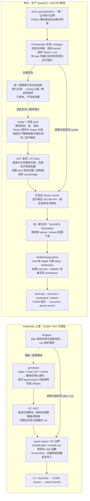
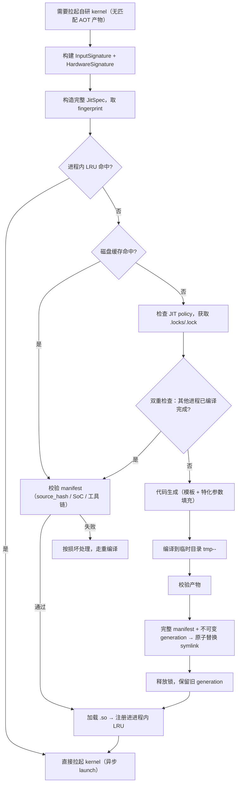

# FlashInfer 框架设计

> 文档状态：Framework design v1.0
>
> 范围：新仓总体框架——对外 API 对标、多 backend 调度、Ascend C / Triton 算子实现体系、
> AOT / JIT 双模式与 kernel 缓存设计。

运行时数据模型、调度算法、AOT/JIT 产物生命周期及 FA 接入要求见 [运行时与编译系统技术设计](runtime-and-compilation-design.md)。[架构介绍提纲](expert-architecture-overview.md) 保留为思路整理资料。

## 1. 概述

### 1.1 项目定位

本仓是面向昇腾 NPU 的推理算子适配框架，对外接口对标上游 FlashInfer：

本仓的工程重心是**“把一个自研算子从源码送到用户调用”这条交付链路**：
自定义算子包、AOT/JIT、wheel 打包发布与可被调用方捕获入图共同构成基础设施。
接口对标是目标，这条交付链路是达成它的基础，核心机制导读见 §2.5。

- **接口对标 flashinfer**：对外包名为 `flashinfer`，调用形式为
  `flashinfer.xx`（如 `flashinfer.prefill.single_prefill_with_kv_cache`），
  名称、参数与语义尽量与 flashinfer 保持一致，降低 CUDA serving 栈迁移成本。
- **一个接口、多个 backend**：同一接口可以接入多个候选后端，具体路由到哪个 kernel 由
  **输入数据**（数据类型、shape、layout 等）与**当前硬件型号**共同决定；目标 kernel
  可能是 CANN 内置算子（aclnn），也可能是本仓自研算子。
- **自研算子双语言**：本仓算子支持 **Ascend C** 与 **Triton（triton-ascend）** 两种实现。
- **AOT / JIT 双模式**：算子默认以 **AOT**（预编译产物随包分发）形式交付；AOT 未覆盖
  的组合自动走 **JIT** 路径——以输入签名（dtype、shape、layout 等）与硬件信息
  （SoC 型号、AI Core 数量，见 §8.1）构成 hash key 查询 kernel 缓存：
  命中则直接拉起该 kernel；未命中则现场编译、写入缓存后再拉起。

上述 AOT/JIT 分工是目标态；当前绝大多数公共接口仍走 CANN aclnn。生产 Ascend C AOT
登记包含 Matmul、MatmulBiasSilu、FlashAttention 和 GroupedMatmulSwigluQuant 四条；
登记不代表所有产品均已验证。自动发现只对已绑定 runner 的实现生效，支持边界见
[作者声明与交付资源](authoring-and-resources.md) 与附录 A。

### 1.2 设计目标

1. 对 flashinfer 稳定 API 提供语义对齐的 `flashinfer.xx` 接口，API 兼容性可度量
   （见 [`api_parity.md`](api_parity.md)：逐 symbol 的 parity manifest 与发布门禁）。
2. 调度决策确定、可解释：给定输入签名与硬件快照，kernel 选择结果唯一且可复现。
3. AOT 优先：生产环境无需编译器即可运行；JIT 作为长尾 shape 与开发期的补充
   （AOT 覆盖主流特化组合，长尾组合与 kernel 迭代开发由 JIT 兜底，见 §5.1/§5.2）。
4. JIT 缓存正确性优先于命中率：任何可能导致二进制语义变化的因素都必须进入 cache key。
5. 热路径零额外开销：`run()` 内不做策略计算、不做同步、不做内存分配。

### 1.3 非目标

- 不模拟 CUDA runtime，不承诺 CUDA 二进制兼容。
- 不逐行翻译 flashinfer 的 CUDA kernel。
- 首期不覆盖 flashinfer 全部能力域；对标范围由 parity 清单管理。
- 不提供在线训练 / autograd。

### 1.4 术语

| 术语 | 含义 |
| --- | --- |
| 接口（interface） | `flashinfer.xx` 暴露的 Python 公共函数或 wrapper 类 |
| backend | 一个接口的一类实现来源：`cann` / `ascendc` / `triton` / `reference` |
| kernel | 一次 dispatch 最终选定的可执行单元（aclnn 算子或自研编译产物） |
| AOT | 提前编译，产物在构建期生成并随 artifact 包分发 |
| JIT | 即时编译，运行期按 cache key 生成并缓存 |
| 输入签名 | 由输入张量的 dtype、shape、layout 及特化参数构成的结构化描述 |
| 硬件签名 | 由 SoC 系列型号与 AI Core 数量构成 |
| descriptor（`KernelDescriptor`） | 一个候选 kernel 的登记记录，描述其标识、能力、优先级及产物引用 |
| capability | 候选 kernel 支持的输入、硬件及执行条件，调度时用作准入判断 |
| registry | 保存 descriptor 的登记表，是调度候选和能力声明的统一来源 |
| recipe | 声明式接入配方，描述自研算子如何编译、需要哪些资源、按什么参数调用 |
| spec / `JitSpec` | 固化一次编译所需输入的结构化规格；`JitSpec` 用于确定编译产物身份 |
| fingerprint（指纹） | 对规范化描述计算的内容摘要，用于判断声明或产物身份是否一致 |
| runner | 把张量与资源传给已加载算子的调用适配器 |
| op-package | 包含算子 host/kernel 产物及 manifest 的交付单元，由统一加载器校验并加载 |
| package identity | op-package 在进程内激活时的包身份；当前单进程仅支持一个包身份 |
| store / loader | 分别负责产物存储与发布、产物校验与加载的公共设施 |
| envelope（支持范围） | 算子承诺处理的输入与执行条件集合；范围声明仍须有对应验证证据 |
| 受控回落 | 只在明确策略允许的失败类别下转入备用路径，并保留原因与诊断 |
| 冻结身份 | plan 成功时固定的 kernel、descriptor 和资源绑定；不允许后续调用悄然换绑 |
| generation（产物代） | 一次完整发布形成的不可变产物目录，新发布通过切换引用替代旧代 |

## 2. 总体架构

### 2.1 架构分层

架构用两个互补的视图描述：**静态视图**回答"每层放什么"，**动态视图**回答"一次调用怎么穿过这些层"。

#### 静态视图：分层栈

```text
L4  对外 API      flashinfer/decode.py、prefill.py、norm.py ...
L3  调度          flashinfer/runtime（dispatcher · registry · capability）
L3' 编译          flashinfer/jit（代码生成 · 编译流水 · 缓存）
L2  Backend       CANN（aclnn）· AOT 加载器 · JIT 加载器
L1  算子          csrc/kernels · flashinfer/triton（设备实现）
L0  硬件          硬件探测（SoC 型号 + AI Core 数）
────────────────────────────────────────────────────────────
底座              ACL Runtime / aclrtStream · Ascend AI Core
```

各层的职责与禁止事项见 §2.2，各目录的详细说明见 §2.3。

#### 动态视图：一次调用的主链路


图注（两个易混淆节点）：

- **用户自定义 kernel**：用户**自己实现的 kernel**（非仓内已有实现），经
  `register_kernel()` 注册进 registry、成为候选池中的一员——喂给 Dispatcher 的是
  descriptor 元数据（kernel_id / capability / priority / artifact 引用），不是
  kernel 二进制本体；二进制在选定后由 L2 加载。注册本身只表示"进入候选池"，
  如何被选中取决于调用方式，两种互斥：
  - **显式 `kernel_id=` 指定**（§7.2 / §3.1）：直接锁定该 kernel，**不与任何
    候选比较**，仅做 capability 校验（不满足则报错，不降级）；
  - **auto**（未指定）：作为普通候选与内置 kernel 竞争，需
    `FLASHINFER_NPU_ALLOW_CUSTOM_KERNELS` 显式开启（§3.4）。"auto" 即 §7.2
    `backend` 参数的默认值；候选集为 registry 中该 op 的**全部已注册候选**
    （内置 + custom），由注册状态决定，与本次调用入参无关——注册了几个，
    auto 就在"这几个 + 内置"中过滤排序。
- **ACL Runtime**：CANN 的宿主侧运行时（libascendcl），**不属于本仓**（静态视图中
  位于分隔线之下的"运行时底座"）。本仓通向硬件的所有调用——内存分配与 H2D/D2H
  拷贝、stream/event 管理、kernel launch、aclnn 算子调用——都经它提交，框架自身
  不直接触达硬件。类比 CUDA 的 runtime/driver API 路径（`cuLaunchKernel` 所在层），
  是三个 backend 汇聚后的唯一出口。

**命名辨析**：图中 "ACL Runtime" ≠ 本仓的 `flashinfer/runtime` 包——前者是
CANN 的外部 C 库，后者是 L3 调度层（只决策，不拉起）。节点与层次（§2.2）的对照：

| 图中节点 | 所属层 | 本仓模块 | 干什么 |
| --- | --- | --- | --- |
| 用户调用 / 对外 API / 构建输入签名 | L4 | `flashinfer/*.py` | 签名构建 |
| Dispatcher | L3 | `flashinfer/runtime` | 决策"选谁"，不拉起 |
| CANN 算子 / AOT 预编译产物 | L2 | `flashinfer/cann` / AOT 加载器 | 拉起编排 |
| JIT 现场编译 | L3' 编译 → L2 拉起 | `flashinfer/jit` | 编译后产物与 AOT 同路 |
| ACL Runtime | 运行时底座（非本仓） | libascendcl | 提交机制 |
| Ascend AI Core | L0 | NPU 硬件 | 执行 |

拉起职责链：**L3 决策 → L2 编排拉起（参数校验、handle 获取、异步 launch）→
ACL Runtime 提交 → AI Core 执行**。"L2 负责 kernel 拉起"指编排归 L2 代码，
提交机制是调用 ACL Runtime 的 C API——如同 CUDA host 代码负责 launch 编排，
实际提交走 `cuLaunchKernel`。图中自上而下顺序即此链：Dispatcher 选中 kernel
（backend 随之确定）在前，L2 拉起在后，与 §2.2 无矛盾。

### 2.2 层次职责

| 层 | 位置 | 职责 | 禁止事项 |
| --- | --- | --- | --- |
| L4 对外 API | `flashinfer/*.py` | 对标 flashinfer 的函数与 wrapper，签名构建，plan/run 生命周期 | 不直接拼接底层算子，不绕过 dispatcher |
| L3 调度层 | `flashinfer/runtime`、`tuning` | dispatcher、registry、capability、负载签名与跨实现调优记录查询 | 不做数据相关 D2H 读取，不在 dispatch 中测量 |
| L3' 编译层 | `flashinfer/jit` | 代码生成、编译流水、缓存管理 | 不在持有 stream 时编译 |
| L2 Backend 层 | `flashinfer/ascendc`、`cann`、`triton` 的实现声明与 runner，共有 AOT/JIT 加载器和 Torch/ACLNN 桥 | 参数校验、handle 绑定与后端下发；生产 Ascend C 当前为同步 eager | 除明确的同步 eager 契约外不隐式同步，不隐式 `.contiguous()` |
| L1 算子层 | `csrc/kernels/<domain>/<op>/op_kernel`、`flashinfer/triton/<domain>/<op>/kernels.py` | 算子模板源码与特化配置；相邻 `op_host` 提供 CANN 推形/tiling | 设备源码不依赖 Torch 类型 |
| L0 硬件层 | capability 探测 | SoC / CANN / 可见设备探测与缓存 | 不散落 `if soc == ...` 判断 |

### 2.3 仓库目录结构

```text
flashinfer/
├── 3rdparty/
├── flashinfer/                  # 以下列主要公开模块；另有私有实现文件
│   ├── __init__.py / __main__.py / cli.py / config.py / version.py
│   ├── activation.py / cascade.py / decode.py / fused_moe.py / gemm.py
│   ├── norm.py / npu.py / page.py / parity.py / prefill.py / rope.py / sampling.py
│   ├── operators/              # 公共算子定义、实现声明协议及目录发现
│   ├── ascendc/                # Ascend C 实现声明与 runner；关联 csrc 原生源码
│   ├── attention/              # Attention 公共领域契约与编排
│   ├── triton/                 # Triton 实现声明、runner 与 Python kernel
│   ├── cann/                   # 已安装 Torch/TorchNPU/CANN 算子适配
│   ├── reference/              # 参考实现声明与 runner
│   ├── aclnn/                  # 统一 Torch schema、原生适配库构建与延迟加载
│   ├── runtime/                # dispatcher / registry / capability / signature
│   ├── jit/
│   │   ├── artifacts.py / ascendc.py / backends.py / build.py / cache.py / cache_key.py
│   │   ├── core.py / discovery.py / env.py / errors.py / loading.py / op_package.py
│   │   ├── recipe.py / runtime.py / status.py / tensor_adapter.py / torch_library.py
│   │   └── attention.py       # 历史导入兼容；领域协议在 attention/jit/
│   ├── aot/                    # 通用构建与导出；data/ 仅在构建输出及安装包存在
│   └── tuning/ / utils/
├── csrc/
│   ├── cmake/                  # 共享 CANN 构建适配，含 op_package/host、kernel
│   ├── aclnn_torch_adapter/     # Torch C++ / OpCommand → ACLNN host 桥
│   ├── kernels/README.md        # 设备源码与配方位置说明
│   ├── kernels/         # 每个算子聚合 host、device 与共享 tiling 声明
│   │   ├── gemm/                # matmul、matmul_bias_silu、grouped_matmul_swiglu_quant、matmul_probe
│   │   └── attention/flash_attention/ # 每算子保留 op_host/、op_kernel/、include/
│   └── recipes/                # 生产 recipe 由实现声明派生；另保留探针显式配方
├── tests/
├── examples/
├── tools/
│   ├── build_flash_attention.py / build_matmul_bias_silu.py / check_imports.py
│   └── merge_parity.py / t08_torch_compile_smoke.py / t09_graph_plan_audit.py
├── docs/
├── pyproject.toml
└── setup.py
```

目录职责速查（按"是什么 / 不是什么"区分易混目录）：

| 目录 | 是什么 | 不是什么 |
| --- | --- | --- |
| `flashinfer/prefill.py`、`decode.py` | **对外 API 门面（facade）**：函数签名对标 flashinfer 顶层模块，内部只做"签名构建 + 调 dispatcher + 持有 Plan 生命周期" | 不是算子——不含任何 kernel 逻辑，算子的实现在 backend 层之下 |
| `flashinfer/attention/` | 各算子域的 plan/run wrapper 与域逻辑 | 与 prefill.py 的关系：prefill.py 是薄门面，域内复杂逻辑（paged KV、wrapper 状态）在域包里 |
| `csrc/kernels/` | **按算子聚合的编译输入**：`op_host` 放 OpDef/推形/tiling，`op_kernel` 放设备实现，`include` 放共享布局 | Triton Python 实现在 `flashinfer/triton/` |
| 包内 `flashinfer/data/kernels/` | **交付声明**：构建时生成 descriptor/冻结 spec；源码 schema 位于 `tools/metadata/` | 源码不维护生成副本，不存放设备源码或缓存 |
| `csrc/` | **host 桥与设备源码**：共享 CMake、TorchNPU 适配、recipe，以及按算子聚合的 `kernels/` | 已不再仅放 host 胶水；不能用目录名推断源码运行在 CPU 还是 AI Core |

**prefill.py/decode.py 与 csrc/kernels/ 的分工**：prefill.py 里一行 kernel 代码都没有——
它接收用户张量、构建 `InputSignature`、委托 dispatcher 选择、返回结果。
CANN 路径调用内置算子；自研路径执行设备源码的 AOT 或 JIT 产物，均由 backend 层拉起。
即：**API 文件是门面，设备 kernel 承担计算**，两者通过
runtime 层的 descriptor/registry 间接关联（API 不直接 import kernel）。

**Ascend C 设备源码位于 `csrc/kernels/`**，位置参考 vLLM-Ascend 的 `csrc/kernels/`；
flashinfer-ori: `csrc/`、`include/flashinfer/` 也将编译输入集中在源码目录。
目录归一化阶段保留了探针字节与 ABI；当前对外配方已统一为 v2。原裸指针探针及冻结源码闭包移入 `tests/fixtures/legacy_ascendc/`，不再作为公开构建输入；公共 CMake/loader 改动按身份闭包重新冻结生产 spec。
完整档交付闭环见 [完整档契约说明](reports/ascendc-contract-v2.md) 与 [接入清单](reports/custom-operator-onboarding.md)。

### 2.3.1 逻辑算子与后端实现的组织规范

公共逻辑定义按 `flashinfer/operators/<domain>/<op>/operator.py` 组织；每个后端在
`flashinfer/<backend>/<domain>/<op>/implementation.py` 声明自己的 Descriptor、Capability
和 runner。一个逻辑 op 可以拥有多个实现，多个 kernel 也可以复用一个 runner 类。
Ascend C 原生实现保留于 `csrc/kernels/<domain>/<op>/`，包括 host、device、tiling
及可选 CMake；Triton Python kernel 与其 runner 同目录。共有加载器和构建器继续集中复用。

登记由框架收集并在同一个 KernelRegistry 中冻结。公共校验与输出推导先于选型；后端原生
参数适配在所选 runner 内执行，实现专属的元数据限制由该候选的绑定契约检查，不提前加载
Ascend C recipe 来限制其他后端。状态化 Attention 前端保留既有 plan/run 和资源生命周期协议。

`operators` 统一维护公共逻辑定义与实现声明协议，后端目录分别维护具体实现。
Ascend C、CANN 原生适配与 Triton 是同级后端，均按
`flashinfer/<backend>/<domain>/<op>/implementation.py` 和同目录 `runner.py` 组织；
`implementation.py` 声明实现身份、能力及 runner 绑定，`runner.py` 完成该实现的执行适配。
共有 runner 工厂可以复用，计算本体的位置由实现方式决定：

| 后端 | 计算本体 | runner 如何执行 |
| --- | --- | --- |
| `cann` | 已安装的 Torch/TorchNPU/CANN 预置算子，也可组合已有原语 | 直接适配调用已有实现，无本仓重新编译厂商算子的步骤 |
| `ascendc` | `csrc/kernels/<domain>/<source-op>/` 中的 host/device/tiling | 通过共有加载器调用本仓构建的原生产物；AOT/JIT 及缺包策略由该实现声明 |
| `triton` | `flashinfer/triton/<domain>/<op>/kernels.py` | 准备或复用 JIT 模块，按该实现的启动配置执行 |

公共定义与后端实现通过显式的逻辑 `op` 值关联。例如 Matmul 的公共定义和三个实现
均声明 `op="gemm.matmul"`；每个实现再声明自己的 `backend` 和全局唯一 `kernel_id`：

```text
逻辑 op: gemm.matmul
  cann    → cann/gemm/matmul_v1
  ascendc → ascendc/gemm/matmul/native/op_package/Ascend950
  triton  → triton/gemm/matmul_v1/Ascend950
```

`op` 确定计算语义与候选集合，`backend` 表示实现后端，`kernel_id` 锁定具体实现。
目录名或函数名不替代这些显式身份；同一 `op` 下的实现须遵守公共语义，并如实声明各自
支持的输入范围。框架通过同一 KernelRegistry 汇总、校验和冻结 Descriptor 与 runner 绑定。
生成的 `data/operators.json` 与 `data/implementations.json` 分别保存公共定义和实现索引，
后者以 `op` 关联前者；它们是由作者源码派生的交付数据。

对外接口按逻辑算子暴露，例如 `flashinfer.matmul` 与 `flashinfer.gemm.matmul` 是同一入口。
一次调用先进入公共接口，完成公共元数据检查与签名构建，再由 dispatcher 在同一 `op`
的候选中依据硬件、Capability、实现 admission、显式选型参数与调优策略选择 kernel。
选型成功后准备输出，`run_selected(kernel_id, ...)` 调用所选 Descriptor 的 runner；
公共接口不按后端各暴露一份，也不通过导入某个实现文件来决定使用哪个 kernel。
显式 `kernel_id` 优先锁定实现，`backend` 限制候选后端；`auto` 先过滤再查有效 tuning，
无记录时采用确定性配置顺序。执行异常保持原样传播，不自动换后端重试。

既有接口仍可通过 `public_entry` 引用原门面；GMM 等无状态接口可直接提供 `schema/infer`
供共有 runtime 编排。两种入口均通过逻辑 `op` 关联后端实现，目录归一化不表示旧前端已全部
改为通用运行器。Matmul 的三个实现差异、Torch 接线和逐层调用见
[统一 Matmul 接口与三后端执行](matmul-backends.md#公共定义三种实现与登记)。

完整文件树、作者职责、交付与验证约束见 [算子与后端源码组织](operator-layout.md)。

量化属于跨算子的能力语义。模型由 `runtime/schema.py` 中的 `QuantSpec`、`InferenceSpec`
及 `CapabilityCase/CapabilitySpec` 表达，具体支持组合由后端 `implementation.py` 声明。
没有实际量化算子接口和实现时，不单独建立只转导出类型的顶层 `quantization` 包。

源码权威定义、生成的交付资源和产物清单应分别管理。`operators.json`、`implementations.json`
及原生 recipe 可由作者声明生成；冻结 spec 和产物摘要承担发布身份与完整性校验职责。
安装包需要相应元数据，不代表所有派生 JSON 都必须作为人工维护的源码长期登记。
源码 checkout 直接发现 Python 声明；生成资源仅写入 `build/generated/`，打包时组装为包内 `data/`。
安装入口严格校验随包索引与冻结契约，缺失或损坏时明确失败。API 对标账本属于诊断资料，外部 API 契约目录
属于领域数据，二者也不应被当成可执行 kernel 清单。资源分类与上游对照见
[源码资源与编译职责核对](reports/source-resources-and-jit-boundaries.md)。

作者接口应以具名的实现事实和支持规则生成完整 Descriptor，不直接暴露其序列化字典。
源码摘要、输入闭包、spec 指纹、格式版本及产物回执由框架推导，作者不手填 digest；
真实硬件限制、原生 ABI、workspace 和同步协议仍须由作者或已有构建声明准确提供。
源码树不再承载生成的 `flashinfer/data/`：开发时收集作者声明，显式构建输出到 build
目录，打包时才在构建输出中组装 `data/`，安装运行只读随包资源。
源码与安装包的加载入口应明确区分，缺失或损坏资源不能静默切换来源。
作者接口采用 `Support`、`DimRange`、各后端 `Implementation` 与 `NativeBinding/BuildConfig`；
全部既有实现已迁移，稳定 kernel ID、能力及 ABI 保持原值。接口与资源说明见
[作者声明与交付资源](authoring-and-resources.md)。
同一 Ascend C 算子的 A2/A3/A5 复用公共接口与 ABI 一致的 runner；框架按目标派生独立
Descriptor、recipe、冻结 spec 和 AOT 包，设备代码在算子内部按 `arch22/arch35` 组织。
格式及目标映射见 [多目标算子交付](authoring-and-resources.md#同一-ascend-c-算子的-a2a3a5-交付)。

通用 `jit/` 基础设施负责 spec、编译、缓存、产物校验和加载，接收显式构建输入与特化身份；
算子的 heads、mask、KV layout 等语义如何映射成这些输入，由领域适配器或后端算子声明决定。
领域特化生成器需要理解算子语义，这不要求共有缓存或加载器理解每种算子。
Attention 计划、特化身份及绑定协议已归入 `flashinfer/attention/jit/`；
具体 kernel 的生成配置归入后端算子目录。协议层存在不构成真实编译或执行证据。

### 2.4 与上游的分层对比

[分层对比](reports/call-stack-layering.md) 按 **wrapper → generator → JIT/AOT →
typed export** 四层对齐职责；这是准备与执行的依赖关系，不表示每次 `run()` 都重走编译。

生产 CATLASS FA 的逐层源码、两条 ACLNN 适配路径，以及同一 kernel 的 AOT/JIT 与跨后端选择的边界，见 [FA 完整调用链与多后端接入](flash-attention-call-chain.md)。

| 上游 FlashInfer（CUDA 代表链） | 本仓昇腾（对应职责与边界） |
| --- | --- |
| wrapper：绑定 workspace，plan 保存 native 调度信息，run 复用 module | 公共 facade + Attention 资源契约，plan 保存选型与资源身份；CANN batch 仍逐请求 gather/FIA/concat，尚非同等 fused scheduler |
| generator：dtype/head_dim/variant 物化模板源码或编译输入 | Attention generator 目前主要形成特化身份，未接通公共 batch 编译；生产 Ascend C 由 recipe + 冻结 spec 提供可编译输入 |
| JIT/AOT：查预编译 module，缺失时按策略构建并加载 | 运行期发现 → 身份匹配 → 延迟绑定调用适配器；两条生产登记接入同一 store/loader，不能外推为全部 op 自动编译 |
| typed export：typed native function 编入库，经 FFI 暴露 plan/run 等属性 | 动态库加载后绑定 ACLNN 两段式 API；统一原生桥通过 TorchNPU `OpCommand::RunOpApi` 管理下发；尚无通用 typed export 生成器 |
| 跨实现 tuning：同一负载比较可比实现/配置，执行时查询结果 | 独立于 backend 的服务；能力过滤后消费有效记录，未命中使用确定性排序；当前没有 Triton FA 候选，发布记录仍为空 |

下图把**准备模块**和**调用已加载模块**分开；typed export 同时涉及编译时注册和运行时入口，不是排在编译后再执行的一次代码生成。



- **wrapper** 不只记录内存地址，还承担输入/能力校验、后端与 kernel 选择，以及适用接口的 plan 资源身份和执行约束。Tensor 内容不应为了选型被隐式读回 host。生产 single-prefill 函数也不要求用户先手动 plan。

**公开调用模式按接口对齐。** 上游同时提供直接函数、plan/run wrapper、run-only wrapper、begin_forward/forward 和准备函数等方式；SegmentGEMMWrapper 没有公开 plan，部分 batch 函数也可直接调用。公共数值 UT 应走对应公共入口和生命周期，底层 ABI/缓存门禁仍单独测试，见 [调用方式与公共 UT](operator-call-patterns.md)。本仓 mixed BatchAttention 虽已导出且有 Host 生命周期验证，默认 NPU provider 仍未接通，不能由普通 batch CANN wrapper 的通过外推。日常使用 quick 回归，发布 full 已包含 real_compile，不重复执行相同冷编译矩阵。
负载签名与编译身份各有职责：前者描述实际 shape、dtype、layout、mask 等，用于候选过滤、调优查询和决策缓存；后者只绑定改变编译代码的特化及源码/环境闭包。可由动态 tiling 处理的序列长度变化不应自动生成新二进制。当前生产 runner 使用冻结 spec，同一支持域内多组 shape 复用它。

注册也分三层：`KernelDescriptor` 登记实现和能力，generator 形成并登记 `JitSpec`，Torch schema 定义调用契约。上游在 flashinfer-ori: `flashinfer/prefill.py` 缓存 module，在 `flashinfer/jit/core.py` 登记生成的 spec；本仓的声明/身份能力已存在，通用模板物化仍有上述边界。

- **generator** 的理解基本正确：把 dtype、head dimension、variant、模板常量等变成具体编译输入；不是每个运行期 shape 都要生成一份新 kernel。上游有真实模板物化；本仓生产 Ascend C 主要由已有源码、宏和 recipe 绑定编译单元，Attention 通用 generator 仍以特化身份契约为主。
- **JIT/AOT** 除了命中缓存，还负责编译、身份/完整性校验和加载。AOT 是提前构建再交付，JIT 是策略允许的缺失补建；本仓损坏产物明确拒绝，不把它当成普通 miss。
- **typed export** 是可调用的**host 函数导出边界**。例如 flashinfer-ori: `csrc/single_prefill_jit_binding.cu` 的 `TVM_FFI_DLL_EXPORT_TYPED_FUNC(run, single_prefill_with_kv_cache)` 把 C++ 函数按类型签名注册成模块的 `run`。调用该函数后，它才组织并提交 device kernel；导出也可以是 `plan` 等准备函数，因此不能等同于 kernel 本体或一次 launch。

本仓对应的是 CANN 生成的 ACLNN host API 加 Tensor 适配层；完整 wheel 随包提供 Torch C++/OpCommand 适配库，两条生产接口统一经 Torch 注册后调用该桥，已移除 Python ctypes 执行分支。尚没有上游那样通用的 typed export 生成器。图中的 ACLNN 第一段执行 host tiling，第二段提交设备工作。CANN 内置算子和 Triton 各有自己的调用/编译路径，不必经过这个 Ascend C 自定义包流程；当前 CANN batch 的 gather/FIA/concat 也不因此变成上游式 fused batch scheduler。


**导出边界的核心是接入 TorchNPU 的下发机制。** 原生桥通过 `OpCommand::RunOpApi` 提交 callback；框架启用任务队列且当前 stream 允许时，TorchNPU 将其作为 `EXECUTE_OPAPI` 入队，关闭队列时使用框架的直接执行路径。应用拥有全局队列策略，本仓不强制覆盖；同步 eager 边界使用已导出的 `NPUStream::stream(true)` 在 callback 外准备 stream，覆盖 level 2 的队列排空要求。绑定与 libffi 签名只在首次建立，callback 负责 ACLNN tiling/workspace/launch，`RunOpApi(sync=true)` 完成后释放描述符和 workspace。当前仍是同步 eager，接入队列不代表异步返回、图支持或性能优势。

Torch 入口由 `flashinfer.aclnn.enable_aclnn()` 幂等注册，Python API 是自动注册并转发的薄封装；该函数只注册，不再切换全局执行模式，也不更改其他 norm 接口的路由。Torch functional/out 的 PrivateUse1 实现复用同一 dispatcher、AOT/JIT 和契约门禁，关键字 `backend`、`kernel_id` 继续参与选型；缺失或损坏的桥明确失败。适配库在真实 NPU 调用时加载，保留同步 eager 生命周期；FakeTensor 仅做形状推导，不提升图能力。构建、调用链和兼容边界见 [Torch/ACLNN 接入](aclnn-torch-adapter.md)。

差异需要分清来源，不能把缺口都归因于硬件：

| 差异类别 | 设计含义与尚需承担的代价 |
| --- | --- |
| 必然差异 | CUDA/CuTe/NVRTC 与 Ascend C/bisheng/CANN 的设备码、提交机制和 ABI 不同；应对齐执行语义和生命周期，不能复用 CUDA 二进制 |
| 有意不对标 | 不逐行搬运 CUDA kernel，不复制 `enable_pdl`、MNNVL/NVSHMEM/CUDA IPC；推理库定位也不承诺训练/autograd |
| 尚未补齐 | Attention 源码物化与公共 JIT 接线、fused batch/workspace 规划、通用 export、生产/batch 入图，以及 **HCCL 路径的通信**；后者是 NPU 通信能力缺口，不能与 CUDA 专属机制一并排除 |

保留独立 Attention 契约可以在失败 plan 发布前完成验证，代价是契约身份与可执行编译单元
之间仍需显式接线。当前已有两条生产 eager 路径；分层报告中的空 registry、固定三参
及旧计数属于当时快照，最新边界见 [接入交付](reports/custom-operator-onboarding.md) 与附录 A。

### 2.5 核心机制总览：从源码到用户调用

先沿一条交付流水线理解框架，再进入公共 API 与调度细节：

```text
自研算子源码 → recipe 契约声明 → 编译（AOT 预编 / JIT 按需）
    → op-package 产物 → 打包进 wheel → 安装后运行期发现并命中
    → 绑定 runner 供公共 API 调用 → （可选）被调用方捕获进图
```

AOT 与 JIT 共用产物契约；流水线中的 wheel 是发布出口，运行期 JIT 产物则进入本地缓存。
各环的支持范围须分别验收，不能由前一环完成推定后一环可用。

1. **自研算子源码**解决实际计算的实现问题。当前生产自研仅有 native 的
   `matmul_bias_silu` 与 catlass 的 `flash_attention` 两条 eager 路径；源码、
   依赖闭包和支持范围由作者交付，见 §10、§3.5。

2. **recipe 契约声明**把编译输入、资源需求与调用 ABI 交给统一设施处理。
   当前受限兼容档与完整档独立校验，完整档已有变参 Tensor、shape 驱动 host tiling
   等契约；数据内容驱动 tiling 仍未支持，见 §3.5。

3. **AOT 预编 / JIT 按需编译**分别解决发布前覆盖常用目标与运行期补充缺失产物的问题。
   当前真实编译、完整 spec 身份与统一 store/loader 已接通，两条生产登记有有限范围
   的 AOT/JIT 执行证据；尚非所有公共 op 自动编译，见 §5、§4。

4. **op-package 产物**把 host 库、设备二进制及身份凭据收成可校验的交付单元。
   当前 manifest、recipe receipt 与包内文件清单共同约束加载，AOT 导出与 JIT 复用
   同一加载器；多 package identity 同进程共存仍未支持，见 §5.3、§5.5、§3.5。

5. **wheel 打包发布**让用户通过安装获得源码侧框架与预编译产物。
   当前 `setup.py` 可构建或复制产物到主 wheel 的 `flashinfer/data/op_packages/`；
   生产目标矩阵的安装后验收仍未齐，实际布局及最终分包取舍见 §5.6。

6. **安装后运行期发现并命中**解决“产物已经交付，调用时去哪里找”的问题。
   当前 scanner 按硬件与 spec 匹配默认目录及附加搜索路径，命中后校验再加载；
   不兼容回落口径和 CANN runtime 版本校验仍有缺口，见 §5.5。

7. **绑定 runner 供公共 API 调用**把已加载 module 接到真实张量调用链上。
   两条生产 Ascend C 登记现已接入延迟绑定，补上此前“wheel 有产物”与“公共入口可用”
   之间的接线；新增算子仍须各自登记、冻结 spec 并绑定 runner，见 §5.5、§3。

8. **可选的调用方捕获入图**让固定资源与更新契约下的算子参与 capture/replay。
   当前公共 single-decode wrapper 仅有单一配置的真实证据，覆盖 **1/85**、
   `CAPTURE_SAFE` 为 **0**；两条生产自研与 batch 入图仍未完成，见 §6。

## 3. 自定义 kernel 接入

场景：用户自己实现了一个 kernel，希望继续使用 `flashinfer.xx` 接口与完整的
plan / run、workspace、trace、JIT 缓存等底层设施，仅把执行体替换为自己的实现。

### 3.1 接入方式：声明式注册

用户通过构建 `KernelDescriptor` 并注册进 registry 接入，框架不感知实现细节：

```python
from flashinfer.runtime import (
    KernelDescriptor, CapabilitySpec, ArtifactRef, register_custom_kernel,
)

register_custom_kernel(
    KernelDescriptor(
        kernel_id="custom/mycompany/attention/decode_fused_v1",  # custom/ 为强制保留前缀
        op="attention.decode",                            # 挂载到已有 op 语义
        backend="custom",                                # 见 §9.2
        compile_mode="aot",
        artifact=ArtifactRef(path="/path/to/libmy.so",   # 已编译产物
                             entry_symbol="my_attention_decode"),
        capability=CapabilitySpec(
            dtypes=["bfloat16"],
            head_dim=[128],
            layouts=["nhd"],
            soc_models=["Ascend910B*"],
        ),
        priority=200,               # 高于内置 kernel 时可竞争胜出
    )
)
```

注册后即可：

1. **显式路由**（推荐，零策略影响）：

```python
wrapper.plan(..., kernel_id="custom/mycompany/attention/decode_fused_v1")
```

`kernel_id` 显式指定直接锁定用户 kernel（§7.2）；capability 不满足时直接报错。

2. **auto 参与竞争**（需显式开启，见安全约束）：用户 kernel 作为普通候选进入
   §9.3 选择算法，与内置 kernel 按 tuning record / priority 公平竞争。


### 3.2 用户 kernel 走 JIT

用户也可只提供源码模板，交给框架 JIT 体系编译：

```python
register_kernel(
    KernelDescriptor(
        kernel_id="mycompany/attention/decode_jit_v1",
        op="attention.decode",
        backend="custom",
        compile_mode="jit",
        source=SourceRef(
            language="ascendc",              # 或 "triton"
            path="/path/to/my_kernel.cpp",
        ),
        ...
    )
)
```

约束：

- JIT cache key 中加入用户命名空间前缀，**用户产物与官方产物物理隔离**
  （`<cache>/jit/user/<namespace>/...`），官方缓存永不加载用户源码的产物，反之亦然；
- 用户源码 hash 进入 cache key（§4.1 的 source_hash 语义一致），源码变更自动重编译；
- 官方 JIT 只编译库内可信模板；用户源码编译失败不影响内置 kernel，错误输出原样抛出。

### 3.3 用户本地 tuning 记录

**解决的问题**：auto 排序的第一依据是 tuning 记录（§9.3 第 4 步），但发布库只覆盖
内置 kernel——官方 CI 拿不到用户注册的 kernel。custom kernel 因此查不到任何记录，
排序只能落到启发式兜底的 `priority` 声明值（§9.4.3）：静态声明不代表实测性能，
kernel 再快也选不中。

**机制**：用户在自己的机器上，用本地调优工具（§11.1 第三种模式）为自己的 kernel
实测生成记录——与发布记录同 schema（§11.3），仅 `source: "local"`，写入本地
tuning database（`FLASHINFER_NPU_TUNING_DIR`）。此后该 kernel 在"本地 > 发布 >
启发式"阶梯中占据本地层，以实测数据与内置 kernel 的发布记录同台竞争。

脚本逐参数含义：

```text
flashinfer tuning benchmark --kernel-id mycompany/attention/decode_fused_v1 --op attention.decode
```

- `flashinfer tuning benchmark`：本地调优子命令（§11.5 治理 CLI 之一）；
- `--kernel-id`：被测 kernel，即 §3.1 `register_kernel()` 注册的那个；带上它只测
  这一个 kernel，不带（`tuning benchmark --op ...`，§11.5）则测该 op 全部候选、
  产出完整本地 ranking；
- `--op`：记录归属的 op（记录按 op × bucket 组织，见 §11.3 key）。

工具内部是 §11.2 离线流水在单 kernel 上的版本：从 descriptor 的 capability /
bucket 声明得到 bucket 空间 → 每个 bucket 构造代表输入 → 加载产物（AOT artifact
或 JIT 现编）→ correctness 校验 → warmup → 实测统计 p50 / p90 → 写入本地库。

公平性说明：

- 同一 kernel 本地与发布都有记录时，本地覆盖发布（用户环境实测更可信，§11.1）；
- 只测单个 kernel 时，该记录按"本地 > 发布"直接生效；需要与内置候选**同机同负载**
  对比时，用不带 `--kernel-id` 的全量测法；
- 本地库与发布库物理隔离（§3.4）：本地记录是用户私有环境结论，不随包分发，
  清理互不影响。

### 3.4 安全与隔离约束

1. **命名空间隔离**：用户 kernel_id 必须以字面 `custom/` 为前缀；注册与内置 kernel_id
   同名的 descriptor 直接抛异常，不允许覆盖任何内置实现（包括 reference）。
2. **auto 默认不生效**：`backend="auto"` 默认在内置与已验证的外部仓 kernel 中选择；用户 kernel
   参与 auto 竞争需要显式开关（环境变量 `FLASHINFER_NPU_ALLOW_CUSTOM_KERNELS=1` 或
   wrapper 参数 `allow_custom=True`），防止未经验证的实现静默进入生产热路径。

   为什么 auto 不等于"全员竞争"——两个参数属于不同维度：

   - `backend="auto"` 是**算法维度**的选择委托："怎么选"（过滤 + tuning 排序）。
     它的隐含契约是：候选池中每个 kernel 都经过本仓质量门禁（CI correctness、
     发布流程、tuning 实测），auto 委托的只是"从中挑最优"，不包含"信任谁"；
   - `FLASHINFER_NPU_ALLOW_CUSTOM_KERNELS` 是**信任维度**的授权："允许谁进入
     候选池"。


3. **显式指定永远可用**：无论开关状态，`kernel_id` / `backend="custom"` 显式指定
   永远合法——显式是用户的明确意图。
4. **缓存隔离**：用户 JIT 产物、用户本地 tuning 记录与官方发布数据三者物理隔离，
   清理互不影响（`clear-cache --user-cache`）。
5. **可见性**：用户 kernel 在 `explain_dispatch` / trace 中的呈现与内置 kernel 完全
   一致（候选、过滤原因、选择依据），不做特殊隐藏。

### 3.5 Ascend C 统一接入契约与旧产物兼容

`op_package` 是标准 CANN **可执行交付包**：ACLNN host API、推形/tiling 库、设备二进制及索引元数据共同组成一个验证与加载单元，布局见 §5.6。AOT 和 JIT 都生成同一类包，区别在构建时机；它与按算子组织的源码目录、Torch schema 是不同对象。共享构建模板位于 `csrc/cmake/op_package/`，各算子的 host 实现在自己的 `op_host/`，不再集中到 `csrc/op_package/`。运行时加载已验证 vendor 树，不执行 `.run` 安装器。

自研算子的接入主体是一份声明式 recipe：它描述**怎么编译、需要什么资源、怎么被调用**。
注册 descriptor 决定算子能否进入候选池；recipe 经 [`recipe.py`](../flashinfer/jit/recipe.py)
校验后提供实际编译与调用所需的契约。两者须一致，登记成功本身不等于已经可执行。

**统一声明与批量编译入口。** `python -m flashinfer.aot --freeze --all` 按 kernel_id 关联集中 descriptor 与 recipe，批量生成冻结 spec；提供 `--output-dir` 后接着构建，`--kernel-id` 可重复选择子集。声明实现位于 `flashinfer/aot/declarations.py`，AOT/JIT 共享 `flashinfer/jit/dependencies.py` 的依赖定位并保留 revision/头树校验。批量构建在编译任何项之前完成全部所选项的源闭包/spec 检查；缓存与产物仍按 kernel 独立，不合并 CMake 工程或 vendor 包。新增算子不再要求专用 Python 构建脚本；能力、workspace 和 ABI 由 descriptor 显式维护，冻结工具不自动扩大。现有脚本仅作兼容选择入口，接入步骤见 [算子接入指南](adding-a-custom-operator.md#14-使用统一声明与批量入口)。

**公开接入只提供完整 v2 契约**：新建、配方读取、配置选择、构建解析和新发布均拒绝 v1。
早期 v1 受限协议仅作为内部兼容：定形 tiling、单一核类型、零 workspace、固定三个 Tensor。
最初将接入范围收到最窄，是为了减少变量，以最小代价打通“源码 → 编译 → 产物 → 加载 → 调用”。
**统一契约面向真实算子**：attention、融合 GEMM 需要 host 动态 tiling、混合核、动态
workspace 或变参 Tensor，无法靠给受限档补一个 kernel 文件完成接入。

这里的版本是**本仓 BuildRecipe 的兼容演进**，不是 Ascend C 的两类算子，也不是 flashinfer-ori 要求作者选择的两套接入方式。上游也有个别 JIT 缓存元数据的 schema 版本，但没有与本仓这两个 recipe profile 对应的选型接口。当前所有公开配方（包括五条 ACLNN 探针）均为 v2；内部 artifact reader 保留 v1 原始序列化与拒绝规则，仅承接旧身份兼容。

同一文件中多个版本号各有所属对象，不能用数字是否相同判断能力：

| 所属对象 | 当前示例 | 表达什么 |
| --- | --- | --- |
| recipe 的 `schema_version` | 公开生产/探针均为 2；内部旧产物仍可为 1 | 对外统一声明，旧格式只在兼容边界解析 |
| recipe 的 `tiling_schema_version` | 生产为 2 | host/device 共享 tiling 数据布局版本；动态行为由 `host_dynamic` 和真实 callback 落实 |
| 冻结声明外层、`JitSpec` 的 `schema_version` | 仍为 1 | 各自的元数据格式，与 recipe 能力档位分开 |
| `ascendc.op_package.v1` | 生产也使用 | 包产物适配格式，不表示生产算子退回受限 recipe |

**shape 驱动的动态 tiling 已经支持，也是新生产算子的接入基线。** FA 的 `FiFlashAttentionTiling` 按 Q/K/V 的实际 S、T、heads 计算 tiling、block 数和 workspace，同一二进制覆盖声明域内多组 shape；MatmulBiasSiLU 也使用 host callback。FA 当前支持 FP16/BF16（Q/K/V/out 同 dtype），仅 dense batch=1、D=128、相同 heads 1..8、S/T 为 128..512 的 128 倍数，不读取 length Tensor 的内容。这里尚未表达/验证的是**数据内容驱动**的 tiling，以及任意变长、任意 scalar/attribute ABI，不应把这个边界写成“框架不支持动态 tiling”。


| 内部旧协议的限制 | 公开 v2 的显式能力与校验 |
| --- | --- |
| 固定 tiling | op-package 路径声明 `host_dynamic`、tiling schema ≥ 2 与 `tiling_host_entry`；host callback 仍须真实实现 |
| AIC-only | 可声明 `aic_aiv`，但**强制 `sync_policy == "cross_core_flags"`**；混合核同步不能省略 |
| 零 workspace | 动态 workspace **必须**有 `workspace_host_entry`，固定 workspace **不许**有；实际大小仍取 GetWorkspaceSize 返回值 |
| 固定三 Tensor | `tensor_parameters` 有序、名称唯一、input 在 output 前；shape 符号须被 `shape_constraints` **恰好绑定一次** |

旧协议的固定 tiling 指 op-package 路径；旧 `host_shared` 不声明 tiling，已移入底层测试设施。
**内部 reader 保留原协议是为兼容既有产物**：格式是 recipe 指纹的一部分，并绑定编译产物身份。
已发布产物必须按构建时的档位重新解析和校验；删掉受限档支持，会让这些产物无法按原身份
校验命中。因此旧协议作为**内部冻结兼容格式**保留，不再对外新建或发布；统一 v2 独立校验，
受限档不得携带完整档新增字段，旧序列化身份保持不变。

**对外已收敛到单一完整档**：`BuildRecipe`、`load_build_recipes`、`resolve_build_recipe`、配置选择及 `export_op_package` 均设 v2 门禁。旧 v1 只由内部 reader 和测试设施使用，存量退场后才可移除。单份 recipe 的 `version` 是配方修订号，
`ascendc.op_package.v1` 是包容器格式标识，均不表示另一套接入契约。

设计依据见 [接入契约归一评审](reports/recipe-unification-review-2026-10-28.md)，当前实现与回归证据见 [v2 迁移验收](reports/v2-migration-2026-10-28.md)。五条 ACLNN 探针保持 FP32 固定 16×16、AIC-only、零 workspace，以命名 host callback 和显式三 Tensor 表达；不扩大支持域。

完整档使用**变参 Tensor ABI**，参数名和顺序取自 recipe；受限档默认仍为 `(a, b, c)`，
当前 `matmul_probe` 也使用该统一路径；旧协议仅留在内部兼容。差别只在 ACLNN 第一段的 Tensor 参数，workspace/tiling
不是额外用户 Tensor；第二段 executor/workspace/stream launch 沿用原协议。

**dtype 组合与编译特化分开表达。** `InputSignature` 记录一次调用的逐参数 dtype/shape；v2 recipe 的可选 `dtype_signatures` 精确列出完整 Tensor dtype 组合，省略时保留原固定 dtype 契约和序列化身份。FA 仅接受全 FP16 或全 BF16，输出遵循 Q 的 dtype，混合组合继续拒绝。OpDef 将 dtype/format 列表按组合对齐，设备模板使用 `DTYPE_Q`，一个 op_package 携带两种 dtype 二进制，由 CANN 按实参匹配；包校验要求全部声明组合均有对应设备产物。shape 驱动 tiling、统一 kernel_id、ACLNN 参数顺序及图能力不因此改变。新增 dtype 的源码摘要、descriptor 和 spec 仍需重新冻结，不能仅扩大白名单。接入步骤见 [dtype 扩展指南](adding-a-custom-operator.md#51-扩展-dtype以-fp16bf16-flashattention-为例)，证据见 [FA 双 dtype 验证](reports/fa-dual-dtype-2026-10-29.md)。

native 与 catlass **共用编译器、store、loader**；catlass 只多一条固定 Git revision
的依赖声明，并校验头树摘要，**wheel 不自带 catlass 头树**。当前两条生产 eager 路径为
原生实现的 `matmul_bias_silu` 和基于 catlass 的 `flash_attention`，均使用完整档。
这不等于图、异步生命周期或任意 scalar/attribute ABI 已验证；数据内容驱动的 tiling
仍未支持，不能由 shape 驱动 host tiling 外推。

接入交付件见 [33 项清单](reports/custom-operator-onboarding.md)、
[操作指南](adding-a-custom-operator.md) 与 [完整档契约说明](reports/ascendc-contract-v2.md)。
这些材料分别提供生产实例、接入步骤与契约证据；新算子仍须交付数学语义、源码闭包、
冻结 spec、runner 绑定、能力门禁和独立真机验收，不能只靠登记 metadata 宣称完成。

## 4. JIT 模式与 kernel 缓存（核心设计）

### 4.1 cache key 设计

JIT 的正确性基石：**任何影响编译产物语义的输入都必须进入 key**。

```text
cache_key = JitSpec.fingerprint
          = sha256(canonical_json(JitSpec.to_dict()))
# canonical JSON: sort_keys=True, separators=(",", ":"), ensure_ascii=True
```

真实编译缓存身份由 [`JitSpec`](../flashinfer/jit/core.py) 的 canonical JSON SHA-256
定义，绑定源码摘要、编译选项、依赖与 descriptor/ABI 等身份。下面保留设计上各维度的
职责说明，**不是另一份字段拼接协议**；实际字段和序列化以 `JitSpec.to_dict()` 为准。
输入动态化与特化范围须由具体 recipe/spec 声明，不能从下面的默认策略推导实现已覆盖。

顶层仍导出的 [`build_cache_key`](../flashinfer/jit/cache_key.py) 是 **legacy 死代码，
应弃用**：非测试调用为零；[JIT 构建测试](../tests/test_jit_build.py) 将它 monkeypatch
成 `forbidden`，断言真实构建路径不调用它，不能用它解释磁盘缓存身份。

各字段的职责——**kernel_id 是稳定逻辑名，不是内容指纹**：它只回答"选哪个
kernel"，不随编译器 / codegen / 源码内容变化（tuning 记录、用户 pin 的
kernel_id、AOT manifest 都引用它，内容维度的变化由以下指纹字段分别捕获）：

| 设计关注项 | 捕获什么变化 | 典型场景 |
| --- | --- | --- |
| `kernel_id` | 选哪个逻辑 kernel（路由身份） | — |
| `source_hash` | 同一 kernel_id 下模板源码被修改 | 开发期改模板 |
| `toolchain_signature` | 编译器版本变化 | CANN 升级、triton-ascend 升级 |
| `codegen_version` | 框架代码生成器（模板 → 可编译源码的展开逻辑）变化 | 框架升级修复 codegen |
| `InputSignature` / `HardwareSignature` | 特化输入与硬件目标 | dtype/shape/layout、SoC/AI Core 数 |
| `package_version` | 上述未覆盖的包级语义变化 | registry / manifest 格式演进 |
| `key_schema_version` | key 组成本身的演进 | 字段增删时递增，自动使全部旧缓存失效 |

**InputSignature**（输入数据部分）：

```python
@dataclass(frozen=True)
class TensorSignature:
    dtype: str               # float16 / bfloat16 / int8 / int4_packed ...
    shape: tuple[int, ...]   # 静态维度参与 hash；动态维度以 -1 通配
    strides: tuple[int, ...]
    layout: str              # "nhd" / "hnd" / 连续性等逻辑 layout 标记

@dataclass(frozen=True)
class InputSignature:
    op: str
    tensors: tuple[TensorSignature, ...]
    scalars: tuple[str, ...]     # head_dim、causal、window、量化 spec 等特化参数
```

- shape 采用**静态维度 + 动态维度**策略：仅声明为静态的维度进入 hash，动态维度作为
  运行时参数传入 kernel。默认策略下 batch/seq 维度动态、head_dim 等结构维度静态，
  避免缓存爆炸；静态化范围可通过 plan 配置。
- dtype、layout 与特化参数始终全量进入 key。

**HardwareSignature**（硬件部分）：即 §8.1 结构，包含 `soc_model`（系列级）、`rank_num`与
`aicore_count`。
编译器版本差异由 `toolchain_signature` 承担；CANN / driver 等
运行时环境一致性由环境建立阶段校验（§8.4）。

### 4.2 缓存目录结构

```text
${FLASHINFER_NPU_CACHE_DIR:-~/.cache/flashinfer}/
├── jit/
│   ├── <key前2位>/<key完整值>/   # 官方 kernel 产物
│   │   ├── kernel.so          # 编译产物（Ascend C：.so + 入口符号；Triton：triton 产物）
│   │   ├── kernel.meta.json   # triton 元数据（ttir/常数等信息）
│   │   ├── manifest.json      # key 组成、编译环境、时间戳、源码/工具链 hash
│   │   └── .lock             # 编译期 file lock（发布后删除或保留为空）
│   └── user/<namespace>/      # 用户自定义 kernel 的 JIT 产物（物理隔离，§3.3）
└── tuning/                    # 本地 tuning database（§11.3）
```

上图保留逻辑布局示意；实际 store 使用 `.locks/`、`.staging/`、`.objects/`，
`<key前2位>/<key完整值>` 是指向不可变 generation 的 symlink，不在其内部放锁，见 §4.5。

### 4.3 命中 / 未命中流程



规则：

1. **两级缓存**：进程内 LRU（key → 已加载 handle）+ 磁盘缓存（key → 产物目录）。
   磁盘命中后加载一次，之后同进程内全部走内存缓存。
2. **双重检查**：拿到 file lock 后重新检查目标目录，避免多进程 / 多线程并发重复编译。
3. **原子发布**：staging 内完成校验与 manifest 后形成不可变 generation，再原子替换
   symlink；其他进程只看到完整代或未命中，已发布 generation 不原地覆盖。
4. **manifest 必校验**：磁盘命中不等于可信——加载前重新核对 source_hash、SoC、
   工具链版本；不信任文件名本身。
5. **编译期与执行期隔离**：编译期间不持有 stream；编译完成并加载后才发起 launch。

### 4.4 缓存失效与治理

- **自动失效**：key 组成中任何 hash 输入（源码、工具链、CANN、SoC、包版本）变化
  自然生成新 key，旧产物不会被错误复用。
- **显式清理**：CLI `flashinfer clear-cache` 删除缓存目录；LRU 上限与总大小
  由环境变量控制。
- **只读环境**：包安装目录只读；用户缓存目录、构建临时目录、发布目录三者分离。
- 禁止以文件名长度截断 key；禁止跨 key 复用产物。

### 4.5 锁、不可变 generation 与失败诊断

miss 的实际顺序为 **policy 检查 → per-spec flock → 锁内复查 → staging 编译 →
校验 → 不可变 generation → 原子替换 symlink**，实现见
[`build.py`](../flashinfer/jit/build.py) 与 [`DiskJitBuildStore`](../flashinfer/jit/cache.py)。
稳定锁位于 `jit/.locks/<spec.fingerprint>.lock`，不随目的路径替换或删除；
私有构建目录在 `.staging/`，完整 manifest 与文件 inventory（size/SHA-256）先写入并
fsync，再 rename 到 `.objects/<key>-<generation>`，最后以 `os.replace` 切换 symlink。

这么发布是为了让并发读者始终看到完整产物，并能继续读取旧 generation；代价是旧代
需要另行治理，不能靠原地覆盖回收。构建失败清理 staging，日志保留到 `.logs/`，异常
保留诊断位置；发布失败不破坏旧代。并发、损坏重建、旧代保留与发布失败用例见
[JIT 测试](../tests/test_jit_build.py) 和 [JIT 说明](jit.md)。
这里本地 JIT 缓存损坏可按 policy 在锁下重建；**随包 AOT 的 corrupt 则必须拒绝**
（§5.5），两类产物的失败策略不能混用。当前依赖支持 flock 和原子 symlink 替换的
本地 POSIX 文件系统，缓存淘汰与旧 generation 自动清理尚未完成。
目标是在保证已加载产物仍可访问的前提下完成自动回收；当前原子发布只解决完整性与并发，
不代表缓存空间治理已经完成。

## 5. AOT 模式与 wheel 发布

### 5.1 AOT 编译粒度：kernel 源码与编译产物是 1:N

AOT 的编译单元**不是 kernel 源码，而是 `kernel × 特化组合`**。一份 kernel 源码要
产出多个二进制：

```text
kernel 源码：ascendc/attention/decode_v2（一份代码）
    × SoC:      910B / 910C            → 指令集、微架构不同，必须各编一份（硬性维度）
    × dtype:    bf16 / fp16             → 编译期常量特化
    × head_dim:  128 / 96               → 编译期常量特化
    × layout:   nhd / hnd               → 编译期确定的访存模式
    ────────────────────────────────────
    = 2 × 2 × 2 × 2 = 16 个编译产物
```

同一份源码编出多个产物的原因：高性能 kernel 必须把 dtype / head_dim / layout 等做成
**编译期常量**（Ascend C 模板参数 / Triton constexpr）——编译期已知才能做 tiling 展开、
循环展开与寄存器分配优化；若作为运行时参数传入，kernel 内部退化为分支 + 通用代码，
性能不可接受。


### 5.2 构建与分发

以下独立 artifact 分包与“主包只含 API/runtime”等描述是分发目标态；当前实际
由主 wheel 携带 op-package，尚无独立 provider / cubin 分包，详见 §5.6。

- CI 遍历 §5.1 定义的支持矩阵，但只预编译**常用**组合（高频 dtype × 主流 shape
  bucket × 已发布的 SoC），产出独立 artifact 包（如 `flashinfer_kernels_<soc>`）。
- 只编"常用"组合是包体积与覆盖率的权衡：全量特化组合（100 kernel × 10 组合 ×
  3 SoC = 3000 产物，GB 级）不可分发；高频组合预编译，长尾组合不预编译、运行期由
  JIT 兜底（§4）——这正是 AOT/JIT 分工的根源。
- 主包 `flashinfer` 只含 API、runtime、JIT 源与 reference，不强制依赖编译器。

构建期编译与 plan 期加载的时机区分：

| 时机 | AOT 模式 | JIT 模式 |
| --- | --- | --- |
| 构建期（CI） | 编译全部预定的常用组合 | 无 |
| plan 期 | 产物**定位 + 加载**（查 manifest → dlopen → handle 缓存），不编译 | 无匹配 AOT 产物时**触发编译**（§4.3） |
| run 期 | 复用已加载 handle，O(1) launch | 同左 |

即 plan 期永远做"产物定位 + 加载"，是否发生编译取决于 AOT 是否覆盖该组合；plan 期的
延迟加载不是 JIT。

### 5.3 artifact manifest

每个 AOT 产物附带 manifest，至少记录：

```json
{
  "kernel_id": "ascendc/attention/decode_v1",
  "entry_symbol": "finpu_attention_decode_v1",
  "op_schema_version": 1,
  "soc_model": "Ascend910B1",
  "cann_version": "9.0.0",
  "source_hash": "sha256:...",
  "toolchain_version": "...",
  "dtypes": ["float16", "bfloat16"],
  "layout_constraints": {"kv": ["nhd", "hnd"]},
  "shape_constraints": {"head_dim": [64, 128]},
  "build_time": "...",
  "package_version": "..."
}
```

### 5.4 加载规则

- dispatch 选定自研算子后，先查 AOT manifest：匹配粒度是**特化组合**
  （kernel_id × dtype × 静态维度 × layout × SoC × CANN ABI × 源码 hash），不仅是
  kernel_id——同一 kernel 的多个产物中挑出与当前输入签名及硬件签名一致的那个。
- manifest 校验失败：显式报错，或按策略转入 JIT 重新编译（trace 中记录原因）。
- AOT 加载结果（handle）进程内缓存，run 热路径直接复用。
- 无匹配产物（组合未被预编译覆盖）→ 进入 JIT 路径（§4），属正常长尾处理，
  不是错误。

### 5.5 运行期发现与受控回落

运行期发现的职责是让公共 API 自动消费已随 wheel 交付的算子包；当前在
[`discovery.py`](../flashinfer/jit/discovery.py) 与 [`runtime.py`](../flashinfer/jit/runtime.py)
实现 **发现产物 → 匹配目标硬件与规格 → 绑定 runner → 按策略转 JIT**，
复用既有 `load_op_package()`，**没有新增第二个加载器**。
默认扫描 `flashinfer/data/op_packages/<spec-sha>`，可用 `FLASHINFER_AOT_PATHS`
追加路径；索引缓存目录与已验证 metadata，命中仍完整校验，绑定后复用 runner/module。
这只覆盖已登记并绑定该 runner 的 Ascend C 算子，不改变 CANN aclnn 的交付方式。

错误必须区分，不能沿用 §5.4 中“校验失败可重新编译”的宽泛描述：

| 类别 | 拒绝与回落边界 |
| --- | --- |
| `missing` | 仅 JIT policy 为 `ENABLED` 且登记 backend factory 时回落；`DISABLED` / `CACHE_ONLY` 拒绝并保留搜索诊断 |
| `corrupt` | **即使 JIT enabled 仍拒绝且不回落**；digest/size/manifest 损坏不能当成缺失静默重编译 |
| `incompatible` | 不兼容候选必须拒绝，不加载它；目标契约还应禁止因此回落，但当前实现存在下述差距 |
| `load error` | 缺符号、dlopen、adapter 绑定、package identity 激活错误均拒绝且不回落，保留原始异常；执行期 CANN 错误原样传播 |

**`incompatible` 一律拒绝且不回落尚未完全落实**：当前 scanner 拒绝各候选后，
将“全部不兼容”汇总为带原因的 `AotMissingError`，`ENABLED` + factory 仍可进入 JIT。
[AOT 运行期发现验收](p0-2-aot-runtime-validation-2026-10-25.md) 的真机 incompatible 场景使用
`DISABLED`，不能证明 enabled 下不回落；目标是只对真正缺失的产物开放 JIT 回落，这一差距仍须在实现中补齐。

已知缺口仍包括：**不比较当前 CANN runtime 版本**。首次生产 AOT 解析会按可信 descriptor/spec 收集同目标、当前已随包的生产项，一次性校验并激活 vendor 集合，避免 CANN 首次自定义执行后缓存路径。不同 op type/API 可在该集合内共存；同 vendor 的另一个 generation、跨 vendor 同名注册及激活后追加新 vendor 均拒绝并要求新进程。缺失的同组项不触发编译；冷 JIT 仍只构建请求项，多 JIT 包须在首次激活前准备并显式组装。每个活动包保留已验证目录与 FD，整组失败恢复环境并关闭新 FD。安装真实 wheel 后的生产矩阵亦不能由默认安装布局测试替代。机制和验收范围见 [AOT 运行期发现](aot-runtime-discovery.md) 与
[AOT 运行期发现验收](p0-2-aot-runtime-validation-2026-10-25.md)，两条后续生产登记见附录 A。

### 5.6 wheel 打包发布：产物落位与安装后的接力

wheel 负责把已构建的算子包交付到安装环境。当前实现是**主 wheel 携带产物**，
没有上游式的独立 provider / cubin 分包；§5.2 的独立 artifact 包仍是目标设计。

构建期由 [`setup.py`](../setup.py) 的 `BuildPy` 写入
`build_lib/flashinfer/data/op_packages/<spec-sha>/`，安装后位于
`flashinfer/data/op_packages/<spec-sha>/`。`<spec-sha>` 是完整 `JitSpec` 指纹，
导出复用 [`export_op_package()`](../flashinfer/aot/build.py) 的校验和复制逻辑。
普通构建默认编译全部已登记的生产 AOT；也可显式选择 `FLASHINFER_AOT_ALL=1`、
`FLASHINFER_AOT_CONFIG` 或 `FLASHINFER_AOT_PREBUILT`，这三种显式模式互斥。
仅源码 wheel 由 `FLASHINFER_AOT_ALL=0` 显式选择；构建会清理旧布局和旧产物残留。

安装后的一个 op-package 示意如下，vendor 子树还可包含头文件、协议库等附属文件：

```text
flashinfer/data/op_packages/<spec-sha>/
├── manifest.json                         # spec 身份与文件 size/SHA-256 清单
├── ascendc-recipe.json                    # resolved recipe 与构建 receipt
├── op-package.json                       # 包身份、vendor/host 库路径与 compute unit
├── op-package.run                        # 构建输出；加载器不执行安装器
└── packages/vendors/<vendor>/
    ├── op_api/lib/libcust_opapi.so         # host 调用库
    └── op_impl/ai_core/tbe/
        ├── op_tiling/...                  # host tiling 库
        └── kernel/
            ├── config/<compute-unit>/binary_info_config.json
            └── <compute-unit>/<op>/...    # 设备 ELF .o 与 CANN 元数据
```

`manifest.json`、recipe receipt 与 `op-package.json` 各自约束编译身份、配方凭据与
加载布局，vendor 下的 host 库和设备二进制须一起交付。目录存在本身不足以证明可加载，
运行期仍会核对完整性和匹配条件，见 §5.5。

`FLASHINFER_AOT_SOCS` 指定的多个 SoC 目标由构建循环逐一导出到同一目录，
各 spec 子目录**累加在同一个 wheel** 中；目标 SoC、dtype、shape 特化越多，包越大。
CONFIG 按 `recipe_id` 选择配方，省略时保留探针默认值，也可选择两条生产配方或 `all`。
普通全量生产构建覆盖已冻结的两条 Ascend950 声明；通用目标循环不等于两条生产算子已获多 SoC 验证。

**wheel 里有产物 ≠ 公共 API 自动用得上**：安装后由 §5.5 的运行期发现接手，
还须命中当前硬件/spec、通过加载校验，并有 descriptor 与 runner 接线。
两条生产登记已完成携带 AOT 的 wheel 隔离安装与禁编译数值自检，见
[目录与分发包验证](reports/kernel-layout-2026-10-27.md)；这仍只是已测 SoC 与样本，
不能替代完整发布目标矩阵或下游模型验收。

**最终形态**是按目标矩阵决定是否拆分发包：先明确承诺的 SoC 与特化组合、体积预算
及 runtime-only 安装要求，再决定主 wheel 合包或独立产物包；多 SoC 累加机制不等于
所有组合已编译、验证或发布。

### 5.7 当前编译配置与新增算子的落点

编译配置按三个来源核对：**recipe 声明 → 公共驱动注入 → CANN SDK 展开**。当前生产配置如下；完整选项、实测 argv 及 vLLM-Ascend 接入对照见 [Ascend C 编译选项](ascendc-compile-options.md)。

| 配置 | MatmulBiasSiLU | FlashAttention |
| --- | --- | --- |
| 实现 / dtype | native / BF16 | CATLASS / FP16、BF16 |
| recipe / tiling schema | 2 / 2 | 2 / 2 |
| 目标 / recipe 架构 | `Ascend950` / `dav-3510` | 同左 |
| recipe 设备选项 | `-O2` | `-O2` |
| 额外宏 / 依赖 | 无 | `CATLASS_ARCH=3510`，固定 CATLASS revision 与头树摘要 |
| task / 同步契约 | `aic_aiv` / `cross_core_flags` | 同左 |
| tiling / workspace | `host_dynamic` / `dynamic` | 同左 |
| spec 额外选项 / recipe 链接选项 | 均为空 | 均为空 |

驱动统一配置 C++17、Release、编译器、compute unit、二进制包与失败策略，并注入 `FI_DEVICE_ENTRY`、`FI_HOST_ENTRY`、`FI_BLOCK_DIM` 及 package 相关宏。设备选项交给 `npu_op_kernel_options`；host OpDef/tiling 与生成的 ACLNN API 使用独立的 host target，不能假定 recipe 的设备 `-O2` 自动控制所有 host 编译。

对当前 CANN 9.2.0 的冷构建已记录实际 argv：主设备编译先有 SDK 的 `-O3`，后有 recipe 的 `-O2`；cube/vec 分别使用 `dav-c310-cube/vec`，模板提取辅助步骤另有 `-O3`。当前 argv 带 `--cce-auto-sync`；`sync_policy=cross_core_flags` 不会自动将其改成 `off`，混合核同步仍须由源码真实实现。以上是当前工具链观察值，不外推为所有 CANN 版本的固定参数。

vLLM-Ascend 在 `csrc/build_aclnn.sh` 按 SoC 选择算子，再在算子 CMake 的 `add_ops_compile_options` 中配置选项，补齐 host/device、Torch binding 与 Meta。本仓对应为设备/host 源码、完整 recipe、冻结 descriptor/spec、公共 runner/API 与数值验收；仅新增 `.cpp` 或注册 Meta 不构成完整接入。竞品某个算子的同步、LLVM 特例必须按算子/目标分析，不能复制为公共默认值。


## 6. 图模式支持

本节依据固定资源、最大 workspace 与参数更新的代码和验收描述当前 aclgraph 契约。§16 的 M5、
§17 第 9/10 项仍保留旧的 GE / 动态 tiling 设想，不作为当前已实现能力的依据。
**本仓不捕获图，只负责让自己的算子可以被调用方捕获；可捕获范围必须逐条有证据。**

#### 6.1 路线选择：aclgraph

本仓选择 aclgraph 的 capture/replay 路线，与 vllm-ascend 的默认运行时图路径一致。
上游通过 `torch.npu.NPUGraph` 捕获并重放设备任务，见
[vllm-ascend Graph Mode Guide](https://docs.vllm.ai/projects/ascend/en/main/user_guide/feature_guide/graph_mode.html)。
torchair 的退出时间线也已明确：v0.11.0rc1（2025-11-10）宣布弃用，早期截止计划为
最晚 2026 Q1；后续弃用公告指定 v0.12.0rc1 移除，该版（2025-12-13）的版本说明
确认已移除，并要求改用 aclgraph。见上游
[版本说明](https://docs.vllm.ai/projects/ascend/en/v0.13.0/user_guide/release_notes.html)。
这里的 2026 Q1 是历史截止计划，不表示当前仍有 torchair 支持承诺。

旧设计的“torchair / GE 在图执行期通过 host 回调每 step 重算 tiling 和 workspace”
不能作为 aclgraph 的实现机制：设备图 replay 不重新执行 Python forward、plan 或
dispatch，也不会自动重跑 host 侧参数推导。本仓的办法是在 **replay 之前**显式更新
已录制任务的参数，而非往 replay 中加入 host 回调。真实测试捕获一次、同图重放十次，
期间 forward 调用增量为 0，见
[aclgraph 捕获重放验收](reports/T11B-report.md) 与
[capture/replay 测试](../tests/test_replay_param_npu.py)。

#### 6.2 责任划分与调用生命周期

责任边界见 [图模式扩展契约](npu_graph_extensions.md)：

| 动作 | 调用方（如 vllm-ascend） | 本仓 |
| --- | --- | --- |
| 创建图、capture / replay、图的生命周期 | 负责整个 forward | 不调用这些操作 |
| 捕获哪些 batch size、分桶、shape 路由、FULL/PIECEWISE 策略 | 负责 | 不管理模型图 |
| 预先分配并传入固定 workspace / metadata buffer，维持其存储生命周期 | 负责 | 校验、持有并使用传入资源 |
| plan/run 划分、固定资源绑定、冻结校验 | 在捕获前调用 plan | 已实现固定资源绑定与冻结校验，见 §6.4 |
| 最大 workspace 查询 | 按返回字节数分配 buffer，显式启用 | 已实现有限的 FIA v1 路径，见 §6.5 |
| 重放前参数更新 | 提供当前逻辑参数、按录制任务顺序调用更新入口，然后 replay | 持有句柄/事件，按登记配方更新，见 §6.6 |

跨卡通信入图、投机解码与模型级调度仍属于调用方。调用方在捕获前查询所选 kernel 的
能力、准备资源并预热；`NEEDS_PARAM_UPDATE` 还要求在调用方 capture 内进入
`ReplayParameterUpdates.recording()`，每次 replay 前调用 `before_replay()`。
具体接口及调用示例见 [NPU 图扩展说明](npu_graph_extensions.md)；这些是
`flashinfer.npu` 下的 NPU-only 扩展，不是上游 FlashInfer 的通用接口。

注册/fake 实现不能替代可捕获证据。当前
[`_torch_library.py`](../flashinfer/_torch_library.py) 实际注册的是 `rmsnorm` 和
`fused_add_rmsnorm`，含 mutation 与 fake 实现；它没有实现旧文示例中的 Attention
三层注册或 GE 接入。本文也不据此承诺其它 JIT/backend 路径可捕获。

#### 6.3 GraphCapability、登记字段与证据门禁

三种值定义在 [`runtime/schema.py`](../flashinfer/runtime/schema.py)，描述一个
kernel 在**已验证条件内**的入图性质，不参与 eager capability 过滤或排序：

| `GraphCapability` | 语义 | 更新字段 / 配方 |
| --- | --- | --- |
| `CAPTURE_SAFE`（`capture_safe`） | 可捕获，重放前不需要改写 host 参数；仍须附验证范围与证据 | 空更新字段及映射，`strategy="none"` |
| `NEEDS_PARAM_UPDATE`（`needs_param_update`） | 可捕获，但每次重放前必须更新声明的任务参数 | 非空更新字段，当前策略为 `host_kwargs` |
| `NOT_CAPTURABLE`（`not_capturable`） | 默认保守声明：未经验证或当前路径不支持入图；仍可正常参与 eager 选型 | 空更新字段，`graph_replay=None` |

登记到 `KernelDescriptor` 的字段对应如下：

| 字段 | 当前含义与校验 |
| --- | --- |
| `graph_capability` | 上述枚举，默认 `NOT_CAPTURABLE` |
| `graph_param_updates` | 需更新的**原生命名参数**，不是 ABI 位置；仅 `NEEDS_PARAM_UPDATE` 可非空，且必须非空、无重复 |
| `graph_replay: GraphReplaySpec` | 更新策略、逻辑字段到原生参数的 `parameter_sources`、必需/固定实参、张量 metadata、参数范围，以及绑定 kernel ID 的测试 selector 和验证环境 |

本例映射为 `actual_seq_lengths_kv <- kv_seq_lengths`。调用方通过
`flashinfer.npu.graph_requirements(kernel_id)` 得到能力和原生更新字段名；真正更新时
按逻辑字段 `kv_seq_lengths` 传值，无需按 CANN 参数位置解包。
schema 校验 kernel 绑定、策略与能力匹配、映射恰好覆盖更新字段；非默认图字段进入
descriptor 指纹，并可经 manifest 往返。

**声明必须附证据。** schema 仍允许构造没有 `graph_replay` 的非默认声明；这只是
静态描述接口，不等于通过图验收。NPU 查询和录制入口会拒绝这种声明；
[`t11_replay_param_audit.py --declarations`](../tools/t11_replay_param_audit.py)
另检查引用的测试 selector 确实存在。提升能力或放宽范围还须在对应设备环境中实际
通过调用方拥有图的 capture/replay 对照；无 NPU 的 skip 不算新证据。
`validated_environment` 是验证环境记录，不是运行时版本探测门禁；字段齐全也不能
自动证明任意 runner、输入或其它环境可捕获。门禁与往返检查见
[`test_graph_capability.py`](../tests/test_graph_capability.py)。

#### 6.4 固定资源与 plan 冻结

decode、paged prefill、ragged prefill 的共享门面
[`PublicBatchWrapper`](../flashinfer/attention/public_batch.py) 保留公开兼容参数
`use_cuda_graph`；在 NPU 上它表示图资源契约，不会触发 capture。
启用时要求调用方传齐固定 int32 metadata buffer，校验连续性、设备、容量与资源
不重叠；可选 custom-mask buffer 成对传入。native plan 用 `copy_` 原地写入 metadata，
不替换固定存储；首次传入的 block table 由 wrapper 持有，后续写入原表。

batch size 由构造时固定 indptr 的长度确定。首次成功的 graph-enabled plan 建立冻结
状态：实际解析的 backend、`q_len_per_req`、block-table 宽度及其有无、kernel ID 与
descriptor 指纹。后续改变这些选择会报错，需要另建 wrapper；不是等到捕获发生后
才冻结，因为本仓无法感知调用方何时捕获。冻结与容量校验先于 metadata 拷贝和新 plan
发布，见 [`AttentionGraphResourceContract._validate_plan`](../flashinfer/attention/execution_identity.py)
与 [`AttentionFrameworkSession`](../flashinfer/attention/planner.py)。

[固定资源与 plan 冻结验收](reports/T9-report.md) 和
[`test_attention_graph_plan.py`](../tests/test_attention_graph_plan.py) 验证了真实 NPU
固定地址、内容更新与冻结门禁；**它们没有证明这些 batch wrapper 已可动态重放**。
允许重新 plan 的参数变化也不能直接推导为可以复用旧图。

#### 6.5 捕获前查询并绑定最大 workspace

三种 batch wrapper 的 `use_max_workspace: bool = False` 默认关闭；仅 native 路径
同时设置 `use_cuda_graph=True` 和 `use_max_workspace=True` 时，plan 才自动查询并
绑定最大需求。单开图开关只得到固定资源与 plan 冻结语义，不能据此承诺最大容量。
显式 `workspace_size()` 查询不发布 plan、不写固定 metadata、不冻结 session；
`flashinfer.npu.maximum_workspace_size()` 委托该已有方法。ragged wrapper 没有这个
查询方法，其 graph plan 支持自动最大查询，不能把扩展入口当作新增的 ragged 接口。

当前查询实现是 [`cann.attention.maximum_workspace_bytes`](../flashinfer/cann/attention/_shared.py)：
查询使用真实连续的 BSND Q/K/V prototype。它调用 FIA **v1** 最大接口，覆盖 LSE 开/关。
返回值是 Tensor，按 `numel() * element_size()` 换算字节。逐请求顺序执行共享 workspace，
需求取最大值而非求和，int workspace 需求为 0。查询的暂存 Tensor 不作为持久
workspace 留存；持久存储始终由调用方提供，容量不足在 plan 发布前报错，不自动扩容。
相同静态配置下 KV 长度变化复用已绑定需求，其它查询配置变化重新查询。
启用这条路径时，plan/run 校验 workspace 绑定，要求连续且 `storage_offset=0`，
run 把原 buffer 传给 FIA `.out(workspace=...)`。

代价是额外常驻显存。[最大 workspace 查询验收](reports/T10-report.md) 实测 FP16/BF16、8/2 heads、
Q length=1、D=64/128、KV length=1～131072 的样本：最大 workspace 为 33,554,432
字节，约为按需分配的 **1.79～2 倍**。这只是算子 workspace 的比较，不含输入/输出、
查询暂存或 allocator 保留量；不是任意 SoC、任意配置或无限长度的容量证明。
可复现验证见 [`test_attention_max_workspace.py`](../tests/test_attention_max_workspace.py)。
FIA v2 只做过接口探针，没有对应 runner；当前 paged wrapper 整理为 dense KV 后执行 FIA，
不能把这份结果外推到原生分页 FIA、量化、RoPE 等其它调用路径。

#### 6.6 重放前的显式参数更新

[`flashinfer.npu.ReplayParameterUpdates`](../flashinfer/npu.py) 为每张调用方图持有
独立录制状态；[`runtime/_graph_params.py`](../flashinfer/runtime/_graph_params.py)
实现通用句柄、事件及更新循环。adapter 只把 descriptor、普通 operation 和命名实参
交给 `_record_kernel_call()`；当前实际更新机制只有 `host_kwargs`，没有通用的任意
tiling 二进制改写器。

录制必须位于调用方已经开启的 capture 中且保持同一流；保存完整实参、张量引用、
task-group handle 和 `ExternalEvent`。每次 `before_replay()` 按 forward 中的任务
顺序接收一份逻辑参数；同一个 kernel 多次调用也是多个任务，调用方保留层/请求对应关系。
更新前先对**全部任务**检查字段、host 类型/序列长度、范围，以及张量的地址、shape、
stride、dtype、device，再执行设备更新。时序为：

```text
capture: event.wait → event.reset → group_begin → operation → group_end
update:  update_stream.wait_stream(current_replay_stream)
         update_begin → operation(new kwargs) → update_end → event.record
caller:  graph.replay()
```

调用方须串行访问同一个 updater，并在调用 `before_replay()` 时的当前流上排队 replay。
预检失败不会更新任何任务；设备更新失败则应丢弃 updater 和对应图。改变已捕获的
张量绑定或 host 序列布局需重新捕获；超出声明范围还须先取得新证据并更新声明。
这些是算子侧更新契约，不是模型图管理；
下游 callback 接线目前只有接口和示例，没有完成模型集成验证。

#### 6.7 已验证范围与未完成项

当前默认登记表共 **84 条记录：1 条 `NEEDS_PARAM_UPDATE`、0 条 `CAPTURE_SAFE`**。
唯一提升的是 `cann/attention/single_decode_fia_v1`；
其它记录保持保守声明，不能由已有 eager、meta 或固定-buffer 测试推断入图能力。
统计与声明证据由上述参数更新审计和 `test_graph_capability.py` 检查。

| 边界 / 未完成项 | 当前实际范围与依据 |
| --- | --- |
| 单算子、有限配置 | `_DECODE_REPLAY` 与真实 capture/replay 测试仅覆盖 Ascend950PR_9579、torch 2.10.0+cpu、torch_npu 2.10.0.post7、CANN 9.2，BSND `.out`、固定 workspace/out、无 mask、8/2 heads、D=64、Q length=1、KV 容量 1024、FP16/BF16、scale=0.125、返回 LSE。原生 Q/K/V shape 为 `(1,1,8,64)` / `(1,1024,2,64)` / `(1,1024,2,64)`，逻辑参数为长度固定为 1 的 host list，元素范围为 `[1,1024]`，已测长度为 `63,1,17,128,513,1024,3,63`；其它张量尺寸或关闭 LSE 会在 recording 中拒绝。 |
| 依赖捕获时长度的 mask | `dense_attention()` 在 recording 中明确拒绝 causal/window/custom（含 packed）mask；仅改 FIA host 长度不能修正已捕获的 mask 预处理。三个 mask 拒绝用例见 `test_replay_param_npu.py`；固定资源与最大 workspace 路径中的 mask 数值测试不等于动态 replay 验证。 |
| batch/paged 动态路径 | `_run_native()` 仍逐请求 gather/slice dense KV，分配中间/输出张量并拼接结果，未改成动态重放路径；三个 batch FIA descriptor 仍为 `NOT_CAPTURABLE`，`_batch_run()` 在参数 recording 中明确拒绝。 |
| 公共 single-decode 入口 | 原公共函数仍无固定 workspace 参数；`SingleDecodeWithKVCacheWrapper` 已承接这条有限配置路线，见 §6.8，不能外推为通用 single-decode 图接口。 |
| 外部 provider 与 Host reference | 外部 provider 的 public batch 图资源绑定仍显式报 `NotImplementedError`；Host ReferenceTensor 只验证结构契约，不能作设备捕获证据，见 `public_batch.py` 与固定资源验收报告。 |
| consumer / 完整模型 | vLLM/SGLang consumer 状态在两本对标账本中仍为 `unverified`；没有运行完整模型。已有单算子 forward 捕获、更新开/关对照和输出/LSE 零误差不能外推为 serving 或全模型验证。 |

上述限制的实现集中在 [`cann/attention/_shared.py`](../flashinfer/cann/attention/_shared.py) 和
[`attention/public_batch.py`](../flashinfer/attention/public_batch.py)；验证范围及未完成项见
[aclgraph 捕获重放验收](reports/T11B-report.md)、[NPU 扩展说明](npu_graph_extensions.md) 与
[对标账本](../tools/metadata/attention_api_parity.json)。新增算子先保留
`NOT_CAPTURABLE`，取得对应路径的真实证据后才能提升声明。


#### 6.8 公共 single-decode 图 wrapper

此前唯一可入图的 single-decode 路线只能从低层 runner 取得，公共函数缺少固定
workspace 参数。当前在 [`single_decode_graph.py`](../flashinfer/attention/single_decode_graph.py)
交付 `SingleDecodeWithKVCacheWrapper`（从 `flashinfer.decode` 导入），持有固定输入、
workspace、out/LSE、图和更新器，沿用上述固定资源、最大 workspace 与参数更新契约。

| 阶段 | 调用方 / wrapper 的约定 |
| --- | --- |
| 捕获外 `plan` / `warmup` | 经 dispatch + registry 解析，冻结 kernel/descriptor、dtype、shape、地址等执行身份，准备并预热固定资源 |
| 捕获内 `run` | 在 `wrapper.recording(graph)` 中只消费已持有资源，录制一次任务，不重新 plan、dispatch、编译或分配 |
| 重放前 `before_replay(kv_seq_len, *, stream)` | 在约定流上更新已录制的 host 长度参数，生成本次更新凭证 |
| `replay()` | 校验冻结身份、流及凭证，提交调用方拥有的图，并消费一次凭证；下一次 replay 必须重新更新 |

`plan` 还**守卫所选 kernel 必须是 `cann/attention/single_decode_fia_v1`，且
`graph_capability == NEEDS_PARAM_UPDATE`**，不满足即 `SchemaError`；不是任意 descriptor
声明可捕获后都能套用这个 wrapper。调用方仍拥有图，须串行调用并维持资源生命周期；
capture 显式设 `auto_dispatch_capture=False`，同图仅支持一个该 wrapper，更新时必传 `stream`。

已声明的**单一配置**为连续 NHD、FP16/BF16（单 wrapper 冻结 dtype），Q `(8,64)`、
K/V `(1024,2,64)`、heads=8/2、head_dim=64、scale=0.125、无 mask、非 causal；
仅 `kv_seq_len` 可在 **1..1024** 内变化，不能据此承诺通用 single-decode 图接口。
真机一次捕获、8 次重放，KV 长度为 `63/1/17/128/513/1024/3/63`，输出与 LSE
误差均为 **0**；容量超限、冻结身份变更、漏调参数更新、未 plan 直接捕获均被拒绝。
证据见 [图模式交付](reports/graph-mode-delivery.md)、[示例](../examples/single_decode_graph.py)
与 [真机测试](../tests/test_single_decode_graph_real.py)。报告计数是该 wrapper 交付时点的快照；
当前覆盖仍为 **1/85**、`CAPTURE_SAFE` 为 **0**，两条生产自研算子均不可入图，
batch 入图与下游模型接入也未因此完成。
目标是在调用方持有图的边界内逐条扩展已验证路径；新增生产算子和 batch 路径须先
完成各自的静态资源规划与真实重放验收，再公开对应的支持范围。

## 7. 对外 API 层

### 7.1 命名对标规则

| 上游 FlashInfer（CUDA） | 本仓（昇腾 NPU） |
| --- | --- |
| `flashinfer.prefill.single_prefill_with_kv_cache` | `flashinfer.prefill.single_prefill_with_kv_cache` |
| `flashinfer.decode.single_decode_with_kv_cache` | `flashinfer.decode.single_decode_with_kv_cache` |
| `flashinfer.BatchPrefillWithPagedKVCacheWrapper` | `flashinfer.BatchPrefillWithPagedKVCacheWrapper` |
| `flashinfer.norm.fused_add_rmsnorm` | `flashinfer.norm.fused_add_rmsnorm` |

规则：

1. 模块路径、函数名、类名、参数名与默认值尽量保持一致。
2. NVIDIA 专属参数（如 `backend="cudnn"/"trtllm"`）映射为同用途 NPU backend 取值，
   无法等价时显式报错并在 parity 清单中标记 `intentionally_different`。
3. 兼容性以机器可读的 parity manifest 跟踪，随发布生成报告。

### 7.2 backend 参数

每个支持多实现的接口提供统一扩展参数，支持两个粒度的显式指定：

```python
def single_prefill_with_kv_cache(
    ...,
    backend: str = "auto",        # "auto" | "cann" | "ascendc" | "triton" | "custom" | "reference"
    kernel_id: str | None = None, # 锁定具体 kernel；含用户自定义 kernel（§3）
) -> torch.Tensor: ...
```

- `auto`（默认）：由 dispatcher 依据输入签名与硬件快照自动选择。
- `backend` 显式指定：候选集缩小为该 backend 下的 kernel，组内仍按同一套
  "过滤 + 排序"算法选具体 kernel（详见 §9.3.1）；不可用时抛出携带原因与候选
  列表的异常，**不静默降级**。
- `kernel_id` 显式指定：直接锁定唯一实现，backend 随之确定（kernel 与 backend 的
  关系见 §9.1）；指定的 kernel 不满足当前 capability 时直接报错。
- `reference` 仅用于 correctness 与调试，需显式 opt-in。

经典 Matmul 已提供同一 `(a, b, out)` 契约的 CANN 内置算子、native Ascend C AOT 和 Triton JIT 三条路径。公共层统一输入检查与输出分配；定制 Matmul 缺少 AOT 时明确失败，Triton 在首次执行时 JIT。共同范围、编译策略和验证入口见 [Matmul 多后端说明](matmul-backends.md)。自动选择复用已有 tuning 查询与确定性顺序，不据此声明性能优势。

### 7.3 plan / run 生命周期

对齐 flashinfer 的 wrapper 语义，目标是把准备工作集中在 plan，run 仅复用资源：

```python
wrapper = flashinfer.BatchPrefillWithPagedKVCacheWrapper(backend="auto")
wrapper.plan(...)   # 签名构建、backend/kernel 选择、JIT 触发（如需）、workspace 规划
wrapper.run(...)    # O(1)：校验 + 已缓存 kernel handle 的异步 launch
```

- 所有调度与 JIT 决策发生在 `plan()`（或函数式接口的首次调用），**不进入 run 热路径**；
  重复 plan() 的同签名决策由 dispatch 决策缓存吸收（§9.3.2）。
- `run()` 只做轻量 shape/bounds 校验与异步 launch，无分配、无 Host 同步。
- 动态 shape 超出 plan 范围时明确报错或触发 re-plan，不静默换 kernel。

以上是生命周期的目标边界；当前 CANN batch 组合路径仍有 gather、分配与拼接，
尚未达到上述 run 约束，也不能由此推定可入图，具体范围见 §6.7。

### 7.4 已支持接口面与统计口径

当前以 [逐 op 清单](generated/operator-coverage/local-operators.md) 和 [上游接口对比](operator-coverage.md) 为准：**85 条 descriptor / 47 个 op**，其中 **45 个 op 至少绑定一个 NPU runner、2 个仅 reference**，分属 9 个已有 NPU 路线的能力域。一个 op 可有多个 backend descriptor；[旧接口面报告](reports/api-surface-by-category.md) 保留历史快照，不能用其混合计数代替当前登记表。REFERENCE 不计作 NPU 加速或生产自研。
已有入口也不等于该能力域已经完整对齐，下面进一步列出同域内部的具名缺口。

### 7.5 已支持能力域内的接口差异

下表对照本地上游源码（flashinfer-ori: `flashinfer/`），列出本轮逐项核实的接口缺口，
不是全部上游 symbol 或参数组合的穷举。函数名按所在能力域模块列示，attention 标明
`decode` / `prefill` 路径；“本仓已有”的 op 数沿用接口面清单口径。

| 能力域 | 本仓已有 | 对照上游仍缺 | 说明 |
| --- | --- | --- | --- |
| 标准 attention | single prefill/decode、paged/ragged batch wrapper、CUDNN 兼容入口及限定 CATLASS prefill；9 op（含 2 个仅 reference） | `decode.trtllm_batch_decode_with_kv_cache`、`prefill.trtllm_batch_context_with_kv_cache`、`decode.xqa_batch_decode_with_kv_cache` | `flashinfer.xqa` 模块也不存在；现有 wrapper 不代表这些专用入口已对齐 |
| GEMM | `mm_bf16`、`bmm_bf16`、`bmm_fp8`、`gemm_fp8_nt_groupwise`、`SegmentGEMMWrapper`、`matmul_bias_silu`；6 op | `mm_fp4`、`group_gemm_fp8_nt_groupwise`、`group_gemm_nvfp4_nt_groupwise`、`group_gemm_mxfp4_nt_groupwise`、`batch_deepgemm_fp8_nt_groupwise`、`group_deepgemm_fp8_nt_groupwise` | FP4、group GEMM、DeepGEMM 系的这些入口尚缺，现有 groupwise 不等于 group GEMM |
| 采样 | 概率/logits 采样、过滤/重归一化、`chain_speculative_sampling`；10 op | `softmax`、`top_k_top_p_sampling_from_logits` | `chain_speculative_sampling` 顶层/模块均存在，且已绑定 CANN runner，不能列作缺口 |
| RoPE | 普通、pos_ids、cos/sin cache 及原地变体；6 op | `apply_llama31_rope`、`apply_llama31_rope_inplace`、`apply_llama31_rope_pos_ids`、`apply_llama31_rope_pos_ids_inplace` | Llama 3.1 缩放变体尚缺 |
| 归一化 | RMSNorm、Add+RMSNorm、Gemma 变体、LayerNorm；5 op | `rmsnorm_quant`、`fused_add_rmsnorm_quant`、`fused_add_rmsnorm_fp8_block_quant`、`layernorm_quant` | 已有非量化入口不能替代带量化输出的融合接口 |
| 模型专用融合（激活） | `silu_and_mul`、`gelu_and_mul`、`gelu_tanh_and_mul`；3 op | `silu_and_mul_scaled_nvfp4_experts_quantize` | 带量化的专家激活融合入口尚缺 |
| MoE / EP | `fused_moe`、`fp8_block_scale_moe`、`fp8_per_tensor_scale_moe`；3 op | `fused_moe.trtllm_fp4_block_scale_moe`、`flashinfer.moe_ep` 公共模块 | FP4 block-scale 与 EP 分发入口尚未接齐；HCCL 路径属于尚未补齐，MNNVL/NVSHMEM/CUDA IPC 属有意不对标 |
| attention 结果合并（cascade） | `merge_state`、`merge_states`；2 op | `merge_state_in_place` | 缺原地合并入口 |
| KV 管理（page） | `append_paged_kv_cache`；1 op | `append_paged_mla_kv_cache`、`get_batch_indices_positions`、`get_seq_lens` | MLA append 与索引/长度辅助入口尚缺 |

核实使用 `/root/miniforge3/envs/flashinfer-a5/bin/python -B`：对上述 25 个函数逐项
检查顶层及所属模块的 `hasattr`，结果均为 `False`，同时只读解析上游对应模块确认声明
存在；`find_spec` 确认本仓 `xqa`、`moe_ep` 模块均为 `None`，上游对应源码存在。
反向核实 `chain_speculative_sampling` 的两层 `hasattr` 均为 `True`，登记表中的
`cann/sampling/chain_speculative_sampling_v1` 绑定可调用 runner，且 `native=True`。

这些同域内部的差异就是接口对标的后续工作量，不能只按“已有该域”销账。
具体取舍与交付优先级见附录 B 的分层，不把表中全部缺口一并视作近期承诺。

## 8. 硬件感知与环境探测

### 8.1 HardwareSignature（硬件签名）

进程内首次访问时构建并缓存，只携带两个会影响 kernel 编译与调度的硬件信息：

```python
@dataclass(frozen=True)
class HardwareSignature:
    soc_model: str      # SoC 系列型号，如 "Ascend910B" / "Ascend910C"
    aicore_count: int   # AI Core 数量
```

字段含义与纳入理由：

- `soc_model`：SoC 的系列型号。不同系列的指令集和微架构不同，编译产物必须按系列
  各编一份，是硬性维度。
- `rank_num`：进程内可见的设备数量（`torch_npu.device_count()`）。
- `aicore_count`：AI Core 数量。同一系列内不同子型号的 AI Core 数不同（如 910B1 与
  910B4），kernel 的 tiling / block 切分和并行度上限取决于它，因此不能只靠
  `soc_model` 区分，必须作为独立字段。


### 8.3 探测怎么做

一句话：**第一次用到时查一次，结果存下来，后面所有调度都直接读这份缓存。**

- SoC 型号、可见设备数量和 AI Core 数量从 `torch_npu` 的设备属性接口读取（首选），拿不到时用
  `npu-smi` 或 CANN 运行时接口兜底。
- 查询只在进程内做一次，做成只读快照缓存在内存里，热路径上不再有硬件查询开销。
- 写 kernel 时禁止在代码里到处写 `if soc == "910B"` 这种判断。某 kernel 支持什么
  硬件，在它的 descriptor 的 capability 声明里写清楚，由 registry 统一判断；
  想知道当前机器满不满足，拿 HardwareSignature 与声明比对即可。

### 8.4 环境一致性校验（非硬件签名职责）

CANN、driver、`torch_npu` 等软件栈版本**不进入 HardwareSignature**，原因是算子不感知
这些信息——它们属于环境一致性问题，目标是在环境建立阶段一次性保证：
以下是目标校验流程；当前 AOT 尚不比较 CANN runtime 版本，不能视为门禁已完成（§5.5）。

- 进程首次使用（或安装后 `flashinfer show-config`）时，将当前软件栈 tuple 与
  support matrix 中 CI 实测过的 tuple 对照；
- 不在已验证 tuple 内 → 显式报错并列出已验证组合，不进入执行；
- 校验结果进程内缓存，后续 dispatch 不再重复检查。


## 9. Dispatcher：多 backend 与 kernel 选择

### 9.1 op、backend 与 kernel 的关系

调度涉及三个粒度递进的概念，backend 与算子（kernel）不在同一层：

| 概念 | 层次 | 示例 | 说明 |
| --- | --- | --- | --- |
| op | 语义层 | `attention.decode` | 描述"做什么"，与实现无关 |
| backend | 实现来源层 | `ascendc` / `triton` / `cann` / `custom` / `reference` | 描述"用什么技术路线实现"，是 kernel 的分类属性 |
| kernel | 具体实现层 | `ascendc/attention/decode_v2` | 唯一可执行单元：模板代码 + 特化配置 + 编译产物，有全局唯一 `kernel_id` |

数量关系：一个 op 挂载多个 kernel；每个 kernel 恰属于一个 backend
（`KernelDescriptor.backend` 字段）；同一 backend 下可有同一 op 的多个 variant
（不同 tiling / pipeline 策略）。

以 `attention.decode` 为例：

| kernel_id | backend | 说明 |
| --- | --- | --- |
| `cann/attention/decode_aclnn_v1` | cann | aclnn 算子组合实现 |
| `ascendc/attention/decode_v1` | ascendc | baseline tiling |
| `ascendc/attention/decode_v2` | ascendc | split-KV + state merge 优化 |
| `triton/attention/decode_v1` | triton | triton-ascend 实现 |

因此用户显式指定的粒度从粗到细为：`backend="auto"`（全候选参与）→
`backend="ascendc"`（backend 组内仍按 auto 逻辑选 kernel）→
`kernel_id="ascendc/attention/decode_v2"`（直接锁定唯一实现，backend 随之确定）。

### 9.2 backend 类型

| backend | 说明 | 编译方式 | 生产默认 |
| --- | --- | --- | --- |
| `cann` | CANN 内置算子或 aclnn 组合实现 | 无（调用预装算子库） | 是 |
| `ascendc` | 本仓 Ascend C 自研算子 | AOT / JIT | 是（AOT） |
| `triton` | 本仓 Triton（triton-ascend）自研算子 | AOT / JIT | 是（AOT） |
| `external` | 本仓主动对接并验证的外部仓实现 | 由外部仓提供 | 是（默认参与 auto） |
| `custom` | 用户注册的自定义 kernel（§3） | AOT / JIT | 否（参与 auto 需显式开启） |
| `reference` | correctness / 调试用高精度参考实现 | 无 | 否（显式 opt-in） |

候选按**来源与信任等级**分三类，`backend` 字段即类别标记：

| | 内置 kernel | 外部仓 kernel | custom kernel |
| --- | --- | --- | --- |
| 来源 | 随本仓分发 | 本仓主动对接并验证的外部仓，如 vllm-ascend、MindSpeed、ATB | 用户运行期临时注册 |
| backend 取值 | `cann` / `ascendc` / `triton` / `reference` | **必须为 `external`** | **必须为 `custom`** |
| 质量保障 | CI correctness、发布流程、发布期 tuning 实测 | 由本仓对接并验证 | 无（用户自担） |
| 注册入口 | `KernelRegistry.register()`（仅初始化期） | `register_external_kernel()` / `KernelRegistry.register_external()` | `register_custom_kernel()` / `KernelRegistry.register_custom()` |
| 命名空间 | 不得占用 `custom/` | 仓库自有前缀，如 `vllm-ascend/`，不得占用 backend 名称对应的框架保留前缀 | 强制 `custom/` 前缀 |
| 进入 auto 候选池 | 默认在池中（`reference` 仍需显式 opt-in） | 默认在池中，无需环境变量 | 需 `FLASHINFER_NPU_ALLOW_CUSTOM_KERNELS=1` |

`register_external_kernel()` 从 `flashinfer.runtime` 和 `flashinfer` 顶层导出，
用于本仓已验证的外部仓集成；外部仓不得使用 custom 注册入口，反之亦然。
外部仓与 custom 的专用入口均允许在内置 registry 冻结后注册；新增记录会更新
registry revision，使既有调度缓存失效，同名记录仍不允许覆盖。

`custom` 与 `external` 标记的是**来源与信任等级，不是实现技术**：用户用
Ascend C 或 Triton 编写的临时 kernel 仍归类为 `custom`；本仓主动对接并验证的
外部仓实现归类为 `external`。三类候选共用 capability 过滤与既有排序；
此身份扩展只改变候选池准入，不调整启发式排序档位。

### 9.3 选择算法

dispatch 输入为 `(InputSignature, DeviceCapability, BackendPolicy)`，输出为
`(kernel_id, fallback_chain, reason_codes)`：

```text
1. backend policy 解析（只是候选集过滤器，后续步骤算法与 auto 完全一致，
   组内选择规则见 §9.3.1）：
   显式指定 → 只保留指定 backend 的候选（含 custom）；
   auto → 内置候选 + （若 FLASHINFER_NPU_ALLOW_CUSTOM_KERNELS 开启）已注册的
          custom 候选。
2. 语义 capability 过滤：dtype / shape 约束 / layout / 特化参数（causal、量化格式等）
   是否被候选支持。
3. 二进制 capability 过滤：SoC 型号、CANN ABI、artifact schema 是否匹配。
4. 排序（默认优先级，可被 tuning 记录覆盖）：
   a. 命中 tuning record 的 kernel；
   b. 自研算子且有匹配 AOT 产物；
   c. CANN 算子；
   d. 自研算子走 JIT；
   e. reference（仅显式允许时）。
5. 返回选择结果与逐条过滤原因（供 explain_dispatch / trace 使用）。
```

要点：

- **决策单元是 kernel，不是 backend**：dispatcher 始终在 kernel 粒度上过滤与排序；
  backend 是选定 kernel 后附带确定的属性，不存在独立的 backend 决策步骤。换言之，
  "backend 如何确定" = capability 过滤后哪些 kernel 幸存 + 排序谁第一 的结果。
- **backend 在过滤阶段被间接淘汰**：capability 过滤淘汰的是 kernel；当某 backend 下
  该 op 的全部 kernel 均被淘汰时，等效于该 backend 退出候选。例如 int4 量化 KV 只有
  ascendc 实现，cann / triton 整组出局，backend 无需决策即已确定。
- **排序阶段跨 backend 公平竞争**：优先依据 tuning record（离线实测性能，不区分
  backend），无记录时才使用默认启发式（自研 AOT > cann > 自研 JIT > reference）。
  两者定义见 §9.4。
- **默认 AOT**：自研算子只有在无匹配 AOT 产物时才进入 JIT 路径；JIT 不是首选。
- CANN 与自研算子的取舍由输入签名与硬件型号共同决定：不支持的 dtype/layout 直接过滤，
  性能取舍优先使用离线 tuning record，无记录时使用确定性启发式。
- 同一 workload 下选择结果必须确定可复现；所有过滤原因可查询。


### 9.3.1 显式指定 backend 后的组内选择

一个 backend 下通常挂多个 kernel，来源有三种：

| 组内多 kernel 的来源 | 例子 |
| --- | --- |
| 同算法不同 variant | `ascendc/attention/decode_v1`（baseline tiling）与 `decode_v2`（split-KV 优化） |
| 结构维度特化 | `decode_v3` 只编译了 head_dim=128 的版本 |
| layout / 量化特化 | nhd 版与 hnd 版、int8 KV 版与 bf16 KV 版 |

显式指定 backend 时**只缩小候选集，不改变选择算法**：组内选择与 auto 走同一套
"过滤 + 排序"流程（policy 是过滤器，算法是唯一实现）。收益：`explain_dispatch`
行为统一、组内与跨组测试共享同一套用例、不存在 auto 与显式两套逻辑的漂移。

组内选择流程：

```text
显式 backend="ascendc" 后：
1. 组内 capability 过滤（算法不变，范围缩小）
   语义过滤：dtype / shape 约束 / layout / 特化参数 × 组内每个 kernel
   二进制过滤：SoC / CANN ABI / artifact 匹配 × 组内每个 kernel
2. 组内排序（算法不变，范围缩小）
   exact / bucket tuning 记录 → 相邻桶借用 → 确定性启发式（§9.4.3）
   启发式在组内退化为：AOT 产物匹配 > 需 JIT
   → descriptor.priority 高者优先 → kernel_id 字典序兜底
```

三种典型情形：

| 情形 | 组内过滤后 | 决策依据 |
| --- | --- | --- |
| 结构维度特化（head_dim / layout / 量化版本不同） | 通常只剩 1 个 | capability 过滤已定，无需排序 |
| 同算法多 variant（v1 / v2 不同 tiling） | 剩多个 | 该 bucket 的 tuning 记录 |
| 无 tuning 记录 | 剩多个 | AOT > JIT，priority → kernel_id 字典序 |

边界：显式 backend 组内 kernel **全部**被 capability 淘汰时，直接报错并附逐条淘汰
原因，**不跨 backend 静默降级**（见 §13 错误处理）。

#### 9.3.2 dispatch 决策缓存

选择算法若每次 plan() 都完整重跑（capability 过滤 + tuning 查询 + 排序），在重复
plan() 场景（进程重启、新 wrapper、每 batch re-plan）下是纯浪费。查询侧
输入签名与硬件签名是**精确值**（范围与通配只在 kernel 声明侧），足以作为 hash key
索引历史决策，因此设置进程内 LRU 决策缓存：

```text
dispatch_cache_key = hash(
    op_name || encode(InputSignature) || encode(HardwareSignature)
    || BackendPolicy
)
→ Decision(kernel_id, resolved_handles, fallback_chain, reason_codes)
```

它与 JIT cache_key（§4.1）是**两个不同的 key**，不可复用：

| | dispatch 决策缓存 | JIT cache_key |
| --- | --- | --- |
| 目的 | 避免重跑选择算法 | 定位编译产物 |
| `kernel_id` | **不能进 key——它是决策输出**（尚未选出） | 必须包含 |
| `source_hash` / `toolchain_signature` | 不需要（不影响"选谁"） | 必须包含 |
| 失效机制 | **无需失效——候选集进程内不可变** | 内容指纹 |

**为什么无需失效机制**：本仓采用与上游 flashinfer 相同的变更模型——
`register_kernel()` 仅在进程初始化阶段（首次 dispatch 前）允许调用，registry 随即
冻结（§3.1）；新增 / 更换 kernel 通过修改注册模块并**重启进程**生效，与 wheel
升级的生效边界一致。候选集在进程内不可变 ⇒ 同一 key 的决策永远有效 ⇒ cache key
天然稳定，不需要任何失效令牌（epoch 计数器）。源码修改、编译器升级同理不影响
"选谁"，只影响产物身份，由 JIT cache key 的 `source_hash` / `toolchain_signature`
承担（§4.1）。


约束：决策缓存是**纯优化**——语义上等价于重跑选择算法，缓存未命中或禁用
（`FLASHINFER_NPU_DISABLE_DISPATCH_CACHE`）时行为不变；缓存条目不落盘，
进程重启后重建。

### 9.4 Tuning 记录与确定性启发式

排序依据有两条数据通路：**tuning record（实测性能）** 与 **确定性启发式（无实测数据时的
规则排序）**。二者的边界与定义如下；tuning 数据的产生、存储、失效与治理机制见 §11。
这是有可用实测记录时的目标选择流程；当前发布库为空，不能据此给出 kernel 性能排名。

#### 9.4.1 tuning 是什么

tuning 是**在真实 NPU 硬件上实测得到的性能数据库**，不是模型推测。采用
"离线实测、随包发布、运行时只读查询"的模式：

```text
发布期（CI / 专用性能机）：
  对每个 op：
    枚举代表性 workload bucket（shape 分桶 × dtype × layout × 特化参数）
    对该 bucket 下全部幸存候选 kernel：
      warmup 若干次 → 实测 M 次 → 统计 p50 / p90 / 方差
      同时执行 correctness 校验（性能数据以正确性为前提）
    生成 tuning record 写入数据库，随 wheel 发布

运行期（dispatch 第 4 步排序）：
  按 (op, workload bucket, capability fingerprint) 查询
  命中 → 该 bucket 实测最快的 kernel 直接胜出
  未命中 → 落入确定性启发式（§9.4.3）
```

tuning record 结构示例：

```json
{
  "key": {"op": "attention.decode",
          "bucket": "bs1-64/seq2k-16k/head128/hd128/bf16",
          "capability_fingerprint": "910B1/cann9.0.0/..."},
  "kernel_id": "ascendc/attention/decode_v2",
  "stats": {"samples": 200, "p50_us": 85.2, "p90_us": 91.7, "stddev": 2.1},
  "env_notes": {"freq_policy": "fixed", "temperature": "62C"},
  "correctness": "passed"
}
```

约束：

- 记录**不能跨 capability / ABI fingerprint 复用**：换 SoC、换 CANN 版本后旧数据
  失效，必须重新实测或退回启发式；
- 记录必须附带 correctness 结论，正确性未通过的候选不产生性能记录；


#### 9.4.2 为什么 tuning 能知道哪个 kernel 最好

因为排序依据是**发布前在目标 SoC + 目标 CANN 版本上的逐 kernel 实测**，而非猜测。
运行期按 bucket 匹配查询，得到该 bucket 下实测最快的 kernel。新 shape 未被实测过
时的处理见 §9.4.4。

#### 9.4.3 确定性启发式

无任何 tuning 记录时使用的排序规则。三条硬要求：

- **确定性**：同输入必同输出，无随机、无运行时测量、无时钟依赖；
- **可解释**：编码为静态规则表，`explain_dispatch` 可打印完整决策链；
- **保守**：优先走验证充分的路径。

规则阶梯：

| 序 | 候选 | 理由 |
| --- | --- | --- |
| 1 | 自研 kernel 且 AOT 产物匹配 | 预编译，避免首次调用触发编译；仍有定位与加载成本 |
| 2 | CANN 算子 | 随环境预装、正确性有保障；代价是融合度低（多算子拼接、中间结果落显存） |
| 3 | 自研 kernel 走 JIT | 需现场编译，首次调用有编译延迟，且要求环境具备工具链 |
| 4 | reference | 仅显式 opt-in，永不进入生产热路径 |

同层 tie-break：`descriptor.priority`（维护者声明，新版本号优先）→ `kernel_id`
字典序（保证最终全确定性）。

该阶梯与 AOT-first 决策一致：生产环境常无编译器，因此策略上优先匹配 AOT 自研产物；
CANN 优先于 JIT 自研，因为 CANN 随环境预装而 JIT 有编译延迟与工具链依赖。

确定性要求的意义：dispatch 结果可复现、benchmark 稳定、trace 可回放、缓存友好。
若排序引入随机或运行时测量，同一 workload 两次 dispatch 可能选出不同 kernel，
上述性质全部失效。

#### 9.4.4 新 shape 的处理：bucket 泛化与查询阶梯

tuning 记录无法覆盖全量 shape。核心机制是 **shape 不枚举，而是分桶**：kernel 选择
的胜负手不是精确 shape，而是"结构维度 + shape 量级区间"。

维度分两类，进入 key 的方式不同：

| 维度类别 | 例子 | 进入 key 的方式 |
| --- | --- | --- |
| 结构维度（选型翻转项） | dtype、layout、head_dim、quant spec、causal | **精确匹配**——这些变了 kernel 排名会翻转 |
| 量级维度（性能平滑项） | batch、seq_len、num_pages、expert 分布 | **分桶**——只在量级跨越时换 kernel |

新 shape 到达时的四级查询阶梯：

```text
1. exact 记录命中?            → 用该记录（最快路径，新 shape 很少命中）
2. bucket 记录命中?           → 该 shape 落入某桶且桶有实测记录 → 用桶冠军
   │                            （新 shape 的常态路径：绝大多数走这里）
3. 同结构签名、相邻桶有记录?   → dtype/layout/head_dim 全同，仅量级维度落在
   │                            无记录桶 → 用相邻桶记录，trace 标注
   │                            "borrowed_record"
4. 全部未命中 → 确定性启发式（§9.4.3 静态规则表）
```

- 每级结果都写入 dispatch reason / trace，选型依据永远可审计；
- 第 3 级属于有损借用：仅允许结构签名完全一致时发生，且必须在 trace 中可见，
  不允许跨结构维度（如跨 dtype）借用记录。

**桶冠军为什么可以泛化到桶内新 shape**——不靠信任，靠发布期桶内抽检：

1. 桶边界对齐 kernel 自身的 tiling 边界，不是等分切：例如 decode kernel 每 16K token
   切一次 KV 分区，则 `seq 2k-16k` 就是一个桶；桶边界由 kernel 作者在 descriptor 中
   声明，与 tiling 参数绑定；
2. 发布期在每个桶内采多个代表 shape（含边界值、奇数值、桶中心），实测确认冠军一致；
   **不一致则拆桶**，直到桶内冠军稳定；
3. 记录因此可以携带置信信息："该桶冠军在 N 个采样点上稳定"。

兜底与闭环：

- 第 3、4 级的选择仍是确定性的，不存在"没数据就不选"；
- **可选在线反馈（默认关闭）**：新 shape 首次执行时可在独立 stream 上做一次受限
  测量，结果写入**本地** tuning cache（不回写发布数据库），同进程后续 dispatch 即可
  命中；由环境变量开关控制，并限制候选数与总时长；
- **全新结构组合**（新 dtype / 新 head_dim）：相邻桶不可借鉴，直接启发式 + JIT——
  长尾结构组合不进 AOT、不进 tuning，但依然可执行，这正是 JIT 路径存在的意义。

### 9.5 选择流程图


## 10. 算子实现层

### 10.1 CANN backend（`flashinfer/cann`）

- 封装 aclnn 算子调用：参数转换、layout 适配、stream 获取。
- 每个封装必须声明支持的 dtype / shape / layout 谓词，注册进 registry。
- 作为 fallback 时必须在 trace / dispatch reason 中可见，不静默发生。

### 10.2 Ascend C 算子（`csrc/kernels`）

当前两条生产 eager 路径使用完整档 recipe；接入目标是复用统一编译、存储与加载链路，
设备源码位置仍待收敛（§2.3），生产算子入图尚未完成（§3.5）。

### 10.3 Triton 算子（`flashinfer/triton`）

当前仅 `gemma_fused_add_rmsnorm` 有真机数值证据；目标是复用统一产物身份与加载设施，
原生 Triton 路径与统一 store 路径仍并存，尚不能宣称全域统一。

### 10.4 kernel 注册（registry）

```python
@dataclass(frozen=True)
class KernelDescriptor:
    kernel_id: str            # "ascendc/attention/decode_v1" 或 "mycompany/..."
    op: str                   # "attention.decode"
    backend: str              # "ascendc" | "triton" | "cann" | "custom" | "reference"
    compile_mode: str         # "aot" | "jit"
    capability: CapabilityPredicate
    priority: int
    tuning_keys: tuple[str, ...]
    artifact: ArtifactRef | None   # AOT 产物引用；JIT kernel 为 None
    source: SourceRef | None        # JIT 源码引用（自研内置或用户自定义，见 §3.3）
```

- registry 是 capability 的唯一事实源，运行时、构建脚本、文档与测试共用一份声明。
- 不允许 import side effect 覆盖同名 kernel。
- 同一协议同时服务内置注册与用户自定义注册（§3.1），`register_kernel` 是用户接入点。

## 11. Tuning 机制（算子级多实现选择）

> **实现定位**：采集、存储、有效性查询与确定性兜底已有实现；默认不触发在线探索。发布库为空，完整公开调优工具及跨后端生产覆盖仍待补齐。下述模式保留为目标契约。

本节定义 tuning 数据如何产生、存储、失效与治理；dispatch 侧如何消费这些数据见 §9.4。
核心原则：**性能结论只来自实测，dispatch 只做查询，绝不在热路径测量**。
当前已有采集、存储、查询和失效测试，发布库仍为空，软件身份和公开调优工具尚未补齐；
下述模式与流水描述启用后的目标形态，不能作为已有性能证据。

**tuning 位于算子级、backend 之外。** 同一逻辑 FA 可登记 Ascend C、CATLASS 或 Triton 实现及其不同配置；先按相同数学语义、dtype/layout/mask、硬件、执行模式与资源限制求可比候选，再准备其 AOT/JIT 产物、验证正确性和测量。内部 tile/block 参数搜索可服务各候选，外层记录最终可调用 kernel 的比较。正常 dispatch 只查询有效 winner；无显著差异保留无 winner 的记录，并使用确定性兜底。

当前 CATLASS FA 的逻辑名为 `ascendc.single_prefill_catlass`，CANN FIA 属于 `attention.single_prefill`，Triton 登记只有 Gemma norm；尚未形成统一 FA 的多后端实测选优。统一入口须接入既有 Attention 能力/ABI 契约，不能仅改登记字符串。软硬件与产物身份变化应使结论失效；当前完整软件身份仍未补齐，不能宣称自动识别所有环境变化。

### 11.1 三种 tuning 模式

| 模式 | 触发方 | 时机 | 结果去向 | 默认状态 |
| --- | --- | --- | --- | --- |
| 发布期离线 tuning | CI / 性能机 | 随版本发布 | 发布数据库，随 wheel 分发 | 开启 |
| 在线探索 tuning | 用户显式开启 | 进程运行期 | 进程内 / 本地 cache，不回写发布库 | 关闭 |
| 本地调优工具 | 用户手动（CLI） | 任意时间 | 本地 tuning database | 按需 |

三层来源的查询优先级：**本地记录 > 发布记录 > 启发式**。本地记录允许覆盖发布记录
（用户为自己的环境实测过，更可信），但必须携带与发布记录相同的完整 key 与统计字段，
并在 `explain_dispatch` 中标注 `source: local`。

### 11.2 发布期离线 tuning 流水

```text
对每个 op：
  1. 由 kernel descriptor 的 bucket 声明得到 bucket 空间
     （桶边界与 kernel tiling 边界绑定，见 §9.4.4）
  2. 对每个 (bucket × capability fingerprint)：
     a. capability 过滤得到幸存候选 kernel 列表
     b. 对每个候选：
        - 加载 / 编译产物
        - correctness 校验（对高精度 reference，输出 + LSE 双指标）
        - warmup N 次 → 实测 M 次 → 统计 p50 / p90 / stddev
     c. 生成该 bucket 的 ranking，冠军写入 tuning record
  3. 桶内一致性抽检：
     对每个桶再采 K 个代表 shape（边界值 / 奇数值 / 桶中心）复测冠军
     → 冠军不一致的桶执行拆桶，回到步骤 2
  4. 汇总生成 tuning database，附带版本与环境 fingerprint，随 wheel 发布
```

约束：

- 性能数据以 correctness 为前提：正确性未通过的候选不产生性能记录；
- 异常数据结果不进入发布库；
- 桶采样数、warmup / 实测次数、统计方法记录在 tuning database 元信息中，可审计。

### 11.3 tuning database 结构

```text
flashinfer/data/
└── tuning/
    ├── <soc>/                     # 按 capability fingerprint 分目录
    │   ├── attention_decode.json  # 按 op 分文件
    │   └── ...
    └── meta.json                  # database 版本、采样方法、生成环境
```

单条 record（consumed by §9.4）：

```json
{
  "key": {"op": "attention.decode",
          "bucket": "bs1-64/seq2k-16k/head128/hd128/bf16",
          "capability_fingerprint": "910B1/cann9.0.0/..."},
  "kernel_id": "ascendc/attention/decode_v2",
  "stats": {"samples": 200, "p50_us": 85.2, "p90_us": 91.7, "stddev": 2.1},
  "confidence": {"bucket_probes": 5, "stable": true},
  "env_notes": {"freq_policy": "fixed", "temperature": "62C"},
  "correctness": "passed",
  "source": "release"              # release | local
}
```

CATLASS AOT 与 Triton JIT FA 通过独立 registry 开展跨实现调优；默认生产登记集合不变。两个候选复用同一公共 Torch 接口及 FP16/BF16 契约，离线验证数值后采集精确 shape 记录，运行期只查询有效记录，不现场计时。记录绑定编译 spec、软件栈与 runner/桥身份，无显著差异时保留确定性排序；不预设不同 shape 一定选中不同 backend。Triton 使用自身 launcher 和当前 NPU stream，同步 eager，不经过 ACLNN，图能力为 NOT_CAPTURABLE。接入方式见 [FA 隔离调优](runtime-and-compilation-design.md#94-catlass-aot-与-triton-jit-的隔离调优)。

### 11.4 在线探索 tuning（默认关闭）

- 开启方式：环境变量（§14）或 wrapper 参数；
- 开启后仅对**无记录 bucket** 生效：新 shape 首次执行时在独立 stream 上 warmup 后
  做一次受限测量（限制候选数量与总时长），结果写入本地 cache；
- 本地 cache 与发布库物理隔离，卸载 / 升级不互相污染；
- 写入即清空 dispatch 决策缓存（§9.3.2）：新记录对后续 plan() 立即生效；

### 11.5 失效与治理

- **结构性失效**：bucket 边界定义变化 → 旧记录
  自动不可匹配（查询 miss）；
- **CLI 治理**：

```text
flashinfer tuning show <op>                 # 查看某 op 的记录与来源
flashinfer tuning benchmark --op ...         # 本地调优工具（写入本地库）
flashinfer tuning validate                  # 校验记录与当前环境 fingerprint 匹配
flashinfer clear-cache --tuning             # 仅清本地 tuning cache
```

## 12. 关键对象汇总

以下对象共同描述目标职责边界；是否接通公共执行路径及验证范围，以附录 A 为准。

| 对象 | 位置 | 不可变 / 可哈希 | 用途 |
| --- | --- | --- | --- |
| `InputSignature` | runtime | 是 | dispatch 与 JIT cache key 的输入侧 |
| `HardwareSignature` | runtime | 是 | SoC 系列型号 + AI Core 数量（软件栈版本由环境校验承担，§8.4） |
| `KernelDescriptor` | runtime | 是 | registry 条目，capability 声明 |
| `Plan` | runtime | 是 | 选定 kernel、workspace 上界、handle 绑定 |
| `cache_key` | jit | 派生值 | 磁盘 / 内存缓存的唯一索引 |
| `manifest.json` | artifact / jit cache | 随产物 | 加载前校验产物身份 |
| `TuningRecord` | runtime / tuning | 是 | bucket × capability 下的实测性能结论 |
| `CapabilitySpec` | runtime | 是 | 自定义 kernel 的能力声明（§3.1） |

## 13. 错误处理与降级

下表是统一错误策略；运行期 AOT 的现行严格分类及实现差距以 §5.5 为准。

| 场景 | 行为 |
| --- | --- |
| 显式 backend 不可用（组内无 kernel 或全部被 capability 淘汰） | 抛异常，附逐条淘汰原因与可用候选，不跨 backend 静默降级（§9.3.1） |
| AOT manifest 校验失败 | 显式报错或按策略转 JIT 重编译，trace 记录原因 |
| JIT 编译失败 | 抛异常附工具链错误输出；可选回退 CANN/reference 并记录 |
| 磁盘缓存损坏 | 视为未命中，重新编译并覆盖发布 |
| 动态 shape 超出 plan 范围 | 明确报错或 re-plan，不静默换 kernel / workspace |
| reference 被请求进入热路径 | 拒绝，需显式 opt-in |
| 注册与内置同名的自定义 kernel | 抛异常，不允许覆盖（§3.5） |
| 用户 kernel 参与 auto 但未开启开关 | 默认不参与候选；显式 `kernel_id` 指定仍可用 |

## 14. 配置项

配置按功能边界组织；缓存治理与 tuning 的目标开关不代表相关能力均已交付（见附录 A）。

| 环境变量 | 默认值 | 含义 |
| --- | --- | --- |
| `FLASHINFER_NPU_CACHE_DIR` | `~/.cache/flashinfer` | JIT 缓存根目录 |
| `FLASHINFER_NPU_BACKEND` | `auto` | 全局默认 backend policy |
| `FLASHINFER_NPU_JIT_DISABLE` | `0` | 禁用 JIT（仅 AOT / CANN 可用） |
| `FLASHINFER_NPU_JIT_CACHE_SIZE` | 1024 | 进程内 LRU 条目上限 |
| `FLASHINFER_NPU_DISABLE_DISPATCH_CACHE` | `0` | 禁用 dispatch 决策缓存（§9.3.2） |
| `FLASHINFER_NPU_ALLOW_CUSTOM_KERNELS` | `0` | 允许自定义 kernel 参与 auto 竞争（§3.5） |
| `FLASHINFER_NPU_TUNING_DIR` | `<cache>/tuning` | 本地 tuning database 目录 |
| `FLASHINFER_NPU_ONLINE_TUNING` | `0` | 在线探索 tuning 开关（§11.4） |
| `ASCEND_RT_VISIBLE_DEVICES` | 未设置（全部可见） | 指定进程可用卡；不进硬件签名（§8.1） |

## 15. 测试策略

以下是各能力的目标验收门禁；当前实测基线与覆盖缺口见附录 A，新增能力须独立取得证据。

1. **Host unit**（无需 NPU）：签名构建、cache key 稳定性（相同输入必同 key，任一
   组成变化必不同 key）、registry 过滤、目录布局、manifest 校验。
2. **正确性**：每个 kernel 与高精度 reference 对比；量化路径区分量化误差与 kernel 误差。
3. **conformance**：对齐 flashinfer 的 shape / layout / mask / 异常语义。
4. **JIT 专项**：
   - 首次调用编译、二次调用命中内存缓存、跨进程命中磁盘缓存；
   - 并发编译同一 key 只产生一次产物（file lock 生效）；
   - 修改源码 / 切换 SoC 型号或 AI Core 数模拟后 key 变化；
   - 损坏产物 / 半成品目录不会被执行。
5. **tuning 专项**：
   - 桶查询阶梯：exact / bucket / borrowed / 启发式四级路径均可触发并记录正确
     reason code；
   - 记录失效：capability fingerprint 或源码 hash 变化后旧记录不被使用；
   - 本地记录覆盖发布记录时 `explain_dispatch` 标注 `source: local`；
   - 在线 tuning 开启时本次调用仍走确定性路径，仅后续 dispatch 受影响。
6. **自定义 kernel 专项**：
   - 注册 → 显式 `kernel_id` 路由 → 正确执行的完整链路；
   - 同名覆盖被拒绝；`allow_custom` 关闭时 auto 不选用户 kernel、开启后可竞争；
   - 用户 JIT 产物落在独立 namespace 目录，官方缓存不加载用户产物；
   - 用户 kernel 在 `explain_dispatch` 中可见。
7. **性能回归**：AOT 与 JIT 产物同 workload 数值一致；launch 热路径无编译、无同步。

## 16. 实施路线

里程碑编号只表示本文的规划阶段；已交付范围见附录 A，当前扩展优先级见附录 B。
图模式里程碑保留历史方案供追溯，后续实施以 §6 的 aclgraph 契约为准。

| 阶段 | 交付 | 验收 |
| --- | --- | --- |
| M0 框架骨架 | API 门面、签名构建、硬件探测、dispatcher、registry | dispatch 可解释；单测全绿 |
| M1 双 backend 闭环 | 1 个算子（建议 `fused_add_rmsnorm`）走通 CANN + Ascend C | 同输入两 backend 数值一致 |
| M2 AOT/JIT 双模式 | AOT manifest 加载 + JIT 缓存全链路 | 命中/未命中/并发/失效用例通过 |
| M3 Triton backend | 同一算子 Triton 实现接入 | 三 backend 数值一致，缓存协议复用 |
| M4 attention 域 | prefill/decode wrapper、plan/run、量化 KV | 与 flashinfer conformance 对齐 |
| M5 图模式（decode） | decode 算子图捕获契约落地：torch.library 三层注册、GE 算子包、动态 tiling 回调接入 | decode 动态图捕获/replay 正确；prefill 保持 eager |
| M6 Tuning 体系 | 离线 tuning 流水、tuning database、查询阶梯、CLI | 桶泛化正确；记录失效可验证 |
| M7 自定义 kernel 接入 | `register_kernel` API、custom backend、隔离缓存、registry 冻结 | 注册→路由→执行链路全绿；冻结后注册正确报错 |
| M8 生态 | parity 报告、vLLM/SGLang 适配 | serving 级 benchmark 进入门禁 |

## 17. 设计约束清单（摘要）

本清单描述设计要求；其中 GE/动态 tiling 为历史方案，当前图模式按 §6 的资源与更新契约演进。

1. 对外 API 只经 dispatcher 访问 backend，禁止绕过。
2. 默认 AOT；JIT 仅在无匹配 AOT 产物时触发，且决策发生在 plan 期。
3. cache key 必须覆盖：输入签名（dtype/shape 静态维度/layout/特化参数）、硬件签名
   （SoC 系列型号 + AI Core 数量）、源码与工具链指纹、包版本；CANN/driver 等
   运行时环境由环境建立阶段校验（§8.4），不进 cache key。
4. 磁盘缓存命中必须先校验 manifest 再加载；进程内 LRU 保证热路径 O(1)。
5. 并发编译由 file lock + 双重检查 + 原子 rename 保证唯一产物。
6. 所有降级与 fallback 必须在 dispatch reason / trace 中可见，禁止静默发生。
7. 性能结论只来自实测；dispatch 热路径绝不做测量；tuning 记录不跨 capability
   fingerprint 复用。
8. 自定义 kernel 与内置实现命名空间、缓存、tuning 数据三重隔离；参与 auto 竞争必须
   显式开启，显式指定永远可用。
9. 图模式支持：flashinfer 定位为提供可被图框架捕获的算子，不做图编译；kernel 选择
   按 bucket 粒度固化，一个 bucket 对应一张图一个 kernel；bucket 内 shape 变化通过动态 tiling
   适配，不触发 kernel 切换。
10. 算子图模式适配仅要求 CANN 两段式原生能力：meta 注册（shape 推导）、动态 tiling、
    workspace 动态计算，由框架封装 GE 接入，kernel 作者不直接对接 GE。


## 附录 A · 实现进展

本附录把目标设计与已交付范围对照，验收报告保留各自验收时点；历史计数不作为
当前总量。当前口径采用本次已核实基线：**85 条 descriptor / 47 个 op**，其中 45 个绑定 NPU runner、2 个仅 reference，backend 为
**ascendc 4 / CANN 41 / REFERENCE 38 / TRITON 2**；9 个能力域已有 NPU 路线，其余上游接口族的逐项范围见 [算子与接口清单](operator-coverage.md)。
“有 op”不表示该域逐参数、逐执行模式都已验证，REFERENCE 条目也不计作生产自研。本次目录迁移的设备实测与未通过项见 [迁移验收记录](reports/operator-layout-migration.md)。

### A.1 核心交付机制

| 机制 | 已交付范围与保留缺口 | 证据 |
| --- | --- | --- |
| JIT | 完整 spec 身份、真实编译/加载、per-spec flock、不可变 generation、原子发布与失败诊断已接通。两条生产算子在限定 envelope 内有 missing → 冷 JIT → 公共 API 数值执行证据，产物复用统一 store/loader。缓存淘汰与旧 generation 自动清理、统一治理仍未完成。 | [JIT 并发与发布验收](reports/T18B-report.md)、[JIT 测试](../tests/test_jit_build.py)、[生产算子接入交付](reports/custom-operator-onboarding.md)、§4 |
| AOT | 已验证产物可导出为 op-package，运行期发现、硬件/spec 匹配、延迟 runner 绑定与公共调用已接通，四条生产登记复用该链路。corrupt、load error 与 identity 冲突拒绝且不回落，但全部 incompatible 仍可能汇总为 missing 后在 enabled 下转 JIT。CANN runtime 版本校验、多 package identity 与安装真实 wheel 后的生产矩阵仍有缺口。 | [发现说明](aot-runtime-discovery.md)、[AOT 运行期发现验收](p0-2-aot-runtime-validation-2026-10-25.md)、[生产登记](../flashinfer/ascendc/__init__.py)、§5.5 |
| wheel 打包发布 | 普通 `setup.py` 构建默认编译全部已登记生产 AOT，也可显式选择 CONFIG/PREBUILT 或仅源码模式；按 spec 指纹放入主 wheel 的 `flashinfer/data/op_packages/`。两条 Ascend950 生产算子已有携带 AOT 的 wheel 隔离安装、禁编译数值自检与源码布局验收；这不替代完整目标矩阵。是否拆分发包仍待按矩阵决定，当前没有独立 provider / cubin 分包。 | [构建入口](../setup.py)、[导出实现](../flashinfer/aot/build.py)、[wheel 与源码布局验收](reports/kernel-layout-2026-10-27.md)、§5.6 |
| 入图 | 固定资源、最大 workspace、plan 冻结与重放前参数更新契约已实现，公共 single-decode wrapper 在单一配置上完成调用方捕获与 8 次更新重放，输出/LSE 误差均为 0。当前仅 **1/85** descriptor 可入图，`CAPTURE_SAFE` 为 **0**。两条生产自研、batch 入图及下游完整模型接入仍未完成。 | [aclgraph 捕获重放验收](reports/T11B-report.md)、[图模式交付](reports/graph-mode-delivery.md)、[真机测试](../tests/test_single_decode_graph_real.py)、§6 |
| 自定义算子接入 | 公开 recipe 统一为 v2，旧格式仅在内部兼容边界校验，变参 Tensor ABI、动态 workspace、shape 驱动 host tiling 与混合核同步契约、native/catlass 范本已有实现。两条生产 eager 路径与 33 项清单给出源码、冻结 spec、编译/导出、runner 和公共调用的有限闭环。任意 scalar/attribute ABI、数据内容驱动 tiling、异步生命周期及入图不能由此外推。 | [操作指南](adding-a-custom-operator.md)、[33 项清单](reports/custom-operator-onboarding.md)、[完整档契约说明](reports/ascendc-contract-v2.md)、§3.5 |
| Torch / ACLNN | 完整 wheel 提供 TorchNPU OpCommand host 桥；所有生产 Ascend C 调用首次准备原生绑定并复用，按框架 queue/stream 下发，保持同步 eager。生产 AOT 首次激活可信 vendor 集合以支持同进程多算子；Python 公共函数统一转发至 Torch schema。任意参数 ABI、异步返回和生产入图未验证。 | [接入说明](aclnn-torch-adapter.md)、[架构重构验收](reports/architecture-refactor-2026-10-28.md) |

### A.2 其它组件

| 组件 | 已交付范围与保留缺口 | 证据 |
| --- | --- | --- |
| API 层 | 公共门面与 parity 账本已有；同名入口不等于逐参数语义对齐，consumer 仍无下游接入证据 | [接口面](reports/api-surface-by-category.md)、[API 对标](api_parity.md) |
| dispatcher | capability 过滤、确定性排序、显式锁定、两级诊断与 revision 缓存已有测试；不是执行失败后跨 backend 重试器 | [调度选择验收](reports/T19A-report.md)、[两级选择测试](../tests/test_two_level_dispatch.py)、[缓存测试](../tests/test_dispatch_cache.py) |
| CANN backend | 41 条 descriptor，是公共执行主线；batch attention 逐请求组合 FIA，尚非 fused batch scheduler | [分层对比](reports/call-stack-layering.md)、[实现](../flashinfer/cann/attention/_shared.py) |
| Triton backend | 2 条全局 descriptor，`gemma_fused_add_rmsnorm` 有真机数值证据；原生 Triton 与统一 store 路径并存，不能声称全域统一 | [接口面](reports/api-surface-by-category.md)、[JIT 说明](jit.md) |
| Ascend C 自研 | 四条生产 eager：`matmul`、`matmul_bias_silu`、`grouped_matmul_swiglu_quant` 原生实现与 `flash_attention` catlass 实现，均使用完整档且登记为不可入图；当前设备验证范围见 [目录迁移验收](reports/operator-layout-migration.md) | [完整档契约说明](reports/ascendc-contract-v2.md)、[生产算子接入交付](reports/custom-operator-onboarding.md) |
| tuning | 采集、store、query 及失效测试已有；FA 隔离调优绑定精确 shape 与执行身份；发布库为空，通用公开 autotuner 未补齐 | [机制说明](tuning.md)、[测试](../tests/test_tuning.py)、[发布测试](../tests/test_tuning_release.py)、[接口面](reports/api-surface-by-category.md) |
| ABI 契约 | 重新冻结后当前契约自洽、结构尺寸未变；原定义未恢复，**不能声称新旧契约语义等价** | [ABI 重冻记录](reports/abi-refreeze-2026-10-25.md) |
| 测试基线 | 全量 **1975 passed / 0 failed**，`-m real_compile` **80 passed / 0 skipped**；8× Ascend950PR、CANN 9.2.0-beta.2，是已核实基线引用，本次文档扩展未重跑 | [测试目录](../tests/)、上述逐项验收；历史报告总量仅代表当时快照 |

生产 FA 的 envelope 是 **FP16、NHD、batch=1、D=128、heads 1..8、S/T 为 128..512
且 128 对齐、无 mask、非 causal**，见 [生产算子接入交付](reports/custom-operator-onboarding.md)。
它不构成通用 prefill/decode 替代，也不能把范围声明当成所有组合均已穷举的证明。

跨组件还需保留三条边界：**没有同口径性能测量，因此没有性能优势结论**；
没有完整模型或 vLLM/SGLang consumer 接入证据；固定资源、meta/fake、eager 数值与
真实 capture/replay 是不同证据，不能互相替代。§16 的 M5、§17 的 GE/动态 tiling
设想仍是历史设计，图模式实现以 §6、公共 wrapper 与捕获重放验收证据为准。

## 附录 B · 两个月对标路线图

### B.1 可行性与“对标”的验收口径

**全量对标两个月不可能**：上游有 **42 个直接子包 / 2656 个 `.py`**，本仓仅
9 个能力域有 op，另 8 个为空或仅有壳，接口数量还未包含执行模式和参数组合的差距。
两个月应承诺一组明确 workload 的完整链路，先固定支持矩阵，再讨论扩域；不能用
导入成功、descriptor 数量或测试总量代替同口径对标，范围依据见 [接口面](reports/api-surface-by-category.md)
与 [分层对比](reports/call-stack-layering.md)。

| 层次 | 什么算达成 / 什么不算 |
| --- | --- |
| 接口 | 达成：承诺入口的参数、返回、dtype/layout、out/alias、异常矩阵可复验；不算：仅同名、可 import、参数被静默忽略 |
| 执行语义 | 达成：数值容差、mutation、状态更新和不支持边界有正反例；不算：reference 可跑或 shape 对齐就宣称生产语义一致 |
| 生命周期 | 达成：plan/run、预热、workspace 所有权与失效可复现，承诺图模式须真实 capture/replay；不算：只有开关、fake/meta 或固定地址测试 |
| 交付 | 达成：安装产物后公共 API 可运行，AOT/JIT、禁编译、完整性与错误诊断按策略验收；不算：开发树手工 load 或只验默认目录布局 |
| 性能 | 达成：相同数学、shape、误差、执行模式与测量政策下给出可复验数据；不算：设计推断、单侧计时或未经测量宣称追平/优势 |

下列规模仅表示改动面与跨层依赖的相对大小，不换算人力或精确工期。P0 先保证
可交付边界；P1 由 workload 选择，不能把所有候选扩展同时写成两个月承诺。

### B.2 P0 必达：把已支持路径交付清楚

| 项目 / 相对规模 | 缺口 → 依赖 → 验收 → 风险 |
| --- | --- |
| 关键 workload 支持矩阵 / 中 | 逐参数语义与证据未齐 → 固定上游基线、输入 envelope、reference 与明确的维护责任 → 每个承诺入口覆盖数值/mutation/别名/异常/容量正反例，不支持项明确拒绝 → 组合膨胀，不能以接口计数冲抵 |
| 安装后的生产 AOT/JIT / 中 | 源码树闭环不足以证明 wheel 可交付 → 两条冻结 recipe/spec、产物清单、runtime-only 与可编译环境 → 安装后公共 API 验 AOT hit、禁 JIT、真实冷 JIT、corrupt/load error；incompatible 在 enabled 下也须不回落 → 源闭包、catlass 外部依赖及单 identity 限制可能阻塞 |
| CANN runtime 兼容门禁 / 中 | 当前不比较运行时版本 → 明确支持栈、版本/ABI 规则与诊断 → 不兼容和未知组合在加载前明确拒绝，支持组合实机通过 → 单靠版本号不足以证明 ABI 兼容 |
| 图模式范围与资源门禁 / 中 | 当前仅 1/84，容易把固定 buffer 当入图证明 → 公共 single-decode wrapper 单配置、更新凭证、冻结身份与流所有权 → 保持一次捕获八次重放及负例，生产/batch 未验证路径继续拒绝 → executor/host tiling 生命周期不能由 eager 外推 |
| 最小 tuning 与性能证据 / 中 | 发布库为空、软件身份不完整、无同口径测量 → 稳定候选、软件栈指纹、统一 correctness/warmup/计时政策 → 旧 winner 在环境变化后失效，报告 AOT/JIT 来源及冷/热数据，不预设性能优势 → 噪声、路径混用导致不可比 |
| 回归与独立复验 / 小至中 | 测试总量未映射支持矩阵 → 上述矩阵、安装产物与真机命令 → 以 1975/80 为回归基线，新增范围逐项关联证据，skip 不算通过 → 基线通过不能代替新增能力验证 |

P0 的图验收是守住已交付范围；新增生产入图闭环列入 P1。单进程多 package identity
尚未支持：P0 可用新进程分别验两条生产路径，**不能宣称两包同进程共存**。若目标
workload 要求共存，多包支持立即成为前置阻塞，必须缩减 P1，不能隐藏到部署说明里。

### B.3 P1 争取：按 workload 选择扩展

| 项目 / 相对规模 | 缺口 → 依赖 → 验收 → 风险 |
| --- | --- |
| 一条生产自研算子入图 / 大 | 两条生产均不可入图 → 选择最小 envelope、异步资源寿命、固定 buffer 与更新机制 → 真机 eager/capture/replay 对照及越界/换绑/漏更新负例，证据绑定 descriptor → host tiling/executor 可能要求重构，未通过前不提升图声明 |
| 固定容量 batch 图试点 / 大 | CANN composite 仍 gather/分配/concat → 静态资源规划与可捕获 batch runner → 限定 batch/shape 的多次 replay 正确、地址稳定、容量拒绝可复验 → 可能需要 fused kernel，不能只包装固定资源与最大 workspace 接口就宣称完成 |
| 受限 MLA 或基础量化 / 大 | 空域/壳域缺少真实执行 → 按目标模型二选一明确数学、布局、reference 与 backend → 仅承诺 envelope 的公共数值与错误路径、交付矩阵 → 吞入整个家族会挤压 P0；不预设两项均完成 |
| 自定义接入脚手架 / 中 | 33 项仍需作者手工组织 → 稳定完整档 recipe、冻结 spec 与同一 build/export 流水 → 新算子按清单独立接入，不改 loader、不放宽受限兼容档 → 代码模板无法自动证明数学、同步或数据内容驱动 tiling |
| 一个下游最小接入 / 大 | 无 vLLM/SGLang consumer 证据 → 明确版本、模型、入口与生命周期 → 下游真实调用、数值/状态/资源证据可复验 → 模型级调度与通信可能超过本仓范围，未跑通仍记 unverified |

### B.4 P2：不在两个月内的完整覆盖与范围取舍

8 个空或仅壳能力域按 [接口面](reports/api-surface-by-category.md) 分别处理：MLA、
稀疏 attention、量化、GDN/KDA/Mamba、通信、公开 trace、公开 autotuner 的执行路径
属于**尚未补齐**；训练/autograd 则沿用 §1.3，属于**有意不对标**。通信域还须拆开：
MNNVL/NVSHMEM/CUDA IPC 有意不对标，**HCCL/collective/EP 路径尚未补齐**。

| 项目 / 相对规模 | 缺口 → 依赖 → 后续验收 → 风险 |
| --- | --- |
| 完整 MLA/稀疏/量化家族 / 大 | 目前为空或仅有壳，P1 最多受限子集 → 逐语义 reference、布局和真实 backend → 家族支持矩阵、数值与安装交付 → 组合规模远超单算子 |
| GDN/KDA/Mamba / 大 | 缺真实执行与状态契约 → 状态布局、更新规则、序列 reference → 跨 step 状态与数值、容量及生命周期验证 → 有接口不能代替状态语义 |
| HCCL 通信 / 大 | NPU collective/EP 未接通 → communicator/bootstrap、stream/存储所有权、多卡环境 → 多卡数值、顺序、错误和资源释放 → 分布式故障与模型调度依赖，不能归为有意不对标 |
| 公开 trace/autotuner / 中至大 | 内部 trace/tuning 不能替代公开协议 → 稳定 schema、软件身份、测量与失效规则 → 公共调用和记录可复验、旧 winner 不误用 → 数据治理与性能政策尚不完整 |
| 数据内容驱动 tiling / 大 | 当前只有 shape 驱动 host tiling → 明确数据依赖、同步与缓存身份 → 数据变化时 eager/图路径各自正确或明确拒绝 → host 读取与 capture 语义冲突，不能套用当前 callback 承诺 |
| 多 package identity / 大 | 单进程只允许一个 identity → CANN 注册/隔离机制与 loader 生命周期 → 多包同进程加载、交错执行、失败恢复 → 当前单包假设贯穿资源管理；若 P0 必需则提前处理 |
| 全库图模式与完整模型矩阵 / 大 | 1/84、无 batch/生产图和下游证据 → 逐 kernel 资源契约、模型接线及多卡能力 → 逐路径真机 capture/replay 与完整模型验证 → 单算子证据不能推广 |

有意不对标项继续保留明确拒绝或兼容说明；尚未补齐项保持账本缺口，不以平台差异
销账。P0/P1 验收后再据实调整范围，不能把路线图中的目标写进附录 A 的已交付列。
