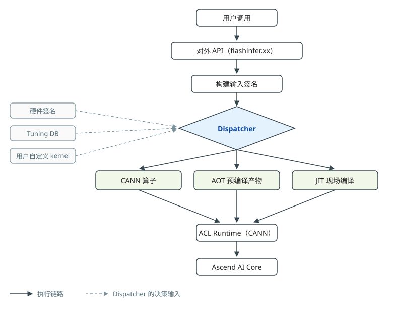
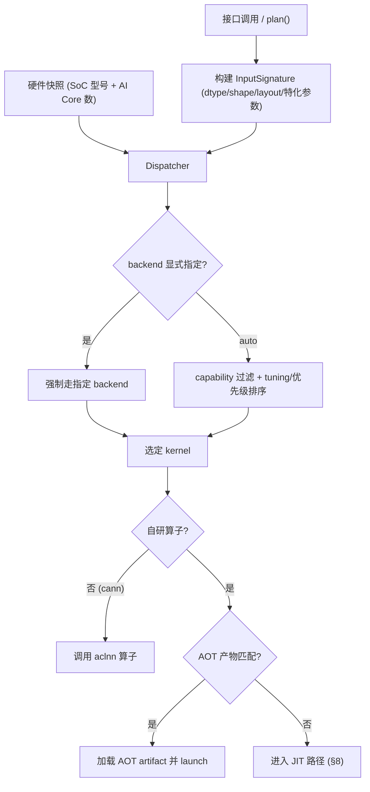
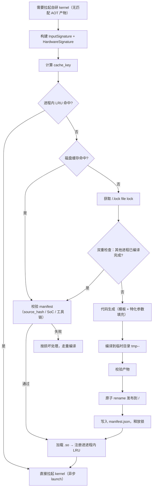

# FlashInfer 框架设计

> 文档状态：Framework design v1.0
>
> 范围：新仓总体框架——对外 API 对标、多 backend 调度、Ascend C / Triton 算子实现体系、
> AOT / JIT 双模式与 kernel 缓存设计。

## 1. 概述

### 1.1 项目定位

flashinfer 是对标 flashinfer 的昇腾 NPU 推理算子库：

- **接口对标 flashinfer**：对外包名为 `flashinfer`，调用形式为
  `flashinfer.xx`（如 `flashinfer.prefill.single_prefill_with_kv_cache`），
  名称、参数与语义尽量与 flashinfer 保持一致，降低 CUDA serving 栈迁移成本。
- **一个接口、多个 backend**：每个接口存在多个候选后端，具体路由到哪个 kernel 由
  **输入数据**（数据类型、shape、layout 等）与**当前硬件型号**共同决定；目标 kernel
  可能是 CANN 内置算子（aclnn），也可能是本仓自研算子。
- **自研算子双语言**：本仓算子支持 **Ascend C** 与 **Triton（triton-ascend）** 两种实现。
- **AOT / JIT 双模式**：算子默认以 **AOT**（预编译产物随包分发）形式交付；AOT 未覆盖
  的组合自动走 **JIT** 路径——以输入签名（dtype、shape、layout 等）与硬件信息
  （SoC 型号、AI Core 数量，见 §4.1）构成 hash key 查询 kernel 缓存：
  命中则直接拉起该 kernel；未命中则现场编译、写入缓存后再拉起。

### 1.2 设计目标

1. 对 flashinfer 稳定 API 提供语义对齐的 `flashinfer.xx` 接口，API 兼容性可度量
   （见 [`api_parity.md`](api_parity.md)：逐 symbol 的 parity manifest 与发布门禁）。
2. 调度决策确定、可解释：给定输入签名与硬件快照，kernel 选择结果唯一且可复现。
3. AOT 优先：生产环境无需编译器即可运行；JIT 作为长尾 shape 与开发期的补充
   （AOT 覆盖主流特化组合，长尾组合与 kernel 迭代开发由 JIT 兜底，见 §7.1/§7.2）。
4. JIT 缓存正确性优先于命中率：任何可能导致二进制语义变化的因素都必须进入 cache key。
5. 热路径零额外开销：`run()` 内不做策略计算、不做同步、不做内存分配。

### 1.3 非目标

- 不模拟 CUDA runtime，不承诺 CUDA 二进制兼容。
- 不逐行翻译 flashinfer 的 CUDA kernel。
- 首期不覆盖 flashinfer 全部能力域；对标范围由 parity 清单管理。
- 不提供在线训练 / autograd。

### 1.4 术语

| 术语 | 含义 |
| --- | --- |
| 接口（interface） | `flashinfer.xx` 暴露的 Python 公共函数或 wrapper 类 |
| backend | 一个接口的一类实现来源：`cann` / `ascendc` / `triton` / `reference` |
| kernel | 一次 dispatch 最终选定的可执行单元（aclnn 算子或自研编译产物） |
| AOT | 提前编译，产物在构建期生成并随 artifact 包分发 |
| JIT | 即时编译，运行期按 cache key 生成并缓存 |
| 输入签名 | 由输入张量的 dtype、shape、layout 及特化参数构成的结构化描述 |
| 硬件签名 | 由 SoC 系列型号与 AI Core 数量构成 |

## 2. 总体架构

### 2.1 架构分层

架构用两个互补的视图描述：**静态视图**回答"每层放什么"，**动态视图**回答"一次调用怎么穿过这些层"。

#### 静态视图：分层栈

```text
L4  对外 API      flashinfer/decode.py、prefill.py、norm.py ...
L3  调度          flashinfer/runtime（dispatcher · registry · capability）
L3' 编译          flashinfer/jit（代码生成 · 编译流水 · 缓存）
L2  Backend       CANN（aclnn）· AOT 加载器 · JIT 加载器
L1  算子          kernels/ascendc · kernels/triton（模板源码）
L0  硬件          硬件探测（SoC 型号 + AI Core 数）
────────────────────────────────────────────────────────────
底座              ACL Runtime / aclrtStream · Ascend AI Core
```

各层的职责与禁止事项见 §2.2，各目录的详细说明见 §2.3。

#### 动态视图：一次调用的主链路



图注（两个易混淆节点）：

- **用户自定义 kernel**：用户**自己实现的 kernel**（非仓内已有实现），经
  `register_kernel()` 注册进 registry、成为候选池中的一员——喂给 Dispatcher 的是
  descriptor 元数据（kernel_id / capability / priority / artifact 引用），不是
  kernel 二进制本体；二进制在选定后由 L2 加载。注册本身只表示"进入候选池"，
  如何被选中取决于调用方式，两种互斥：
  - **显式 `kernel_id=` 指定**（§3.2 / §10.1）：直接锁定该 kernel，**不与任何
    候选比较**，仅做 capability 校验（不满足则报错，不降级）；
  - **auto**（未指定）：作为普通候选与内置 kernel 竞争，需
    `FLASHINFER_NPU_ALLOW_CUSTOM_KERNELS` 显式开启（§10.5.2）。"auto" 即 §3.2
    `backend` 参数的默认值；候选集为 registry 中该 op 的**全部已注册候选**
    （内置 + custom），由注册状态决定，与本次调用入参无关——注册了几个，
    auto 就在"这几个 + 内置"中过滤排序。
- **ACL Runtime**：CANN 的宿主侧运行时（libascendcl），**不属于本仓**（静态视图中
  位于分隔线之下的"运行时底座"）。本仓通向硬件的所有调用——内存分配与 H2D/D2H
  拷贝、stream/event 管理、kernel launch、aclnn 算子调用——都经它提交，框架自身
  不直接触达硬件。类比 CUDA 的 runtime/driver API 路径（`cuLaunchKernel` 所在层），
  是三个 backend 汇聚后的唯一出口。

**命名辨析**：图中 "ACL Runtime" ≠ 本仓的 `flashinfer/runtime` 包——前者是
CANN 的外部 C 库，后者是 L3 调度层（只决策，不拉起）。节点与层次（§2.2）的对照：

| 图中节点 | 所属层 | 本仓模块 | 干什么 |
| --- | --- | --- | --- |
| 用户调用 / 对外 API / 构建输入签名 | L4 | `flashinfer/*.py` | 签名构建 |
| Dispatcher | L3 | `flashinfer/runtime` | 决策"选谁"，不拉起 |
| CANN 算子 / AOT 预编译产物 | L2 | `flashinfer/cann` / AOT 加载器 | 拉起编排 |
| JIT 现场编译 | L3' 编译 → L2 拉起 | `flashinfer/jit` | 编译后产物与 AOT 同路 |
| ACL Runtime | 运行时底座（非本仓） | libascendcl | 提交机制 |
| Ascend AI Core | L0 | NPU 硬件 | 执行 |

拉起职责链：**L3 决策 → L2 编排拉起（参数校验、handle 获取、异步 launch）→
ACL Runtime 提交 → AI Core 执行**。"L2 负责 kernel 拉起"指编排归 L2 代码，
提交机制是调用 ACL Runtime 的 C API——如同 CUDA host 代码负责 launch 编排，
实际提交走 `cuLaunchKernel`。图中自上而下顺序即此链：Dispatcher 选中 kernel
（backend 随之确定）在前，L2 拉起在后，与 §2.2 无矛盾。

### 2.2 层次职责

| 层 | 位置 | 职责 | 禁止事项 |
| --- | --- | --- | --- |
| L4 对外 API | `flashinfer/*.py` | 对标 flashinfer 的函数与 wrapper，签名构建，plan/run 生命周期 | 不直接拼接底层算子，不绕过 dispatcher |
| L3 调度层 | `flashinfer/runtime` | dispatcher、registry、capability、签名与硬件快照 | 不做数据相关 D2H 读取 |
| L3' 编译层 | `flashinfer/jit` | 代码生成、编译流水、缓存管理 | 不在持有 stream 时编译 |
| L2 Backend 层 | `flashinfer/cann`、`aot` 加载器、JIT 加载器 | kernel 拉起：参数校验、handle 获取、异步 launch | 不隐式同步、不隐式 `.contiguous()` |
| L1 算子层 | `kernels/ascendc`、`kernels/triton` | 算子模板源码与特化配置 | 不依赖框架类型（torch header 不进入） |
| L0 硬件层 | capability 探测 | SoC / CANN / 可见设备探测与缓存 | 不散落 `if soc == ...` 判断 |

### 2.3 仓库目录结构

```text
flashinfer/
├── flashinfer/
│   ├── __init__.py
│   ├── prefill.py              # 对外 API，对标 flashinfer 顶层模块
│   ├── decode.py
│   ├── norm.py / activation.py / sampling.py / ...
│   ├── attention/              # 各算子域：plan/run wrapper 与域逻辑
│   ├── gemm/
│   ├── runtime/                # dispatcher / registry / capability / signature
│   ├── jit/                    # JIT engine：codegen、cache、compiler 封装
│   ├── aot/                    # AOT artifact 加载与校验
│   ├── cann/                   # CANN aclnn backend 适配
│   ├── tuning/                 # tuning 查询、本地库、在线探索（§9）
│   └── utils/
├── kernels/
│   ├── ascendc/                # Ascend C 算子模板与特化配置
│   └── triton/                 # Triton 算子模板
├── csrc/                        # 可选：C++ launcher 与稳定 ABI
├── tests/
├── benchmarks/
├── tools/                       # AOT 构建、缓存清理、parity 报告 CLI
├── docs/
├── pyproject.toml
└── CMakeLists.txt
```

目录职责速查（按"是什么 / 不是什么"区分易混目录）：

| 目录 | 是什么 | 不是什么 |
| --- | --- | --- |
| `flashinfer/prefill.py`、`decode.py` | **对外 API 门面（facade）**：函数签名对标 flashinfer 顶层模块，内部只做"签名构建 + 调 dispatcher + 持有 Plan 生命周期" | 不是算子——不含任何 kernel 逻辑，算子的实现在 backend 层之下 |
| `flashinfer/attention/` | 各算子域的 plan/run wrapper 与域逻辑 | 与 prefill.py 的关系：prefill.py 是薄门面，域内复杂逻辑（paged KV、wrapper 状态）在域包里 |
| `kernels/ascendc/`、`kernels/triton/` | **kernel 模板源码**（编译输入）：Ascend C `.cpp/.h` 模板、Triton `@triton.jit` 模板、特化配置 | 不是 Python 包——不被 import，是 CI 遍历支持矩阵的编译对象（§7.1） |
| `csrc/`（可选） | **C++ host 胶水**（pybind11 绑定、C++ launcher、稳定 ABI 层）——仅当 launch 热路径需要压到 C++ 开销时引入 | 不放 kernel 实现——kernel 源码在 `kernels/`；csrc 是"Python 与产物之间的桥" |

**prefill.py/decode.py 与 kernels/ 的分工**：prefill.py 里一行 kernel 代码都没有——
它接收用户张量、构建 `InputSignature`、委托 dispatcher 选择、返回结果。真正的计算
发生在 dispatcher 选中的 kernel 里（CANN 算子 / kernels/ 模板的 AOT 产物 / JIT
产物），由 backend 层拉起。即：**API 文件 = 壳，kernels/ = 芯**，两者通过
runtime 层的 descriptor/registry 间接关联（API 不直接 import kernel）。

**kernels/ 与 csrc/ 都放"非 Python 代码"，但角色正交**：kernels/ 放**设备侧**
kernel 本体（跑在 AI Core 上的代码），编成独立 artifact wheel 按需 dlopen（§7.4）；
csrc/ 放**宿主侧**胶水（跑在 CPU 上、连接 Python 与 ACL Runtime 的代码），编成主
wheel 的 `_C.so` 扩展。上游 flashinfer 把两者都塞进 csrc/ 一起编进主包；本仓拆开
——kernel 独立分发（多 SoC 产物不拖累主包），host 胶水默认用 Python（无 csrc/
也能工作），只在需要时引入。

## 3. 对外 API 层

### 3.1 命名对标规则

| flashinfer | flashinfer |
| --- | --- |
| `flashinfer.prefill.single_prefill_with_kv_cache` | `flashinfer.prefill.single_prefill_with_kv_cache` |
| `flashinfer.decode.single_decode_with_kv_cache` | `flashinfer.decode.single_decode_with_kv_cache` |
| `flashinfer.BatchPrefillWithPagedKVCacheWrapper` | `flashinfer.BatchPrefillWithPagedKVCacheWrapper` |
| `flashinfer.norm.fused_add_rmsnorm` | `flashinfer.norm.fused_add_rmsnorm` |

规则：

1. 模块路径、函数名、类名、参数名与默认值尽量保持一致。
2. NVIDIA 专属参数（如 `backend="cudnn"/"trtllm"`）映射为同用途 NPU backend 取值，
   无法等价时显式报错并在 parity 清单中标记 `intentionally_different`。
3. 兼容性以机器可读的 parity manifest 跟踪，随发布生成报告。

### 3.2 backend 参数

每个支持多实现的接口提供统一扩展参数，支持两个粒度的显式指定：

```python
def single_prefill_with_kv_cache(
    ...,
    backend: str = "auto",        # "auto" | "cann" | "ascendc" | "triton" | "custom" | "reference"
    kernel_id: str | None = None, # 锁定具体 kernel；含用户自定义 kernel（§10）
) -> torch.Tensor: ...
```

- `auto`（默认）：由 dispatcher 依据输入签名与硬件快照自动选择。
- `backend` 显式指定：候选集缩小为该 backend 下的 kernel，组内仍按同一套
  "过滤 + 排序"算法选具体 kernel（详见 §5.3.1）；不可用时抛出携带原因与候选
  列表的异常，**不静默降级**。
- `kernel_id` 显式指定：直接锁定唯一实现，backend 随之确定（kernel 与 backend 的
  关系见 §5.1）；指定的 kernel 不满足当前 capability 时直接报错。
- `reference` 仅用于 correctness 与调试，需显式 opt-in。

### 3.3 plan / run 生命周期

对齐 flashinfer 的 wrapper 语义：

```python
wrapper = flashinfer.BatchPrefillWithPagedKVCacheWrapper(backend="auto")
wrapper.plan(...)   # 签名构建、backend/kernel 选择、JIT 触发（如需）、workspace 规划
wrapper.run(...)    # O(1)：校验 + 已缓存 kernel handle 的异步 launch
```

- 所有调度与 JIT 决策发生在 `plan()`（或函数式接口的首次调用），**不进入 run 热路径**；
  重复 plan() 的同签名决策由 dispatch 决策缓存吸收（§5.3.2）。
- `run()` 只做轻量 shape/bounds 校验与异步 launch，无分配、无 Host 同步。
- 动态 shape 超出 plan 范围时明确报错或触发 re-plan，不静默换 kernel。

### 3.4 图模式支持

flashinfer 的定位是**提供可被图框架捕获的算子**，而非自行实现图编译。
图编译由模型框架（vLLM、SGLang 等）调度，flashinfer 负责让算子满足图捕获的技术要求。

#### 3.4.1 图模式的技术要求

模型框架（如 torchair / GE）捕获算子时，要求算子提供：

| 能力 | 说明 | flashinfer 职责 |
| --- | --- | --- |
| **meta 注册（shape 推导）** | 给定输入 shape，推导输出 shape，构图时 GE 用 | 框架统一封装，kernel 作者提供 lambda |
| **动态 tiling（host 回调）** | 图执行期每 step 重算 tiling + workspace size | 框架注册第一段接口为 GE 回调 |
| **kernel 选择固化** | 构图期选定 kernel，图执行期不再进 Python 调度 | dispatch 结果在 plan() 时固化 |

**flashinfer 不做的**：图编译调度、多图管理、shape 路由——这些是模型框架的职责。

#### 3.4.2 适用范围：decode-only

**图模式仅面向 decode 算子，prefill 不入图**。图模式的净收益 = 省下的 host 开销 × 复用次数
− 图编译成本；prefill 每请求执行一次、seq 请求间差异大（零复用），编译成本无法摊销，
收益为负，统一走 eager plan/run 路径。**本章后续内容均只针对 decode**。

**decode 执行模式**：动态图（GE 动态 shape）——构图期选 kernel 固化，tiling 注册为回调
每 step 重算。decode 每 step shape 缓变、同 bucket 高复用，图编译成本被反复 replay 摊销，
收益为正。

用户不感知差异：统一调 `single_prefill_with_kv_cache()` / `single_decode_with_kv_cache()`，
框架根据算子类型自动适配 eager 或图模式。

#### 3.4.3 kernel 选择固化的 bucket 策略

**核心问题**：decode 每 step shape 变，若 kernel 选择也变，则图内无法固化 → 图爆炸。

**初版形态（无 tuning 竞争）**：每接口固化**单默认 kernel**（capability 过滤 + 启发式首选，
§5.4.3），图分裂仅发生在 capability 硬边界——通常一个接口一张动态图。
多 kernel 后端竞争与 tuning 冠军切换为**进阶特性**（§9，后期启用），届时才引入按下述
bucket 粒度的冠军分图。

**进阶策略（tuning 启用后）**：kernel 选择按 **bucket 粒度**固化，而非单点 shape：

```text
capability 声明：  kernel 声明支持 bs1-64/seq2k-16k（bucket 范围）
dispatch 选择：   构图时按 bucket 中心 shape 选 kernel，bucket 内所有 shape 复用
图捕获：          一个 bucket = 一张图 = 一个固定 kernel
```

| 机制 | 作用 | 阶段 |
| --- | --- | --- |
| **capability 按 bucket 声明** | kernel 明确支持范围，不承诺单点 shape；capability 边界是图分裂的硬约束 | 初版 |
| **dispatch 用 bucket 中心 shape** | 选择结果在 bucket 内稳定，不因 shape 微变而切换 | 初版（默认 kernel） |
| **tuning bucket 边界对齐 kernel 切换边界** | 确保 bucket 内不跨 kernel 优势区，性能结论一致 | 进阶（§9 启用后） |

**bucket 数量控制**：图数量 = bucket 数量。初版图数量 = capability 段数（通常为 1）；
进阶期通过 tuning 流水（§9.2）验证 bucket 内一致性，不一致时拆桶而非允许 bucket 内换 kernel，
且冠军切换需满足显著收益阈值方允许分裂新图。

#### 3.4.4 算子侧适配清单（图捕获契约）

被图框架捕获的算子必须满足以下契约。CANN 两段式算子天然满足大部分条款，
kernel 作者的实际负担仅有：shape 推导 lambda、确认纯函数约束、KV cache 类算子标记 mutation。

**契约定位（两点前提）**：

1. **契约对象是注册算子节点，不是 kernel 接口**。图捕获的直接对象是 flashinfer 对外接口
   注册的 torch 算子（图内一个原子节点）；底下的 kernel 两段式接口不是图结构的一部分，
   而是该节点在图执行期的内部行为（动态 tiling 回调）。kernel 选择在构图期固化，
   图节点与 kernel 1:1 绑定——因此 mutation 声明、meta 推导均挂在接口级算子上。
2. **契约内容不是 flashinfer 私设，是 CANN 生态通用规范的显式化**。注册体系
   （`torch.library` 三层）、图工具链（torchair/GE）、实现契约（纯函数推导、mutation 声明、
   两段式动态 tiling）与 torch_npu 等仓完全同套——flashinfer 复用标准机制，差异仅在
   GE 侧接入的内容（自研 kernel vs 官方 aclnn）。kernel 作者无需学习新规范，
   框架维护跟随 torchair/GE 演进即可。

**A. 注册与接入**

| 适配项 | 说明 | 责任方 |
| --- | --- | --- |
| **meta 注册** | 输出 shape/dtype 推导函数，构图期 GE 调用 | 框架封装，kernel 作者提供 lambda（通常 1~3 行） |
| **动态 tiling** | 第一段接口支持 bucket 内任意 shape | kernel 作者（CANN 两段式天然支持） |
| **workspace 动态计算** | `GetWorkspaceSize` 返回当前 shape 实际 size | kernel 作者（CANN 两段式天然支持） |
| **mutation 声明** | KV cache 原地更新的算子，声明被修改的输入 buffer | 注册时标记（防图优化错误重排/内存复用） |

**B. 纯函数约束（必须满足）**

| 约束 | 含义 | 反例（不可支持） |
| --- | --- | --- |
| 输出 shape 是输入 shape 的纯函数 | `out_shape = f(in_shapes)`，构图期可求值；f 可为符号推导（batch/seq 作为符号变量，运行期代入数值） | data-dependent shape：输出 shape 取决于数据内容（nonzero/unique 类） |
| 输出 dtype 是输入 dtype 的纯函数 | `out_dtype = f(in_dtypes)`，通常是平凡映射（等于输入 dtype；LSE 固定 fp32） | 运行期看数据决定 dtype |
| 无 host 侧数据依赖 | host 编排代码不读 tensor 数据做分支；决策只基于 shape/dtype/layout/标量参数 | `if tensor[0] > 0:` 出现在 host 代码 |
| 无隐藏全局状态 | kernel 行为不依赖全局可变变量，图重放行为一致 | 依赖全局计数器/内部缓存状态 |

**C. 显式化约束（副作用不得隐藏）**

- **副作用显式声明**：KV cache in-place 更新必须声明为 mutation；输出通过返回值或显式 out 参数暴露；
- **workspace 显式申请**：GM workspace 由框架按 `GetWorkspaceSize` 返回值分配，kernel 内部禁止自行 `aclrtMalloc`；
- **随机性显式输入**：含随机行为的算子（如采样），seed/offset 必须作为显式输入参数。

**D. flashinfer 算子对照检查**

| 算子类型 | 输出 shape 可推导 | mutation | 结论 |
| --- | --- | --- | --- |
| `single_prefill/decode_with_kv_cache` | 是（= q 的 shape） | KV cache 更新需声明 | 满足 |
| batch prefill/decode wrapper | 是（= q shape + indptr **长度**，非内容） | 同上 | 满足 |
| LSE 返回（`return_lse`） | 是（固定 fp32） | 无 | 满足 |
| 量化 KV cache 写入 | 是 | 需声明 | 满足 |

**唯一需刻意处理的点**：KV cache 类算子的 mutation 声明——这是与普通纯算子的最大区别，
不声明会导致图框架误判 buffer 未被修改而做错误的内存复用。

#### 3.4.5 算子注册形式（torch.library 三层）

图捕获机制由图编译工具链（torchair/GE）实现；flashinfer 的职责是按 PyTorch
算子注册规范，把算子挂进 `torch.ops.flashinfer.*` 命名空间。**注册形式取决于图编译
工具链规范，与推理框架无关**——注册一次，任何基于 PyTorch 图编译的推理框架
（vLLM / SGLang 等）都能捕获，推理框架只是图编译的触发方。

注册分三层，与 §3.4.4 契约一一对应：

```python
# 第 1 层：schema 定义（契约 C：mutation 声明的落地处）
torch.library.define(
    "flashinfer::single_decode_with_kv_cache",
    "(Tensor q, Tensor(a!) k_cache, Tensor(b!) v_cache, ...) -> Tensor"
    #                ^^               ^^  "!" 标记该 buffer 被原地修改，
    #                PyTorch functionalization 据此处理 KV cache 更新
)

# 第 2 层：meta/fake 注册（契约 B：纯函数约束的落地处）
@torch.library.register_fake("flashinfer::single_decode_with_kv_cache")
def _decode_meta(q, k_cache, v_cache, ...):
    return torch.empty_like(q)   # out_shape/dtype = f(in)，纯元信息推导，
                                 # 图捕获时 fake tensor 传播调用
)

# 第 3 层：实现绑定（契约 A：动态 tiling / workspace 的落地处）
@torch.library.impl("flashinfer::single_decode_with_kv_cache", "PrivateUse1")
def _decode_impl(q, k_cache, v_cache, ...):
    ...  # dispatch（构图期固化）→ plan → 两段式 launch
```

| 层 | 落地契约条款 | 责任方 |
| --- | --- | --- |
| schema 定义 | 契约 C（mutation 声明） | 框架统一编写；kernel 作者标记可变 buffer |
| meta/fake 注册 | 契约 B（shape/dtype 纯函数推导） | kernel 作者提供推导 lambda，框架挂载 |
| 实现绑定 | 契约 A（动态 tiling、workspace） | 框架封装两段式调用，kernel 作者不感知 |

GE 侧接入按 kernel 类型分岔，动态 tiling 回调的提供者不同：

| kernel 类型 | GE 侧接入方式 | 动态 tiling 回调由谁提供 |
| --- | --- | --- |
| aclnn（cann backend） | torchair 原生识别 aclnn 调用 | **CANN 栈自带**——aclnn 两段式是 GE 动态 shape 标准路径，图执行期自动重跑第一段，框架零适配 |
| 自研 Ascend C | 编译为 GE 自定义算子，绑定到实现层 | **框架封装**——在实现绑定层把第一段接口注册为图执行期 host 回调 |
| Triton | 经 triton-ascend 工具链产物接入 | **无回调**——无两段式，实现层按当前 shape 重算 grid/constexpr 后直接 launch |

kernel 作者始终不直接对接 torchair/GE：三层注册代码由框架生成或封装。

#### 3.4.6 JIT 在图模式下的约束

- 构图期若查无 AOT 产物，可触发 JIT 编译（§8）；产物进磁盘缓存，该图长期复用；
- **图执行期绝不允许触发 JIT**——图运行中不能再进 Python 编译流程；
- shape 超出算子 capability 声明的 bucket 范围时，模型框架侧报错或触发重新构图。

#### 3.4.7 对既有机制的影响

- **dispatch cache**：图模式下 dispatch 只发生在构图期；图生命周期内选择结果已固化，
  dispatch cache 不再被查询。registry 冻结约束（§10.1）与图模式天然契合——换 kernel = 重构图。
- **图注册路径**：`register_kernel`（§10.1）除 eager launch ABI 外，同步注册 torchair 算子
  （meta + 图接入），由框架封装层完成，对用户透明。
- **错误处理**：图模式下的 capability 失败、编译失败等，在构图期抛出，不延迟到运行期。


## 4. 硬件感知与环境探测

### 4.1 HardwareSignature（硬件签名）

进程内首次访问时构建并缓存，只携带两个会影响 kernel 编译与调度的硬件信息：

```python
@dataclass(frozen=True)
class HardwareSignature:
    soc_model: str      # SoC 系列型号，如 "Ascend910B" / "Ascend910C"
    aicore_count: int   # AI Core 数量
```

字段含义与纳入理由：

- `soc_model`：SoC 的系列型号。不同系列的指令集和微架构不同，编译产物必须按系列
  各编一份，是硬性维度。
- `rank_num`：进程内可见的设备数量（`torch_npu.device_count()`）。
- `aicore_count`：AI Core 数量。同一系列内不同子型号的 AI Core 数不同（如 910B1 与
  910B4），kernel 的 tiling / block 切分和并行度上限取决于它，因此不能只靠
  `soc_model` 区分，必须作为独立字段。


### 4.3 探测怎么做

一句话：**第一次用到时查一次，结果存下来，后面所有调度都直接读这份缓存。**

- SoC 型号、可见设备数量和 AI Core 数量从 `torch_npu` 的设备属性接口读取（首选），拿不到时用
  `npu-smi` 或 CANN 运行时接口兜底。
- 查询只在进程内做一次，做成只读快照缓存在内存里，热路径上不再有硬件查询开销。
- 写 kernel 时禁止在代码里到处写 `if soc == "910B"` 这种判断。某 kernel 支持什么
  硬件，在它的 descriptor 的 capability 声明里写清楚，由 registry 统一判断；
  想知道当前机器满不满足，拿 HardwareSignature 与声明比对即可。

### 4.4 环境一致性校验（非硬件签名职责）

CANN、driver、`torch_npu` 等软件栈版本**不进入 HardwareSignature**，原因是算子不感知
这些信息——它们属于环境一致性问题，在环境建立阶段一次性保证：

- 进程首次使用（或安装后 `flashinfer show-config`）时，将当前软件栈 tuple 与
  support matrix 中 CI 实测过的 tuple 对照；
- 不在已验证 tuple 内 → 显式报错并列出已验证组合，不进入执行；
- 校验结果进程内缓存，后续 dispatch 不再重复检查。


## 5. Dispatcher：多 backend 与 kernel 选择

### 5.1 op、backend 与 kernel 的关系

调度涉及三个粒度递进的概念，backend 与算子（kernel）不在同一层：

| 概念 | 层次 | 示例 | 说明 |
| --- | --- | --- | --- |
| op | 语义层 | `attention.decode` | 描述"做什么"，与实现无关 |
| backend | 实现来源层 | `ascendc` / `triton` / `cann` / `custom` / `reference` | 描述"用什么技术路线实现"，是 kernel 的分类属性 |
| kernel | 具体实现层 | `ascendc/attention/decode_v2` | 唯一可执行单元：模板代码 + 特化配置 + 编译产物，有全局唯一 `kernel_id` |

数量关系：一个 op 挂载多个 kernel；每个 kernel 恰属于一个 backend
（`KernelDescriptor.backend` 字段）；同一 backend 下可有同一 op 的多个 variant
（不同 tiling / pipeline 策略）。

以 `attention.decode` 为例：

| kernel_id | backend | 说明 |
| --- | --- | --- |
| `cann/attention/decode_aclnn_v1` | cann | aclnn 算子组合实现 |
| `ascendc/attention/decode_v1` | ascendc | baseline tiling |
| `ascendc/attention/decode_v2` | ascendc | split-KV + state merge 优化 |
| `triton/attention/decode_v1` | triton | triton-ascend 实现 |

因此用户显式指定的粒度从粗到细为：`backend="auto"`（全候选参与）→
`backend="ascendc"`（backend 组内仍按 auto 逻辑选 kernel）→
`kernel_id="ascendc/attention/decode_v2"`（直接锁定唯一实现，backend 随之确定）。

### 5.2 backend 类型

| backend | 说明 | 编译方式 | 生产默认 |
| --- | --- | --- | --- |
| `cann` | CANN 内置算子或 aclnn 组合实现 | 无（调用预装算子库） | 是 |
| `ascendc` | 本仓 Ascend C 自研算子 | AOT / JIT | 是（AOT） |
| `triton` | 本仓 Triton（triton-ascend）自研算子 | AOT / JIT | 是（AOT） |
| `custom` | 用户注册的自定义 kernel（§10） | AOT / JIT | 否（参与 auto 需显式开启） |
| `reference` | correctness / 调试用高精度参考实现 | 无 | 否（显式 opt-in） |

候选按**来源**分两类，`backend` 字段即类别标记：

| | 内置 kernel | custom kernel |
| --- | --- | --- |
| 来源 | 随本仓分发 | 用户运行期 `register_kernel()` 注册 |
| backend 取值 | `cann` / `ascendc` / `triton` / `reference` | **必须为 `custom`**（注册时强制，其余四个值保留给本仓，否则 §10.5.2 的开关可被绕过） |
| 质量保障 | CI correctness、发布流程、发布期 tuning 实测 | 无（用户自担） |
| 进入 auto 候选池 | 默认在池中 | 需 `FLASHINFER_NPU_ALLOW_CUSTOM_KERNELS` |

注意 `custom` 标记的是**来源与信任等级，不是实现技术**——用户 kernel 实际也用
Ascend C 或 Triton 编写，但调度策略关心"是否经过质量门禁"而非"用什么语言实现"，
因此用户写的 Ascend C kernel 归类为 `custom` 而非 `ascendc`。两类一旦同在候选池中，
选择算法完全同权（同一套 capability 过滤 + 排序）；差异只在信任策略（§10.5）。

### 5.3 选择算法

dispatch 输入为 `(InputSignature, DeviceCapability, BackendPolicy)`，输出为
`(kernel_id, fallback_chain, reason_codes)`：

```text
1. backend policy 解析（只是候选集过滤器，后续步骤算法与 auto 完全一致，
   组内选择规则见 §5.3.1）：
   显式指定 → 只保留指定 backend 的候选（含 custom）；
   auto → 内置候选 + （若 FLASHINFER_NPU_ALLOW_CUSTOM_KERNELS 开启）已注册的
          custom 候选。
2. 语义 capability 过滤：dtype / shape 约束 / layout / 特化参数（causal、量化格式等）
   是否被候选支持。
3. 二进制 capability 过滤：SoC 型号、CANN ABI、artifact schema 是否匹配。
4. 排序（默认优先级，可被 tuning 记录覆盖）：
   a. 命中 tuning record 的 kernel；
   b. 自研算子且有匹配 AOT 产物；
   c. CANN 算子；
   d. 自研算子走 JIT；
   e. reference（仅显式允许时）。
5. 返回选择结果与逐条过滤原因（供 explain_dispatch / trace 使用）。
```

要点：

- **决策单元是 kernel，不是 backend**：dispatcher 始终在 kernel 粒度上过滤与排序；
  backend 是选定 kernel 后附带确定的属性，不存在独立的 backend 决策步骤。换言之，
  "backend 如何确定" = capability 过滤后哪些 kernel 幸存 + 排序谁第一 的结果。
- **backend 在过滤阶段被间接淘汰**：capability 过滤淘汰的是 kernel；当某 backend 下
  该 op 的全部 kernel 均被淘汰时，等效于该 backend 退出候选。例如 int4 量化 KV 只有
  ascendc 实现，cann / triton 整组出局，backend 无需决策即已确定。
- **排序阶段跨 backend 公平竞争**：优先依据 tuning record（离线实测性能，不区分
  backend），无记录时才使用默认启发式（自研 AOT > cann > 自研 JIT > reference）。
  两者定义见 §5.4。
- **默认 AOT**：自研算子只有在无匹配 AOT 产物时才进入 JIT 路径；JIT 不是首选。
- CANN 与自研算子的取舍由输入签名与硬件型号共同决定：不支持的 dtype/layout 直接过滤，
  性能取舍优先使用离线 tuning record，无记录时使用确定性启发式。
- 同一 workload 下选择结果必须确定可复现；所有过滤原因可查询。


### 5.3.1 显式指定 backend 后的组内选择

一个 backend 下通常挂多个 kernel，来源有三种：

| 组内多 kernel 的来源 | 例子 |
| --- | --- |
| 同算法不同 variant | `ascendc/attention/decode_v1`（baseline tiling）与 `decode_v2`（split-KV 优化） |
| 结构维度特化 | `decode_v3` 只编译了 head_dim=128 的版本 |
| layout / 量化特化 | nhd 版与 hnd 版、int8 KV 版与 bf16 KV 版 |

显式指定 backend 时**只缩小候选集，不改变选择算法**：组内选择与 auto 走同一套
"过滤 + 排序"流程（policy 是过滤器，算法是唯一实现）。收益：`explain_dispatch`
行为统一、组内与跨组测试共享同一套用例、不存在 auto 与显式两套逻辑的漂移。

组内选择流程：

```text
显式 backend="ascendc" 后：
1. 组内 capability 过滤（算法不变，范围缩小）
   语义过滤：dtype / shape 约束 / layout / 特化参数 × 组内每个 kernel
   二进制过滤：SoC / CANN ABI / artifact 匹配 × 组内每个 kernel
2. 组内排序（算法不变，范围缩小）
   exact / bucket tuning 记录 → 相邻桶借用 → 确定性启发式（§5.4.3）
   启发式在组内退化为：AOT 产物匹配 > 需 JIT
   → descriptor.priority 高者优先 → kernel_id 字典序兜底
```

三种典型情形：

| 情形 | 组内过滤后 | 决策依据 |
| --- | --- | --- |
| 结构维度特化（head_dim / layout / 量化版本不同） | 通常只剩 1 个 | capability 过滤已定，无需排序 |
| 同算法多 variant（v1 / v2 不同 tiling） | 剩多个 | 该 bucket 的 tuning 记录 |
| 无 tuning 记录 | 剩多个 | AOT > JIT，priority → kernel_id 字典序 |

边界：显式 backend 组内 kernel **全部**被 capability 淘汰时，直接报错并附逐条淘汰
原因，**不跨 backend 静默降级**（见 §12 错误处理）。

#### 5.3.2 dispatch 决策缓存

选择算法若每次 plan() 都完整重跑（capability 过滤 + tuning 查询 + 排序），在重复
plan() 场景（进程重启、新 wrapper、每 batch re-plan）下是纯浪费。查询侧
输入签名与硬件签名是**精确值**（范围与通配只在 kernel 声明侧），足以作为 hash key
索引历史决策，因此设置进程内 LRU 决策缓存：

```text
dispatch_cache_key = hash(
    op_name || encode(InputSignature) || encode(HardwareSignature)
    || BackendPolicy
)
→ Decision(kernel_id, resolved_handles, fallback_chain, reason_codes)
```

它与 JIT cache_key（§8.1）是**两个不同的 key**，不可复用：

| | dispatch 决策缓存 | JIT cache_key |
| --- | --- | --- |
| 目的 | 避免重跑选择算法 | 定位编译产物 |
| `kernel_id` | **不能进 key——它是决策输出**（尚未选出） | 必须包含 |
| `source_hash` / `toolchain_signature` | 不需要（不影响"选谁"） | 必须包含 |
| 失效机制 | **无需失效——候选集进程内不可变** | 内容指纹 |

**为什么无需失效机制**：本仓采用与上游 flashinfer 相同的变更模型——
`register_kernel()` 仅在进程初始化阶段（首次 dispatch 前）允许调用，registry 随即
冻结（§10.1）；新增 / 更换 kernel 通过修改注册模块并**重启进程**生效，与 wheel
升级的生效边界一致。候选集在进程内不可变 ⇒ 同一 key 的决策永远有效 ⇒ cache key
天然稳定，不需要任何失效令牌（epoch 计数器）。源码修改、编译器升级同理不影响
"选谁"，只影响产物身份，由 JIT cache key 的 `source_hash` / `toolchain_signature`
承担（§8.1）。


约束：决策缓存是**纯优化**——语义上等价于重跑选择算法，缓存未命中或禁用
（`FLASHINFER_NPU_DISABLE_DISPATCH_CACHE`）时行为不变；缓存条目不落盘，
进程重启后重建。

### 5.4 Tuning 记录与确定性启发式

排序依据有两条数据通路：**tuning record（实测性能）** 与 **确定性启发式（无实测数据时的
规则排序）**。二者的边界与定义如下；tuning 数据的产生、存储、失效与治理机制见 §9。

#### 5.4.1 tuning 是什么

tuning 是**在真实 NPU 硬件上实测得到的性能数据库**，不是模型推测。采用
"离线实测、随包发布、运行时只读查询"的模式：

```text
发布期（CI / 专用性能机）：
  对每个 op：
    枚举代表性 workload bucket（shape 分桶 × dtype × layout × 特化参数）
    对该 bucket 下全部幸存候选 kernel：
      warmup 若干次 → 实测 M 次 → 统计 p50 / p90 / 方差
      同时执行 correctness 校验（性能数据以正确性为前提）
    生成 tuning record 写入数据库，随 wheel 发布

运行期（dispatch 第 4 步排序）：
  按 (op, workload bucket, capability fingerprint) 查询
  命中 → 该 bucket 实测最快的 kernel 直接胜出
  未命中 → 落入确定性启发式（§5.4.3）
```

tuning record 结构示例：

```json
{
  "key": {"op": "attention.decode",
          "bucket": "bs1-64/seq2k-16k/head128/hd128/bf16",
          "capability_fingerprint": "910B1/cann9.0.0/..."},
  "kernel_id": "ascendc/attention/decode_v2",
  "stats": {"samples": 200, "p50_us": 85.2, "p90_us": 91.7, "stddev": 2.1},
  "env_notes": {"freq_policy": "fixed", "temperature": "62C"},
  "correctness": "passed"
}
```

约束：

- 记录**不能跨 capability / ABI fingerprint 复用**：换 SoC、换 CANN 版本后旧数据
  失效，必须重新实测或退回启发式；
- 记录必须附带 correctness 结论，正确性未通过的候选不产生性能记录；


#### 5.4.2 为什么 tuning 能知道哪个 kernel 最好

因为排序依据是**发布前在目标 SoC + 目标 CANN 版本上的逐 kernel 实测**，而非猜测。
运行期按 bucket 匹配查询，得到该 bucket 下实测最快的 kernel。新 shape 未被实测过
时的处理见 §5.4.4。

#### 5.4.3 确定性启发式

无任何 tuning 记录时使用的排序规则。三条硬要求：

- **确定性**：同输入必同输出，无随机、无运行时测量、无时钟依赖；
- **可解释**：编码为静态规则表，`explain_dispatch` 可打印完整决策链；
- **保守**：优先走验证充分的路径。

规则阶梯：

| 序 | 候选 | 理由 |
| --- | --- | --- |
| 1 | 自研 kernel 且 AOT 产物匹配 | 预编译、CI 全量验证、零首调延迟 |
| 2 | CANN 算子 | 随环境预装、正确性有保障；代价是融合度低（多算子拼接、中间结果落显存） |
| 3 | 自研 kernel 走 JIT | 需现场编译，首次调用有编译延迟，且要求环境具备工具链 |
| 4 | reference | 仅显式 opt-in，永不进入生产热路径 |

同层 tie-break：`descriptor.priority`（维护者声明，新版本号优先）→ `kernel_id`
字典序（保证最终全确定性）。

该阶梯与 AOT-first 决策一致：生产环境常无编译器且不容忍首调延迟，AOT 自研最优；
CANN 优先于 JIT 自研，因为 CANN 随环境预装而 JIT 有编译延迟与工具链依赖。

确定性要求的意义：dispatch 结果可复现、benchmark 稳定、trace 可回放、缓存友好。
若排序引入随机或运行时测量，同一 workload 两次 dispatch 可能选出不同 kernel，
上述性质全部失效。

#### 5.4.4 新 shape 的处理：bucket 泛化与查询阶梯

tuning 记录无法覆盖全量 shape。核心机制是 **shape 不枚举，而是分桶**：kernel 选择
的胜负手不是精确 shape，而是"结构维度 + shape 量级区间"。

维度分两类，进入 key 的方式不同：

| 维度类别 | 例子 | 进入 key 的方式 |
| --- | --- | --- |
| 结构维度（选型翻转项） | dtype、layout、head_dim、quant spec、causal | **精确匹配**——这些变了 kernel 排名会翻转 |
| 量级维度（性能平滑项） | batch、seq_len、num_pages、expert 分布 | **分桶**——只在量级跨越时换 kernel |

新 shape 到达时的四级查询阶梯：

```text
1. exact 记录命中?            → 用该记录（最快路径，新 shape 很少命中）
2. bucket 记录命中?           → 该 shape 落入某桶且桶有实测记录 → 用桶冠军
   │                            （新 shape 的常态路径：绝大多数走这里）
3. 同结构签名、相邻桶有记录?   → dtype/layout/head_dim 全同，仅量级维度落在
   │                            无记录桶 → 用相邻桶记录，trace 标注
   │                            "borrowed_record"
4. 全部未命中 → 确定性启发式（§5.4.3 静态规则表）
```

- 每级结果都写入 dispatch reason / trace，选型依据永远可审计；
- 第 3 级属于有损借用：仅允许结构签名完全一致时发生，且必须在 trace 中可见，
  不允许跨结构维度（如跨 dtype）借用记录。

**桶冠军为什么可以泛化到桶内新 shape**——不靠信任，靠发布期桶内抽检：

1. 桶边界对齐 kernel 自身的 tiling 边界，不是等分切：例如 decode kernel 每 16K token
   切一次 KV 分区，则 `seq 2k-16k` 就是一个桶；桶边界由 kernel 作者在 descriptor 中
   声明，与 tiling 参数绑定；
2. 发布期在每个桶内采多个代表 shape（含边界值、奇数值、桶中心），实测确认冠军一致；
   **不一致则拆桶**，直到桶内冠军稳定；
3. 记录因此可以携带置信信息："该桶冠军在 N 个采样点上稳定"。

兜底与闭环：

- 第 3、4 级的选择仍是确定性的，不存在"没数据就不选"；
- **可选在线反馈（默认关闭）**：新 shape 首次执行时可在独立 stream 上做一次受限
  测量，结果写入**本地** tuning cache（不回写发布数据库），同进程后续 dispatch 即可
  命中；由环境变量开关控制，并限制候选数与总时长；
- **全新结构组合**（新 dtype / 新 head_dim）：相邻桶不可借鉴，直接启发式 + JIT——
  长尾结构组合不进 AOT、不进 tuning，但依然可执行，这正是 JIT 路径存在的意义。

### 5.5 选择流程图



## 6. 算子实现层

### 6.1 CANN backend（`flashinfer/cann`）

- 封装 aclnn 算子调用：参数转换、layout 适配、stream 获取。
- 每个封装必须声明支持的 dtype / shape / layout 谓词，注册进 registry。
- 作为 fallback 时必须在 trace / dispatch reason 中可见，不静默发生。

### 6.2 Ascend C 算子（`kernels/ascendc`）


### 6.3 Triton 算子（`kernels/triton`）


### 6.4 kernel 注册（registry）

```python
@dataclass(frozen=True)
class KernelDescriptor:
    kernel_id: str            # "ascendc/attention/decode_v1" 或 "mycompany/..."
    op: str                   # "attention.decode"
    backend: str              # "ascendc" | "triton" | "cann" | "custom" | "reference"
    compile_mode: str         # "aot" | "jit"
    capability: CapabilityPredicate
    priority: int
    tuning_keys: tuple[str, ...]
    artifact: ArtifactRef | None   # AOT 产物引用；JIT kernel 为 None
    source: SourceRef | None        # JIT 源码引用（自研内置或用户自定义，见 §10.3）
```

- registry 是 capability 的唯一事实源，运行时、构建脚本、文档与测试共用一份声明。
- 不允许 import side effect 覆盖同名 kernel。
- 同一协议同时服务内置注册与用户自定义注册（§10.1），`register_kernel` 是用户接入点。

## 7. AOT 模式

### 7.1 AOT 编译粒度：kernel 源码与编译产物是 1:N

AOT 的编译单元**不是 kernel 源码，而是 `kernel × 特化组合`**。一份 kernel 源码要
产出多个二进制：

```text
kernel 源码：ascendc/attention/decode_v2（一份代码）
    × SoC:      910B / 910C            → 指令集、微架构不同，必须各编一份（硬性维度）
    × dtype:    bf16 / fp16             → 编译期常量特化
    × head_dim:  128 / 96               → 编译期常量特化
    × layout:   nhd / hnd               → 编译期确定的访存模式
    ────────────────────────────────────
    = 2 × 2 × 2 × 2 = 16 个编译产物
```

同一份源码编出多个产物的原因：高性能 kernel 必须把 dtype / head_dim / layout 等做成
**编译期常量**（Ascend C 模板参数 / Triton constexpr）——编译期已知才能做 tiling 展开、
循环展开与寄存器分配优化；若作为运行时参数传入，kernel 内部退化为分支 + 通用代码，
性能不可接受。


### 7.2 构建与分发

- CI 遍历 §7.1 定义的支持矩阵，但只预编译**常用**组合（高频 dtype × 主流 shape
  bucket × 已发布的 SoC），产出独立 artifact 包（如 `flashinfer_kernels_<soc>`）。
- 只编"常用"组合是包体积与覆盖率的权衡：全量特化组合（100 kernel × 10 组合 ×
  3 SoC = 3000 产物，GB 级）不可分发；高频组合预编译，长尾组合不预编译、运行期由
  JIT 兜底（§8）——这正是 AOT/JIT 分工的根源。
- 主包 `flashinfer` 只含 API、runtime、JIT 源与 reference，不强制依赖编译器。

构建期编译与 plan 期加载的时机区分：

| 时机 | AOT 模式 | JIT 模式 |
| --- | --- | --- |
| 构建期（CI） | 编译全部预定的常用组合 | 无 |
| plan 期 | 产物**定位 + 加载**（查 manifest → dlopen → handle 缓存），不编译 | 无匹配 AOT 产物时**触发编译**（§8.3） |
| run 期 | 复用已加载 handle，O(1) launch | 同左 |

即 plan 期永远做"产物定位 + 加载"，是否发生编译取决于 AOT 是否覆盖该组合；plan 期的
延迟加载不是 JIT。

### 7.3 artifact manifest

每个 AOT 产物附带 manifest，至少记录：

```json
{
  "kernel_id": "ascendc/attention/decode_v1",
  "entry_symbol": "finpu_attention_decode_v1",
  "op_schema_version": 1,
  "soc_model": "Ascend910B1",
  "cann_version": "9.0.0",
  "source_hash": "sha256:...",
  "toolchain_version": "...",
  "dtypes": ["float16", "bfloat16"],
  "layout_constraints": {"kv": ["nhd", "hnd"]},
  "shape_constraints": {"head_dim": [64, 128]},
  "build_time": "...",
  "package_version": "..."
}
```

### 7.4 加载规则

- dispatch 选定自研算子后，先查 AOT manifest：匹配粒度是**特化组合**
  （kernel_id × dtype × 静态维度 × layout × SoC × CANN ABI × 源码 hash），不仅是
  kernel_id——同一 kernel 的多个产物中挑出与当前输入签名及硬件签名一致的那个。
- manifest 校验失败：显式报错，或按策略转入 JIT 重新编译（trace 中记录原因）。
- AOT 加载结果（handle）进程内缓存，run 热路径直接复用。
- 无匹配产物（组合未被预编译覆盖）→ 进入 JIT 路径（§8），属正常长尾处理，
  不是错误。

## 8. JIT 模式与 kernel 缓存（核心设计）

### 8.1 cache key 设计

JIT 的正确性基石：**任何影响编译产物语义的输入都必须进入 key**。

```text
cache_key = sha256(
    key_schema_version        # "flashinfer-jit-v1"，key 组成变更时递增
    || op_name                # "attention.decode"（可从 kernel_id 推导，保留用于 manifest 可读性）
    || kernel_id              # "ascendc/attention/decode_v1"
    || encode(InputSignature) # 见下
    || encode(HardwareSignature)  # 见下
    || toolchain_signature    # Ascend C 编译器版本 或 triton-ascend 版本
    || source_hash            # 算子模板源码 hash
    || codegen_version        # 代码生成器版本
    || package_version        # flashinfer 包版本
)
```

各字段的职责——**kernel_id 是稳定逻辑名，不是内容指纹**：它只回答"选哪个
kernel"，不随编译器 / codegen / 源码内容变化（tuning 记录、用户 pin 的
kernel_id、AOT manifest 都引用它，内容维度的变化由以下指纹字段分别捕获）：

| key 组成 | 捕获什么变化 | 典型场景 |
| --- | --- | --- |
| `kernel_id` | 选哪个逻辑 kernel（路由身份） | — |
| `source_hash` | 同一 kernel_id 下模板源码被修改 | 开发期改模板 |
| `toolchain_signature` | 编译器版本变化 | CANN 升级、triton-ascend 升级 |
| `codegen_version` | 框架代码生成器（模板 → 可编译源码的展开逻辑）变化 | 框架升级修复 codegen |
| `InputSignature` / `HardwareSignature` | 特化输入与硬件目标 | dtype/shape/layout、SoC/AI Core 数 |
| `package_version` | 上述未覆盖的包级语义变化 | registry / manifest 格式演进 |
| `key_schema_version` | key 组成本身的演进 | 字段增删时递增，自动使全部旧缓存失效 |

**InputSignature**（输入数据部分）：

```python
@dataclass(frozen=True)
class TensorSignature:
    dtype: str               # float16 / bfloat16 / int8 / int4_packed ...
    shape: tuple[int, ...]   # 静态维度参与 hash；动态维度以 -1 通配
    strides: tuple[int, ...]
    layout: str              # "nhd" / "hnd" / 连续性等逻辑 layout 标记

@dataclass(frozen=True)
class InputSignature:
    op: str
    tensors: tuple[TensorSignature, ...]
    scalars: tuple[str, ...]     # head_dim、causal、window、量化 spec 等特化参数
```

- shape 采用**静态维度 + 动态维度**策略：仅声明为静态的维度进入 hash，动态维度作为
  运行时参数传入 kernel。默认策略下 batch/seq 维度动态、head_dim 等结构维度静态，
  避免缓存爆炸；静态化范围可通过 plan 配置。
- dtype、layout 与特化参数始终全量进入 key。

**HardwareSignature**（硬件部分）：即 §4.1 结构，包含 `soc_model`（系列级）、`rank_num`与
`aicore_count`。
编译器版本差异由 `toolchain_signature` 承担；CANN / driver 等
运行时环境一致性由环境建立阶段校验（§4.4）。

### 8.2 缓存目录结构

```text
${FLASHINFER_NPU_CACHE_DIR:-~/.cache/flashinfer}/
├── jit/
│   ├── <key前2位>/<key完整值>/   # 官方 kernel 产物
│   │   ├── kernel.so          # 编译产物（Ascend C：.so + 入口符号；Triton：triton 产物）
│   │   ├── kernel.meta.json   # triton 元数据（ttir/常数等信息）
│   │   ├── manifest.json      # key 组成、编译环境、时间戳、源码/工具链 hash
│   │   └── .lock             # 编译期 file lock（发布后删除或保留为空）
│   └── user/<namespace>/      # 用户自定义 kernel 的 JIT 产物（物理隔离，§10.3）
└── tuning/                    # 本地 tuning database（§9.3）
```

### 8.3 命中 / 未命中流程



规则：

1. **两级缓存**：进程内 LRU（key → 已加载 handle）+ 磁盘缓存（key → 产物目录）。
   磁盘命中后加载一次，之后同进程内全部走内存缓存。
2. **双重检查**：拿到 file lock 后重新检查目标目录，避免多进程 / 多线程并发重复编译。
3. **原子发布**：编译产物先写临时目录，校验通过后原子 rename 到目标路径；
   其他进程要么看到完整产物，要么看不到，不存在半成品。
4. **manifest 必校验**：磁盘命中不等于可信——加载前重新核对 source_hash、SoC、
   工具链版本；不信任文件名本身。
5. **编译期与执行期隔离**：编译期间不持有 stream；编译完成并加载后才发起 launch。

### 8.4 缓存失效与治理

- **自动失效**：key 组成中任何 hash 输入（源码、工具链、CANN、SoC、包版本）变化
  自然生成新 key，旧产物不会被错误复用。
- **显式清理**：CLI `flashinfer clear-cache` 删除缓存目录；LRU 上限与总大小
  由环境变量控制。
- **只读环境**：包安装目录只读；用户缓存目录、构建临时目录、发布目录三者分离。
- 禁止以文件名长度截断 key；禁止跨 key 复用产物。

## 9. Tuning 机制（进阶特性，后期启用）

> **版本定位**：本节为进阶特性，初版不启用——初版 dispatch 直接按确定性启发式（§5.4.3）
> 选定默认 kernel，无 tuning 记录查询；机制设计在此完整保留，作为后期启用多 kernel
> 竞争时的依据（对应 §15 M6）。

本节定义 tuning 数据如何产生、存储、失效与治理；dispatch 侧如何消费这些数据见 §5.4。
核心原则：**性能结论只来自实测，dispatch 只做查询，绝不在热路径测量**。

### 9.1 三种 tuning 模式

| 模式 | 触发方 | 时机 | 结果去向 | 默认状态 |
| --- | --- | --- | --- | --- |
| 发布期离线 tuning | CI / 性能机 | 随版本发布 | 发布数据库，随 wheel 分发 | 开启 |
| 在线探索 tuning | 用户显式开启 | 进程运行期 | 进程内 / 本地 cache，不回写发布库 | 关闭 |
| 本地调优工具 | 用户手动（CLI） | 任意时间 | 本地 tuning database | 按需 |

三层来源的查询优先级：**本地记录 > 发布记录 > 启发式**。本地记录允许覆盖发布记录
（用户为自己的环境实测过，更可信），但必须携带与发布记录相同的完整 key 与统计字段，
并在 `explain_dispatch` 中标注 `source: local`。

### 9.2 发布期离线 tuning 流水

```text
对每个 op：
  1. 由 kernel descriptor 的 bucket 声明得到 bucket 空间
     （桶边界与 kernel tiling 边界绑定，见 §5.4.4）
  2. 对每个 (bucket × capability fingerprint)：
     a. capability 过滤得到幸存候选 kernel 列表
     b. 对每个候选：
        - 加载 / 编译产物
        - correctness 校验（对高精度 reference，输出 + LSE 双指标）
        - warmup N 次 → 实测 M 次 → 统计 p50 / p90 / stddev
     c. 生成该 bucket 的 ranking，冠军写入 tuning record
  3. 桶内一致性抽检：
     对每个桶再采 K 个代表 shape（边界值 / 奇数值 / 桶中心）复测冠军
     → 冠军不一致的桶执行拆桶，回到步骤 2
  4. 汇总生成 tuning database，附带版本与环境 fingerprint，随 wheel 发布
```

约束：

- 性能数据以 correctness 为前提：正确性未通过的候选不产生性能记录；
- 异常数据结果不进入发布库；
- 桶采样数、warmup / 实测次数、统计方法记录在 tuning database 元信息中，可审计。

### 9.3 tuning database 结构

```text
flashinfer/data/
└── tuning/
    ├── <soc>/                     # 按 capability fingerprint 分目录
    │   ├── attention_decode.json  # 按 op 分文件
    │   └── ...
    └── meta.json                  # database 版本、采样方法、生成环境
```

单条 record（consumed by §5.4）：

```json
{
  "key": {"op": "attention.decode",
          "bucket": "bs1-64/seq2k-16k/head128/hd128/bf16",
          "capability_fingerprint": "910B1/cann9.0.0/..."},
  "kernel_id": "ascendc/attention/decode_v2",
  "stats": {"samples": 200, "p50_us": 85.2, "p90_us": 91.7, "stddev": 2.1},
  "confidence": {"bucket_probes": 5, "stable": true},
  "env_notes": {"freq_policy": "fixed", "temperature": "62C"},
  "correctness": "passed",
  "source": "release"              # release | local
}
```

### 9.4 在线探索 tuning（默认关闭）

- 开启方式：环境变量（§13）或 wrapper 参数；
- 开启后仅对**无记录 bucket** 生效：新 shape 首次执行时在独立 stream 上 warmup 后
  做一次受限测量（限制候选数量与总时长），结果写入本地 cache；
- 本地 cache 与发布库物理隔离，卸载 / 升级不互相污染；
- 写入即清空 dispatch 决策缓存（§5.3.2）：新记录对后续 plan() 立即生效；

### 9.5 失效与治理

- **结构性失效**：bucket 边界定义变化 → 旧记录
  自动不可匹配（查询 miss）；
- **CLI 治理**：

```text
flashinfer tuning show <op>                 # 查看某 op 的记录与来源
flashinfer tuning benchmark --op ...         # 本地调优工具（写入本地库）
flashinfer tuning validate                  # 校验记录与当前环境 fingerprint 匹配
flashinfer clear-cache --tuning             # 仅清本地 tuning cache
```

## 10. 自定义 kernel 接入

场景：用户自己实现了一个 kernel，希望继续使用 `flashinfer.xx` 接口与完整的
plan / run、workspace、trace、JIT 缓存等底层设施，仅把执行体替换为自己的实现。

### 10.1 接入方式：声明式注册

用户通过构建 `KernelDescriptor` 并注册进 registry 接入，框架不感知实现细节：

```python
from flashinfer.runtime import (
    KernelDescriptor, CapabilitySpec, ArtifactRef, register_kernel,
)

register_kernel(
    KernelDescriptor(
        kernel_id="mycompany/attention/decode_fused_v1",  # 自定义命名空间前缀
        op="attention.decode",                            # 挂载到已有 op 语义
        backend="custom",                                # 见 §5.2
        compile_mode="aot",
        artifact=ArtifactRef(path="/path/to/libmy.so",   # 已编译产物
                             entry_symbol="my_attention_decode"),
        capability=CapabilitySpec(
            dtypes=["bfloat16"],
            head_dim=[128],
            layouts=["nhd"],
            soc_models=["Ascend910B*"],
        ),
        priority=200,               # 高于内置 kernel 时可竞争胜出
    )
)
```

注册后即可：

1. **显式路由**（推荐，零策略影响）：

```python
wrapper.plan(..., kernel_id="mycompany/attention/decode_fused_v1")
```

`kernel_id` 显式指定直接锁定用户 kernel（§3.2）；capability 不满足时直接报错。

2. **auto 参与竞争**（需显式开启，见安全约束）：用户 kernel 作为普通候选进入
   §5.3 选择算法，与内置 kernel 按 tuning record / priority 公平竞争。


### 10.2 用户 kernel 走 JIT

用户也可只提供源码模板，交给框架 JIT 体系编译：

```python
register_kernel(
    KernelDescriptor(
        kernel_id="mycompany/attention/decode_jit_v1",
        op="attention.decode",
        backend="custom",
        compile_mode="jit",
        source=SourceRef(
            language="ascendc",              # 或 "triton"
            path="/path/to/my_kernel.cpp",
        ),
        ...
    )
)
```

约束：

- JIT cache key 中加入用户命名空间前缀，**用户产物与官方产物物理隔离**
  （`<cache>/jit/user/<namespace>/...`），官方缓存永不加载用户源码的产物，反之亦然；
- 用户源码 hash 进入 cache key（§8.1 的 source_hash 语义一致），源码变更自动重编译；
- 官方 JIT 只编译库内可信模板；用户源码编译失败不影响内置 kernel，错误输出原样抛出。

### 10.3 用户本地 tuning 记录

**解决的问题**：auto 排序的第一依据是 tuning 记录（§5.3 第 4 步），但发布库只覆盖
内置 kernel——官方 CI 拿不到用户注册的 kernel。custom kernel 因此查不到任何记录，
排序只能落到启发式兜底的 `priority` 声明值（§5.4.3）：静态声明不代表实测性能，
kernel 再快也选不中。

**机制**：用户在自己的机器上，用本地调优工具（§9.1 第三种模式）为自己的 kernel
实测生成记录——与发布记录同 schema（§9.3），仅 `source: "local"`，写入本地
tuning database（`FLASHINFER_NPU_TUNING_DIR`）。此后该 kernel 在"本地 > 发布 >
启发式"阶梯中占据本地层，以实测数据与内置 kernel 的发布记录同台竞争。

脚本逐参数含义：

```text
flashinfer tuning benchmark --kernel-id mycompany/attention/decode_fused_v1 --op attention.decode
```

- `flashinfer tuning benchmark`：本地调优子命令（§9.5 治理 CLI 之一）；
- `--kernel-id`：被测 kernel，即 §10.1 `register_kernel()` 注册的那个；带上它只测
  这一个 kernel，不带（`tuning benchmark --op ...`，§9.5）则测该 op 全部候选、
  产出完整本地 ranking；
- `--op`：记录归属的 op（记录按 op × bucket 组织，见 §9.3 key）。

工具内部是 §9.2 离线流水在单 kernel 上的版本：从 descriptor 的 capability /
bucket 声明得到 bucket 空间 → 每个 bucket 构造代表输入 → 加载产物（AOT artifact
或 JIT 现编）→ correctness 校验 → warmup → 实测统计 p50 / p90 → 写入本地库。

公平性说明：

- 同一 kernel 本地与发布都有记录时，本地覆盖发布（用户环境实测更可信，§9.1）；
- 只测单个 kernel 时，该记录按"本地 > 发布"直接生效；需要与内置候选**同机同负载**
  对比时，用不带 `--kernel-id` 的全量测法；
- 本地库与发布库物理隔离（§10.5.4）：本地记录是用户私有环境结论，不随包分发，
  清理互不影响。

### 10.4 安全与隔离约束

1. **命名空间隔离**：用户 kernel_id 必须带自有命名空间前缀；注册与内置 kernel_id
   同名的 descriptor 直接抛异常，不允许覆盖任何内置实现（包括 reference）。
2. **auto 默认不生效**：`backend="auto"` 默认只在内置 kernel 中选择；用户 kernel
   参与 auto 竞争需要显式开关（环境变量 `FLASHINFER_NPU_ALLOW_CUSTOM_KERNELS=1` 或
   wrapper 参数 `allow_custom=True`），防止未经验证的实现静默进入生产热路径。

   为什么 auto 不等于"全员竞争"——两个参数属于不同维度：

   - `backend="auto"` 是**算法维度**的选择委托："怎么选"（过滤 + tuning 排序）。
     它的隐含契约是：候选池中每个 kernel 都经过本仓质量门禁（CI correctness、
     发布流程、tuning 实测），auto 委托的只是"从中挑最优"，不包含"信任谁"；
   - `FLASHINFER_NPU_ALLOW_CUSTOM_KERNELS` 是**信任维度**的授权："允许谁进入
     候选池"。


3. **显式指定永远可用**：无论开关状态，`kernel_id` / `backend="custom"` 显式指定
   永远合法——显式是用户的明确意图。
4. **缓存隔离**：用户 JIT 产物、用户本地 tuning 记录与官方发布数据三者物理隔离，
   清理互不影响（`clear-cache --user-cache`）。
5. **可见性**：用户 kernel 在 `explain_dispatch` / trace 中的呈现与内置 kernel 完全
   一致（候选、过滤原因、选择依据），不做特殊隐藏。

## 11. 关键对象汇总

| 对象 | 位置 | 不可变 / 可哈希 | 用途 |
| --- | --- | --- | --- |
| `InputSignature` | runtime | 是 | dispatch 与 JIT cache key 的输入侧 |
| `HardwareSignature` | runtime | 是 | SoC 系列型号 + AI Core 数量（软件栈版本由环境校验承担，§4.4） |
| `KernelDescriptor` | runtime | 是 | registry 条目，capability 声明 |
| `Plan` | runtime | 是 | 选定 kernel、workspace 上界、handle 绑定 |
| `cache_key` | jit | 派生值 | 磁盘 / 内存缓存的唯一索引 |
| `manifest.json` | artifact / jit cache | 随产物 | 加载前校验产物身份 |
| `TuningRecord` | runtime / tuning | 是 | bucket × capability 下的实测性能结论 |
| `CapabilitySpec` | runtime | 是 | 自定义 kernel 的能力声明（§10.1） |

## 12. 错误处理与降级

| 场景 | 行为 |
| --- | --- |
| 显式 backend 不可用（组内无 kernel 或全部被 capability 淘汰） | 抛异常，附逐条淘汰原因与可用候选，不跨 backend 静默降级（§5.3.1） |
| AOT manifest 校验失败 | 显式报错或按策略转 JIT 重编译，trace 记录原因 |
| JIT 编译失败 | 抛异常附工具链错误输出；可选回退 CANN/reference 并记录 |
| 磁盘缓存损坏 | 视为未命中，重新编译并覆盖发布 |
| 动态 shape 超出 plan 范围 | 明确报错或 re-plan，不静默换 kernel / workspace |
| reference 被请求进入热路径 | 拒绝，需显式 opt-in |
| 注册与内置同名的自定义 kernel | 抛异常，不允许覆盖（§10.5） |
| 用户 kernel 参与 auto 但未开启开关 | 默认不参与候选；显式 `kernel_id` 指定仍可用 |

## 13. 配置项

| 环境变量 | 默认值 | 含义 |
| --- | --- | --- |
| `FLASHINFER_NPU_CACHE_DIR` | `~/.cache/flashinfer` | JIT 缓存根目录 |
| `FLASHINFER_NPU_BACKEND` | `auto` | 全局默认 backend policy |
| `FLASHINFER_NPU_JIT_DISABLE` | `0` | 禁用 JIT（仅 AOT / CANN 可用） |
| `FLASHINFER_NPU_JIT_CACHE_SIZE` | 1024 | 进程内 LRU 条目上限 |
| `FLASHINFER_NPU_DISABLE_DISPATCH_CACHE` | `0` | 禁用 dispatch 决策缓存（§5.3.2） |
| `FLASHINFER_NPU_ALLOW_CUSTOM_KERNELS` | `0` | 允许自定义 kernel 参与 auto 竞争（§10.5） |
| `FLASHINFER_NPU_TUNING_DIR` | `<cache>/tuning` | 本地 tuning database 目录 |
| `FLASHINFER_NPU_ONLINE_TUNING` | `0` | 在线探索 tuning 开关（§9.4） |
| `ASCEND_RT_VISIBLE_DEVICES` | 未设置（全部可见） | 指定进程可用卡；不进硬件签名（§4.2） |

## 14. 测试策略

1. **Host unit**（无需 NPU）：签名构建、cache key 稳定性（相同输入必同 key，任一
   组成变化必不同 key）、registry 过滤、目录布局、manifest 校验。
2. **正确性**：每个 kernel 与高精度 reference 对比；量化路径区分量化误差与 kernel 误差。
3. **conformance**：对齐 flashinfer 的 shape / layout / mask / 异常语义。
4. **JIT 专项**：
   - 首次调用编译、二次调用命中内存缓存、跨进程命中磁盘缓存；
   - 并发编译同一 key 只产生一次产物（file lock 生效）；
   - 修改源码 / 切换 SoC 型号或 AI Core 数模拟后 key 变化；
   - 损坏产物 / 半成品目录不会被执行。
5. **tuning 专项**：
   - 桶查询阶梯：exact / bucket / borrowed / 启发式四级路径均可触发并记录正确
     reason code；
   - 记录失效：capability fingerprint 或源码 hash 变化后旧记录不被使用；
   - 本地记录覆盖发布记录时 `explain_dispatch` 标注 `source: local`；
   - 在线 tuning 开启时本次调用仍走确定性路径，仅后续 dispatch 受影响。
6. **自定义 kernel 专项**：
   - 注册 → 显式 `kernel_id` 路由 → 正确执行的完整链路；
   - 同名覆盖被拒绝；`allow_custom` 关闭时 auto 不选用户 kernel、开启后可竞争；
   - 用户 JIT 产物落在独立 namespace 目录，官方缓存不加载用户产物；
   - 用户 kernel 在 `explain_dispatch` 中可见。
7. **性能回归**：AOT 与 JIT 产物同 workload 数值一致；launch 热路径无编译、无同步。

## 15. 实施路线

| 阶段 | 交付 | 验收 |
| --- | --- | --- |
| M0 框架骨架 | API 门面、签名构建、硬件探测、dispatcher、registry | dispatch 可解释；单测全绿 |
| M1 双 backend 闭环 | 1 个算子（建议 `fused_add_rmsnorm`）走通 CANN + Ascend C | 同输入两 backend 数值一致 |
| M2 AOT/JIT 双模式 | AOT manifest 加载 + JIT 缓存全链路 | 命中/未命中/并发/失效用例通过 |
| M3 Triton backend | 同一算子 Triton 实现接入 | 三 backend 数值一致，缓存协议复用 |
| M4 attention 域 | prefill/decode wrapper、plan/run、量化 KV | 与 flashinfer conformance 对齐 |
| M5 图模式（decode） | decode 算子图捕获契约落地：torch.library 三层注册、GE 算子包、动态 tiling 回调接入 | decode 动态图捕获/replay 正确；prefill 保持 eager |
| M6 Tuning 体系 | 离线 tuning 流水、tuning database、查询阶梯、CLI | 桶泛化正确；记录失效可验证 |
| M7 自定义 kernel 接入 | `register_kernel` API、custom backend、隔离缓存、registry 冻结 | 注册→路由→执行链路全绿；冻结后注册正确报错 |
| M8 生态 | parity 报告、vLLM/SGLang 适配 | serving 级 benchmark 进入门禁 |

## 16. 设计约束清单（摘要）

1. 对外 API 只经 dispatcher 访问 backend，禁止绕过。
2. 默认 AOT；JIT 仅在无匹配 AOT 产物时触发，且决策发生在 plan 期。
3. cache key 必须覆盖：输入签名（dtype/shape 静态维度/layout/特化参数）、硬件签名
   （SoC 系列型号 + AI Core 数量）、源码与工具链指纹、包版本；CANN/driver 等
   运行时环境由环境建立阶段校验（§4.4），不进 cache key。
4. 磁盘缓存命中必须先校验 manifest 再加载；进程内 LRU 保证热路径 O(1)。
5. 并发编译由 file lock + 双重检查 + 原子 rename 保证唯一产物。
6. 所有降级与 fallback 必须在 dispatch reason / trace 中可见，禁止静默发生。
7. 性能结论只来自实测；dispatch 热路径绝不做测量；tuning 记录不跨 capability
   fingerprint 复用。
8. 自定义 kernel 与内置实现命名空间、缓存、tuning 数据三重隔离；参与 auto 竞争必须
   显式开启，显式指定永远可用。
9. 图模式支持：flashinfer 定位为提供可被图框架捕获的算子，不做图编译；kernel 选择
   按 bucket 粒度固化，一个 bucket 对应一张图一个 kernel；bucket 内 shape 变化通过动态 tiling
   适配，不触发 kernel 切换。
10. 算子图模式适配仅要求 CANN 两段式原生能力：meta 注册（shape 推导）、动态 tiling、
    workspace 动态计算，由框架封装 GE 接入，kernel 作者不直接对接 GE。
