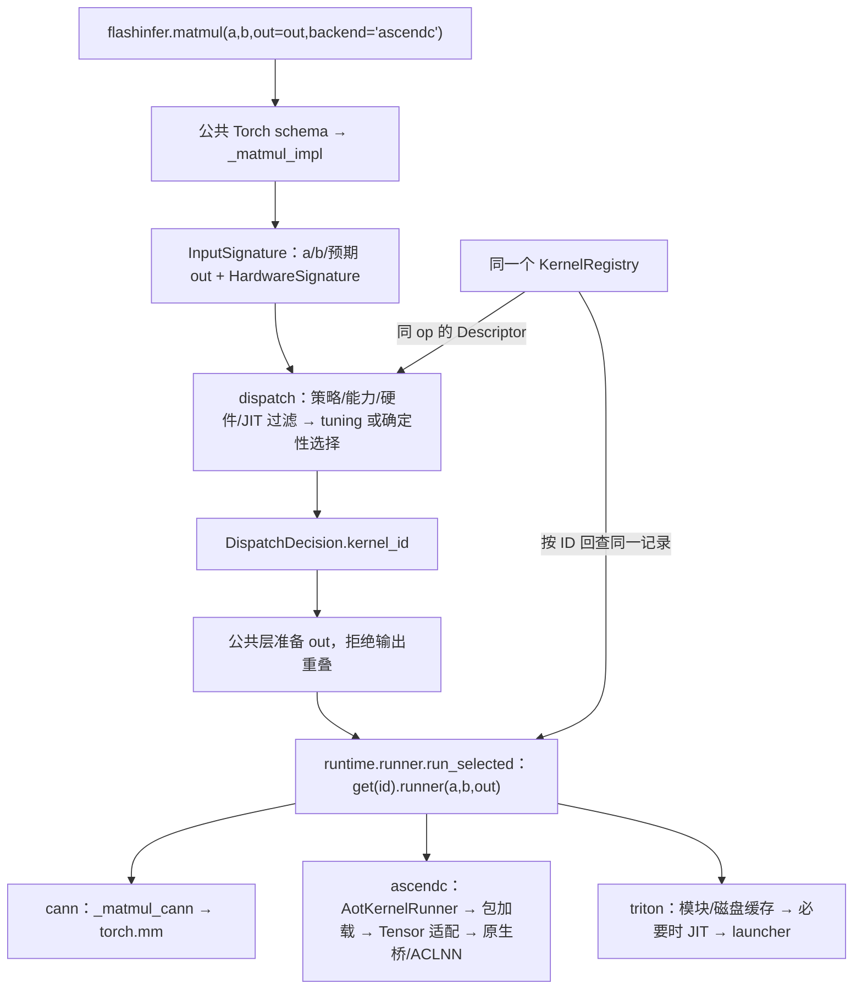

# Matmul：统一接口与三后端执行

`flashinfer.gemm.matmul` 和顶层 `flashinfer.matmul` 提供同一语义：`out = a @ b`。
调用方只指定输入、可选输出和选型参数；公共层完成元数据检查与输出分配，再交给 dispatcher 选中的 runner。

```python
import torch
import torch_npu
import flashinfer

a = torch.randn(32, 48, device="npu", dtype=torch.bfloat16)
b = torch.randn(48, 64, device="npu", dtype=torch.bfloat16)
out = torch.empty(32, 64, device=a.device, dtype=a.dtype)

for backend in ("cann", "ascendc", "triton"):
    assert flashinfer.matmul(a, b, out=out, backend=backend) is out

result = flashinfer.matmul(a, b, backend="auto")
```

## 共同输入与内存契约

当前共同范围为 Ascend950，二维 BF16，物理 ND，连续行主序：
`a[M,K]`、`b[K,N]`、`out[M,N]`，M/N/K 均为 16–256 的 16 倍数。
三条 descriptor 当前声明相同的 capability；公共元数据检查不读取 Ascend C recipe。
各候选分别通过自己的 admission 检查实现限制，Ascend C 候选绑定其冻结的 v2 recipe。
跨 Tensor 的收缩维、dtype、设备、输出形状和连续性也会检查。

未传 `out` 时，公共层在 dispatch 成功后分配一次输出；传入时直接使用原对象。
三个 runner 的 Tensor 调用 ABI 都是 `(a, b, out)`；不在后端进行输入转换、重排、补齐、分配替代输入或复制计算结果到另一个输出。
正 storage offset 的连续视图可直接使用；输出与任一输入重叠会拒绝。
后端内部的 workspace、host tiling 和设备临时存储属于各自执行实现。

非法元数据在执行或 JIT 之前拒绝；显式 backend 不可用时不会静默改用另一个后端。
这是同步 eager 接口。三个 descriptor 都是 `NOT_CAPTURABLE`，不承诺 autograd 或 aclgraph。

## 编译与路由

| `backend` | 实现与交付 | 运行期行为 |
| --- | --- | --- |
| `cann` | TorchNPU `torch.mm(..., out=out)` 调用已安装 CANN 内置算子 | 本仓不编译 CANN；descriptor 的 `compile_mode=none` 表示没有本仓构建步骤，厂商包已预编译 |
| `ascendc` | 本仓 native Ascend C BF16 MMAD，FP32 累加、BF16 直接写出 | 使用随 wheel 交付的 AOT op-package，host 按 shape 计算 tiling；包缺失明确失败 |
| `triton` | 本仓 `@triton.jit` Matmul | 首次执行经统一 JIT store 编译；同一进程复用 module，后续进程可复用已校验磁盘缓存 |

`backend=None` 遵循 `FLASHINFER_NPU_BACKEND`；显式 `auto` 使用自动选择。
自动选择先过滤能力和策略，再查询有效 tuning 记录；无记录时使用已配置的确定性顺序，默认 CANN 在本例中优先。
这不构成性能排名。当前没有发布 Matmul 性能记录，也没有同口径性能优势结论。
UT 使用明确标记的合成时钟验证 tuning 记录能够改变路由；合成数据只保存在测试临时库。

`kernel_id` 可以锁定登记的具体实现，仍须通过 capability 检查。
常规 `backend="triton"` 在 `FLASHINFER_NPU_JIT_DISABLE=1` 时被 dispatcher 拒绝。
已存在的 Triton 缓存复用通过禁用实际编译器的独立进程测试验证。

定制 Matmul 的 recipe 显式设为 `allow_jit_fallback=false`，即使全局允许 JIT，AOT 缺失也不会编译 Ascend C。
该可选字段的默认值为 true，默认值不写入序列化；原有 recipe/spec 身份保留。
其他已有 Ascend C 算子的缺包回落策略不由 Matmul 修改。

## 公共定义、三种实现与登记

三个后端采用同一层次，公共定义只有一份：

```text
flashinfer/
├── gemm.py                                  # matmul 公共 Python 接口
├── operators/gemm/matmul/operator.py         # 逻辑 op、公共 Torch schema/回调
├── ascendc/gemm/matmul/
│   ├── implementation.py                    # 实现声明、NATIVE 构建/ABI、绑定工厂
│   └── runner.py                            # 原生包 Tensor runner 工厂
├── cann/gemm/matmul/
│   ├── implementation.py                    # 实现声明、Capability、runner 绑定
│   └── runner.py                            # 已安装 TorchNPU torch.mm 调用
└── triton/gemm/matmul/
    ├── implementation.py                    # 实现声明、Capability、runner 绑定
    ├── runner.py                            # JIT spec、缓存和启动
    └── kernels.py                           # Triton 设备实现
csrc/kernels/gemm/matmul/              # Ascend C host/device 实现
```

`operators/gemm/matmul/operator.py` 属于所有实现共享的公共层，不是某个后端。
其 `OPERATOR.op="gemm.matmul"`；三个 `IMPLEMENTATION.op` 也都是 `gemm.matmul`。
三条 kernel_id 分别是 `cann/gemm/matmul_v1`、
`ascendc/gemm/matmul/native/op_package/Ascend950`、`triton/gemm/matmul_v1/Ascend950`。
不同实现通过共同的逻辑 op 关联，kernel_id 区分具体执行实现。

生成器将这些后端声明写入 `data/implementations.json`。运行时首次建立全局 Registry，
框架读取实现索引，校验声明并调用绑定工厂；Ascend C 再关联 `data/kernels/` 中的冻结元数据。
登记结果是三个带有 runner 的 Descriptor。登记不会执行 kernel 或触发编译。

| 项目 | Ascend C implementation | Triton implementation |
| --- | --- | --- |
| 共同身份 | `op=gemm.matmul`，`ImplementationDefinition` | 相同逻辑 op 和声明协议 |
| 具体身份 | `backend=ascendc`，独立 kernel_id | `backend=triton`，独立 kernel_id |
| Descriptor 来源 | 从 `NATIVE` 派生并冻结，运行时通过 `bind_kernel` 读取与绑定 | `descriptor()` 构造 Python 声明并绑定 runner |
| 实现限制 | Capability 加冻结 recipe 的 Tensor/shape ABI 检查 | Capability 加自身的对齐、连续性 admission |
| 编译和交付 | `NATIVE/BuildConfig` 描述 host/device、ABI、选项，构建 AOT op-package | runner 的 `spec()`、`_CONSTANTS`、`_OPTIONS` 描述 Triton JIT 输入 |
| 执行入口 | `AotKernelRunner` 延迟加载，调用 `runner.py:make_runner` 创建通用 Tensor 适配器 | `TritonMatmulRunner` 准备模块后按 grid 启动 kernel |
| 公共 runner 参数 | `(a, b, out)` | `(a, b, out)` |

## 一次调用如何选择实现

当前 Matmul 的 Python 门面是 `gemm.py` 中显式定义的函数，顶层 `__init__.py` 转导出；
它通过逻辑 `operator.py:torch_declarations()` 提供的 functional/out schema 进入同一回调：

```text
flashinfer.matmul / flashinfer.gemm.matmul
  → enable_aclnn 收集公共 Torch 声明（首次调用时注册）
  → torch.ops.flashinfer.matmul 或 matmul_out
  → operators/gemm/matmul/operator.py 的公共回调
  → gemm._matmul_impl：公共校验、输出元数据、InputSignature(op=gemm.matmul)
  → dispatch：过滤三个 Descriptor，返回选中的 kernel_id
  → 分配或复用 out，检查别名
  → run_selected(kernel_id, a, b, out)
  → 选中 Descriptor 的 runner
```

这里没有分别暴露三份公共 Matmul，也不会按导入哪个 implementation 文件来选型。
`kernel_id` 显式锁定的优先级高于有效的 `backend` 参数，仍检查能力、目标和 admission；
`backend` 只限制候选后端。`auto` 在过滤后优先使用有效 tuning 记录，否则采用配置顺序，
本例缺省为 CANN → Ascend C AOT → Triton JIT；这不是性能测量结果。
`DispatchDecision.fallback_chain` 是候选顺序信息，`run_selected` 只调用已选 runner 一次，
执行失败不会沿该列表自动切换。AOT 缺失与 Triton 编译错误也不会把当前调用改送其他后端。

逻辑定义中仍使用 `public_entry` 引用旧门面，公共检查位于 `_matmul.py`，
尚未改为 GMM 那种完整的 `schema/infer` 通用执行入口。
`AscendCOp` 是当前 Torch schema/回调声明对象的历史命名，并不把这个公共接口锁定到 Ascend C。

## 构建与安装

在已配置 CANN、TorchNPU、Triton 和 catlass 的构建环境中执行：

```bash
# 声明已冻结；单独构建并导出定制 Matmul AOT。
python -B -m flashinfer.aot \
  --kernel-id ascendc/gemm/matmul/native/op_package/Ascend950 \
  --cache-dir build/matmul/aot-cache --output-dir build/matmul/release

# 默认 wheel 自动包含四条生产 Ascend C 声明及公共 Torch/ACLNN 桥。
python -B setup.py bdist_wheel
```

完整 wheel 需要预编译 Matmul、MatmulBiasSiLU、FlashAttention 和 GroupedMatmulSwigluQuant 四个 Ascend C 包。
Triton Matmul 源码随 Python 包交付，运行期 JIT 产物留在本地缓存。
仅源码 wheel 不提供 native Matmul 的运行产物；选择 `ascendc` 时会明确报缺包。
隔离安装、检查 `flashinfer.__file__`、避免 editable 安装干扰的步骤见
[wheel 安装说明](../README-wheel-conda.md) 和 [完整交付流程](hands-on-flash-attention.md)。

```bash
# 安装后仅使用包内 AOT，自检不依赖源码树。
python -B -m flashinfer selftest

# 日常回归与 Matmul 专项真机测试。
python -B tools/run_regression.py --profile quick
python -B tools/run_regression.py --profile compile tests/test_matmul_real.py

# 发布或跨层改动执行 full；其中已包含 real_compile。
python -B tools/run_regression.py --profile full
```

## 实现与验收位置

框架、单次 Matmul 调用、缺省路由示例和后端接入见 [四页架构讲解](presentations/dispatcher.pptx) 与 [PDF 预览](presentations/dispatcher.pdf)。完整类型定义见 [dispatcher 数据结构参考](generated/dispatcher-data-models.md)。

| 层 | 文件 |
| --- | --- |
| 公共接口与统一输出准备 | `flashinfer/gemm.py`、`flashinfer/_matmul.py` |
| 按选中 ID 查找并调用 runner | `flashinfer/runtime/runner.py` |
| 公共定义与 Torch functional / out / FakeTensor | `flashinfer/operators/gemm/matmul/operator.py`；`flashinfer/aclnn/_ops.py` 负责收集注册 |
| CANN 声明与 runner | `flashinfer/cann/gemm/matmul/` |
| native host/device 与 recipe | `csrc/kernels/gemm/matmul/`、`csrc/recipes/matmul.json` |
| native 声明与 runner / 冻结交付元数据 | `flashinfer/ascendc/gemm/matmul/`；`flashinfer/data/kernels/registry.json`、`flashinfer/data/kernels/ascendc_specs.json` |
| Triton 声明、runner 与 kernel | `flashinfer/triton/gemm/matmul/` |
| 元数据、分配、路由、FakeTensor 与合成调优 UT | `tests/test_matmul.py` |
| 真机矩阵、AOT 错误、JIT 冷/热缓存与队列验证 | `tests/test_matmul_real.py`、`tests/matmul_acceptance.py` |

真机测试矩阵定义覆盖 7 组 shape、三后端、functional/out 两种形式，使用 BF16 量化输入的 CPU FP64 golden，容差 `atol=0.008, rtol=0.008`。
测试定义不代表当前环境已经通过执行验收；最近一次跨层迁移的实际结果与环境限制见 [迁移验收记录](reports/operator-layout-migration.md)。
另检查非默认 stream、TorchNPU 队列 0/1/2、正 storage offset、原始输入与输出指针、AOT 禁编译、缺包与损坏拒绝，以及 Triton 首次 JIT 和新进程磁盘命中。
这组样本不代表完整 shape 笛卡尔积已验证。

共享设备环境可设置 `FLASHINFER_TEST_NPU_DEVICE=1`，让 pytest 和数值验收脚本在指定设备运行；未设置时保留原选择方式。
此开关不隐藏设备，不改动“8 卡可见”、SoC、数值、编译计数或超时检查，也不影响生产 API。
regression 入口会同时处理生成的 Python 子进程探针，并在日志目录保存 `device.json`；这部分辅助不随 wheel 交付。

## Descriptor 的来源与统一登记

`gemm_descriptors()` 是提供描述记录的函数。CANN 与 Triton 的函数处于各自模块中，分别由
`cann_descriptors()`、`triton_descriptors()` 汇总，随后加入同一个 `KernelRegistry`。
同一数学接口由 `op="gemm.matmul"` 关联，具体实现由唯一 `kernel_id` 标识。
Registry 按 ID 保存记录，按 op 派生候选和来源栈视图；登记顺序不决定选择顺序。

| 实现 | 描述记录来源 | `runner` |
| --- | --- | --- |
| CANN | `flashinfer/cann/gemm/` 中的 Python 声明 | `_matmul_cann` 函数 |
| Triton | `flashinfer/triton/gemm/` 中的 Python 声明 | `TritonMatmulRunner` 可调用对象 |
| Ascend C AOT | `registry.json` 读取为 Descriptor，关联冻结 spec，再由 Python 绑定入口 | `AotKernelRunner` 可调用对象 |

manifest 是本仓 AOT 描述的当前来源。AOT 最终仍作为普通 `KernelDescriptor` 参与同一选择流程；
也可以由 Python 提供同样的描述，但仍需关联可信的构建、ABI 和产物身份。
构建 recipe、运行期 Descriptor 清单、冻结 spec 和实际产物凭证分属不同阶段。
当前公共契约存放在 native Matmul 的冻结声明中，CANN/Triton 复用其 capability；这不改变其 runner 指向。

## 从一次调用到 kernel

以传入 `out`、指定 `backend="ascendc"` 为例：



本次只执行选中的 Ascend C 分支，其他两列表示更换 backend 后的执行路径。普通选型先检查决策缓存；
未命中时只评估同 op 的候选，有效 tuning 也必须通过兼容性过滤。没有兼容候选时明确报错。
选型先决定来源栈，再决定栈内实现；默认排序使用 tier、priority 与 kernel_id。
`DispatchDecision` 返回身份和原因；执行由公共 `run_selected` 完成，失败不会遍历 `fallback_chain` 重试。

AOT runner 首次经 `resolve()` 查找、校验和加载 op_package，`runner_factory` 创建
`TorchOpPackageRunner`；后者复查 Tensor 并绑定原生桥，进入 ACLNN 两阶段 host tiling/launch。
已加载模块和内层 callable 在进程内复用。Triton 的决策缓存与编译产物缓存是不同层次。

BF16/FP16 自动路由在 PPT 中是隔离 Registry 的能力机制示例。当前生产公共门面与各 runner
仍共同约束 BF16；真正加入 FP16 时须同时满足公共契约和后端实现，不能只修改 Descriptor 的 dtype 声明。
复杂 shape×dtype 条件应扩展在兼容性过滤阶段，位于 tuning 与排序之前。

## 执行边界与再生成

三个 runner 遵守同一个 Tensor/out 契约，使用调用方的逻辑 NPU device 和当前 stream。
host tiling、workspace 和 launch 的组织由后端负责。TorchNPU host task_queue、runtime stream
与设备硬件队列分属不同层次，共享 stream 不等于具有相同 RTS 入口或物理 SQ/CQ。
原生桥的同步与队列契约见 [ACLNN/Torch 适配](aclnn-torch-adapter.md)，host/kernel 的详细时序见
[Attention 执行链说明](flash-attention-call-chain.md)。

文档工具只维护当前四页版。字体路径指向可用的中文 OTF/TTF，输出检查记录和预览放入已忽略的 `build/`：

```bash
python -B tools/build_dispatcher_slides.py --font /path/to/chinese-font.otf
python -B tools/inspect_dispatch_data_model.py
```

PPT 固定输出为 `docs/presentations/dispatcher.pptx`；可通过 LibreOffice 导出同名 PDF。
结构参考从当前源码提取，不手写重复字段清单。生成器直接检查隔离路由示例，不依赖某次测试日志或旧编译缓存。
