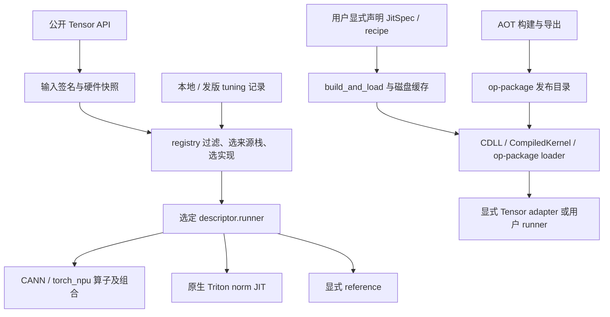

# 昇腾 flashinfer 对标竞品现状分析

> 本仓 `fbca115abc4c4992c827486aebe9b215a24dc444`（infer）· 上游 `da992ed99` · 2026-10-24
>
> R2 基准为已完整阅读的 `docs/reports/competitor-survey.md`，逐项主键取其 §5 的 45 行。
> 本轮只新增本文；代码、登记表、构建配置和 R1 报告均未修改。执行、路径与工作区核验见 §10。
>
> **引用口径**：本文对 `docs/framework_design.md` 的引用使用**行号**，指向上述基线
> `fbca115abc` 时点的该文件。该设计文档此后已更新（顶层章节重排，且本文 §8 列出的
> 若干处不一致已被修正），这些行号不再对应当前版本。按本文基线解析请用
> `git show fbca115abc:docs/framework_design.md`；复核本文结论应以该时点版本为准，
> 不要用当前版本的同名章节反推本文引述有误。

## 1. 结论速览（含四轴线一句话结论 + 总体成熟度判断）

**本仓已经具备可运行的 CANN/Triton 算子入口、调度和编译基础设施，但尚未形成“生产自研算子登记 → 自动 AOT 发现 → JIT 补齐 → 通用图执行”的完整交付链。**
不能按 `core.py` 等旧注释把它评价为纯骨架，也不能按设计文档把尚未接通的链路评价为成品。
本轮在已有 A5 Python 环境验证 139 个模块全部可导入；选定测试合计 **397 passed、3 failed、4 deselected**，三处失败均为既有 Attention ABI/wire 冻结指纹不匹配。
本轮未执行新的 NPU kernel 编译、数值对拍或 capture/replay；下文所有 A5 数值结果均明确标作仓内历史记录。
证据：`tools/check_imports.py:8`、`tests/test_runtime_abi.py:177`、`tests/test_attention_quant_launch_abi.py:202`、`tests/test_attention_metadata_wire.py:53`；实际命令见 §10.1。

| 轴线 | 一句话结论 | 关键证据 |
|---|---|---|
| JIT | 显式 `build_and_load` 的内容身份、磁盘缓存、并发去重和加载已实现；生产 Triton norm 仍走原生 Triton JIT，Attention generator 与生产 dispatch 未统一接入。 | `flashinfer/jit/build.py:109`；`flashinfer/jit/cache.py:248`；`flashinfer/triton/norm.py:19`；`flashinfer/jit/attention/modules.py:125` |
| AOT | op-package 构建、导出、显式校验加载和 ACLNN 两阶段执行已存在；**运行期自动 AOT 优先、缺失回落 JIT 尚未实现**。 | `flashinfer/aot/build.py:70`；`flashinfer/jit/op_package.py:172`；`setup.py:66`；`flashinfer/runtime/dispatch.py:74` |
| 入图 | 固定 buffer、plan 冻结、任务参数更新各有实现；默认 79 条 descriptor 中仅 1 条声明可入图，且限于有实测约束的 CANN single-decode runner。 | `flashinfer/attention/public_batch.py:169`；`flashinfer/attention/execution_identity.py:137`；`flashinfer/runtime/_graph_params.py:223`；`flashinfer/cann/attention.py:10` |
| 自定义算子（catlass） | native/CATLASS 双实现、recipe、CMake、显式加载及 torch.library 桥已由固定 GEMM 探针串联；CATLASS 可选，多 SoC 主要是 native op-package 交叉编译，尚无生产 Ascend C 登记项。 | `flashinfer/jit/recipe.py:59`；`csrc/recipes/matmul_probe.json:1`；`flashinfer/jit/torch_library.py:48`；`flashinfer/data/kernels/registry.json:4` |

成熟度应分层判断：host 契约与负例检查较充分，CANN 适配是默认真实执行主线，自研编译/分发处于“有实机探针和显式入口、生产整合待完成”的阶段。
默认登记的 **CANN 40、reference 38、Triton 1、Ascend C 0** 是实现条目数，不是 79 个独立算子，更不是 79 个都经过同等实机验证。
`get_global_registry()` 由 Python descriptor factory 构建；空 JSON 并不意味着这些入口不存在。
证据：`flashinfer/runtime/registry.py:280`、`flashinfer/runtime/registry.py:301`；§6.4 给出独立统计口径，§10 给出脚本。

另一个评审前提是**对标版本发生过变化**：现有 parity 账本仍钉在上游 `289557772`，其 bootstrap inventory 不能直接作为本轮 `da992ed99` 的覆盖率。
CLI 实测给出通用账本 325 symbols、129 pending gaps、`release-compatible: no`，完整性检查通过不表示功能齐备。
证据：`flashinfer/data/api_parity.json:1`、`flashinfer/cli.py:51`；R1 的新基准见 `docs/reports/competitor-survey.md:3`。

## 2. 本仓实际架构（代码里真实的分层与数据流）

### 2.1 实际存在的层次

| 层次 | 真实职责与数据 | 代码证据 |
|---|---|---|
| API façade | norm、activation、GEMM、sampling 等组织输入签名，分配/检查输出，调用选中 runner；部分可显式切换 torch.library 边界。 | `flashinfer/norm.py:46`、`flashinfer/norm.py:96`；`flashinfer/__init__.py:9` |
| 通用 runtime | `InputSignature` 描述 dtype/shape/逻辑与物理 layout/特化；`HardwareSignature` 描述系列 SoC、核数、UB；registry 管 descriptor 和来源栈，dispatch 过滤、排序、缓存决策。 | `flashinfer/runtime/signature.py:14`；`flashinfer/runtime/hardware.py:19`；`flashinfer/runtime/registry.py:35`；`flashinfer/runtime/dispatch.py:130` |
| 后端适配 | CANN runner 延迟导入 torch/torch_npu，调用已有算子或组合 Tensor 运算；Triton norm 直接启动 DSL kernel；reference 必须显式准入。 | `flashinfer/cann/moe.py:76`；`flashinfer/cann/attention.py:125`；`flashinfer/triton/norm.py:19`；`flashinfer/runtime/dispatch.py:264` |
| Attention 公共张量桥 | single 入口按 ReferenceTensor / tensor-like provider / 真实 Tensor 分流；public batch 负责 metadata、plan、workspace，再执行 CANN 组合路径。 | `flashinfer/_single_attention.py:33`、`flashinfer/_single_attention.py:77`、`flashinfer/_single_attention.py:133`；`flashinfer/attention/public_batch.py:379`、`flashinfer/attention/public_batch.py:593` |
| Attention 独立契约体系 | schema、plan、tensor view、wire、artifact、provider、receipt、accuracy/trace 多层；可注入外部 callable，但默认 package runtime specs 为空。它不是通用 registry 的别名。 | `flashinfer/attention/operator_bootstrap.py:388`；`flashinfer/attention/operator_execution.py:89`；`flashinfer/attention/torch_adapter.py:93` |
| 显式 JIT/AOT 工具链 | spec/recipe → backend.compile → 校验/发布 → loader；AOT 复用编译后导出 op-package。当前 API 调度不会自动替调用者完成全部步骤。 | `flashinfer/jit/build.py:109`；`flashinfer/jit/ascendc.py:102`；`flashinfer/aot/build.py:70` |
| 图与编译适配 | torch.library 定义不透明 Tensor op；独立 NPU 扩展录制、更新 aclgraph task；两者不是同一项兼容性。 | `flashinfer/_torch_library.py:90`；`flashinfer/npu.py:34`；`flashinfer/runtime/_graph_params.py:193` |
| 性能证据层 | 显式测量 → SQLite 本地/发版记录 → dispatch 查询；普通 dispatch 不自动测量，也没有自动搜索 tactic 空间。 | `flashinfer/tuning/benchmark.py:162`；`flashinfer/tuning/store.py:268`；`flashinfer/runtime/dispatch.py:330` |



图中未画“dispatch 自动扫描 AOT/JIT”的连线，因为该调用不存在。
`build_and_load` 明确声明 dispatch/status 不会触发它；norm 选中没有 runner 的 descriptor 时直接报错。
`fallback_chain` 是可解释的候选顺序，当前源码仅构造与打印它，没有执行失败后遍历它重试的通用引擎。
证据：`flashinfer/jit/build.py:114`；`flashinfer/norm.py:35`；`flashinfer/runtime/dispatch.py:353`、`flashinfer/runtime/dispatch.py:509`。

### 2.2 选型、计划与执行的实际边界

通用 dispatch 先检查 backend policy、自定义 opt-in、reference opt-in、capability、SoC target 与 JIT disable；
再查有效 tuning 冠军，否则采用默认 `external > cann > aot > jit > reference`，同档按 priority 和 kernel_id。
两级来源栈选择仍复用这一排序，并非新的性能算法；显式 kernel_id 只做 capability/target 检查，绕过普通排序和 JIT 过滤分支。
证据：`flashinfer/runtime/dispatch.py:202`、`flashinfer/runtime/dispatch.py:241`、`flashinfer/runtime/dispatch.py:309`；
`flashinfer/config.py:42`。本轮 79 条默认记录的审计未发现同一 op/source 的多配置组，不能把两级抽象等同于已有丰富候选优化空间。
统计工具：`tools/t19_selection_audit.py:27`、`tools/t19_selection_audit.py:75`。

batch Attention 的 plan 确实缓存决策和资源身份，但 run 仍是 Python 逐请求 gather、调用 FIA、拼接/复制输出。
通用 `Plan.workspace_bytes` 仍为零占位，实际 T10 workspace 管理在 Attention 自己的 contract 中；不能画成统一 C++ scheduler 生成 plan vector 的模型。
CANN MoE 也有 `.cpu()`、`.tolist()`、`.contiguous()` 等组合操作，因此设计中“run 无同步、无分配”还不是全库性质。
证据：`flashinfer/runtime/plan.py:17`；`flashinfer/attention/public_batch.py:593`；`flashinfer/attention/workspace.py:136`；
`flashinfer/cann/moe.py:61`、`flashinfer/cann/moe.py:111`。

### 2.3 三种“登记/清单”必须分开

1. **通用运行期 registry：79 条。** Python factory 首次构建后 freeze，允许专门入口新增 external/custom；有 runner 不等于有自研 artifact。证据：`flashinfer/runtime/registry.py:81`、`flashinfer/runtime/registry.py:96`、`flashinfer/runtime/registry.py:301`。
2. **随包 kernel manifest：0 条。** `flashinfer/data/kernels/registry.json:4` 的 `kernels=[]`；CLI `list-kernels` 只读此表，实测输出 `No runnable kernels are registered.`。这条诊断不能代表默认 runtime registry。证据：`flashinfer/cli.py:62`。
3. **Attention package provider 默认集：0 条。** capability JSON 的 profiles 为空，默认 runtime specs 也为空；外部 evidence/loader/callable 机制存在，但默认没有具体 provider 被声明。证据：`flashinfer/data/attention_capabilities.json:4`；`flashinfer/attention/operator_bootstrap.py:388`。

## 3. 逐项对标矩阵（对 R1 基准清单逐行，四态 + 证据）

判定采用题目列出的标记：✅ 已实现且有可运行路径和测试/样例/实测证据；🟡 契约/接口已备但目标链未接通；🟠 只覆盖机制的一部分；❌ 未发现对应实现；⬜ 有明确架构理由而有意不做。
✅ 只覆盖该行写明的机制范围，不自动外推到全部 API、SoC 或生产发布；历史测试记录与本轮结果分列。
对“不存在”的判定，证据列给出相邻真实入口及其边界，并在相关章节说明检索范围；不为不存在的文件编造行号。
原始机制定义及上游文件见 R1 §5（`docs/reports/competitor-survey.md:1087`），本表严格保留全部 45 个主键。

| ID / R1 机制 | 状态 | 昇腾当前实现、范围和缺口 | 文件:行号证据 |
|---|---|---|---|
| JI-01 特化规格 | ✅ | immutable JitSpec、backend protocol、build/verify/publish/load 已运行；本轮 host JIT 21 测试通过。 | `flashinfer/jit/core.py:56`；`flashinfer/jit/backends.py:26`；`flashinfer/jit/build.py:109`；`tests/test_jit_build.py:98` |
| JI-02 模板生成 | 🟡 | Attention variant/spec 生成仅形成身份/契约，无 Jinja 展开及可编译 Attention translation unit；Ascend C 探针用静态源。 | `flashinfer/jit/attention/modules.py:125`、`flashinfer/jit/attention/modules.py:161`；`flashinfer/jit/core.py:162`；`flashinfer/jit/ascendc.py:134` |
| JI-03 编译缓存身份 | ✅ | 完整 spec 的 canonical SHA-256，绑定源、环境、特化、flags、符号、路径；recipe 再加入依赖和构建输入。 | `flashinfer/jit/core.py:210`、`flashinfer/jit/core.py:253`；`flashinfer/jit/backends.py:248`；`tests/test_jit_build.py:209` |
| JI-04 增量有效性 | 🟠 | 内容寻址及发布目录 inventory 校验已接通；原源码更新需重新声明 spec，不是命中后 Ninja 依赖图检查，也不扫描任意隐式 include。 | `flashinfer/jit/cache.py:213`；`flashinfer/jit/recipe.py:304`；`flashinfer/jit/build.py:76`；`tests/test_jit_build.py:162` |
| JI-05 编译并发与去重 | ✅ | per-spec flock、锁内复查、原子 generation、loader LRU；双进程/线程测试通过。CMake 并发固定 -j2，资源配置弱于上游。 | `flashinfer/jit/cache.py:311`、`flashinfer/jit/cache.py:349`；`flashinfer/jit/ascendc.py:190`；`tests/test_jit_build.py:98`、`tests/test_jit_build.py:126` |
| JI-06 批量预热 | ❌ | 无对应 spec 清单并行预热入口；当前单 spec 构建及 AOT 顺序循环不能等价于 subninja prebuild。 | `flashinfer/jit/build.py:109`；`flashinfer/aot/build.py:87` |
| JI-07 架构上下文 | 🟠 | 显式 target/environment/toolchain、有限 SoC 映射存在；hardware 缓存 device 0，缺统一多目标 CompilationContext。 | `flashinfer/jit/env.py:37`；`flashinfer/runtime/hardware.py:77`；`flashinfer/jit/ascendc.py:119`；`flashinfer/jit/op_package.py:28` |
| JI-08 Python callable 形成 | 🟠 | CDLL/dlsym、Triton CompiledKernel、ACLNN 两阶段均存在；通用 typed Tensor FFI 未齐，Ascend C Tensor 桥限固定 GEMM。 | `flashinfer/jit/loading.py:298`、`flashinfer/jit/loading.py:351`；`flashinfer/jit/torch_library.py:124`；`flashinfer/jit/op_package.py:142` |
| JI-09 DSL 持久缓存 | 🟠 | npubin/IR/metadata/CPU launcher 持久化与版本校验有历史 cache-only 实测；依赖 Triton 3.6 ABI，生产 norm 绕过统一缓存。 | `flashinfer/jit/_triton_compile.py:67`；`flashinfer/jit/loading.py:306`；`flashinfer/triton/_norm_kernels.py:50`；`docs/reports/T18B-report.md:220` |
| JI-10 生成程序身份 | 🟠 | source/host/target/options/构建依赖可内容寻址；尚无 Cake 式通用生成程序工厂，Attention 生成源仍是契约。 | `flashinfer/jit/recipe.py:59`、`flashinfer/jit/recipe.py:288`；`flashinfer/jit/core.py:210`；`flashinfer/jit/attention/modules.py:125` |
| JI-11 NVRTC 嵌入路线 | 🟠 | 离线设备 ELF 与 host ABI 组合由 op-package 实现子集；无 NVRTC 式 source string→设备对象→嵌入 host object 的对应服务，也无任意跨模块 device linking。CUDA NVRTC 格式本身不作为移植目标。 | `flashinfer/jit/ascendc.py:192`；`csrc/cmake/OpPackage.cmake:1`；`flashinfer/jit/op_package.py:71`；`docs/ascendc_aot.md:183` |
| JI-12 懒加载与 capture 预热 | 🟠 | Triton 首次调用 lazy import、显式预构建可行；缺统一 capture 中禁首次编译检查和 wrapper plan 自动 prewarm。 | `flashinfer/triton/norm.py:19`；`flashinfer/jit/build.py:114`；`examples/jit_a5.py:104` |
| AO-01 AOT 清单粒度 | 🟠 | recipe × target 可枚举，当前只有 GEMM 探针配置；没有 attention dtype/head-dim 功能矩阵。 | `csrc/recipes/matmul_probe.json:1`；`flashinfer/aot/build.py:70` |
| AO-02 wheel 职责切分 | 🟠 | 可把 op-package 附加进主 wheel；没有上游 shim/按目标 provider/device-artifact 三类分包体系。 | `setup.py:1`；`setup.py:66`；`pyproject.toml:26` |
| AO-03 provider 发现 | 🟡 | 有 manifest、显式 directory loader 和自定义 registry 接口；没有已安装 AOT provider 的自动发现/版本选择入口。 | `flashinfer/aot/__init__.py:19`；`flashinfer/jit/op_package.py:172`；`flashinfer/runtime/registry.py:301` |
| AO-04 AOT 优先级 | 🟡 | aot/jit tier 已排序，但未接包内 AOT discovery、load failure 与 JIT fallback；显式加载能力不能代替自动策略。 | `flashinfer/runtime/dispatch.py:74`、`flashinfer/runtime/dispatch.py:353`；`flashinfer/norm.py:35`；`flashinfer/jit/build.py:126` |
| AO-05 异构设备分发 | ❌ | 有 target 校验，无按当次 Tensor 所在设备分派多目标 AOT module 的对应对象；全局 hardware 只探测设备 0。 | `flashinfer/runtime/hardware.py:87`、`flashinfer/runtime/hardware.py:101`；`flashinfer/jit/op_package.py:172` |
| AO-06 严格预编译运行 | 🟠 | 显式 op-package 可无编译器加载；JIT cache-only/disabled 可阻止 miss，但接受有效本地 JIT cache，无上游 AOT-only provider 覆盖门禁。 | `flashinfer/jit/build.py:61`；`flashinfer/jit/op_package.py:172`；`docs/ascendc_aot.md:183`；`tests/test_jit_build.py:222` |
| AO-07 artifact 版本与完整性 | 🟠 | SHA-256/size、spec/record、包 manifest、目标/符号/ELF 校验真实执行；无上游远端发布 pin 链，旧 ArtifactManifest.verify 未进入实际加载链。 | `flashinfer/jit/cache.py:213`；`flashinfer/jit/op_package.py:71`；`flashinfer/aot/__init__.py:27` |
| AO-08 下载并发与离线 | ❌ | 未实现远端 artifact 下载、mirror、retry、NO_DOWNLOAD 等价服务；本地离线导出及缓存锁不构成下载器。 | `flashinfer/aot/build.py:42`；`flashinfer/jit/cache.py:248`；`flashinfer/cli.py:1` |
| AO-09 cubin 与 host 组合 | 🟠 | op-package 包含设备对象与 host ACLNN 库，加载器设置 vendor OPP 路径；没有上游按 hash callback 拉取独立设备 artifact 的机制。 | `flashinfer/jit/op_package.py:54`、`flashinfer/jit/op_package.py:172`；`csrc/cmake/OpPackage.cmake:1` |
| RT-01 注册辅助器有效性 | ✅ | helper 真调用 torch.library；显式 enable 后注册，与上游 identity helper 不同。本轮注册测试通过。 | `flashinfer/utils.py:15`、`flashinfer/utils.py:39`；`flashinfer/_torch_library.py:90`；`tests/test_torch_library.py:248` |
| RT-02 有效 custom op 与 fake | 🟠 | 两个 norm 的 mutation/fake 已接，另有用户 AscendCOp；并非所有公开算子和 Attention 都注册。 | `flashinfer/_torch_library.py:50`、`flashinfer/_torch_library.py:90`；`flashinfer/_meta/ascendc.py:4` |
| RT-03 compile 真实边界 | 🟠 | 显式启用的 norm、固定 Ascend C GEMM 有 fullgraph 测试/历史 NPU 记录；不能外推全包、所有 wrapper 或 aclgraph。 | `tests/test_torch_library.py:263`、`tests/test_torch_library.py:291`；`tests/test_ascendc_torch_library.py:316`；`docs/reports/T14-report.md:125` |
| RT-04 图模式 wrapper | 🟠 | decode、专用 CUDAGraph decode、paged/ragged prefill 有固定资源参数；batch descriptor 未获可捕获声明，recording 显式拒绝组合路径。 | `flashinfer/decode.py:74`、`flashinfer/decode.py:194`；`flashinfer/prefill.py:93`、`flashinfer/prefill.py:251`；`flashinfer/cann/attention.py:217` |
| RT-05 图 metadata 更新 | 🟠 | plan 原位 copy_ CSR/mask/block table 已有；host 参数更新仅 single decode 有有限实测，尚未串成通用 batch replay。 | `flashinfer/attention/public_batch.py:205`、`flashinfer/attention/public_batch.py:404`；`flashinfer/runtime/_graph_params.py:223`；`tests/test_replay_param_npu.py:111` |
| RT-06 图计划容量 | 🟠 | 固定 metadata、batch、max workspace 有检查；paged prefill 仅显式给 max_total_num_rows 时检查 Q 行数；缺设备 scheduler padding/valid-mask/split-KV 计划物化。 | `flashinfer/attention/public_batch.py:169`、`flashinfer/attention/public_batch.py:259`、`flashinfer/attention/public_batch.py:438`；`flashinfer/runtime/plan.py:22` |
| RT-07 图重规划限制 | 🟠 | 首次成功 plan 冻结 backend/batch/q_len/kernel 等；改变要求新 wrapper。缺 MLA 多后端 replan 能力矩阵。 | `flashinfer/attention/execution_identity.py:137`；`flashinfer/attention/public_batch.py:387`；`tests/test_attention_graph_plan.py:118` |
| RT-08 piecewise 集成边界 | 🟠 | 有单算子 full-forward capture/update 证据；没有 MoE 区域 piecewise 与下游切图整合证据，模型图模式由调用方管理。 | `flashinfer/npu.py:34`；`tests/test_replay_param_npu.py:61`；`docs/reports/T11B-report.md:44` |
| RT-09 后端支持检查 | ✅ | CapabilitySpec、target、policy、opt-in 筛选及 explain 已真实运行；CPU 调度测试通过，设备库存在性仍需 runner 实际调用确认。 | `flashinfer/runtime/dispatch.py:241`；`flashinfer/runtime/registry.py:58`；`tests/test_dispatch.py:78`、`tests/test_dispatch.py:210` |
| RT-10 局部 auto 策略 | 🟠 | 通用来源栈+档位+有效 tuning winner；没有上游各算子丰富的 backend heuristic/tactic 集合，默认每 op/source 仅一配置。 | `flashinfer/runtime/dispatch.py:318`；`tools/t19_selection_audit.py:75`；`flashinfer/tuning/store.py:316` |
| RT-11 运行期 autotune | 🟠 | 显式候选采样、噪声判据和 winner 持久化可运行；dispatch 仅读记录，ONLINE_TUNING 开关未接自动探索。 | `flashinfer/tuning/benchmark.py:162`；`flashinfer/runtime/dispatch.py:330`；`flashinfer/config.py:89`；`tools/t20_collect_gemma.py:130` |
| RT-12 调优缓存 identity | 🟠 | signature/bucket/hardware/descriptor/capability 指纹校验；未把所有软件栈版本和 JIT 实时身份绑定为可比字段。 | `flashinfer/tuning/store.py:66`、`flashinfer/tuning/store.py:173`；`flashinfer/runtime/schema.py:914`；`docs/reports/T20B-report.md:380` |
| RT-13 managed autotune | 🟠 | 本地 SQLite → 随包 SoC shard → heuristic，损坏拒绝、显式 reload、原子发版导出；发布 manifest 为空，无上游 v2 环境散列及 tune/replay context 等价覆盖。 | `flashinfer/tuning/store.py:268`；`flashinfer/tuning/_release.py:59`；`flashinfer/tuning/data/manifest.json:3`；`tests/test_tuning.py:159` |
| RT-14 调优/捕获边界 | 🟠 | setup 在捕获外、显式 warmup 已有；无统一 active-capture 中禁止首次 profiling/JIT 的执行门禁。 | `flashinfer/utils.py:54`；`flashinfer/tuning/benchmark.py:162`；`tests/test_replay_param_npu.py:68`；`flashinfer/jit/build.py:109` |
| RT-15 两阶段执行 | 🟠 | public batch plan 保存 host 元数据、决策、资源，run 复用；无与上游同层级的设备 scheduler plan vector。 | `flashinfer/attention/public_batch.py:379`、`flashinfer/attention/public_batch.py:516`、`flashinfer/attention/public_batch.py:593`；`flashinfer/runtime/plan.py:17` |
| RT-16 workspace 管理 | 🟠 | caller-owned 固定地址/字节要求、FIA max 查询已接；int workspace 仍 empty(0)，无通用 pinned/device staging 或全局 retired scratch。 | `flashinfer/attention/public_batch.py:111`、`flashinfer/attention/public_batch.py:432`；`flashinfer/attention/workspace.py:136`；`flashinfer/cann/attention.py:183` |
| EX-01 源码与依赖交付 | 🟠 | 默认 wheel 复制 csrc/kernels/ascendc 构建输入，安装后 native probe 可编译；CATLASS 头文件须另供固定 Git checkout，尚无上游多包依赖交付体系。 | `MANIFEST.in:1`；`setup.py:34`、`setup.py:45`；`flashinfer/aot/build.py:29`；`flashinfer/jit/recipe.py:317` |
| EX-02 Python 导出与 lazy | ✅ | 顶层 API 与新扩展导出存在，重依赖按执行延迟导入；默认无 torch 环境 import 成功，已有 A5 环境 139 模块导入成功。 | `flashinfer/__init__.py:9`；`flashinfer/norm.py:82`；`flashinfer/triton/norm.py:3`；`tools/check_imports.py:8` |
| EX-03 CLI 与诊断 | 🟠 | config、parity、host Attention trace/corpus 工具可跑；缺上游 artifact 安装/下载、完整 cache 状态治理，list-kernels 与通用 registry 口径不同。 | `flashinfer/cli.py:38`、`flashinfer/cli.py:62`、`flashinfer/cli.py:109`；`flashinfer/__main__.py:1` |
| EX-04 自定义普通算子 | 🟠 | recipe→CMake→host/op-package→显式 loader→torch.library 探针链有实测；外部任意算子仍需自写 launch、meta、runner 及生产登记/AOT发现。 | `flashinfer/jit/recipe.py:59`；`flashinfer/jit/torch_library.py:25`；`flashinfer/runtime/registry.py:313`；`docs/reports/T14-report.md:125` |
| EX-05 外部 attention variant | 🟠 | single JIT module 的 run/extra args 注入协议可用；没有 variant 源码编译闭环，public batch 拒绝 jit_args/jit_kwargs/variant_owns_mask。 | `flashinfer/_single_attention.py:141`、`flashinfer/_single_attention.py:183`；`flashinfer/attention/public_batch.py:44`；`flashinfer/jit/attention/modules.py:125` |
| EX-06 通信集成生命周期 | 🟠 | MoE EP 分支能接调用方提供的 megaMoe 通信上下文；无本仓 Fleet/Handle 的 dispatch/combine/complete 生命周期，实机多卡未验证。 | `flashinfer/cann/moe.py:34`；`flashinfer/fused_moe.py:124`；`flashinfer/runtime/registry.py:280` |
| EX-07 日志与设备 profiler | 🟠 | explain、构建日志、host trace/replay 有实现；没有 kernel 内事件→Perfetto，host Attention 明确拒绝 profiler data。 | `flashinfer/runtime/dispatch.py:486`；`flashinfer/jit/ascendc.py:200`；`flashinfer/attention/trace.py:314`；`flashinfer/attention/holistic.py:323` |
| EX-08 外部方案替换 | 🟠 | custom runner 和 Attention package/callable/evidence 注入接口存在；默认 provider 空，未形成通用 TraceTemplate/Solution 匹配及 Python/C++ 自动替换层。 | `flashinfer/runtime/registry.py:313`；`flashinfer/attention/operator_execution.py:89`；`flashinfer/attention/holistic.py:110`；`flashinfer/attention/operator_bootstrap.py:388` |

本表没有把通用机制缺失归为 ⬜。明确有意不同的是 CUDA 二进制兼容、NVIDIA 专有后端/PDL，以及由调用方管理模型级图策略；这些理由不能用来豁免 AOT 自动发现、缓存或设备代码/host ABI 组合等通用需求。
证据：`docs/framework_design.md:36`；`flashinfer/runtime/dispatch.py:152`；`flashinfer/norm.py:7`；`flashinfer/npu.py:34`。

### 3.1 八条待验证线索逐条复核

| 线索 | 复核结论 | 核查后的事实及证据 |
|---|---|---|
| 1. kernel JSON 空、无生产 Ascend C 登记 | **确认** | JSON kernels=0；默认 Python registry 也无 ascendc/ascendc_aot/ascendc_jit 项。但 CANN/reference/Triton 的 79 项不依赖该 JSON。`flashinfer/data/kernels/registry.json:4`；`flashinfer/runtime/registry.py:280`。 |
| 2. 完全不存在运行期 AOT 加载 | **部分正确，推翻绝对说法** | 自动扫描随包 op_packages、AOT 优先/JIT 兜底确实未接；旧 ArtifactManifest.verify 无实际调用。但 `load_op_package` 已真实校验、CDLL 和 ACLNN 执行，并被 JIT loader、示例消费。`flashinfer/jit/op_package.py:172`；`flashinfer/jit/loading.py:390`；`flashinfer/aot/__init__.py:27`。 |
| 3. 79 条中 1 条可入图 | **确认** | 79=40 CANN+38 reference+1 Triton；78 not_capturable、1 needs_param_update、0 capture_safe。唯一 single_decode_fia_v1，更新 actual_seq_lengths_kv。统计见 §6.4；声明见 `flashinfer/cann/attention.py:10`。 |
| 4. legacy key 且唯一顶层 JIT 导出 | **部分正确** | 磁盘身份确为 JitSpec.fingerprint；“唯一”错误，顶层还导出 toolchain_fingerprint。`flashinfer/jit/cache_key.py:1`；`flashinfer/jit/core.py:253`；`flashinfer/__init__.py:28`、`flashinfer/__init__.py:136`。 |
| 5. 11 个 real_compile，全是 gcc | **推翻** | rg 与 AST 均得 15 个标记函数、4 文件：jit_build=11、norm=2、torch_library=1、ascendc_torch_library=1。后几类有真实 NPU/Triton/bisheng 用例；参数化后的测试 case 数不是 15。`tests/test_norm.py:493`、`tests/test_norm.py:518`；`tests/test_torch_library.py:291`；`tests/test_ascendc_torch_library.py:316`。 |
| 6. 真实执行仅三条，Ascend C 仅 examples | **部分正确** | 三类实现主线成立；40 是 CANN 登记数，不能等同 40 项逐项实测。Ascend C 的源码、构建、loader、torch.library 已在库内，examples 是演练入口，仍未进生产登记；Triton 历史还执行 add_one 探针，不能作恰三 kernel 的枚举。`docs/reports/T1-report.md:9`；`docs/ascendc_aot.md:183`；`docs/reports/T18B-report.md:54`；`flashinfer/jit/torch_library.py:124`。 |
| 7. Attention 53 文件且仅两个张量桥 | **部分正确** | 53 个 .py 数量属实，大量为 host 契约；“仅两个”被 TorchTensorViewAdapter 等反例推翻。provider 契约可接 callable，并不意味默认有 NPU provider。`flashinfer/attention/torch_adapter.py:93`、`flashinfer/attention/torch_adapter.py:121`；`flashinfer/attention/operator_execution.py:89`；`flashinfer/attention/operator_bootstrap.py:388`。 |
| 8. T1 等未勾选说明当前不能 import/CLI | **部分正确，当前导入阻塞推翻** | T1/T2/T5/T15/T16/T17 的未勾选属实；默认 python import/CLI 成功，A5 环境 139 模块导入 0 失败。T1 报告已记录恢复，剩余 ABI 指纹失败本轮也复现；不是现在仍被 SchemaError 阻塞，也不能断言 T1 全部完成。`docs/TASKS.md:72`、`docs/TASKS.md:124`、`docs/TASKS.md:205`；`docs/reports/T1-report.md:13`、`docs/reports/T1-report.md:34`；`flashinfer/runtime/schema.py:66`。 |

## 4. 轴线一 · JIT

### 4.1 真实身份不是顶层 legacy key

`build_cache_key(signature, hardware, toolchain)` 仍可调用，内容为 input、SoC/核数、toolchain 字符串及 schema；它的注释已明确“Legacy / not a complete build identity”。
实际 `DiskJitBuildStore` 使用 `JitSpec.fingerprint`，即完整 `to_dict()` 的 canonical JSON SHA-256。
顶层同时再导出 `build_cache_key` 和 `toolchain_fingerprint`；新的 `JitSpec/declare_kernel/build_and_load` 在 `flashinfer.jit` 子包中。
证据：`flashinfer/jit/cache_key.py:46`；`flashinfer/jit/core.py:35`、`flashinfer/jit/core.py:210`、`flashinfer/jit/core.py:253`；
`flashinfer/jit/cache.py:259`；`flashinfer/__init__.py:28`；`flashinfer/jit/__init__.py:19`。

| 身份层 | 实际字段或来源 | 限制与证据 |
|---|---|---|
| 通用 JitSpec | schema_version、name、domain、generator_id/version、target_soc、environment_fingerprint、specialization_fingerprint、input_fingerprints、source_artifacts、compile_options、entry_points | input_fingerprints 按名排序，options 保留顺序；`flashinfer/jit/core.py:118`、`flashinfer/jit/core.py:146`、`flashinfer/jit/core.py:210`。 |
| 可执行 compilation unit | 追加 kernel_id、完整 SourceRef（language/locator/digest）、output_path；必须恰好一个 entry point | 旧 Attention spec 不具备这三个字段时，不能直接视为编译单元；`flashinfer/jit/core.py:162`。 |
| backend 声明 | descriptor fingerprint、target、输出、entry、环境、特化、flags、包版本组成 name/input 摘要 | `flashinfer/jit/backends.py:82`；并不是从任意 Tensor 自动推断所有特化字段。 |
| JitEnvironment | SoC/revision、CANN、compiler id/version、torch、torch_npu、Python ABI、build type、features | 是显式契约，本身不探测；泛型/Triton 调用方必须提供准确环境身份。`flashinfer/jit/env.py:37`。 |
| Ascend C 补充身份 | build_recipe、resolved_recipe；显式源/头/CMake 文件摘要，依赖 revision 与实际 header tree，工具链指纹；op-package 加 output_adapter | `flashinfer/jit/backends.py:234`；`flashinfer/jit/recipe.py:288`、`flashinfer/jit/recipe.py:304`。 |
| 工具链实测指纹 | bisheng、CMake、host C++ 文件摘要/版本，CANN 及其构建辅助输入，host ABI、adapter 源码摘要 | discover/validate 是显式构建阶段行为；`flashinfer/jit/ascendc.py:29`、`flashinfer/jit/ascendc.py:54`、`flashinfer/jit/ascendc.py:85`。 |

缓存承诺有明确前提：**改源后必须更新 SourceRef/recipe 并重新声明 spec**。
命中旧 spec 时校验的是已发布的旧内容，不会去原源码树追踪变化；miss 时发现源 bytes 与声明 digest 不符会拒绝编译。
因此“所有环境/源变化都能自动失效”超出了当前机制，尤其生产 descriptor 没声明的依赖不可能自动加入身份。
证据：`flashinfer/jit/build.py:76`；`flashinfer/jit/backends.py:159`；`flashinfer/jit/recipe.py:225`。

### 4.2 缓存目录和命中/未命中

以下为**运行期生成布局模式**，不表示这些路径已在源码树中存在。

```text
${FLASHINFER_NPU_CACHE_DIR:-~/.cache/flashinfer}/jit/
  user/<namespace>/                 # 显式使用 namespace 时，其下布局相同
  <sha[:2]>/<sha> -> ../../.objects/<sha>-<uuid>
  .objects/<sha>-<uuid>/
    manifest.json                   # schema_version / spec / files / record
    build.log                       # 不进入文件完整性 inventory
    <spec.output_path>              # host .so / NPU binary / op-package.json
    source.py / request.json / triton.json / triton-cache/  # Triton 分支
    ascendc-recipe.json              # Ascend C 构建 receipt
  .locks/<sha>.lock                  # 稳定 inode
  .staging/<sha>-<temporary>/
  .logs/                            # 失败诊断
```

路径依据：`flashinfer/jit/cache.py:248`、`flashinfer/jit/cache.py:311`、`flashinfer/jit/cache.py:327`、`flashinfer/jit/cache.py:349`。
版本和 SoC 通过 fingerprint 隔离，目录没有设计文档所画的明文 version/SoC 层级。

实际顺序为：

1. `build_and_load → _build_record → store.lookup(spec)`；读取 manifest，核对 spec/record、metadata 摘要、文件 inventory 的 hash/size、主 artifact。损坏视为 miss。证据：`flashinfer/jit/build.py:61`；`flashinfer/jit/cache.py:213`、`flashinfer/jit/cache.py:270`。
2. 命中则复用；miss 且 policy 为 DISABLED/CACHE_ONLY 时抛 `MissingJITCacheError`，不会编译。否则取得 per-spec `flock`，锁内复查。证据：`flashinfer/jit/build.py:72`；`flashinfer/jit/cache.py:311`。
3. 私有 staging 内 `backend.compile`，核 ELF 类型/机器码/入口或输出 adapter，生成 manifest；fsync 后发布 immutable generation，再原子替换 symlink。失败日志保留，旧 generation 不被覆盖。证据：`flashinfer/jit/build.py:76`；`flashinfer/jit/cache.py:349`。
4. 再验证 artifact bytes，发布进程内 `JitCacheIndex`，由 loader 缓存或装载 module，校验 receipt 后返回。证据：`flashinfer/jit/build.py:126`。
5. loader LRU key 包含 record/verification/entry，Triton 还区分 device；`FLASHINFER_NPU_JIT_CACHE_SIZE` 控制已加载模块数，不控制磁盘清理。反复调用 build_and_load 仍走前面的磁盘校验；热路径应持有 module/runner。证据：`flashinfer/jit/loading.py:351`；`flashinfer/jit/build.py:137`。

本轮 `tests/test_jit_build.py` 的 21 项通过，包含双进程/线程去重、损坏重建、同完整 spec 命中、flags 改 key、禁编译 miss、旧 generation 保留等。
这里的真实编译是 `gcc -shared -fPIC` 的 host `.so` fixture，验证的是 orchestration，不是 NPU kernel。
证据：`tests/test_jit_build.py:56`、`tests/test_jit_build.py:98`、`tests/test_jit_build.py:126`、`tests/test_jit_build.py:162`、`tests/test_jit_build.py:209`。

### 4.3 Ascend C 真实编译器链

调用链：显式 `AscendCToolchain.discover → resolve_build_recipe → AscendCBackend.declare → build_and_load → _build_record → AscendCBackend.compile → compile_recipe`。
driver 快照显式源、头、CMake、第三方依赖，生成 `recipe.cmake`，去掉 CPATH/CXXFLAGS/LDFLAGS 等隐式注入后运行 CMake。
证据：`flashinfer/jit/backends.py:198`；`flashinfer/jit/ascendc.py:102`、`flashinfer/jit/ascendc.py:134`、`flashinfer/jit/ascendc.py:179`。

父进程实际构造的命令如下；尖括号是执行时路径/参数占位符。

```sh
cmake -S <snapshot>/csrc -B <scratch>/cmake \
  -DFI_RECIPE_FILE=<scratch>/recipe.cmake \
  -DCMAKE_ASC_COMPILER=<CANN>/bin/bisheng \
  -DCMAKE_CXX_COMPILER=<host-c++> -DCMAKE_BUILD_TYPE=Release
cmake --build <scratch>/cmake --verbose -j2
# op_package 分支向第一条 configure 命令追加以下参数：
# -DASCEND_CANN_PACKAGE_PATH=<CANN> -DASCEND_COMPUTE_UNIT=<compute-unit>
# -DASCEND_PYTHON_EXECUTABLE=<sys.executable> -DENABLE_SOURCE_PACKAGE=OFF
# -DENABLE_BINARY_PACKAGE=ON -DASCEND_SKIP_FAILED_COMPUTE_UNIT=OFF
# -Dvendor_name=<vendor> -DCMAKE_INSTALL_PREFIX=<scratch>/cmake
# 普通 build 完成后再执行：
cmake --build <scratch>/cmake --target binary package --verbose -j2
```

精确 argv 见 `flashinfer/jit/ascendc.py:186`，`subprocess.run` 合并输出至 build.log、超时 600 秒见 `flashinfer/jit/ascendc.py:200`。
host_shared 由 `find_package(ASC)`、ASC/CXX language、SHARED target 交给 CANN 的 CMake 规则调用 bisheng；Python 不自行拼装全部编译/链接命令。
证据：`csrc/CMakeLists.txt:6`；`csrc/cmake/HostShared.cmake:3`。
历史 verbose 记录中的下一级形式是：

```sh
bisheng <defines/includes> -std=c++17 -fPIC --npu-arch=dav-3510 -O2 \
  -MD -MT <object> -MF <depfile> -o <object> -c --asc-aicore-lang <source.cpp>
bisheng -shared -Wl,-soname,<library.so> -o <library.so> <object>
```

这是 `docs/ascendc_build_design.md:258`、`docs/ascendc_build_design.md:283` 中的历史探针记录，不是本轮执行输出。
op-package 使用 compute unit 和 CANN binary/package 流程，不能把 host_shared 命令原样推广到所有输出。

### 4.4 Triton 真实编译与加载链

统一路径 `TritonBackend.compile` 校验 SourceRef，写冻结 `source.py/request.json`，启动
`<sys.executable> -m flashinfer.jit._triton_compile <staging>/request.json`。
它设置私有 TRITON_CACHE_DIR、ALWAYS_COMPILE，禁止 override/dump；worker 校验当前 NPU target，验证 JITFunction 及 signature/constexprs 后，
执行 `ASTSource → triton.compile(target, options) → kernel._init_handles()`。
证据：`flashinfer/jit/backends.py:144`；`flashinfer/jit/_triton_compile.py:12`、`flashinfer/jit/_triton_compile.py:49`。

worker 保存 npubin、原生 IR/JSON、npu_utils 和 launcher 的 CPU `.so` 及相对路径 metadata。
loader 精确核对 Triton/torch/torch_npu/Python ABI，当前仅支持 Triton 3.6.*，从预编扩展与 `CompiledKernel` 恢复执行；不重新 import 原 kernel 源码，不调用编译器。
launch 自动取得当前 NPU stream 并检查 device。证据：`flashinfer/jit/_triton_compile.py:67`；`flashinfer/jit/loading.py:252`、`flashinfer/jit/loading.py:298`。
Triton 内部具体底层 compiler flags 由第三方 compiler 展开；本轮没有重跑该编译器，不能凭通用经验补成 bisheng argv。

历史记录在 A5 上验证了 Gemma FP32 `(4,128)`、残差精确一致、误差 `9.5367431640625e-07`，以及禁止 subprocess 的新进程 cache-only 加载/执行。
证据：`docs/reports/T18B-report.md:214`、`docs/reports/T18B-report.md:220`。
但**默认登记的 Triton norm runner 直接调用原生 `@triton.jit`**，统一链只是由显式示例/局部 descriptor 使用。
证据：`flashinfer/triton/norm.py:19`、`flashinfer/triton/_norm_kernels.py:50`；`examples/jit_a5.py:82`、`examples/jit_a5.py:104`。

### 4.5 与竞品的机制差异

| 对比点 | 竞品基线 | 昇腾当前 |
|---|---|---|
| 缓存有效性 | NVCC module URI + version/arch workspace，再由 Ninja 检查依赖/命令 | 完整 spec SHA + immutable generation，命中校验已发布 bytes；更新源须重声明 |
| 构建/加载顺序 | try_load AOT/provider → 缺失才 JIT | 显式 JIT 只查自身 store；AOT release 单独给目录加载 |
| callable ABI | TVM-FFI typed export、TensorView、stream | ctypes/ACLNN/Triton 专用 adapter，固定 GEMM Tensor 桥 |
| 预热 | 批量 subninja、独立 lazy module prewarm/capture guard | 单 spec 手动预构建；无统一批量入口/图前门禁 |
| DSL 路线 | CuTe 专门对象/meta 缓存 | Triton npubin 与 runtime 扩展持久化；生产 norm 仍有旁路 |

上游依据：`flashinfer-ori: flashinfer/jit/core.py:536`、`flashinfer-ori: flashinfer/jit/cpp_ext.py:252`、`flashinfer-ori: flashinfer/jit/cute_dsl_core.py:145`、`flashinfer-ori: flashinfer/jit/attention/_lazy.py:42`，细节见 R1 §3.1。
本仓对应证据分别见本章 §4.1～§4.4，不能由共有“JitSpec”名称推导两者生命周期相同。

**能力边界结论：统一构建、校验、缓存和装载基础设施已可运行，并有 A5 两种工具链的历史探针记录；Attention 代码生成、生产 dispatch 自动触发、统一图前预热和生产 Triton 缓存治理仍未接通。**

## 5. 轴线二 · AOT

### 5.1 编译与打包粒度

实际构建链是 `python -m flashinfer.aot → compile_and_package → load_build_recipes → config.select → _for_target → resolve_build_recipe → declare_kernel → _build_record → export_op_package`。
这与 JIT 共用磁盘 store/锁/构建/校验；AOT 省去加载步骤，复制已验证 generation 到 release 目录。
证据：`flashinfer/aot/build.py:70`、`flashinfer/aot/build.py:87`、`flashinfer/aot/build.py:101`；`flashinfer/jit/build.py:61`。

**当前 AOT CLI 硬编码 matmul_probe 配方族**，specialization 也是固定字符串 `float32;M=16;N=16;K=16;row_major` 的摘要。
配方文件有 7 条：A5 native/CATLASS × host_shared/op_package 为 4 条，另 3 条是 native op_package 的 A2/A3/310P；共 2 条 host_shared、5 条 op_package，AOT 入口只接受后者。
这是可枚举的探针清单，尚不是生产 attention/norm/GEMM 的常见 dtype/shape 特化矩阵。
证据：`flashinfer/aot/build.py:74`、`flashinfer/aot/build.py:77`、`flashinfer/aot/build.py:82`、`flashinfer/aot/build.py:99`；`csrc/recipes/matmul_probe.json:1`。

### 5.2 产物结构与三层 manifest

下列是**构建生成布局模式**；具体 kernel 文件名由 CANN 生成。

```text
<release-root>/<spec.fingerprint>/
  manifest.json
  ascendc-recipe.json
  op-package.json
  op-package.run                       # 只携带，不执行安装器
  packages/vendors/<vendor>/
    op_api/lib/libcust_opapi.so
    op_impl/ai_core/tbe/kernel/config/<compute_unit>/binary_info_config.json
    op_impl/ai_core/tbe/kernel/<compute_unit>/...  # NPU ELF、CANN JSON
    ...                                         # proto/tiling 等 host 产物
```

目录由 `flashinfer/jit/op_package.py:54`、`flashinfer/jit/op_package.py:103`、`csrc/op_package/host/CMakeLists.txt:17` 确定。
`export_op_package` 在复制前后验证，排除 build.log，以 spec SHA 命名目标；同名目标已有不同 bytes 时拒绝覆盖。
证据：`flashinfer/aot/build.py:42`。

| 文件/契约 | 实际字段 | 用途与验证 |
|---|---|---|
| store `manifest.json` | schema_version=1、spec、files、record | spec 为完整 JitSpec；files 为相对路径→digest/size；record 含 schema_version、spec_name、spec_fingerprint、environment_fingerprint、artifact、producer_id、build_metadata_fingerprint。`flashinfer/jit/cache.py:81`、`flashinfer/jit/cache.py:213`、`flashinfer/jit/cache.py:349`。 |
| `op-package.json` | **精确八项**：schema_version、output_adapter、spec_fingerprint、recipe、vendor_path、api_library、compute_unit、run_file | 与 recipe/spec/target/host entry 一致，host ELF 为对应 CPU 的 ET_DYN，含 ACLNN/GetWorkspaceSize；按 CANN config 找设备 ET_EXEC、符号、hash、coreType/magic。`flashinfer/jit/op_package.py:63`、`flashinfer/jit/op_package.py:82`、`flashinfer/jit/op_package.py:97`、`flashinfer/jit/op_package.py:115`。 |
| `ascendc-recipe.json` | resolved、toolchain、commands、compile_options | 构建审计 receipt，记录冻结输入与工具链，不是运行期自动发现索引。`flashinfer/jit/ascendc.py:226`。 |
| 旧 ArtifactManifest | kernel_id、soc_models、toolkit_version、artifact_schema | 独立遗留轻量类；verify 没有实际消费者，不能据此说新 loader 没做校验。`flashinfer/aot/__init__.py:19`。 |

### 5.3 安装与运行期优先级的明确答案

默认 wheel 包含 Python/data，以及复制到安装包数据区的 `csrc`、`kernels/ascendc` 构建输入，不探测编译器。
安装后的 `_source_root` 能回到这份数据；CATLASS 头不随包提供，需外部固定 Git checkout。
`FLASHINFER_AOT_CONFIG` 触发构建，或 `FLASHINFER_AOT_PREBUILT` 复制已验证 release，两者互斥；多 SOC 经 `FLASHINFER_AOT_SOCS` 指定。
这些产物在打包阶段写入，**wheel 内路径/安装后的布局**为 `flashinfer/data/op_packages/<spec-sha>`，AOT wheel 标成 `py3-none-<platform>`，不是独立 provider 分包。
证据：`setup.py:17`、`setup.py:28`、`setup.py:34`、`setup.py:45`、`setup.py:50`、`setup.py:54`；`flashinfer/aot/build.py:29`；`MANIFEST.in:1`。

**运行期有显式 AOT 加载，运行期没有自动 AOT 优先/JIT 兜底。** 两个结论同时成立：

1. `load_op_package(directory, target_soc=...)` 解析目录，`verify_build_directory → verify_op_package`，在 ACL 初始化前设置 `ASCEND_CUSTOM_OPP_PATH`，`ctypes.CDLL` 取得 ACLNN 函数。调用方持有 tensor/stream/workspace，执行 GetWorkspaceSize→launch。证据：`flashinfer/jit/op_package.py:142`、`flashinfer/jit/op_package.py:172`；`examples/ascendc_aot_a5.py:147`。
2. 通用 JIT loader 也在 `ASCENDC_OP_PACKAGE` 分支消费上述 loader；说明它不是孤立注释或无人调用的函数。证据：`flashinfer/jit/loading.py:389`。
3. 对包内 op_packages 的源码检索只找到 setup 写入，没有 runtime scanner。`build_and_load` 不扫描它；dispatch 只根据 compile_mode 排 tier，选中后公共 API 直接调用 runner。证据：`setup.py:54`；`flashinfer/jit/build.py:114`；`flashinfer/runtime/dispatch.py:95`；`flashinfer/gemm.py:32`。
4. 显式 load 的 missing/corrupt/target mismatch/dlopen failure 报错，不尝试 JIT；同进程第二个 package identity 被拒绝，要求新进程。没有按当次 Tensor 的设备挑选多个 AOT module 的能力。证据：`flashinfer/jit/op_package.py:182`、`flashinfer/jit/op_package.py:191`。
5. loader 验证传入 target 与产物声明一致，不重新比较当前 CANN 版本；构建时记录 CANN hash 不等于跨版本 ABI 已保证。JIT DISABLED/CACHE_ONLY 则允许有效本地 JIT cache 命中，与上游只接受 AOT/provider 的 NVCC 严格模式不同。证据：`flashinfer/jit/op_package.py:184`；`flashinfer/jit/ascendc.py:69`；`flashinfer/jit/build.py:72`。

否定性检索范围为 `flashinfer/`、`setup.py`、`tools/`、`examples/` 的 `data/op_packages`、`ArtifactManifest`、`load_op_package` 及调用链；
另在 `flashinfer/aot`、`flashinfer/jit` 检索下载相关符号，未发现 repository/download/retry 服务。
不是因为旧 `aot/__init__.py` 写了 “M2”，就推断所有加载代码不存在。

### 5.4 可运行证据与覆盖范围

仓内历史记录给出 A5 native/CATLASS op-package 在禁止 execve/execveat、禁止 compiler discovery/JIT 的环境中加载、ACLNN 两阶段执行，数值 `max_abs_error=0.0`。
这证明显式预编译运行，不证明生产 API 自动找到随包产物。
证据：`docs/ascendc_aot.md:183`、`docs/ascendc_aot.md:194`。
本轮相关 recipe/op-package 测试 44 项通过，但使用合成 ELF/fake CDLL 等 host fixture；没有重新构建 wheel 或执行 NPU 包。
测试入口：`tests/test_ascendc_recipe.py:76`；`tests/test_ascendc_op_package.py:225`。

**能力边界结论：固定探针已具备真实 AOT 构建、打包、校验和显式无编译器运行链；生产 API 自动发现 AOT、按设备/特化挑包以及 AOT miss→JIT 仍未接通。**

## 6. 轴线三 · 入图场景

### 6.1 torch.library / meta / fake 的实际注册面

这里须区分 Dynamo/FakeTensor 能追踪的算子边界与 aclgraph 能安全捕获、更新、重放的设备任务。
`register_custom_op`、`register_fake_op` 真正委托 `torch.library.custom_op` / `register_fake`，不是 identity decorator；依赖不足时明确报 torch≥2.4 要求。
注册由 `enable_torch_library()` 显式触发，锁内校验并注册；普通 import 不自动改写全部公共 API。
证据：`flashinfer/utils.py:15`、`flashinfer/utils.py:29`、`flashinfer/utils.py:39`、`flashinfer/utils.py:51`、`flashinfer/utils.py:78`。

| 注册类别 | schema / fake 行为 | 真实范围与证据 |
|---|---|---|
| 默认 `flashinfer::rmsnorm` | void out 形式，声明修改 out；fake 返回 None，输出 metadata 已由调用方 tensor 提供。 | `flashinfer/_torch_library.py:90`、`flashinfer/_torch_library.py:101`；前端按开关调用 `flashinfer/norm.py:86`。 |
| 默认 `flashinfer::fused_add_rmsnorm` | void in-place，修改 input/residual；fake 返回 None。 | `flashinfer/_torch_library.py:104`、`flashinfer/_torch_library.py:116`；前端 `flashinfer/norm.py:143`。 |
| 用户显式 `AscendCOp` | name/schema/device_impl/meta_impl/mutates_args；检查 namespace、schema mutation、重复定义，禁止返回 alias；PrivateUse1 实现与 fake 分别注册。 | `flashinfer/jit/torch_library.py:14`、`flashinfer/jit/torch_library.py:25`；`flashinfer/_torch_library.py:16`、`flashinfer/_torch_library.py:50`。 |
| Ascend C GEMM 探针声明 | meta 只接受 contiguous FP32、固定 16×16；native/CATLASS × host_shared/op_package 的显式接入。 | `flashinfer/_meta/ascendc.py:4`；`flashinfer/jit/torch_library.py:63`；`docs/reports/T14-report.md:125`。 |

本轮 131 项相关 host 测试通过，包含 schema、FakeTensor/opcheck、CPU fullgraph（custom backend 返回 graph.forward），不等于 NPU Inductor 或 aclgraph 实测。
仓内 T8 有 norm NPU Inductor fullgraph 历史记录，T14 有上述四种 GEMM 组合 graph_count=1、graph_break_count=0 记录。
证据：`tests/test_torch_library.py:263`、`tests/test_torch_library.py:291`；`tests/test_ascendc_torch_library.py:316`；
`docs/reports/T8-report.md:3`、`docs/reports/T8-report.md:64`；`docs/reports/T14-report.md:125`。
GEMM 的 op_package Tensor 桥先同步 stream，再释放 ACL descriptors/workspace；host_shared 桥同样同步，但没有这些 ACL 对象。不能由 fullgraph 成功推出 capture 安全。
证据：`flashinfer/jit/torch_library.py:145`、`flashinfer/jit/torch_library.py:169`；`docs/reports/T14-report.md:93`。

### 6.2 aclgraph 三段机制：固定 buffer、plan 冻结、重放前更新

**第一段：固定 buffer。** PublicBatchWrapper 的 graph 模式要求全部 CSR metadata buffer，检查 int32、同设备、可写、非 alias；保存 data_ptr/shape/stride/dtype/device。
每次 plan 先检查原存储身份和容量，再向固定 tensor 切片 `copy_`；block table 同样原地更新，mask 另有容量校验。
paged prefill 的 Q 行数仅在显式给出 `max_total_num_rows` 时检查；默认 None 不会在首次 plan 自动冻结最大行数。
ReferenceTensor 只模拟结构，不做真实设备 copy。
证据：`flashinfer/attention/public_batch.py:63`、`flashinfer/attention/public_batch.py:162`、`flashinfer/attention/public_batch.py:169`、
`flashinfer/attention/public_batch.py:205`、`flashinfer/attention/public_batch.py:259`、`flashinfer/attention/public_batch.py:279`、`flashinfer/attention/public_batch.py:404`。

**第二段：plan 冻结。** 首次成功 graph plan 保存 batch/backend/q_len_per_req/block_table_width/kernel_identity；后续若改变，要求独立 wrapper。
所有 plan 与 workspace 校验通过后才 copy、commit、publish。冻结发生在首次成功 plan，而非等待库感知调用方完成 capture。
证据：`flashinfer/attention/execution_identity.py:137`；`flashinfer/attention/public_batch.py:387`；`tests/test_attention_graph_plan.py:118`。
本轮 23 项 host identity/lifecycle 与构造错误测试通过；涉及 NPU fixed-buffer copy 的测试未重跑。

**第三段：重放前参数更新。** 调用方在 `torch.npu.graph(...)` 内进入 `ReplayParameterUpdates.recording()`。
adapter 记录调用时验证 descriptor 的 GraphReplaySpec，建立 ExternalEvent wait/reset 与 graph_task_group_begin/end，保存 operation、kwargs、tensor 引用和 task handle。
调用形如 `before_replay(({"kv_seq_lengths": [seq_len]},), stream=update_stream)`：接口接收每个已录任务的参数映射序列，映射逻辑字段到 CANN 的 `actual_seq_lengths_kv`；先验证所有任务及绑定存储、固定 host layout，随后 update stream 等待 replay stream，执行
`graph_task_update_begin → 同一 operation 携新 kwargs → graph_task_update_end → event.record`。
最后仍由用户调用 `graph.replay()`；这不是在重放前重新执行整段 Python forward。
证据：`flashinfer/npu.py:34`、`flashinfer/npu.py:55`、`flashinfer/npu.py:61`；`flashinfer/runtime/_graph_params.py:132`、
`flashinfer/runtime/_graph_params.py:193`、`flashinfer/runtime/_graph_params.py:223`、`flashinfer/runtime/_graph_params.py:266`。

三段均有代码，但**batch 的前两段与 single-decode 的第三段并未接成通用 batch replay 链**。
`cann/attention.py` 在 recording 下明确拒绝 batch composite；把 CSR 写回固定地址并不能自动更新 CANN 捕获时固化的 host 参数。
证据：`flashinfer/cann/attention.py:217`；`tests/test_replay_param_npu.py:61`、`tests/test_replay_param_npu.py:111`。

### 6.3 哪些 wrapper 支持什么

| 入口 | 已有机制 | 能否据此承诺 NPU 捕获/重放 | 证据 |
|---|---|---|---|
| `BatchDecodeWithPagedKVCacheWrapper(use_cuda_graph=True)` | 固定 CSR、plan 身份冻结、workspace 容量检查 | descriptor 为 NOT_CAPTURABLE；不能承诺。 | `flashinfer/decode.py:74`；`flashinfer/cann/attention.py:217` |
| `CUDAGraphBatchDecodeWithPagedKVCacheWrapper` | 固定传 graph=True 的专用 facade | 与上一行同边界，名字不是 capture 证明。 | `flashinfer/decode.py:194` |
| paged/ragged `BatchPrefill...Wrapper` | 固定 metadata/mask、冻结 plan | NOT_CAPTURABLE；未验证批量动态 replay。 | `flashinfer/prefill.py:93`、`flashinfer/prefill.py:251`；`flashinfer/attention/public_batch.py:279` |
| external provider batch | provider 路由契约 | graph 初始化直接拒绝。 | `flashinfer/attention/batch.py:106` |
| host reference graph 模式 | 结构身份、生命周期校验 | 仅 host 模型，非 NPU graph。 | `flashinfer/attention/batch.py:249`；`flashinfer/attention/execution_identity.py:538` |
| 公共 `single_decode_with_kv_cache` | eager CANN runner | 签名没有固定 workspace 参数，不能直接等同下行已验证路线。 | `flashinfer/decode.py:37`；`flashinfer/cann/attention.py:125` |
| single-decode descriptor.runner + 固定 workspace + ReplayParameterUpdates | 一次 capture、多次 host 参数更新/replay；FIA out 在录制时创建并持有 | 只在 GraphReplaySpec 写明的窄范围内有历史 NPU 证据。 | `flashinfer/cann/attention.py:10`、`flashinfer/cann/attention.py:145`；`tests/test_replay_param_npu.py:34` |

唯一 recipe 声明的证据环境是 Ascend950PR_9579、torch 2.10.0+cpu、torch_npu 2.10.0.post7、CANN 9.2；
BSND `.out`，Q=(1,1,8,64)，K/V=(1,1024,2,64)，FP16/BF16，heads=8/2、scale=0.125、LSE=True，固定 workspace/out，无 mask，KV 长度 1..1024。
这里 caller 提供固定 workspace；低层 FIA out 由 dense_attention 在 capture 时调用 infer_output 创建，recorder 持有其引用，runner 并不接受 out 参数。测试另有 caller-owned 最终 out/LSE buffer。
证据：`flashinfer/cann/attention.py:145`；`tests/test_replay_param_npu.py:57`。
录制时缺少 workspace、causal/window/custom mask 均被拒绝。
证据：`flashinfer/cann/attention.py:10`、`flashinfer/cann/attention.py:125`。
历史测试四种 dtype/data 组合一次 capture 后 10 次 replay，检查 output/LSE 逐位一致、handle/storage 不变、forward 调用数不增加，并有关闭更新的反例；不是所有 shape 或版本的兼容承诺。
证据：`tests/test_replay_param_npu.py:34`、`tests/test_replay_param_npu.py:111`；`docs/reports/T11B-report.md:61`。

### 6.4 可入图条目确切统计及其他限制

统计对象为 `get_global_registry().descriptors()` 首次构建的默认完整 descriptor 表，不是空的 kernel JSON，也不是 Attention provider 表。
先按 `backend.value` 计数，再按 `graph_capability.value` 计数；脚本见 §10。

| backend | 总条目 | NOT_CAPTURABLE | NEEDS_PARAM_UPDATE | CAPTURE_SAFE |
|---|---:|---:|---:|---:|
| cann | 40 | 39 | 1 | 0 |
| reference | 38 | 38 | 0 | 0 |
| triton | 1 | 1 | 0 | 0 |
| 合计 | **79** | **78** | **1** | **0** |

唯一非 NOT_CAPTURABLE 条目为 **`cann/attention/single_decode_fia_v1`**，更新字段只有 `actual_seq_lengths_kv`。
证据：`flashinfer/runtime/registry.py:280`、`flashinfer/runtime/registry.py:301`；`tests/test_graph_capability.py:133`。
默认导入统计不需要 torch/torch_npu，因此“登记存在”也不等于“79 项本轮均在 NPU 执行”。

模型 FULL/PIECEWISE 策略由调用方负责；本仓没有模型级切图调度，也没有 R1 MoE 区域捕获的对应实测。
现有测试先 warmup 三次；显式注册和编译可在捕获前完成，但未见统一的 active-capture 首次 JIT/首次 profiling 禁止门禁。
证据：`docs/framework_design.md:262`；`flashinfer/npu.py:34`；`tests/test_replay_param_npu.py:68`；`flashinfer/tuning/benchmark.py:162`。

**能力边界结论：已存在两个 norm 与一个固定 Ascend C 探针的显式 torch.library/compile 接入，以及一条受限 CANN single-decode 的 aclgraph 参数更新路径；batch 固定 buffer 与 plan 冻结尚不能构成通用动态 replay。**

## 7. 轴线四 · 自定义算子接入（catlass）

### 7.1 recipe schema 与构建契约

schema version 1 的 BuildRecipe 是已校验的构建输入，不是注册即自动上线的算子插件声明。
当前 `csrc/recipes/matmul_probe.json` 有 **7 个 recipe**，共同覆盖固定 GEMM 探针；本轮校验其 6 个唯一 SourceRef 文件均存在且 SHA-256 匹配。
证据：`flashinfer/jit/recipe.py:59`；`csrc/recipes/matmul_probe.json:1`。

| 字段组 | 字段与约束 | 证据 |
|---|---|---|
| 身份与目标 | recipe_id、version、kernel_id、implementation=`native/catlass`、target_soc、npu_arch、toolchain=`ascendc` | `flashinfer/jit/recipe.py:59` |
| 输入闭包 | 主 source 及 sources、headers、host_sources 为带 language/locator/digest 的 SourceRef；include_dirs；dependencies 的 name/revision/include_dir | `flashinfer/jit/recipe.py:66`；`flashinfer/jit/recipe.py:123` |
| 构建参数 | definitions、compile_options、link_options | `flashinfer/jit/recipe.py:71` |
| 执行契约 | device_entry、host_entry、launch_abi、tiling_mode、tiling_schema_version、block_dim、workspace_bytes、task_type、sync_policy | `flashinfer/jit/recipe.py:74` |
| 产物契约 | output_kind=`host_shared/op_package`，对应 output_adapter；package_vendor、package_op_type | `flashinfer/jit/recipe.py:87`；`flashinfer/jit/recipe.py:104` |

op_package 当前限制为单 device translation unit，host_shared 支持 sources 列表。两种输出均要求正 block_dim、tiling schema=1、workspace=0、aic_only、compiler_default 同步策略；
host_shared 要求无 tiling，op_package 要求 fixed tiling、host sources、vendor/op type。
这不覆盖任意动态 tiling、非零 scratch 或 AIV/AIC 混合算子。
证据：`flashinfer/jit/recipe.py:104`、`flashinfer/jit/recipe.py:134`；`flashinfer/jit/ascendc.py:128`。
`AscendCBuildConfig` 以 implementation/output/target/recipe_id 等选择唯一现有 recipe；没有 CATLASS 失败后自动改 native 的策略。
证据：`flashinfer/jit/recipe.py:181`、`flashinfer/jit/recipe.py:210`。

### 7.2 native 与 CATLASS 的真实差异、CMake 组织

| 维度 | native | CATLASS |
|---|---|---|
| device 数学实现 | GM 上标量三重循环 FP32 GEMM，固定 M=N=K=16；是验证 ABI/编译链的探针，不能当高性能 GEMM。`kernels/ascendc/matmul_probe/native.cpp:12` | 使用 `Gemm::MmadPingpong<Arch::Ascend950,...>`、PackedTileCopyTla、BlockMmadTla、BasicMatmulTla，仍固定 16×16 row-major。`kernels/ascendc/matmul_probe/catlass.cpp:19`、`kernels/ascendc/matmul_probe/catlass.cpp:28` |
| 依赖 | 不需要 CATLASS checkout。`flashinfer/jit/recipe.py:123` | header 模板依赖，固定 commit `41bf90da655bba3c66d0acd7e00abe33960ecfd6`、CATLASS_ARCH=3510；不是另一个 compiler/runtime 或 libcatlass。`csrc/recipes/matmul_probe.json:112` |
| 依赖身份 | 本仓输入的路径及 digest | 额外校验 Git HEAD、实际 header 内容与 include closure；dirty header 会改变身份。`flashinfer/jit/recipe.py:317` |
| 公共构建/加载 | 两者复用 AscendCBackend、CMake、store、loader 与相应 host ABI；implementation 是编译输入选择，不是独立 dispatch backend。`flashinfer/jit/backends.py:208`；`flashinfer/jit/ascendc.py:134` | 同左。 |

**CATLASS 可选**：native recipe 不解析 CATLASS Git 依赖；只有选中 CATLASS recipe 才必须提供对应 checkout。
测试覆盖 native 不依赖 CATLASS、依赖版本错误、header 内容变化。
证据：`tests/test_ascendc_recipe.py:76`、`tests/test_ascendc_recipe.py:100`、`tests/test_ascendc_recipe.py:108`。

CMake 顶层按 output kind 选择 HostShared 或 OpPackage 模块。
host_shared 用 ASC/CXX 构建共享库，launcher 导出 `(stream,a,b,c)` C ABI，内部 triple-chevron 调用 device entry。
op_package 按 host/kernel 子目录组织，host 侧生成 ACLNN/proto/tiling，kernel 侧生成 device binary，最终 package target 打包。
固定探针 host 定义负责 OpDef/infer/tiling，tiling struct 为 4 字节 uint32，值 256、block_dim=1、workspace=0。
证据：`csrc/CMakeLists.txt:6`、`csrc/CMakeLists.txt:12`；`csrc/cmake/HostShared.cmake:3`；`csrc/launch/matmul_probe.inc:4`；
`csrc/cmake/OpPackage.cmake:3`；`csrc/op_package/host/CMakeLists.txt:10`；`csrc/op_package/kernel/CMakeLists.txt:2`；
`csrc/op_package/matmul_probe.cpp:10`、`csrc/op_package/matmul_probe.cpp:38`；`csrc/include/flashinfer_ascend/probe_tiling.h:5`。
具体 CMake/bisheng 命令链见 §4.3，AOT 只是复用该链导出 generation，不能从 native/CATLASS 二选一推断 JIT/AOT 自动分发。

### 7.3 多平台 / 多 SoC 的真实覆盖

| 输出路径 | 当前代码允许目标 | 证据层级 |
|---|---|---|
| host_shared，native/CATLASS | 精确 Ascend950 / dav-3510 | driver 明确限制；有 A5 历史实跑。`flashinfer/jit/ascendc.py:119`；`docs/ascendc_aot.md:273`、`docs/ascendc_aot.md:291` |
| op_package，native | ascend910b1→ascend910b/dav-2201；ascend910_9391→ascend910_93/dav-2201；ascend310p1→ascend310p/dav-2002；ascend950 家族→ascend950/dav-3510 | 映射存在；A2/A3/310P 只有历史交叉编译与产物校验，A5 有运行记录。`flashinfer/jit/op_package.py:28`；`docs/ascendc_aot.md:167`、`docs/ascendc_aot.md:183` |
| op_package，CATLASS | ascend950 家族；非 A5 在 toolchain discovery 前被拒绝 | A5 历史实跑，不能外推 CATLASS 其他 Arch。`flashinfer/aot/build.py:34`；`docs/ascendc_aot.md:194` |

完整 requested SoC 进入 identity，每个目标独立编译与导出；目标 alias 映射不等于所有产品子型号已经验证。
没有 fat binary 按 Tensor device 自动选择的实现；同一进程加载不同 op-package identity 会被拒绝。
证据：`flashinfer/jit/op_package.py:28`、`flashinfer/jit/op_package.py:191`。
host 架构与 CANN 信息参与构建环境身份，但 aarch64 host 的实际编译/运行本轮未验证，不能以 SoC 映射替代 host 平台证据。

### 7.4 外部用户接入一个 CATLASS 算子的端到端清单

以下与 R1 外部算子清单逐阶段对应，明确哪些现成设施可复用、哪些仍须接入者实现。

1. **定义数学、Tensor 与 ABI 契约及 reference。** 列清 dtype/shape/layout/contiguity、mutation、stream、tiling/workspace；先判断是否符合当前 AIC/零 workspace 限制，超出先扩 schema/driver。参考 `flashinfer/jit/recipe.py:134`、`flashinfer/_meta/ascendc.py:4`、`csrc/op_package/matmul_probe.cpp:10`。
2. **实现 device translation unit。** 使用 CATLASS headers，选择实际支持目标的 Arch/Tile/Policy。不能只改 target_soc 字符串就声称跨 Arch。参考 `kernels/ascendc/matmul_probe/catlass.cpp:19`。
3. **实现所选输出的 host 桥。** host_shared 编写导出 C launcher；op_package 编写 OpDef、infer shape/type、tiling。前者裸 device pointer/stream ABI，后者 ACL tensor/executor ABI，不可混用。参考 `csrc/launch/matmul_probe.inc:4`、`csrc/op_package/matmul_probe.cpp:38`。
4. **声明 BuildRecipe 与配置。** 填入输入文件 SHA、目标、flags、entry/ABI、CATLASS 固定 revision，kernel_id 使用 custom namespace；配置仅选择已有 recipe，不替用户生成源码或契约。参考 `flashinfer/jit/recipe.py:59`、`flashinfer/jit/recipe.py:123`、`flashinfer/jit/recipe.py:210`、`flashinfer/runtime/registry.py:118`。
5. **准备工具链与依赖并 resolve。** 显式 `AscendCToolchain.discover(cann_root)`、`resolve_build_recipe(..., dependency_roots={'catlass': ...})`；wheel 内带本仓 build 源，CATLASS checkout 另供。导入/declare 本身不探测编译器。参考 `flashinfer/jit/ascendc.py:69`、`flashinfer/jit/recipe.py:304`、`setup.py:34`。
6. **声明 spec，显式编译/加载。** 用 Backend.CUSTOM descriptor 携 source/target_soc/launch_abi，经 AscendCBackend、declare_kernel、environment/specialization/entry/output_path 构成 spec，再调用 build_and_load。可用 isolated registry，或在真实 runner 准备好后注册；用户 cache 显式给 namespace。不能假定注册 descriptor 就会自动编译。参考 `examples/ascendc_jit_a5.py:43`、`examples/ascendc_jit_a5.py:48`、`examples/ascendc_jit_a5.py:52`、`examples/ascendc_jit_a5.py:147`；`flashinfer/jit/backends.py:208`、`flashinfer/jit/cache.py:248`。
7. **把 verified module 接成 callable。** host_shared 为自身 C ABI 设置 ctypes.argtypes 并传 stream；op_package 显式 load 后调用 workspace-size/launch。**现成 OpPackageModule 的 GetWorkspaceSize/argtypes 固定三个 aclTensor*（a,b,c），matmul_probe_op 也拒绝其他 kernel。任意输入/attr 数目的新算子必须增加 adapter/runner，不能只改 recipe 名称。** 参考 `flashinfer/jit/op_package.py:155`、`flashinfer/jit/op_package.py:201`、`flashinfer/jit/torch_library.py:63`。
8. **接 public dispatch 与 torch.library/meta。** 提供真实 descriptor.runner/capability，经 register_custom_kernel 注册；自动选择 custom 另受配置约束，显式 kernel_id 是另一入口。定义 `AscendCOp(name='flashinfer::my_op', schema=..., device_impl=..., meta_impl=..., mutates_args=...)`，显式 `enable_torch_library(ascendc_ops=(op,))`，meta 只读 metadata。参考 `flashinfer/runtime/registry.py:313`、`flashinfer/runtime/dispatch.py:126`、`flashinfer/jit/torch_library.py:14`、`flashinfer/_torch_library.py:50`、`flashinfer/gemm.py:32`。
9. **分别验证 eager、compile、capture。** 在真实 NPU 校验数值、mutation、错误路径，做 FakeTensor/opcheck/fullgraph 与 graph-break 对照；若需要 aclgraph，另设计稳定生命周期、固定存储、参数更新及反例。已有 probe 的 stream 同步不能直接用于承诺入图。参考 `tests/test_ascendc_torch_library.py:316`、`docs/reports/T14-report.md:128`、`flashinfer/jit/torch_library.py:169`。
10. **预编译与交付。** 当前 AOT CLI 硬编码 matmul_probe 与 recipe 文件；新 family 要扩枚举入口或自行复用同一构建/export 流程。配置或 PREBUILT 方式构建平台 wheel，检查 source closure、manifest、SoC、安装后显式加载与禁编译运行。交付需写明 release 目录和加载步骤；打包本身不会补齐 discovery/fallback。参考 `flashinfer/aot/build.py:77`、`flashinfer/aot/build.py:82`、`setup.py:54`、`flashinfer/jit/op_package.py:172`。

**能力边界结论：CATLASS 是可选 Ascend C 实现依赖，当前闭环限于固定 A5 GEMM 探针；外部算子可复用构建与注册设施，但通用 ABI adapter、AOT 枚举/发现、生产 dispatch 与 aclgraph 仍需逐算子接通，非 A5 CATLASS 没有本仓 recipe。**

## 8. 设计文档与代码的不一致清单

以下分开列出尚未交付的设计、实现已经演进但文档未更新、文档自身的历史残留。
设计提出某机制不是它已实现的证据；同样，过期的“仅骨架”注释也不能否定后续实现。

| 设计/文档陈述 | 代码实际情况及判断 | 两侧文件:行号证据 |
|---|---|---|
| 默认 AOT，plan 定位 manifest/dlopen，未覆盖时 JIT | 有显式构建/加载，但没有生产 API 自动 discovery→load→fallback；属于未交付集成。 | `docs/framework_design.md:21`、`docs/framework_design.md:849`、`docs/framework_design.md:878`；`flashinfer/jit/build.py:114`、`flashinfer/jit/op_package.py:172`、`setup.py:54` |
| 自研 AOT 优于 CANN 的默认 heuristic | 实际默认 external→cann→aot→jit→reference，且 tier 依据 compile_mode，不核验匹配 AOT 是否可用；设计的排序与 artifact 前提均不同。 | `docs/framework_design.md:551`、`docs/framework_design.md:698`；`flashinfer/config.py:42`、`flashinfer/runtime/dispatch.py:74` |
| kernel 独立分发，多 SoC 不拖累主包 | 当前为同一主 wheel 的 pure / 附 AOT 变体，多目标产物累加在主包；无上游 provider 分包和自动版本发现。 | `docs/framework_design.md:177`；`setup.py:54`、`setup.py:61`；`pyproject.toml:6` |
| csrc 可选，仅必要时加 C++ host 胶水 | Ascend C 实际构建依赖 csrc/CMake 和 host/kernel adapter；device 数学源码仍在 kernels，分离原则保留，但“默认无 csrc”不适用于此链。桥为 ctypes/CANN，未形成统一 `_C.so` Tensor FFI。 | `docs/framework_design.md:165`、`docs/framework_design.md:177`；`flashinfer/jit/recipe.py:297`、`csrc/CMakeLists.txt:1`、`flashinfer/jit/loading.py:351` |
| AOT manifest 按 kernel/entry/schema/SoC/CANN/dtypes/shapes 平铺 | 当前 store spec/files/record 与 op-package recipe/vendor/compute/entry 分层，若干信息经 fingerprint 绑定；legacy ArtifactManifest 又是更小 schema。不能把三者混为设计中的单张清单。 | `docs/framework_design.md:857`；`flashinfer/jit/cache.py:221`、`flashinfer/jit/op_package.py:82`、`flashinfer/aot/__init__.py:22` |
| 设计 cache key 与示意目录就是运行期格式 | 实际 JitSpec canonical fingerprint、namespace/key/原子 generation/manifest 才是有效路径；legacy build_cache_key 不参与真实 store 身份。 | `docs/framework_design.md:890`、`docs/framework_design.md:947`；`flashinfer/jit/core.py:210`、`flashinfer/jit/cache.py:248`、`flashinfer/jit/cache_key.py:1` |
| run 无分配、无 Host 同步，热路径只有 launch | CANN composite 存在 CPU/list 转换、临时张量、逐请求循环；探针 torch 桥显式 stream 同步。可作为后续性能目标，不能作当前全库保证。 | `docs/framework_design.md:230`、`docs/framework_design.md:1293`；`flashinfer/cann/moe.py:61`、`flashinfer/cann/moe.py:111`、`flashinfer/attention/public_batch.py:593`、`flashinfer/jit/torch_library.py:169` |
| 发布期离线 tuning 默认开启，在线开关能启动探索 | 已有显式采集与本地/发布库查询；仓内发布 manifest 的 socs 为空。ONLINE_TUNING 当前只进入配置展示，没有 runtime consumer。 | `docs/framework_design.md:1016`、`docs/framework_design.md:1076`；`flashinfer/tuning/data/manifest.json:3`、`flashinfer/config.py:89`、`flashinfer/config.py:100`、`flashinfer/tuning/benchmark.py:162` |
| 调优 JSON/目录与 FLASHINFER_NPU_TUNING_DIR 控制实际存储 | 实际是 SQLite：本地由 FLASHINFER_NPU_TUNING_DB 或 XDG cache 决定，发布按 SoC shard 查询；tuning_dir 仅展示，未被 store 消费。 | `docs/framework_design.md:1052`、`docs/framework_design.md:1180`；`flashinfer/tuning/store.py:40`、`flashinfer/tuning/store.py:262`、`flashinfer/config.py:82` |
| M5/旧路线写 GE 算子包、动态 tiling 回调 | 真实路线为显式 torch.library + aclgraph task 参数更新；同文 §3.4 已明确旧 §15/§16 不能代表当前状态。应清理历史残留，不应反过来把已更正的 §3.4 当作错误承诺。 | `docs/framework_design.md:235`、`docs/framework_design.md:250`、`docs/framework_design.md:1304`；`flashinfer/runtime/_graph_params.py:223` |
| torch.library 当前仅两个 norm | 对默认 enable 正确；还存在用户显式 AscendCOp 和 T14 GEMM 桥，应补“默认/扩展”区别。 | `docs/framework_design.md:277`；`flashinfer/_torch_library.py:50`、`flashinfer/_torch_library.py:90`；`docs/reports/T14-report.md:3` |
| jit/core 自述 framework-only、aot 包自述 M2 才 dlopen | 后续真实编译/store/loader 已在其他文件落地；这些模块注释过期。 | `flashinfer/jit/core.py:1`、`flashinfer/aot/__init__.py:3`；`flashinfer/jit/build.py:109`、`flashinfer/jit/op_package.py:172` |
| TASKS 的 T1 仍是 66 模块导入阻塞 | 未勾选状态保留，但本轮 import/CLI 与 139 模块导入全通过；T1 历史报告已记录恢复及 ABI 遗留。不宜按 checkbox 推断当前可用性。 | `docs/TASKS.md:72`、`docs/TASKS.md:124`；`docs/reports/T1-report.md:13`、`docs/reports/T1-report.md:34`；`tools/check_imports.py:8` |

另须避免把旧 parity 账本的 `functional/framework` 数字与 R1 新基准混用。
本轮 `parity-check` 通过的是旧 ledger 内部完整性；它明确报告 release-compatible=no，且版本仍为 `289557772`。
证据：`flashinfer/data/api_parity.json:1`；`flashinfer/cli.py:51`；`docs/reports/competitor-survey.md:3`。

## 9. 风险、缺口与建议优先级

以下是后续任务建议，本轮未修改实现或测试断言。优先级依据当前交付链缺口，不依据未经测量的性能假设。

| 优先级 | 问题与影响 | 建议的具体完成标准 | 证据 |
|---|---|---|---|
| P0 | 冻结 Attention binary ABI v1/v2 与 wire 指纹仍失败，影响跨组件契约可信度 | 解释序列化差异，确定兼容恢复或正式版本迁移；不能仅更新 golden 令测试变绿。三个失败用例与消费者一起回归。 | `tests/test_runtime_abi.py:177`、`tests/test_attention_quant_launch_abi.py:202`、`tests/test_attention_metadata_wire.py:53`；`docs/reports/T1-report.md:34` |
| P0 | “AOT 优先/JIT 兜底”没有运行期编排，部署预期与行为不符 | 复用现有 verified loader，串起 provider discovery、target/ABI 检查、runner 形成、明确失败策略；安装 wheel 后在无编译器环境测 AOT 命中，再分别测缺失/损坏和允许/禁止 JIT。 | `setup.py:54`、`flashinfer/jit/op_package.py:172`、`flashinfer/jit/build.py:114`、`flashinfer/runtime/dispatch.py:95` |
| P1 | 生产 Ascend C 登记为零，探针不能代表算子覆盖 | 先选一个生产算子，交付 recipe/ABI adapter/runner/registry/meta、真实数值与性能证据、安装后可调用的 artifact；避免继续只增加未接通契约。 | `flashinfer/data/kernels/registry.json:4`、`flashinfer/runtime/registry.py:280`、`flashinfer/jit/op_package.py:155` |
| P1 | Triton 生产路径与统一 JIT cache 分离，tuning 软件环境身份不完整 | 明确两条 cache 的维护责任或统一接入；将实际 compiler/runtime/source/特化身份纳入调优有效性，验证代码或环境变化后不误用旧冠军。 | `flashinfer/triton/_norm_kernels.py:50`、`flashinfer/jit/_triton_compile.py:67`、`flashinfer/tuning/store.py:173`；`docs/reports/T20B-report.md:380` |
| P1 | wrapper graph flag 容易被理解为可捕获承诺 | 先把低层 single-decode 已验证的固定 workspace/update 路径接到明确公共入口；batch 保留 NOT_CAPTURABLE，直至真实 capture、变参、反例与生命周期验证通过。 | `flashinfer/decode.py:37`、`flashinfer/cann/attention.py:125`、`flashinfer/cann/attention.py:217`、`tests/test_replay_param_npu.py:111` |
| P1 | registry/CLI/任务账本口径冲突，评审容易高估或低估 | 诊断同时报告 runtime descriptors、随包 artifacts、Attention providers；更新旧任务状态和新上游 parity 基线，并分列 host、历史设备、本轮设备证据。 | `flashinfer/cli.py:62`、`flashinfer/attention/operator_bootstrap.py:388`、`docs/TASKS.md:124`、`flashinfer/data/api_parity.json:1` |
| P2 | 多 SoC 目前主要是交叉编译，hardware device 0 与单 package 进程限制影响异构扩展 | 建立按实际 Tensor device 的硬件/产物身份、跨版本兼容边界与多 package 策略；分目标做独立运行验证，再声明可用范围。 | `flashinfer/runtime/hardware.py:87`、`flashinfer/jit/op_package.py:191`、`docs/ascendc_aot.md:167` |
| P2 | 发布 tuning 空库，未知 UB 会拒绝记录，不能据此宣称自动最优 | 补可审计 hardware 查询和代表工作负载；用完整硬件身份采集并发版真实记录，保留拒用/回退证据，不手填硬件或性能数。 | `flashinfer/tuning/data/manifest.json:3`、`flashinfer/tuning/store.py:168`；`docs/reports/T20B-report.md:375` |

R3 评审建议分别讨论四个正交维度：**implementation（native/CATLASS/Triton/CANN）、delivery（AOT/JIT）、runtime callable、graph capability**。
现有代码已经证明它们不是同一维度：选择 CATLASS 不会自动得到 AOT 分发，拥有 AOT 产物不代表生产 runner 注册，torch.library fullgraph 成功也不代表 aclgraph 安全。
该分层直接来自 recipe、compile_mode、runner 和 GraphReplaySpec 四套实际契约。
证据：`flashinfer/jit/recipe.py:59`；`flashinfer/runtime/schema.py:936`；`flashinfer/runtime/registry.py:35`；`flashinfer/cann/attention.py:10`。

## 10. 未验证项

### 10.1 本轮实际验证命令、结果与证据口径

所有命令在本仓根目录执行；上游只读检查使用约定的 bind mount。本文文件引用使用仓库相对路径。
默认 Python 为 3.12.14，无 torch/torch_npu/triton/pytest；先验证轻量 import 和 CLI。
随后使用机器已有 `flashinfer-a5` Python 3.11.17 环境（包含上述依赖），没有安装包或修改环境。
以下测试均设置 `PYTHONDONTWRITEBYTECODE=1`，pytest 使用 `-p no:cacheprovider`；构建 fixture、审计输出写到临时目录。

| 实际命令/统计 | 结果 |
|---|---|
| `git rev-parse HEAD`；`git branch --show-current` | `fbca115abc4c4992c827486aebe9b215a24dc444`；infer。上游 HEAD 独立检查为 `da992ed9919604c5eb6dc255c63f5e89a466452c`。 |
| `python -c "import flashinfer; print('IMPORT_OK', flashinfer.__version__)"` | 默认 Python exit 0，`IMPORT_OK 0.1.0.dev0`。 |
| `python -m flashinfer --help`；`python -m flashinfer show-config` | exit 0；11 个 argparse 子命令；默认 auto、JIT enabled、dispatch order=external,cann,aot,jit,reference。 |
| `python -m flashinfer list-kernels` | exit 0，`No runnable kernels are registered.`；该命令只读空 JSON，不能解释成 runtime 无后端。 |
| `python -m flashinfer parity-check` | exit 0，旧账本检查通过；bootstrap 325 symbols/129 pending gaps/release-compatible=no。attention_core 44 symbols/9 pending gaps/release-compatible=no；不代表新上游覆盖完成。 |
| `python -m tools.check_imports`（已有 A5 环境） | 139 modules、0 failing；有 Triton deprecated API 与驱动诊断信息，无 Python 导入失败。 |
| `python -m tools.t19_selection_audit --write /tmp/r2-selection.json` | 79 descriptors，cann40/reference38/triton1，multi_config_op_source_groups=0。 |
| `rg -n real_compile tests/`，另以 AST 对装饰器函数计数 | 15 个标记函数、4 个文件；准确分布见下表，不按参数化 case 计数。 |
| `rg --files flashinfer/attention` 的文件清单计数 | 53 个文件，均为 .py。 |
| 对 recipe SourceRef 逐项解析、路径检查与 SHA-256 比较 | 7 recipes；6 个唯一源/header，存在 6/6、digest 匹配 6/6；kernels JSON 条目为 0。 |
| `rg -n 'ArtifactManifest|load_op_package|data/op_packages' flashinfer setup.py tools examples` | legacy verify 无调用；显式 loader 有调用；包内 op_packages 只找到 setup 写入，无 runtime discovery。 |

descriptor 与 graph 统计使用下列脚本；Counter 缺失键按 0 处理，非 NOT_CAPTURABLE 才计作“标为可入图”：

```python
from collections import Counter
from flashinfer.runtime.registry import get_global_registry

descriptors = get_global_registry().descriptors()
print("total", len(descriptors))
print("backend", Counter(d.backend.value for d in descriptors))
print("graph", Counter(d.graph_capability.value for d in descriptors))
for d in descriptors:
    if d.graph_capability.value != "not_capturable":
        print(d.kernel_id, d.graph_capability.value, d.graph_param_updates)
```

输出为 total=79；backend cann=40/reference=38/triton=1；graph not_capturable=78/needs_param_update=1；
唯一 ID 是 `cann/attention/single_decode_fia_v1`，更新字段 `actual_seq_lengths_kv`，capture_safe=0。

| real_compile 所在文件 | 标记函数数 | 代码实际验证对象 |
|---|---:|---|
| `tests/test_jit_build.py:98` | 11 | gcc host `.so` fixture；store/loader/并发/失效等。 |
| `tests/test_norm.py:493`、`tests/test_norm.py:518` | 2 | 真实 NPU Triton norm 对 FP64 reference、跨 backend 数值一致性。 |
| `tests/test_torch_library.py:291` | 1 | 真实 NPU Inductor/torch.library smoke。 |
| `tests/test_ascendc_torch_library.py:316` | 1 | 参数化 host_shared/op_package，真实 native bisheng 构建与 NPU Tensor 桥；1 函数不等于 1 case。 |
| 合计 | **15** | 只有 jit_build 的 11 个 real_compile 用例在本轮执行；其他设备用例未执行。 |

下列测试在已有 A5 环境执行，命令共同前缀为 `PYTHONDONTWRITEBYTECODE=1 python -m pytest -q -p no:cacheprovider`。
首次在默认 Python 尝试 pytest 的错误为 `No module named pytest`；改用已有环境后解除该工具阻塞，未把错误当作测试结论。

| 命令后续参数（实际批次） | 结果 | 能证明的范围 |
|---|---|---|
| `tests/test_dispatch.py tests/test_dispatch_cache.py tests/test_dispatch_ordering.py tests/test_dispatch_backend_parity.py tests/test_tuning.py tests/test_runtime_abi.py` | 167 passed、1 failed | host 调度/缓存/tuning 通过，Attention binary ABI v1 冻结指纹失败。 |
| `tests/test_attention_quant_launch_abi.py tests/test_attention_metadata_wire.py` | 11 passed、2 failed | ABI v2 与 metadata wire 冻结指纹失败；其余选定契约检查通过。 |
| `tests/test_jit_build.py --basetemp=/tmp/r2-jit-pytest`，另设 `FLASHINFER_NPU_CACHE_DIR=/tmp/r2-jit-cache` | 21 passed | 含 11 个 gcc real_compile；不是 bisheng/Triton 实编译。 |
| `-m 'not real_compile' tests/test_ascendc_recipe.py tests/test_ascendc_op_package.py` | 44 passed | recipe、合成 ELF、fake CDLL 等 host 契约。 |
| `tests/test_graph_capability.py tests/test_replay_param_runtime.py tests/test_torch_library.py tests/test_ascendc_torch_library.py -m 'not real_compile' -k 'not fake_npu'` | 131 passed、4 deselected | host 图声明、fake NPU task API、真实 torch.library 与 CPU fullgraph；非 NPU 图。 |
| `tests/test_attention_execution_identity.py tests/test_attention_graph_plan.py::test_graph_decode_requires_metadata_arguments tests/test_attention_graph_plan.py::test_graph_decode_rejects_none_metadata tests/test_attention_graph_plan.py::test_graph_decode_rejects_graph_flag` | 23 passed | host plan identity/lifecycle 与 graph wrapper 构造校验。 |
| 合计 | **397 passed、3 failed、4 deselected** | 定向检查，不是全仓测试通过。 |

三个失败分别为 `KernelBinaryABITests.test_attention_binary_abi_matches_logical_order_mutation_and_stream`、
`test_v1_is_frozen_and_v2_has_an_independent_binary_identity`、`test_config_directory_layout_and_canonical_blob_are_frozen`。
失败点均为 hash 比较；没有修改代码或预期值。
证据：`tests/test_runtime_abi.py:177`；`tests/test_attention_quant_launch_abi.py:202`；`tests/test_attention_metadata_wire.py:53`。

### 10.2 未验证项与不能外推的结论

| 未验证项 | 原因/边界 |
|---|---|
| 本轮新的 NPU 数值、性能、bisheng/Triton 设备编译、aclgraph replay | 本轮执行的是源码审计和上述 host 定向测试；未运行设备用例。已有环境导入带驱动诊断信息，但未独立探测设备可用性，因此也不武断声称设备不可用。历史报告只能作为历史证据。 |
| 历史报告指向的仓外原始日志、安装包/临时产物仍否可复取 | 只核对入仓报告、测试和源码；没有把未入仓日志列作已复验产物。 |
| A2/A3/310P 设备运行、非 A5 CATLASS、aarch64 host | 现有资料仅给前几者 native op-package 交叉编译；没有对应实机运行证据，非 A5 CATLASS 当前也无本仓 recipe。 |
| 全新普通算子仅凭现有 recipe 即可完成接入 | 当前 loader/Tensor 桥含固定 GEMM ABI；需实现新 adapter 后才可验证，不是换名字即可推出的能力。 |
| 重新 build/install wheel、sdist、无编译器部署复演 | 未运行发布构建；打包判断来自 setup/MANIFEST 源码及历史验证记录。显式运行与自动 AOT 发现仍分别判断。 |
| 全包 torch.compile、所有 wrapper 图捕获、MoE piecewise、多卡通信与完整 vLLM consumer | 缺同等范围的真实调用与设备验证；仅已有窄路径记录，不能用 import 或 schema 测试代替。 |
| 相对竞品的性能差距、吞吐/时延及生产稳定性 | 本轮没有同硬件等价工作负载的基准，且两者硬件体系不同；不提供推测性百分比。 |
| 全仓测试总通过率 | 只跑明确列出的定向批次；已知三项失败必须保留，不能把历史全量结果当本轮。 |

自动 AOT discovery/fallback、非探针通用 ABI adapter 等明确代码缺口不属于“环境原因未验证”。
它们已通过入口、调用点和相邻实现边界核查，应作为架构待交付项进入 R3。

### 10.3 交付范围与工作区基线

开始工作时实际 `git status --short` 为：

```text
?? .claude/
?? docs/reports/competitor-survey.md
```

除用户已说明的 `.claude/` 外，R1 报告在本工作区也已是 untracked；本轮完整保留，没有删除、修改或暂存它。
因此严格要求“除 .claude 外只有 R2 untracked”与实测初始状态不一致，应按**相对初始状态仅新增本文**验收。
交付前检查记录见下方；未执行 git add/commit/push。

交付前实际 `git status --short`：

```text
?? .claude/
?? docs/reports/ascend-parity-analysis.md
?? docs/reports/competitor-survey.md
```

`git diff --check` exit 0；由于该命令不覆盖 untracked 文件，另对本文全文检查尾随空格，结果为 0。
脚本逐行比较 R1/R2 主键：45 对 45，无缺失、重复或额外行，每行均有状态和文件行号证据。
逐条检查全文带行号的源码/文档引用：对应本仓或只读上游的文件均存在，行号均在文件范围内；四轴线还经独立交叉审阅，修正了单 translation unit 限制与 replay 更新接口等细节。
全文无 bind mount 绝对前缀；生成产物目录均注明为布局模式或安装布局，不冒充源码树中已有的文件。

