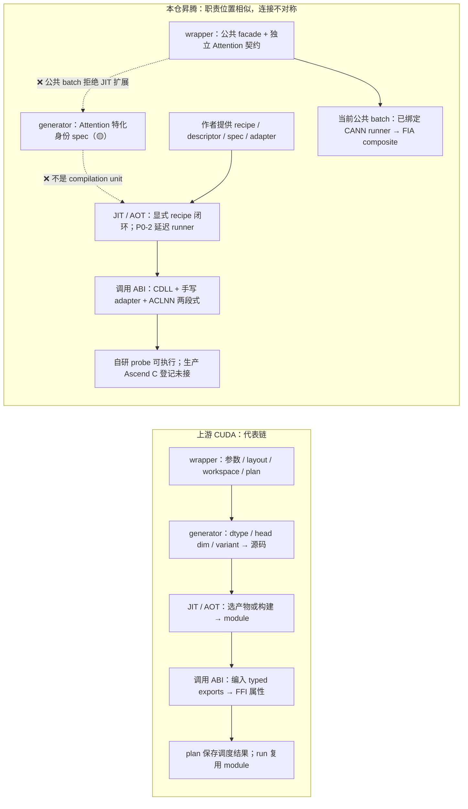
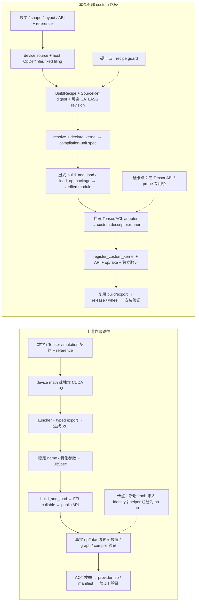

# 算子调用分层：昇腾现状与上游架构对比

> 核对日期：2026-10-25。本仓为 `/mnt/fi/flashinfer` 的 `infer` 工作区，包含 P0-1/P0-2；
> 上游为只读 `/mnt/fi/flashinfer-ori` @ `da992ed99`，以下统一记作 `flashinfer-ori: path:行号`。
> 本轮只做源码核对；✅ 表示指定链路已有实现，🟡 表示契约或局部接通，❌ 表示明确缺口；均不代替实机验收。
> 接口覆盖口径沿用 [接口面报告](api-surface-by-category.md) §0–2 的 43 op / 79 descriptor，不把它当自研 kernel 数量。

## 1. 一张总图（两边同形并排）

这四层描述的是职责依赖，不是每次 `run()` 都重新生成、编译、导出；typed export 在编译时进入库，load 才暴露属性。
上游选 FA2 CUDA-core batch decode 为代表；本仓必须同时画出公共 CANN 主线、Attention 契约支线和显式 Ascend C 工具链。



图中实线表示已接通的职责链，虚线标出不能直接穿越的接口。并排只对齐职责，不把两个 ABI 或三个本仓入口合并。
上游主链锚点：`flashinfer-ori: flashinfer/decode.py:536`、`flashinfer-ori: flashinfer/jit/attention/modules.py:1945`、
`flashinfer-ori: flashinfer/jit/core.py:337`、`flashinfer-ori: csrc/batch_decode_jit_binding.cu:48`。
本仓锚点：`flashinfer/attention/public_batch.py:44`、`:388`；`flashinfer/jit/build.py:66`；`flashinfer/jit/runtime.py:152`；`flashinfer/jit/op_package.py:165`。

P0-2 后不能再画“完全没有自动 AOT 发现”：**已绑定 `AotKernelRunner` 的 descriptor 首次执行可发现 AOT，并在允许时回落 JIT**。
这不等于默认生产登记已完成：`flashinfer/jit/runtime.py:152` 明确其作者接入职责；`flashinfer/runtime/registry.py:280` 未纳入该生产路径，
`flashinfer/data/kernels/registry.json:4` 仍为空。最新运行证据范围见 [P0-2 验收](../p0-2-aot-runtime-validation-2026-10-25.md)“五项必需场景”。

## 2. 逐层对比

### 2.1 wrapper 层

**职责：把参数、资源与执行状态绑在一起，使准备阶段的结果能被多次执行复用。** 两边都有 plan/run，但 plan 的载体与实际工作不同。

```text
上游 BatchDecodeWithPagedKVCacheWrapper（FA2 CUDA-core 路线）
  构造 → kv_layout + caller float workspace
       → device int workspace + pinned-host int workspace
  plan → 规范 dtype / paged metadata / backend
       → get_batch_decode_module → _cached_module
       → module.plan(workspaces, host indptr, heads, ...)
       → DecodePlan → DecodePlanInfo.ToVector() → _plan_info
  run  → 解包 Q/K/V、核验 dtype、准备 out/LSE
       → module.run(workspaces, _plan_info, tensors, layout, ...)
       → FromVector() + workspace base/offset → device kernel
```

锚点：`BatchDecodeWithPagedKVCacheWrapper` 在 `flashinfer-ori: flashinfer/decode.py:1194`，资源在 `:1398`，模块/plan 在 `:2557`，run 在 `:3453`；
native `BatchDecodeWithPagedKVCachePlan` 在 `flashinfer-ori: csrc/batch_decode.cu:39`，run 的 `FromVector` 在 `:142`，workspace offsets 解引用在 `:223`；
`DecodePlanInfo` 在 `flashinfer-ori: include/flashinfer/attention/scheduler.cuh:366`，保存 offsets、padding、split-KV/graph 标志。

```text
本仓 BatchDecodeWithPagedKVCacheWrapper / BatchPrefill...Wrapper
  构造 → PublicBatchWrapper：layout / caller workspace / 固定 metadata buffers
  plan → AttentionPlanSpec + PagedKVMetadata / RaggedKVMetadata
       → AttentionFrameworkSession.prepare_plan（候选状态）
       → dispatch(backend="cann") → 校验 graph identity / workspace
       → commit_prepared_plan → 保存 _native_decision / _workspace_contract
  run  → 复用 descriptor.runner → cann._batch_run → _run_native
       → 每请求 gather K/V → dense_attention/FIA → concat / out copy

  独立资源契约 → AttentionWorkspaceContract(capacity, requirement, generation)
  通用 Plan   → signature + hardware + decision；workspace_bytes = 0 占位
```

锚点：decode facade 的 `plan/run` 为 `flashinfer/decode.py:100`、`:114`；`PublicBatchWrapper._publish_plan` 为 `flashinfer/attention/public_batch.py:379`，
commit/保存决定在 `:408`，run 调 runner 在 `:516`，请求循环/gather/FIA/concat 在 `:642`、`:650`、`:661`、`:673`。
`AttentionPlanSpec` / metadata 在 `flashinfer/attention/schema.py:655`、`:151`、`:225`；session 的 prepare/commit 在 `flashinfer/attention/planner.py:242`、`:280`。

| 状态边界 | 上游代表链 | 本仓当前含义与代价 |
|---|---|---|
| plan 产物 | native 调度 vector + workspace 内容 | host 契约、metadata、选型与资源身份；不能据此声称已有同等 fused scheduler |
| workspace | native planner 以 workspace 基址与 offsets 配合执行 | `AttentionWorkspaceContract` 单列容量和需求，`None` 是未知；默认 plan 未必查询精确需求 |
| graph | plan 在 capture 外准备稳定资源，run 消费 | 固定 buffer 与首次成功 plan 冻结已有代码；batch composite 在 recording 下明确拒绝 |

workspace 证据：`flashinfer/attention/workspace.py:21`、`:136`、`:160`；默认只绑定 generation 的分支在 `flashinfer/attention/public_batch.py:438`。
零占位只指 `flashinfer/runtime/plan.py:22` 的 `Plan`；同文件 `build_plan:60` 返回的历史 `_WorkloadPlan` 可从 kernel 查询需求，不能泛称所有 plan 都为零。
graph 边界：`flashinfer/attention/execution_identity.py:137`；`flashinfer/cann/attention.py:217`。上游也有后端限制，详见既有调研 §3.4、§3.6。

**为什么 / 代价 / 性质：** 独立 Attention 契约使失败 plan 可以先验证后发布，也能表达“需求未知”；这是本仓的机制选择，非硬件必然。
逐请求组合带来 Python 调度、gather 和中间 Tensor 成本；fused batch、统一 workspace 规划与 batch replay 闭环属于**尚未补齐**。
CUDA `enable_pdl` 在 `flashinfer/attention/public_batch.py:474` 明确丢弃，是**有意不对标**的 launch hint；设备执行机制不同则属**必然差异**。

### 2.2 generator 层

**职责：把编译期特化转换为可准备的执行单元。** 上游主链会物化源码；本仓 Attention 当前只形成经过身份校验的声明。

```text
上游：不是所有路线都先经过 Jinja
  attention dtype/head_dim/variant
    → gen_batch_decode_module → gen_customize_batch_decode_module
    → Jinja render → config.inc + kernel.cu + launcher/binding → JitSpecNvcc
  CakeProgram
    → 已导出 kernel/binding 源码 + target/options/content digest → gen_jit_spec
  CuTe-DSL compile_fn
    → JitSpecCuteDsl → export_to_c → .o + meta.json → cute.runtime.load_module
  FlashKDA generated source
    → NVRTC → cubin mapping → embedded_cubin_factory → host module
```

Jinja 锚点：`flashinfer-ori: flashinfer/jit/attention/modules.py:960`、`:1945`、`:1990`；`get_batch_decode_uri:210` 编入 dtype、head dims 和开关。
Cake 锚点：`flashinfer-ori: flashinfer/jit/cake_program.py:112`、`:183`、`:218`；CuTe 锚点：`flashinfer-ori: flashinfer/jit/cute_dsl_core.py:243`、`:281`。
NVRTC 锚点：`flashinfer-ori: flashinfer/jit/flash_kda_nvrtc.py:68`、`:111`；embedding 接线在 `flashinfer-ori: flashinfer/jit/flash_kda.py:686`。
CuTe 的无缓存分支可直接执行 compile closure；Cake 此处汇合到 NVCC，NVRTC 只服务特定路线，不能把这些名字画成同一层的可替换开关。

```text
本仓：Attention 契约支线（🟡，不是可用 generator 闭环）
  AttentionFrameworkPlan + AttentionDispatchReceipt + runtime environment
    → AttentionJitVariant.from_plan_spec
    → gen_attention_jit_module_spec
    → AttentionJitModuleSpec：variant / plan / receipt 身份
      └─ 内部 JitSpec 没有 kernel_id / source / output_path
         → ❌ _build_record：不是 compilation unit，拒绝编译
  公共 batch(jit_args / jit_kwargs / variant_owns_mask)
    → ❌ _init_facade 直接 NotImplementedError

另一路已接通的构建入口（不能借此给 Attention generator 升格）
  手写 Ascend C 源码 + BuildRecipe + resolved inputs
    → AscendCBackend.declare → 完整 compilation-unit JitSpec → 显式 build
```

准确定位：generator 在 `flashinfer/jit/attention/modules.py:125`，依赖的 plan/provider 契约在 `flashinfer/attention/`；
`AttentionJitVariant.from_plan_spec` 在 `flashinfer/jit/attention/variants.py:85`；未填编译单元字段的构造在 `flashinfer/jit/attention/modules.py:161`。
硬断点：`flashinfer/jit/core.py:162` 定义编译单元字段，`flashinfer/jit/build.py:66` 拒绝非编译单元；公共拒绝点为 `flashinfer/attention/public_batch.py:44`。
已接通工具链的声明入口：`flashinfer/jit/backends.py:225`；未绑定 recipe 的编译仍在 `:258` 拒绝，不能只给一个 generator 名字就执行。

外部 callable 也不能填补这条证据：`AttentionInjectedCallableExecutor`（`flashinfer/attention/operator_execution.py:89`）负责消费注入实现；
默认 provider specs 仍为空（`flashinfer/attention/operator_bootstrap.py:391`）。single 的 `with_jit_module` 要调用方自带 module（`flashinfer/_single_attention.py:141`）。

**为什么 / 代价 / 性质：** 把 dtype/layout/variant 身份前置可防错误复用，但声明本身不产生机器代码；Attention 的源码物化与编译接线是**尚未补齐**。
CUDA 模板、CuTe/NVRTC 与 Ascend C 的语言及目标码不同是**必然差异**；不逐行搬运 CUDA kernel 是**有意不对标**（`docs/framework_design.md` §1.3）。
选择 recipe 作为构建输入是工程选择，不能据此把动态 tiling 或任意 ABI 缺口合理化；具体护栏见 §3。

### 2.3 JIT / AOT 层

**职责：让一份特化声明取得经过校验的 module，并决定缓存、构建和失败策略。** AOT 是提前准备产物，不是另一套数学实现。

```text
上游 JitSpec.build_and_load
  → JitSpecNvcc.try_load
    → 主包 AOT 路径；否则 provider manifest + 版本 / target / module 筛选
    → 加载已选 .so；单 module 或按调用设备分派的异构 module
  → miss：FileLock → 再 try_load
    → DISABLE_JIT：错误
    → 允许 JIT：write_ninja → run_ninja → load
      └─ Ninja 判断本地 JIT .so 是否新鲜；可能无需重编译
  发布侧：gen_all_modules → build_jit_specs → provider .so + manifest
```

锚点：`flashinfer-ori: flashinfer/jit/core.py:337`、`:536`、`:577`；`get_aot_artifacts` 在 `flashinfer-ori: flashinfer/jit/env.py:296`；
异构分派在 `flashinfer-ori: flashinfer/jit/core.py:361`；发布编译/复制在 `flashinfer-ori: flashinfer/aot.py:1407`，manifest 在 `flashinfer-ori: flashinfer-jit-cache-provider/build_backend.py:77`。
加载失败会尝试其他**已选** artifact，不重选同 target 的次优 provider；本地 JIT `.so` 不在 try_load 的 AOT 快路径中，也不能绕过禁 JIT 检查。

```text
本仓 P0-2：作者先 bind_aot_kernel，再登记 descriptor
  public API → dispatch → descriptor.runner → AotKernelRunner.resolve
    → AotPackageIndex.find(spec + descriptor/ABI + target_soc)
      → 命中：完整校验 → load_op_package → runner_factory → 保留 callable/module
      → missing（含全体不兼容）：仅 ENABLED 且有 backend factory 才进入 JIT
      → corrupt / load error：报错，不回落；launch 错误原样传播
    → JIT：build_and_load → DiskJitBuildStore.lookup
      → miss：锁内复查 → staging → backend.compile → 校验 → 原子发布 → load
  发布侧：同一 _build_record → export_op_package → data/op_packages/<spec-sha>
```

锚点：`bind_aot_kernel` / `resolve` 在 `flashinfer/jit/runtime.py:152`、`:86`；查找根目录/匹配为 `flashinfer/jit/discovery.py:118`、`:229`。
只捕获 missing 与 policy 分流在 `flashinfer/jit/runtime.py:97`、`:105`；构建/加载在 `flashinfer/jit/build.py:61`、`:109`；
内容 inventory 与不可变 generation 在 `flashinfer/jit/cache.py:291`、`:371`；发布为 `flashinfer/aot/build.py:42`，wheel 位置为 `setup.py:54`。

| 需要分清的边界 | 当前事实与代价 |
|---|---|
| dispatch 排序 ≠ 产物发现 | tier 映射仍是 metadata（`flashinfer/runtime/dispatch.py:95`）；实际发现发生于已绑定 runner，普通无 runner 条目仍报错（`flashinfer/gemm.py:32`） |
| 两种 no-JIT 语义 | 直接 `build_and_load` 可命中 JIT store（`flashinfer/jit/build.py:76`）；P0-2 runner 的 AOT missing 在 DISABLED/CACHE_ONLY 下直接拒绝（`flashinfer/jit/runtime.py:102`） |
| 身份与新鲜度 | 上游 URI + Ninja 依赖检查；本仓 `JitSpec.fingerprint` 是 canonical 内容身份（`flashinfer/jit/core.py:253`），改源码须更新声明，旧 spec 不自动追踪原树 |
| 自动机制 ≠ 生产覆盖 | P0-2 probe 在隔离进程替换 registry 后走公开 GEMM（`tests/aot_runtime_probe.py:120`）；不证明默认 43 op 都消费自研 AOT |

**为什么 / 代价 / 性质：** CMake/bisheng 与 Ninja/NVCC 的工具链差异来自目标平台；内容寻址和严格 corruption 失败策略是本仓机制选择。
P0-2 已补上有条件的发现/回落，剩余**尚未补齐**的是生产登记、通用 family 枚举及复杂 ABI；AOT CLI 仍选 `matmul_probe`（`flashinfer/aot/build.py:77`、`:82`）。
不要求原样复制 provider wheel 布局属于交付机制的选择，并非编译能力缺失；跨 CANN 兼容检查仍是明确缺口（`flashinfer/jit/op_package.py:188`）。

### 2.4 typed export / 调用 ABI 层

**职责：把准备好的 native 实现变成 Python 能正确传参、持有资源并执行的调用入口。两边是两套 ABI 形态。**

```text
上游：typed native function → FFI module 属性
  C++ 签名：TensorView / Array<int64_t> / Optional / scalars
    → TVM_FFI_DLL_EXPORT_TYPED_FUNC(plan, native_plan)
    → TVM_FFI_DLL_EXPORT_TYPED_FUNC(workspace_size, native_query)
    → TVM_FFI_DLL_EXPORT_TYPED_FUNC(run, native_run)
    → 编译进 .so → tvm_ffi.load_module(path)
    → mod.plan / mod.workspace_size / mod.run
    → Python SimpleNamespace / wrapper 调用
```

typed 签名与宏：`flashinfer-ori: csrc/batch_decode_jit_binding.cu:24`、`:48`；加载：`flashinfer-ori: flashinfer/jit/core.py:601`；
属性包装：`flashinfer-ori: flashinfer/decode.py:628`。CuTe 用其 runtime loader，不能把所有 DSL 输出都硬画成上述 `.so` 宏路径。

```text
本仓 op-package：原生 C 符号 + 显式 marshaling + ACLNN executor 生命周期
  CANN host codegen → libcust_opapi.so + device binary + package metadata
    → load_op_package：校验 → 激活 vendor 路径 → ctypes.CDLL
    → getattr(aclnnXGetWorkspaceSize) + 手设 argtypes/restype
    → adapter：torch Tensor → aclTensor* a / b / c
      → get_workspace_size(a,b,c) → (bytes, aclOpExecutor*)
      → 准备 workspace → launch(workspace, bytes, executor, stream)
      → adapter 负责资源寿命与错误处理
  host_shared 支线 → CDLL + 裸指针 C launcher(stream,a,b,c)，不是 ACLNN
```

锚点：host codegen 为 `csrc/op_package/host/CMakeLists.txt:10`；`load_op_package` 为 `flashinfer/jit/op_package.py:182`，CDLL/argtypes 为 `:225`、`:227`；
`OpPackageModule.get_workspace_size` / `launch` 为 `:165`、`:176`；Tensor descriptor 创建/同步销毁为 `flashinfer/jit/torch_library.py:154`、`:169`。
host_shared 的独立 ABI 为 `csrc/launch/matmul_probe.inc:4`，加载分支为 `flashinfer/jit/loading.py:380`。上述是本仓自研工具链，不代表 CANN 公共 runner 也逐层经过它。

| 易混同的概念 | 应保留的边界 |
|---|---|
| Python callable 属性 | 上游由 typed FFI 绑定产生；本仓 CDLL 的函数指针须另设 ABI，`OpPackageModule` 是手写 Python 包装，不是 typed export 的等价实现 |
| Attention binary/wire ABI | 本仓 plan/receipt 的序列化契约不能自动生成 ACLNN Tensor adapter，也不是 TVM-FFI export；参见 `flashinfer/jit/attention/modules.py:169` |
| torch.library | 是另一层 dispatcher/fake/mutation 契约；上游通用 helper 在该基线为 identity（`flashinfer-ori: flashinfer/utils.py:398`），本仓显式 `AscendCOp` 真注册（`flashinfer/_torch_library.py:50`） |

**为什么 / 代价 / 性质：** 复用 CANN 的 ACLNN package 能沿用其 host/device 组织，但本仓须自己维护 Tensor、stream、executor 和 workspace 的寿命。
平台 native ABI 不兼容是**必然差异**；选择 ctypes/ACLNN 而不复制 TVM-FFI 是现有机制选择，不应说硬件禁止 typed FFI。
固定参数表、通用 adapter 缺失与同步 probe 的生产化属于**尚未补齐**；当前 probe 明确不保证 aclgraph（`flashinfer/jit/torch_library.py:169`）。

## 3. 自定义算子接入路径对比

下面把“外部作者新增定形算子”的产物与卡点并排；步骤依据既有上游调研 §4.5、本仓对标报告 **§7.4**，不复制原十步表。
本仓报告 §7.3 实为多平台/SoC 覆盖。上游用 gated activation 举例，本仓用满足 v1 的三 Tensor Ascend C 算子举例；新算子本轮均未实现或运行。



上游产物锚点：device math / generator 为 `flashinfer-ori: flashinfer/jit/activation.py:106`、`:139`；typed export 为 `:97`；
Python getter / API 为 `flashinfer-ori: flashinfer/activation.py:46`、`:115`；AOT 自动遍历 activation 映射在 `flashinfer-ori: flashinfer/aot.py:889`。
全新 family 须加入枚举；新编译期 knob 须加入 identity。源码打包在 `flashinfer-ori: pyproject.toml:178`，provider manifest 在 `flashinfer-ori: flashinfer-jit-cache-provider/build_backend.py:77`。

本仓的简单定形算子至少要交付：device TU、host infer/tiling/OpDef、完整 recipe/spec、可调用 adapter、带 capability 的 runner、公开调用入口及验证。
可照看的实物为 `csrc/op_package/matmul_probe.cpp:17`、`:38`；`BuildRecipe` 为 `flashinfer/jit/recipe.py:59`，resolve 为 `:304`；
`AscendCBackend` 接受 custom descriptor（`flashinfer/jit/backends.py:208`）。`register_custom_kernel` 只登记 runner，不生成新 Python API（`flashinfer/runtime/registry.py:313`）。
若复用既有 op，runner 要匹配其参数表；全新 op 须另写 façade。`AscendCOp`/fake 是独立接线（`flashinfer/jit/torch_library.py:14`、`flashinfer/_torch_library.py:50`）。
CATLASS 是可选模板依赖，不是另一个 runtime；native 不要求它，catlass recipe 才绑定依赖（`flashinfer/jit/recipe.py:123`）。

```text
复杂算子在哪一行被挡住（本仓现有 Ascend C recipe / op-package v1 路线）
  动态 tiling 或 tiling_schema_version != 1
    → recipe.py:134-139：op_package 只能 fixed；host_shared 只能 none
  workspace_bytes != 0 / task_type != "aic_only" / 非默认 sync_policy
    → recipe.py:135-139：SchemaError，声明阶段即拒绝
  任意 Tensor 个数、scalar / attr 参数表
    → op_package.py:165：get_workspace_size(self, a, b, c)
    → op_package.py:227：三个 aclTensor* + size/executor 输出指针写死
  多个 device TU → ascendc.py:128-129：op_package 仅允许一个
  想直接复用现成高层桥 → torch_library.py:63-64：只接受 matmul_probe
  想只加 recipe 就走 AOT CLI → aot/build.py:77、:82：仍硬编码 probe family
```

以上短文件名均指 `flashinfer/jit/`，唯 AOT CLI 为 `flashinfer/aot/build.py`。
`flashinfer/jit/recipe.py:139` 的原始错误文字是 **"Ascend C v1 supports explicit fixed tiling, AIC-only, no workspace"**。
其条件还包含正整数 block_dim 与 `sync_policy == "compiler_default"`；不能只删除 guard，就宣称 compiler、host tiling 与 runtime 资源契约已支持。
**两类护栏合起来意味着：动态 tiling、非零 recipe workspace、AIC+AIV 混合、任意参数个数的算子，当前不能按这套现成接入契约直接接进来。**
这是本仓 v1 接线能力限制，不是 CANN/Ascend C 本身的能力上限；复杂算子须扩 schema/driver/ABI adapter 后另行验证。

尤其要区分两个 workspace：recipe 的 `workspace_bytes=0` 限制用户 scratch 契约；ACLNN `GetWorkspaceSize` 返回的是 runtime 执行需求。
现成桥仍会为后者的非零返回值分配内存（`flashinfer/jit/torch_library.py:163`–`:165`），因此不能写成“ACLNN 永远零 workspace”。
同一桥还把 Tensor metadata 固定为 16×16（`:154`），meta 限制 FP32/连续性（`flashinfer/_meta/ascendc.py:14`）；“正好三个 Tensor”仍不等于可以复用 probe runner。

```text
P0-2 的自动发现不能直接拼到旧 custom 十步清单后面
  外部 custom：Backend.CUSTOM + custom/...
    → 显式 module + 自有 runner → register_custom_kernel（冻结后允许）
    → ❌ bind_aot_kernel 拒绝该 backend
  算子作者集成 AOT：ASCENDC_AOT，或 ASCENDC + CompileMode.AOT
    → frozen spec + runner_factory + 可选 jit_backend_factory
    → bind_aot_kernel → 初始化期 KernelRegistry.register → freeze
    → public API → 延迟 discovery / load / 受控 JIT
    → 🟡 机制已验证 probe，默认生产登记仍待接入
```

两个入口的类型护栏分别在 `flashinfer/runtime/registry.py:118` 与 `flashinfer/jit/runtime.py:55`；普通 register 的冻结检查在 `flashinfer/runtime/registry.py:81`。
P0-2 测试用隔离 registry 的具体位置为 `tests/aot_runtime_probe.py:120`，不应作为外部用户改写全局 registry 的交付方法。
本仓 release 可复用 `export_op_package`（`flashinfer/aot/build.py:42`）；新增 family 还须枚举、登记与安装验证，不能把复制产物等同于应用自动可用。

上游另有无需改主仓 kernel 的 Attention variant 路线：variant 字符串 + 额外 tensor/scalar schema → `gen_customize_*` → single `with_jit_module` 或 batch `jit_args`。
证据为 `flashinfer-ori: tests/utils/test_jit_example.py:21`、`:1035`；batch 注入在 `flashinfer-ori: flashinfer/decode.py:1375`，其中 cuDNN/CuTe-DSL 明确拒绝。
自定义 URI 仍需自己的离线枚举/打包；本仓公共 batch 在 `flashinfer/attention/public_batch.py:44` 已挡住该接口，不能把“契约同名”当扩展对等。

## 4. 差异归类：必然 / 有意不对标 / 尚未补齐

分类针对具体边界；“当前选择不同”与“做不到”不能互相替代。机制选择仅指不照搬实现形式，不推断永久路线图，功能缺口仍归尚未补齐。

| 性质 | 具体边界 | 为什么这样判断 / 代价 |
|---|---|---|
| **必然差异** | CUDA 与 Ascend 目标码、编译器及设备 runtime | CUDA 模板不能作为 NPU binary 执行；两侧各用本平台构建/加载，证据见 §2.2–2.4；不要求相同 native ABI |
| **有意不对标** | CUDA runtime 模拟、二进制兼容、逐行 kernel 翻译 | 明确非目标：`docs/framework_design.md` §1.3；迁移应追求接口语义，不追求 CUDA 二进制直用 |
| **有意不对标** | CUDA PDL hint | facade 显式丢弃：`flashinfer/attention/public_batch.py:474`；保留参数名不代表实现该 launch 功能 |
| **有意不对标（现有机制选择）** | 独立 Attention 契约、内容寻址、ctypes/ACLNN、随主包交付 | 分别提供状态校验、构建身份、CANN 接线和现有分发路径；代价是契约桥接与 adapter 工作，不能据此说 typed FFI 不可能实现 |
| **尚未补齐** | Attention generator → compilation unit；公共 batch 定制扩展 | 硬断点分别在 `flashinfer/jit/build.py:66`、`flashinfer/attention/public_batch.py:44` |
| **尚未补齐** | 通用 workspace 规划、fused batch、batch replay | `Plan` 仍占位，真实路径逐请求执行，recording 明确拒绝；证据见 §2.1 |
| **尚未补齐** | 动态 tiling / mixed AIC+AIV / 非零 recipe workspace / 任意 ABI | recipe 和固定三 Tensor adapter 的双重护栏；不能归因于硬件或当作永远不做，证据见 §3 |
| **尚未补齐（生产接入）** | AOT 发现/回落 vs 生产接入 | P0-2 已局部补齐发现/回落机制；生产登记、自定义 backend 与 hook 衔接、family 枚举仍未形成通用交付，证据见 §2.3、§3 |

与既有报告不一致之处及本次判断：

- [架构简报](ascend-architecture-brief.md) §3–5、[对标报告](ascend-parity-analysis.md) §5.3/§7.4 的“无自动发现/回落”已过时；以 P0-2 源码及限定 probe 验收为准。
- 对标报告 §5.3 的“须在 ACL 初始化前设置路径”已过时；现 loader 要求首次 custom-op 执行前激活（`flashinfer/jit/op_package.py:185`），测试先创建/运算 NPU Tensor（`tests/aot_runtime_probe.py:110`）。
- 简报 §6 的 ABI 冻结红灯已被 [P0-1 记录](abi-refreeze-2026-10-25.md) §一–五取代；原始旧契约仍未恢复，重冻不能解释成证明新旧语义等价。
- 旧十步清单编号应为 §7.4；generator 精确位置为 `flashinfer/jit/attention/modules.py:125`。未发现上游调研在本次主链核对中的实质冲突。

## 5. 未验证项

- 本轮未执行编译、pytest、NPU/CUDA kernel、安装或性能测试；图中负例来自构造参数与显式 guard 的静态核对。
- P0-1 的 1780 passed / 28 real_compile、P0-2 的 1828 passed / 36 real_compile 均为既有记录，不是本轮重新执行结果。
- 上游 typed FFI、Jinja/Cake/CuTe/NVRTC、provider 离线命中及 custom variant 的实际运行，本轮未验证；多 GPU 与各 backend graph 行为不能由代表链外推。
- 本仓任意新算子的数值、全量 dtype/shape/layout、动态 tiling、mixed AIC/AIV、复杂 workspace、性能及 capture/replay 均未验证；现有 probe 不是生产算子覆盖。
- P0-2 报告明确保留：真正重建并 pip install wheel 后运行、其他物理 SoC、跨 CANN 版本、capture 内首次延迟绑定、已激活 module 跨 fork 未验证。
- 单进程多 package identity 目前明确拒绝（`flashinfer/jit/op_package.py:203`），不是已有支持但缺测试；跨 CANN 版本比较目前未实现（`:188`）。
- 本轮只新增本文，不修改代码或既有报告；旧报告的时态差异在 §4 标注，未把其历史结果改写为当前全局保证。
