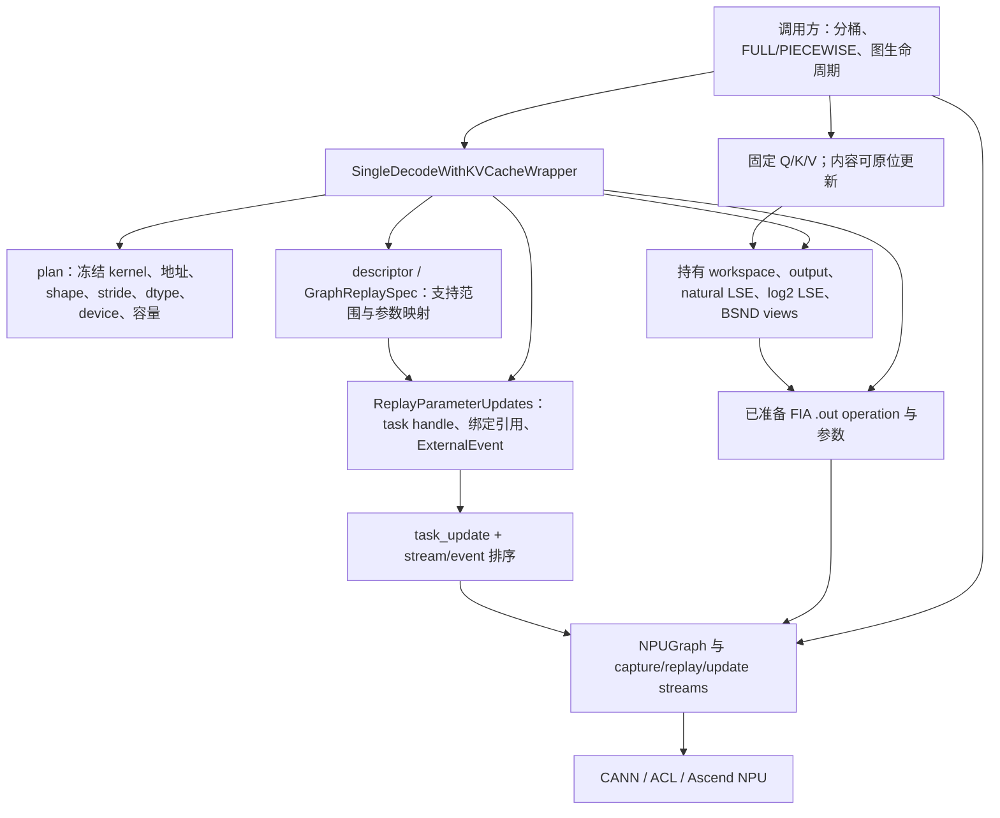
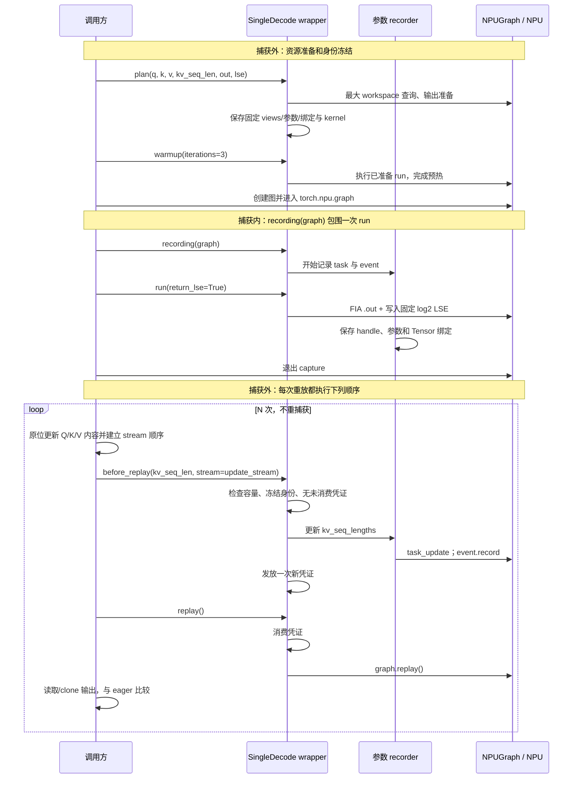

# 图模式交付：single-decode 公共资源接口与 aclgraph 生命周期

> T3，2026-10-25；本仓 `/mnt/fi/flashinfer`、分支 `infer`。
> 上游只读基线 `/mnt/fi/flashinfer-ori` @ `da992ed99`；源码引用统一使用 `flashinfer-ori:` 前缀。
> 设备：8× Ascend950PR；CANN 9.2.0-beta.2；解释器见 §10。
> 本文是已有架构评审的增量交付记录；不改写 P0-1、P0-2、T2′ 的代码或历史证据。

## 1. 交付结论与支持范围

本次将唯一已有入图声明的 single-decode 路线接到 `flashinfer.decode` 公共 wrapper。
调用方通过 `plan / warmup / recording / run / before_replay / replay` 完成资源与执行生命周期。
固定 workspace、输出和 LSE 在捕获前准备；捕获内使用已保存的 FIA 参数与 Tensor views。
每次重放必须经过参数更新，公共 `replay()` 消费一次更新凭证，防止静默沿用上次 KV 长度。
这次没有新增可入图 descriptor，没有把 batch composite 改成可捕获。

| 约束 | 本次公共 wrapper 的范围 |
|---|---|
| backend / kernel | CANN；`cann/attention/single_decode_fia_v1`。 |
| 公共输入 | NHD；Q `(8, 64)`，K/V `(1024, 2, 64)`，连续 NPU Tensor。 |
| 低层输入 | 已准备的 BSND views；Q `(1, 1, 8, 64)`，K/V `(1, 1024, 2, 64)`。 |
| dtype | Q/K/V 同为 FP16 或同为 BF16；不能在既有 wrapper 上切换。 |
| 固定数学选项 | heads=8/2，head_dim=64，scale=0.125，无 causal/window/custom mask。 |
| 动态项 | `kv_seq_len` 为整数，范围 1..1024；固定容量与逻辑有效长度分开。 |
| 输出 | 持有 `(8, 64)` 输出；FP32 `(8,)` LSE 使用上游 `log2` 口径。 |
| LSE 内部 | FIA 始终计算 natural-log LSE；捕获中写入预分配的 log2 输出。 |
| 并发 | 调用方串行使用同一 wrapper、图和资源；本轮未承诺并发重入。 |
| 图绑定 | 一图只绑定一个本 wrapper，recording 内只运行一次；显式 `auto_dispatch_capture=False`。 |

支持范围来自既有 `GraphReplaySpec`，不是由 descriptor 的普通 eager shape 能力推导。
例如普通 FIA descriptor 可以接受其他 head dimension，不代表该组合已经有 capture 证据。
公共类的导入路径是 `from flashinfer.decode import SingleDecodeWithKVCacheWrapper`。
本次不调整已有改动中的顶层 `flashinfer.__init__` 导出。

## 2. 登记表复核与历史结论更新

复核对象是 `get_global_registry().descriptors()`，不是磁盘 JSON 条数，也不是独立算子数。

| backend | descriptor | NOT_CAPTURABLE | NEEDS_PARAM_UPDATE | CAPTURE_SAFE |
|---|---:|---:|---:|---:|
| ascendc | 1 | 1 | 0 | 0 |
| cann | 40 | 39 | 1 | 0 |
| reference | 38 | 38 | 0 | 0 |
| triton | 1 | 1 | 0 | 0 |
| 合计 | **80** | **79** | **1** | **0** |

唯一可入图条目仍是 `cann/attention/single_decode_fia_v1`，能力仍为 `NEEDS_PARAM_UPDATE`。
本次保留 `flashinfer/cann/attention.py` 中的声明及其验证范围；没有放宽 `graph_capability`。
旧报告的 1/79 已过时：当前默认登记增加了一个不可入图的 Ascend C 条目，比例成为 1/80。
“公共 single-decode 没有可用固定资源入口”在本次完成后由新 wrapper 取代。
既有无状态 `single_decode_with_kv_cache` 的签名仍保留，其本身不是新的图资源接口。
“三段机制尚未接成通用 batch 路径”仍成立；本次只完成 single-decode 的闭环。

前置阅读：`ascend-architecture-review.md` §7、`ascend-parity-analysis.md` §6，
`call-stack-layering.md` 的 wrapper/generator/JIT-AOT/ABI 分层，及 `competitor-survey.md` §3.4。
历史报告中的旧全量/编译数字只代表对应任务时点；本次实际结果见 §10。

## 3. 仓库应该提供哪些接口：逐项对标上游

状态“已提供”描述本次之前的接口；“本次新增”描述 T3；“仍缺失”不作为已承诺能力。
上游机制基线来自 `competitor-survey.md` §3.4，已回查指定 commit 的实现。

| 交付接口或契约 | 上游机制 | 本仓状态与边界 |
|---|---|---|
| 稳定 workspace 持有 | batch 构造接收 float workspace，内部持有 device/host int workspace | 已提供 batch 资源契约；本次新增 single wrapper 持有。 |
| 显式输出 / LSE buffer | `run(..., out=..., lse=...)` 或捕获时保留返回值 | 本次新增 single `plan(..., out=..., lse=...)`，也可由 wrapper 分配并持有。 |
| 固定输入与 metadata 地址 | CSR、page metadata、mask 原位 `copy_` | 已提供 batch 固定资源校验；本次 single 保存 Q/K/V 与 BSND views。 |
| 捕获外 `plan` | 解析 backend、选 module、planner 物化 workspace 与 plan_info | 已提供 batch；本次新增 single 选择固定 kernel、分配/核验资源、冻结身份。 |
| workspace 大小查询 | native workspace_size 与 planner 使用相同估算逻辑 | 已提供 batch `workspace_size` / `npu.maximum_workspace_size`；single `plan` 查询 FIA 最大需求。 |
| 捕获外预热 | caller warmup，部分 lazy module 有显式 prewarm | 本次新增 single `warmup(iterations=3)`；全库统一首次 JIT/调优门禁仍缺失。 |
| 捕获内 `run` | 复用 module、plan_info、metadata、固定 workspace | 本次新增 single 准备后执行；batch composite 仍明确拒绝 recording。 |
| 身份变更拒绝 | 固定 batch / Q 长度 / backend；按 backend 限制 replan | 已提供 batch 冻结；本次 single 冻结存储、shape、stride、dtype、device、kernel。 |
| 每次重放更新 | 捕获外 `plan` 原位更新设备 metadata | 已提供低层 `ReplayParameterUpdates`；本次新增 single `before_replay` 封装 KV 长度。 |
| 漏更新保护 | 上游上述流程由调用方组织；不宣称有相同 token 接口 | 本次新增 single `replay()`，无新更新凭证时拒绝执行。 |
| 捕获作用域 | 调用方 `torch.cuda.graph(g)` | 本次新增 wrapper `recording(graph)` 绑定调用方 aclgraph；图创建仍归调用方。 |
| 能力查询与证据 | 各 backend 的具体图模式限制 | 已提供 `graph_requirements`、descriptor `GraphReplaySpec`；没有将 wrapper 名字视为能力。 |
| 多任务更新顺序 | 依后端设备 metadata 及 planner 契约 | 已提供 recorder 按捕获任务顺序更新；新 wrapper 限单次 single-decode 捕获。 |
| 模型 FULL/PIECEWISE | 下游选择捕获区域，算子库提供局部能力 | 调用方职责；本仓没有模型级切图或图缓存管理器。 |
| 资源换绑与重捕获 | 部分 wrapper 可 reset，但旧图仍依赖原地址 | single 变更冻结身份须新 wrapper 和新图；不提供捕获后的 resize/reset。 |
| batch 图调度容量 | planner padding、valid mask、固定 offsets | 仍缺失等价可运行 batch 路径；只有 Python 资源冻结不够。 |
| batch 参数更新 | 各后端支持 replan 的能力矩阵 | 仍缺失 batch 的录制/更新范围与真机证据。 |

上游不同 wrapper 不能被折叠为一个“全部支持图模式”的布尔值；完整对照如下。

| 上游 §3.4 公开 wrapper | 本仓对应交付状态 |
|---|---|
| `BatchDecodeWithPagedKVCacheWrapper` | 已提供同名资源接口；batch descriptor 仍不可入图。 |
| `CUDAGraphBatchDecodeWithPagedKVCacheWrapper` | 已提供同名 facade；只是固定 `use_cuda_graph=True`。 |
| `BatchPrefillWithPagedKVCacheWrapper` | 已提供固定 metadata/mask；尚无 batch replay 闭环。 |
| `BatchPrefillWithRaggedKVCacheWrapper` | 已提供固定 indptr/mask；尚无 batch replay 闭环。 |
| `BatchMLAPagedAttentionWrapper` | 仍缺失同等图模式 wrapper/backend/replan 契约。 |
| `PODWithPagedKVCacheWrapper` | 仍缺失相应公开图资源组合。 |
| `MultiLevelCascadeAttentionWrapper` | 仍缺失多层 wrapper 图资源组合；已有 merge 算子不等于它。 |
| `BatchAttentionWithAttentionSinkWrapper` | 仍缺失继承 prefill 的 sink variant 图路径。 |
| `BatchPrefillWithCausalBidirectionalRangesWrapper` | 仍缺失对应 variant 图路径。 |
| `BatchDecodeCuteDSLWrapper` / `BatchDecodePagedCuteDSLWrapper` | 仍缺失对应 NPU 图执行能力；不要求移植 CUDA DSL 二进制。 |
| `BatchPrefillCuteDSLWrapper` | 仍缺失对应执行与资源能力。 |
| `CuteDslMoEWrapper` / `CuteDslMxfp8Mxfp4MoEWrapper` | 仍缺失同等 MoE 区域 capture/replay 与辅助 stream 验证。 |
| `B12xMoEWrapper` | 仍缺失同等按 token 容量预分配及图复用能力。 |

上游对应文件：`flashinfer-ori: flashinfer/decode.py`、`flashinfer-ori: flashinfer/prefill.py`、
`flashinfer-ori: flashinfer/mla/_batch_mla/_wrapper.py`、`flashinfer-ori: flashinfer/pod.py`、
`flashinfer-ori: flashinfer/cascade.py`、`flashinfer-ori: flashinfer/attention/_core.py`、
`flashinfer-ori: flashinfer/cute_dsl/attention/wrappers/batch_decode.py`、
`flashinfer-ori: flashinfer/cute_dsl/attention/wrappers/batch_prefill.py`、
`flashinfer-ori: flashinfer/fused_moe/cute_dsl/fused_moe.py`、`flashinfer-ori: flashinfer/fused_moe/cute_dsl/b12x_moe.py`。

## 4. 每个新接口实际完成什么动作

接口来自 `flashinfer.decode.SingleDecodeWithKVCacheWrapper`；核心实现文件及最终行号见 §11。

| 接口 | 三段机制中的动作和状态变化 | 不承担的工作 |
|---|---|---|
| 构造 `(..., workspace_buffer=None, kv_layout="NHD")` | 建立一个独立的资源生命周期，保留可选 caller workspace | 不创建图、不捕获、不宣称 plan 完成。 |
| `plan(q, k, v, *, kv_seq_len=None, out=None, lse=None)` | 捕获外校验支持范围；查询最大 workspace；准备 output/LSE/views/参数；首次成功冻结执行身份 | 不将 eager 的任意 shape 扩大成图支持范围，不修改 descriptor。 |
| `warmup(iterations=3)` | 捕获外执行已经准备好的 `run`，为 FIA 运行做好准备并完成必要同步 | 不提供全库 JIT/AOT 自动预热，不选择模型分桶。 |
| `run(q=None, k=None, v=None, *, return_lse=False)` | 消费持有的输入、workspace、FIA `.out` 与 metadata；检查可选输入与冻结绑定一致 | 不重新 plan，不扩容，不推断新容量，不重新 dispatch。 |
| `recording(graph)` | 在调用方 active capture 中建立 recorder，保存图对象并记录对应 task/handle/event | 不代替外层 `torch.npu.graph`，不自动选择 capture 区域。 |
| `before_replay(kv_seq_len, *, stream)` | 捕获外检查容量/身份，更新录制任务长度，建立 stream/event 顺序，发放一次 replay 凭证 | 不替换 Q/K/V，不重跑完整 Python forward，不直接 replay。 |
| `replay()` | 确认成功录制及一次新更新，检查冻结资源，消费凭证并调用绑定图的 replay | 不允许无更新重放，不重新捕获，不推断调用方输入拷贝是否已完成。 |
| `workspace_buffer / output / lse` | 暴露已持有资源供检查、复用和结果读取 | 不能据此 resize/rebind 既有图的存储。 |
| `kernel_id / kv_capacity` | 暴露计划选定的 kernel 与容量，帮助调用方诊断和分桶 | 不能据此推断其他 dtype、SoC、shape 已验证。 |

同一输入可在捕获前调整逻辑 KV 长度，之后须重新预热；捕获后用 `before_replay`，不重新 `plan`。
即使新 Tensor shape/dtype 相同，换地址也会破坏已捕获指针绑定，因此要新建 wrapper。
数据内容变化应对原有 Q/K/V 做 `copy_`；LSE/output 在每次执行后被覆盖，需要保留历史时另行 clone。
传入 `out/lse/workspace` 表示调用方负责分配，wrapper 负责保留强引用和检查容量/身份。
未传入时由 `plan` 分配并持有；两种模式均不得在捕获内临时准备这些设备 buffer。

参数更新底层继续复用 `flashinfer.npu.ReplayParameterUpdates`：

1. `recording` 记录 FIA operation、kwargs、Tensor 绑定、task handle 与 ExternalEvent。
2. wrapper 将整数长度封成 `({"kv_seq_lengths": [length]},)`；逻辑名映射到 `actual_seq_lengths_kv`。
3. recorder 先校验全部参数，再让 update stream 等待当前 replay stream 已提交的工作。
4. 执行 `graph_task_update_begin → 同一 FIA operation → graph_task_update_end → event.record`。
5. 图中的 event wait/reset 将实际设备任务排到对应更新之后。

这里“调用同一 operation”属于 task 参数更新协议，不是再次执行整个 wrapper 的 Python forward。
直接调用原生 `graph.replay()` 会绕开 wrapper 的凭证检查；本公共契约要求调用 `wrapper.replay()`。
仅有 Python API 无法拦截其他持有者对原生图对象的任意调用，不能把绕过接口也写成已受保护。
调用方须将实际正在 capture 的图传给 `recording(graph)`，且不能 reset/re-capture 已绑定图。
torch_npu 没有公开 current-graph ID 供本接口核对，因此这两项属于调用方必须遵守的生命周期契约。
本接口拒绝同图多个 wrapper；要捕获多个独立参数更新节点，需要额外的图级更新/replay 协调器。
`auto_dispatch_capture=True` 会与显式 task-group 协议叠加，接口明确拒绝；capture stream 必须与输入同设备。
已有未消费的更新时再次 `before_replay` 会拒绝并使该 wrapper 失效；设备更新失败也要求弃图重建。

## 5. 静态架构：组件与资源归属



资源归属不是转移 Tensor 的唯一所有权：调用方可保留引用，但不能改变绑定地址或 metadata。
wrapper 保持 input/output/workspace 的强引用，recorder 保持 task 参数引用和同步对象。
图、wrapper、固定 buffers、stream/event 必须存活到最后一次异步 replay 完成。
释放或更换资源前由调用方同步相应 stream；新 shape/dtype/batch 使用新 wrapper 和新图。
与之并行的 batch 资源链只到固定 CSR/mask/block table、plan 冻结，尚未连到可录制的 batch runner。

## 6. 动态架构：plan → 预热 → 捕获 → N 次重放



“捕获外”并不自动等于同步完成：图与更新均涉及 stream 排队，调用方必须遵守先后关系。
更新入口在当前 replay stream 下调用；update stream 必须位于相同设备。
更新后仍在同一 replay stream 调用 `replay()`，禁止并发交错使用同一 wrapper。

## 7. 上游调用方如何配置完整流程

上游完整范例是 `flashinfer-ori: tests/attention/test_batch_decode_kernels.py` 的
`test_cuda_graph_batch_decode_with_paged_kv_cache`：构造固定 CSR/workspace → plan → 三次 warmup →
调用方 capture `wrapper.run` → 循环在捕获外 plan 更新 metadata → graph replay。
上游源码的多次 plan 依 backend 能力成立，不能机械替换成所有 NPU wrapper 的相同流程。

迁移到本次 single-decode 公共入口的完整步骤：

1. 先决定设备、dtype、容量桶和 graph 区域；本次单请求固定为 batch=1、Q=1、KV 容量=1024。
2. 创建一份固定 Q/K/V；应用可将短请求的数据写入前 `kv_seq_len` 行，剩余容量不会成为有效 KV。
3. 构造 `SingleDecodeWithKVCacheWrapper`；可显式给 workspace，也可让 `plan` 查询并分配。
4. 在 capture 外 `plan(q, k, v, kv_seq_len=...)`，可显式给 out/LSE；检查支持范围错误。
5. 在 capture 外 `warmup()`；完成应用侧其他 kernel 的编译、加载与预热。
6. 调用方创建 `NPUGraph` 与 capture/update streams，进入 `torch.npu.graph(..., auto_dispatch_capture=False)`。
7. 在图作用域里进入 `wrapper.recording(graph)`，调用一次 `wrapper.run(return_lse=True)`。
8. 每次请求先对固定输入原位更新；跨 stream producer 由调用方建立依赖。
9. 在 replay stream 下调用 `wrapper.before_replay(length, stream=update_stream)`，然后 `wrapper.replay()`。
10. 读取结果时遵守异步执行语义；需保存多个结果则 clone，不能积累同一 output Tensor 的引用。
11. 同一身份复用该图；需要新 shape/dtype/容量/存储时分配新 wrapper、新图、重新 plan/warmup/capture。
12. 最后一次 replay 完成后才释放图及资源；模型调度器负责淘汰、失败恢复与进程退出生命周期。

FULL 指调用方希望捕获的整个 forward；本次只证明其中这条 single-decode 路线可捕获。
PIECEWISE 需要调用方确定区域边界和图间 Tensor/stream 依赖；本仓不提供自动切图。
分桶须把冻结 identity 纳入 key，不能只按 KV 有效长度合并不同 dtype、heads 或地址生命周期。
当前只有一个已验证容量/shape 桶；“可更新长度”不等于任意容量桶已经受支持。
上游 MoE piecewise 用例也只能证明算子区域，不证明全模型图调度器或某 serving 发布版集成。
证据：`flashinfer-ori: tests/moe/test_cute_dsl_bf16_moe.py`、`flashinfer-ori: flashinfer/fused_moe/utils.py`。

## 8. 与上游的机制差异

| 比较点 | 上游 CUDA Graph | 本次 aclgraph 交付 |
|---|---|---|
| 动态 metadata 生效方式 | 捕获外 plan 对固定设备 metadata 原位写入；既有 kernels 读取新值 | KV 长度是 FIA 固化的 host 参数，必须 task update；仅 copy Tensor 不够。 |
| plan 调度职责 | C++ planner 写 offsets、split-KV、padding、valid mask、plan vector | 本次 single plan 只准备固定 FIA 资源和参数；没有复制 batch scheduler。 |
| graph 资源形态 | caller float workspace + device/pinned-host int workspace 等 | wrapper 持有 FIA 最大 workspace、输出、LSE、固定 BSND views。 |
| 重放入口 | 范例由 caller `g.replay()` | 公共 wrapper 增加一次性更新凭证，以便明确拒绝漏更新。 |
| replan | 依后端能力；MLA 不支持时明确拒绝二次 plan | single 捕获后禁止重新 plan；使用 `before_replay` 更新唯一动态项。 |
| 编译/调优 | 有具体 lazy prewarm 与 active-capture profiling guard | 此固定 CANN 路径有预热；不能推导全库已有统一冷路径门禁。 |
| 覆盖面 | 多种 attention、MoE wrapper 各有约束 | 仍只有 1/80 descriptor；batch 资源接口不能计入可捕获数。 |

上游 planner 证据：`flashinfer-ori: include/flashinfer/attention/scheduler.cuh` 的 `DecodePlanInfo/DecodePlanImpl`，
以及 `flashinfer-ori: csrc/batch_decode.cu` 的 plan/run 序列化与 offsets 恢复。
MLA replan 证据：`flashinfer-ori: flashinfer/mla/_batch_mla/_wrapper.py` 与
`flashinfer-ori: flashinfer/mla/_batch_mla/_backends/_capabilities.py`。
预热/调优证据：`flashinfer-ori: flashinfer/jit/attention/_lazy.py`、`flashinfer-ori: flashinfer/autotuner/autotuner.py`。

## 9. batch 入图还差什么：明确后续工作

1. **可捕获 batch 执行器。** `flashinfer/cann/attention.py::_batch_run` 在 recording 下仍直接拒绝。
   不能仅删除 guard；现 `PublicBatchWrapper._run_native` 逐请求 gather/slice/FIA，再 `torch.cat` 输出。
2. **固定调度规模。** 需要把 Python metadata/循环/slice 形成的请求数与任务结构移出热路径，
   为容量内长度变化建立固定任务数、offsets、padding/有效请求标志或经过验证的等价方案。
3. **稳定的全部设备资源。** CSR/mask/block table 已固定，但 gather 临时结果、每请求输出/LSE、
   拼接结果及所需 workspace 仍须按容量预分配和绑定，不能只固定调用方最外层 out。
4. **逐任务参数更新协议。** 明确每个请求的 KV/Q 长度、mask 与 tiling 哪些在 host 固化，
   哪些可读设备 metadata；任务顺序、更新布局和容量范围必须由 batch GraphReplaySpec 声明。
5. **metadata 到执行器的真实连接。** 固定 CSR 的 `copy_` 不能更新已经捕获的 Python tuple/切片边界；
   要证明改变页表内容和长度后，图确实读取新请求布局，且不会保留上一 plan 的 host 值。
6. **完整容量与冻结规则。** 除 batch/backend/Q 长度/kernel 外，覆盖总页数、block width、
   Q 总行数、mask 字节数、output/LSE 和 scratch；paged prefill 默认 Q 容量仍不同于上游首 plan 冻结。
7. **图前准备与失败生命周期。** 给 batch 明确的预热、捕获状态、漏更新拒绝、错误后失效规则，
   并覆盖 stream/device 错配、资源换绑、重捕获和多请求更新原子校验。
8. **真机正反例后再改声明。** 至少验证不同长度/页表、多次 replay、eager 数值、容量越界、
   身份变更、漏更新和未 plan；只有这些证据成立后才能逐 descriptor 改能力，不能批量升级。

已提供的 `use_max_workspace=True` 和 `maximum_workspace_size` 能帮助固定资源，不能替代上述执行改造。
external provider 的 batch graph 初始化当前也明确拒绝；本次未将 provider 路由接入可捕获路径。

## 10. 实际验证记录

所有命令工作目录为 `/mnt/fi/flashinfer`，解释器必须是 `/root/miniforge3/envs/flashinfer-a5/bin/python`。
测试均使用 `-B -p no:cacheprovider`，没有使用未安装的 pytest-timeout 或 `--timeout`。
设备自检的实际命令与输出如下；文档收尾时再次读设备，结果相同。

```text
$ ls /dev/davinci* | head
/dev/davinci0
/dev/davinci1
/dev/davinci2
/dev/davinci3
/dev/davinci4
/dev/davinci5
/dev/davinci6
/dev/davinci7
/dev/davinci_manager
$ /root/miniforge3/envs/flashinfer-a5/bin/python -B -c 'import torch,torch_npu;print(torch.npu.is_available(),torch.npu.device_count())'
True 8
```

实际环境识别为 `Ascend950PR_9579`、torch `2.10.0+cpu`、torch_npu `2.10.0.post7`。
两个示例分别一次 capture、八次 replay；长度依次为 `63, 1, 17, 128, 513, 1024, 3, 63`。
FP16/BF16 每次输出与 LSE 的 `max_abs_error` 都为 0，断言 `atol=0, rtol=0`。
两份最终日志均打印 `workspace_bytes=33554432`；容量按 `numel() * element_size()`，不是元素数。
末行均为 `PASS captures=1 replays=8 boundary_checks=enabled`。
完整 stdout：`/mnt/fi/t3-validation/fp16-example.log`、`/mnt/fi/t3-validation/bf16-example.log`。

示例实际命令（均在上述绝对工作目录执行）：

```bash
/root/miniforge3/envs/flashinfer-a5/bin/python -B examples/single_decode_graph.py --dtype float16 --check-boundaries
/root/miniforge3/envs/flashinfer-a5/bin/python -B examples/single_decode_graph.py --dtype bfloat16 --check-boundaries
```

| 必验边界 | 公共接口要求 | 实际验证入口 |
|---|---|---|
| 捕获外 plan/预热、捕获、多次长度更新 | 每次 replay 输出与 eager 一致；包含 FP16/BF16 和固定 LSE | 四组 dtype×ramp/random 均逐次零误差；另测原位更换 Q/K/V 内容。 |
| KV 长度超过容量 | 在更新设备任务前拒绝，错误包含容量含义 | `kv_seq_len=1025` 和 0 均被拒绝；随后合法长度仍可重放。 |
| 改 shape/batch/dtype/地址 | 拒绝冻结身份变更，提示新 wrapper | 四类 `run/plan` 均拒绝；另测 q/workspace/out/LSE 换存储。 |
| 漏调用参数更新 | 首次及已经重放一次后都拒绝 `replay()` | 两次均明确拒绝；不依赖真实死锁作为诊断。 |
| 未 plan 直接捕获 | 在调用设备 FIA 前明确报错 | 实际 graph context 内拒绝；另测漏 warmup 和 capture 内 plan。 |

示例中四类必验负例的实际错误摘录（shape/batch/dtype 三项使用同一冻结身份诊断）：

```text
REJECT KV capacity exceeded (1025 > 1024): SchemaError: kv_seq_len must be an integer in [1, 1024]; plan frozen KV capacity is 1024
REJECT frozen shape changed: SchemaError: q frozen address/shape/batch/dtype/device changed; use a new wrapper
REJECT frozen batch changed: SchemaError: q frozen address/shape/batch/dtype/device changed; use a new wrapper
REJECT frozen dtype changed: SchemaError: q frozen address/shape/batch/dtype/device changed; use a new wrapper
REJECT replay without fresh parameter update: SchemaError: every replay requires a fresh before_replay(kv_seq_len, stream=...) call
REJECT capture without plan: SchemaError: single-decode graph requires plan() outside capture first
```

新增测试最终结果：`30 passed in 3.24s`，0 failed、0 skipped；原始 stdout 为 `/mnt/fi/t3-validation/public-real.log`。
另覆盖 caller workspace、过小 workspace、输出别名、捕获内禁止查询/dispatch、跨 stream、同图双 wrapper、
自动 task dispatch 和重复未消费 update；所有检查均在真实 NPU 环境执行。
原有 real_compile 隔离回归：`43 passed, 1864 deselected in 136.92s (0:02:16)`，0 failed、0 skipped。
其原始 stdout 为 `/mnt/fi/t3-validation/original-real-compile.log`。

对应实际 pytest 命令：

```bash
/root/miniforge3/envs/flashinfer-a5/bin/python -B -m pytest -p no:cacheprovider -q -s tests/test_single_decode_graph_real.py
/root/miniforge3/envs/flashinfer-a5/bin/python -B -m pytest -p no:cacheprovider -q -m real_compile --ignore=tests/test_single_decode_graph_real.py
```

全量实际命令及摘要如下；原始 stdout 为 `/mnt/fi/t3-validation/full.log`。

```text
$ /root/miniforge3/envs/flashinfer-a5/bin/python -B -m pytest -p no:cacheprovider -q
1937 passed, 4 warnings in 143.76s (0:02:23)
```

全量为原有 1907 + 新增 30，0 failed、0 skipped；警告为 1 条 torch_npu 格式回退和 3 条 Triton 弃用提示。
全部 real_compile 为原有 43 + 新增 30，0 failed、0 skipped；完整 stdout 为 `/mnt/fi/t3-validation/real-compile.log`。

```text
$ /root/miniforge3/envs/flashinfer-a5/bin/python -B -m pytest -p no:cacheprovider -q -m real_compile
73 passed, 1864 deselected in 133.50s (0:02:13)
```

## 11. 交付文件与未验证项

交付包括公共 wrapper、端到端示例、新增 `@pytest.mark.real_compile` 正反例和本文。

| 文件与位置 | 交付内容 |
|---|---|
| `flashinfer/decode.py:22` | 导出公共 `SingleDecodeWithKVCacheWrapper`，保留既有无状态函数。 |
| `flashinfer/attention/single_decode_graph.py:22` | wrapper 类；构造和只读资源属性。 |
| `flashinfer/attention/single_decode_graph.py:145` | `plan`：范围校验、真实最大 workspace、output/LSE、身份冻结。 |
| `flashinfer/attention/single_decode_graph.py:225` | `warmup`：捕获外执行和同步。 |
| `flashinfer/attention/single_decode_graph.py:241` | `run`：已准备 FIA `.out` 和固定 LSE 转换。 |
| `flashinfer/attention/single_decode_graph.py:261` | `recording`：绑定图并记录一次 run。 |
| `flashinfer/attention/single_decode_graph.py:293` | `before_replay`：校验并更新 KV 长度。 |
| `flashinfer/attention/single_decode_graph.py:314` | `replay`：消费一次更新凭证。 |
| `examples/single_decode_graph.py:49` | 单次 capture、多次 replay、逐次 eager 数值、可选完整边界检查。 |
| `tests/test_single_decode_graph_real.py:16` | 文件级 real_compile 标记；真实设备不可用时失败，不 skip。 |
| `docs/reports/graph-mode-delivery.md` | 接口矩阵、动作、调用方流程、架构图、验收与差距记录。 |

未验证项明确保留：

- 其他 SoC、其他 CANN/torch_npu 版本及多物理设备运行；8 卡可见不代表 8 卡矩阵均已跑。
- 支持范围以外的 heads、head_dim、shape、KV 容量、dtype、layout、mask、量化及位置编码。
- batch decode/prefill、MLA、POD、cascade、MoE 区域和模型 FULL/PIECEWISE 端到端集成。
- 多线程/多 stream 并发重入、跨 wrapper 共享同一 workspace 的并发安全、跨进程图资源复用。
- 吞吐、延迟、显存峰值、长时间压力及碎片化；正确性验证不能替代性能结论。
- 全库首次 JIT/AOT 延迟加载和 autotune 在 active capture 中的统一门禁。
- 上游 CUDA Graph 真机执行；本任务只静态核对指定上游 commit，没有 GPU 对比运行。

本次没有把 `torch.compile` fullgraph 成功算作 aclgraph 证据，也没有把 skip 算作 pass。
本次未发现需要修改既有断言的冲突；既有 ABI 冻结常量和测试断言均未修改。
