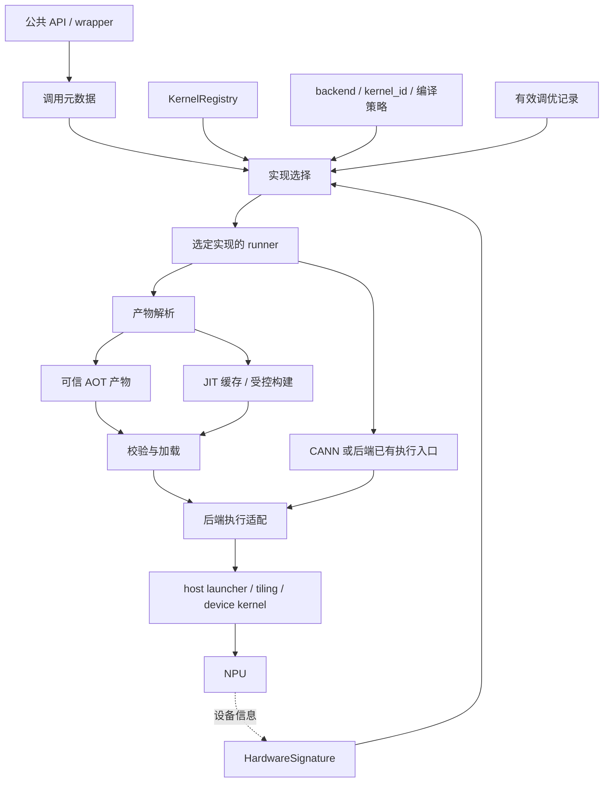
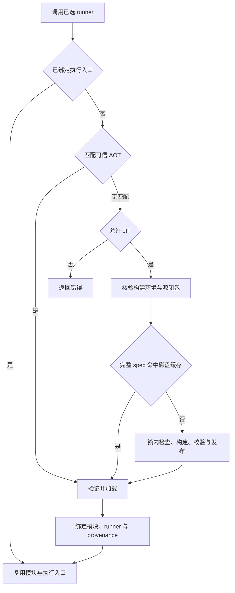
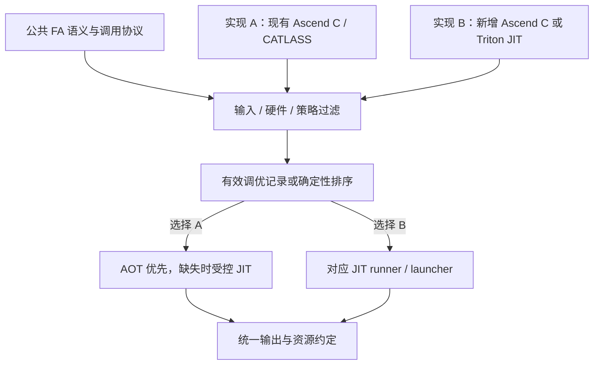

# FlashInfer Ascend 运行时与编译系统技术设计

## 1. 概述

FlashInfer Ascend 面向昇腾 NPU 提供推理算子接口、实现选择机制，以及自定义算子的构建、交付和执行能力。公共 API 在算子语义和调用方式上对标 FlashInfer，底层接入 CANN 内置算子、Ascend C/CATLASS 和 Triton 实现。

系统将算子调用划分为三个职责域：公共接口定义计算语义和调用约定；运行时根据输入、硬件和策略选择实现；所选实现负责准备可执行产物并完成设备调用。AOT 与 JIT 共享构建身份和产物契约，分别用于发布前构建和运行期受控构建。

本文规定运行时与编译系统的数据模型、模块边界、选择算法、产物生命周期和后端接入要求，并以生产 CATLASS FlashAttention 为实例列出源码路径。第 9 节中的独立 JIT FA 接入属于扩展设计；其余章节描述现有机制及实现约束。源码行号对应本文编写时的工作树。

### 1.1 设计目标

1. 对齐 FlashInfer 的接口语义与适用接口的生命周期，保留直接函数、plan/run wrapper 和 run-only wrapper 等调用方式。
2. 以逻辑算子为单位管理多个实现，使公共接口与具体实现、编译器和产物位置解耦。
3. 为 CANN、Ascend C/CATLASS、Triton 及已验证外部实现提供统一的登记和选择机制。
4. 对本仓构建的算子复用 AOT/JIT 构建流水线、缓存身份、完整性校验和加载规则。
5. 支持依据有效测量记录进行实现选择，并在缺少适用记录时给出确定、可解释的结果。
6. 保持算子支持域、native ABI、编译策略、资源生命周期和执行来源可验证。

### 1.2 实现范围

多实现选择是运行时提供的接入能力。当前内置生产登记中，同一逻辑 op 尚未接入多个 NPU 实现；部分 op 另有 reference 实现，reference 默认不参与普通自动选择。默认生产 registry 中 CATLASS FA 仅有 Ascend C 候选；第 9.4 节的隔离 registry 已为同一入口加入 Triton FA，CANN single-prefill 尚未接入该候选集合。

生产 Ascend C FA 与 MatmulBiasSiLU 已采用 AOT 优先、缺失时按策略 JIT 的产物解析机制。两者通过统一 Torch 注册与 C++ TorchNPU/ACLNN 桥执行。CANN 内置算子和现有 Triton 算子保留各自的执行适配。

接口存在、实现登记、构建成功和执行验证分别构成不同证据。本文不将其中任一状态替代其他状态；完整接口范围见 [算子覆盖说明](operator-coverage.md)。

## 2. AOT/JIT 设计依据

### 2.1 编译特化与运行期参数

推理算子的编译输入可能包含 dtype、head dimension、计算 variant、tile 配置及目标设备。多个维度的组合会扩大预编译矩阵，而具体模型通常只使用其中一部分组合。

AOT 在发布或部署准备阶段生成产物，适用于已知配置的预先交付。JIT 将部分构建工作推迟到配置明确后的加载、预热或首次调用阶段，只构建需要的编译单元，并通过缓存复用产物。该安排允许编译成本在发布阶段与部署阶段之间分配。

JIT 的主要工程价值是减少完整特化矩阵的提前构建要求、支持新增配置的增量交付，并提供一致的缓存复用机制。特化优化由源码、generator 和编译器实现，AOT 同样可以编译特化 kernel；编译时机不构成 kernel 性能优势的依据。

编译参数与运行期参数应分别建模。改变生成代码的配置属于编译身份；可由现有二进制及动态 tiling 处理的参数保留为运行期输入。不能直接用完整调用 signature 作为所有 kernel 的编译特化粒度。

当前 FA 支持的 S/T/H 变化由 host 动态 tiling 处理，FP16/BF16 组合已包含在冻结配方中。不同 shape 或 dtype 可以产生不同 InputSignature，同时复用同一冻结 spec 和 op-package。当前 JIT 补建既定契约对应的产物，不根据任意新 head_dim、mask 或 dtype 自动生成实现。

### 2.2 构建模式与实现选择的关系

实现选择确定执行哪一份算法或配置；产物解析确定如何获得该实现的可执行代码。两者采用独立身份：

| 维度 | 表达内容 | 典型字段 |
| --- | --- | --- |
| 计算语义 | 参与比较的逻辑算子及公共约定 | `op`、公共 API |
| 实现来源 | 实现所属后端或接入来源 | `backend`、来源栈 |
| 实现身份 | 可独立登记、锁定和追踪的实现 | `kernel_id` |
| 编译身份 | 源码、特化、目标、环境和选项的组合 | `JitSpec.fingerprint` |
| 登记分类 | 调度所使用的编译模式声明 | `compile_mode` |
| 执行来源 | 已绑定模块实际来自 AOT 或 JIT | `provenance.source` |

同一 kernel_id 可采用 AOT 优先、缺失时 JIT 的准备方式，无须仅因编译时机不同登记两份算法实现。反之，同一 backend 内采用不同算法或配置的实现，应具有独立 kernel_id，分别声明支持域并参与选择。

### 2.3 公共构建机制

发布侧与运行侧使用相同的构建记录、缓存存储和产物校验逻辑：

```text
AOT 发布：build_production_packages → _publish → _build_record → 校验与导出
JIT 运行：build_and_load → _build_record → 校验与加载
```

公共构建入口为 [`_build_record`](../flashinfer/jit/build.py#L75)。AOT 将已验证产物导出到交付目录并随 wheel 发布；JIT 将产物保存在本地构建缓存，供后续调用或进程复用。现有批量构建入口保留按 kernel 的缓存和产物，不合并为单次 CMake 构建或同一 vendor 包。

## 3. 总体架构

### 3.1 模块分层

| 层级 | 模块职责 | 主要位置 |
| --- | --- | --- |
| L4 公共 API | 定义语义、组织参数、构造调用元数据、管理输出及适用接口的 plan/run 生命周期 | `flashinfer/decode.py`、`flashinfer/prefill.py`、`flashinfer/norm.py`、`flashinfer/attention/catlass_prefill.py` |
| L3 实现选择 | 查询候选实现，执行支持域和策略过滤，查询调优记录，形成 DispatchDecision | `flashinfer/runtime/`、`flashinfer/tuning/` |
| L3′ 构建与产物管理 | 声明编译单元、发现 AOT、查询构建缓存、受控编译、验证和加载产物 | `flashinfer/jit/`、`flashinfer/aot/` |
| L2 后端适配 | 将公共调用转换为后端参数与执行协议，管理 native 调用、workspace、stream 和资源生命周期 | `flashinfer/cann/`、`flashinfer/jit/tensor_adapter.py`、`flashinfer/aclnn/`、`csrc/aclnn_torch_adapter/`、Triton launcher |
| L1 算子实现 | 实现 host infer/tiling、设备计算及相应 launcher | `csrc/kernels/<op>/op_host/`、`csrc/kernels/<op>/op_kernel/`、`flashinfer/triton/` |
| L0 硬件执行 | 执行设备计算，提供上层选型与 tiling 使用的设备特征 | 昇腾 NPU；探测模块为 `flashinfer/runtime/hardware.py` |

L3′ 为所选实现提供产物准备能力，不是每次调用的必经编译步骤。CANN 内置实现使用已安装的运行栈；当前生产 Ascend C 实现通过该层解析 AOT/JIT；Triton 可以使用其自身的 JIT launcher。

`flashinfer/jit/` 同时包含公共构建、AOT 发现及加载代码。其目录名称不限制模块只能服务 JIT。

### 3.2 组件关系



硬件探测是实现选择的输入来源。当前 [`current_hardware`](../flashinfer/runtime/hardware.py#L101) 在进程内缓存 SoC、AI Core 数及可查询的 UB 信息；未知信息保留未知值。host tiling 还可通过 CANN 平台接口获取执行所需参数。

### 3.3 依赖约束

公共 API 不根据编译目录或动态库文件名选择实现。dispatcher 仅处理候选元数据和选择策略，不探测编译器、不编译源码、不执行候选 kernel。runner 负责将选定实现与其具体准备、执行过程关联。

后端 adapter 接受已验证模块和受信任声明，完成参数与 native ABI 的转换。编译 driver 负责产生声明的输出；缓存、锁、发布、完整性校验及加载由公共构建层管理，避免各编译器重复实现。

## 4. 核心数据模型

### 4.1 语义与实现标识

`op` 标识逻辑计算及公共调用约定，是候选集合的查询键。多个公共入口可以映射到同一 op，例如 functional/out 或兼容别名；一个公共接口也可以根据语义路径映射到不同内部 op。因此，API 数量、op 数量、实现数量与二进制数量分别统计。

`kernel_id` 标识具体实现，用于登记、显式锁定、编译声明关联和执行追踪。kernel_id 不替代版本及内容校验；源码、能力或编译输入改变后，由 descriptor 与 spec 指纹识别变化。

`backend` 表达实现来源。cann、ascendc、triton 对应常用实现技术栈，external/custom 还承担来源与接入策略分类。源码语言通过 `SourceRef.language` 表达，编译器接口通过 `JitBackend.backend_id` 表达。历史 ascendc_aot/ascendc_jit 枚举保留兼容身份，新接入优先将来源与 compile_mode 分别声明。

### 4.2 调用与硬件签名

| 对象 | 主要字段 | 消费方 |
| --- | --- | --- |
| `InputSignature` | op、按 Tensor 参数顺序排列的 dtypes/shapes/layouts、physical_layouts、specializations、可选 inference | capability 过滤、调优查询、决策缓存 |
| `HardwareSignature` | soc_model、aicore_count、ub_size_bytes | 支持域和目标检查、调优记录匹配 |

InputSignature 是不可变的调用元数据快照，不包含 Tensor 内容或内存地址。物理格式未知时保留未知状态，不由逻辑布局或 stride 推定为 ND/NZ。语义选项由公共接口标准化为 specializations。

当前 FA 将 recipe 的完整参数校验结果写入 `tensor_contract` 特化条件，再由通用 capability 过滤消费。signature 描述本次调用，recipe 声明合法组合，二者不承担相同职责。签名定义见 [signature.py:14](../flashinfer/runtime/signature.py#L14)。

### 4.3 候选描述与登记

| 对象 | 职责与主要约束 |
| --- | --- |
| `CapabilitySpec` | 声明 dtype、shape、布局、特化、硬件及语义能力组合；提供不支持原因，不能用优先级或测量记录覆盖不合法条件 |
| `KernelDescriptor` | 聚合 op、kernel_id、backend、capability、compile_mode、priority、runner，以及适用的源码、产物、目标、ABI、workspace 和图能力声明 |
| `KernelRegistry` | 维护实现目录；按 op 查询；内置初始化后冻结；外部或 custom 接入按各自规则执行，并更新 revision |
| `ImplementationStack` | 同一 registry 快照的来源分组视图；不另建候选事实源或来源性能分数 |
| `DispatchDecision` | 保存 kernel_id、backend、选择原因、候选/来源栈报告及 fallback_chain |

descriptor 的静态信息与进程内 runner 绑定分开，延迟绑定不改变其序列化身份。registry revision 参与决策缓存，避免登记变化后继续复用旧候选集合。

CapabilitySpec 提供通用选型条件，BuildRecipe 提供完整 Tensor 参数与构建契约。二者存在重叠约束时必须保持一致，不能分别扩张支持范围。定义见 [schema.py](../flashinfer/runtime/schema.py) 和 [registry.py](../flashinfer/runtime/registry.py)。

#### 推理场景与选择维度

选择条件要描述本次调用的语义及完整输入组合。以下是需要区分的推理场景，
也是登记与测试时的检查清单；列入清单不代表本仓已有相应设备实现。
普通能力层原已检查 dtype、shape、逻辑/物理布局、SoC、核数和 specializations；
完整量化契约及 Attention 模式检查还存在于 `QuantSpec`、`KernelConstraints`
和 `AttentionCapabilityRule`，新增通用模型继续保留这些专用校验。

分类参考 [flashinfer-ori: api/quantization](https://docs.flashinfer.ai/api/quantization.html)、
[flashinfer-ori: api/attention](https://docs.flashinfer.ai/api/attention.html) 与
[TensorRT 量化方案说明](https://docs.nvidia.com/deeplearning/tensorrt/latest/inference-library/quantized-types-schemes.html)。
这些来源用于核对功能维度，不作为本仓 Ascend kernel 支持证明。

#### 通用功能特性全量分类

能力分类以可跨实现比较的功能契约为中心，不以 M/N/K 轴命名建立功能类别。精确 `op` 决定候选集合；
同一集合中所有实现遵守同一公共参数、Tensor 角色和输出契约。算子类别用于组织语义，
量化等特性按角色组合到调用上，不建立 `Attention/量化/GEMM` 这种互斥分类树。

| 分类 | 功能特性 | 调用事实 / 支持域表达 | 匹配边界 |
| --- | --- | --- | --- |
| Tensor 与结果精度 | 每个输入/输出的 dtype，含混合精度 | `InputSignature.dtypes` / 完整 `dtype_signatures` | 按参数顺序匹配整组；不能只检查 dtype 是否分别在集合中 |
| 数值精度 | 计算精度、累加精度、QK reduction | 下表 `compute.dtype`、`accumulator.dtype`、`attention.fp16_qk_reduction` | 不从存储 dtype 猜测计算精度；输出 dtype 仍在完整 Tensor 组合中 |
| 量化对象 | 激活、权重、Q/K/V、输出的量化绑定 | `InferenceSpec.quantization` / case 的逐 Tensor `(index, QuantSpec)` | GEMM 示例为 A/B/out，Attention 为 Q/K/V/out；索引由公共契约确定 |
| 量化格式 | INT8、packed INT4、FP8；W8A16/W4A16/A8W8 等组合 | `QuantSpec.storage_dtype/compute_dtype/accumulator_dtype` 与完整 dtype 组合 | 简称不是完整契约；`uint8` 不能区分 INT4 packing 或其他字节载荷 |
| 量化方式 | 对称/非对称、zero point | `QuantSpec.scheme/has_zero_point` | 整份 QuantSpec 精确匹配；不能隐式添加 zero point |
| 量化尺度 | tensor/channel/token/group/block、axis、group size、scale dtype | `QuantSpec.granularity/axis/group_size/scale_dtype` | scale 的实际 shape/内容及广播合法性另由 Tensor/算子契约验证 |
| 量化存储 | 量化物理布局及 packing 顺序 | `QuantSpec.physical_layout/packing_order` | 不隐式重打包；FP4/MX 等多级 scale/码本不能仅凭一个模式标签宣称支持 |
| 数据组织 | KV dense/ragged/paged、逻辑轴顺序 | 下表 `kv_cache.kind/layout`；Tensor `layouts/physical_layouts` | NHD/HND 与 ND/NZ 属于不同维度，页表、容量和有效长度另行核验 |
| 计算模式 | GEMM 形式与转置；Attention 阶段与头组织；采样、归一化、激活、归约 | 下表对应命名特性；专用数学契约继续有效 | Attention 头数关系及 QK/VO 维数等继续核验；同一 op 下只匹配统一公共契约的变化 |
| Mask 与位置 | 因果、自定义/packed mask、位置编码、窗口 | 下表 `mask.kind`、`position.encoding`、`attention.causal/sliding_window` | 模式标签不替代 mask 内容、位置参数和窗口边界校验 |
| Attention 数值选项 | logits soft cap | `InferenceSpec.logits_soft_cap` / `supports_logits_soft_cap` | 只声明能否处理该选项，具体值仍由公共参数传给 runner |
| 融合 | bias、activation、residual、norm、quantize 等有序计算 | `InferenceSpec.fusion_ops` / case 精确有序列表 | `bias→silu` 与 `silu→bias` 不等价；不能从不同 case 拼接 |
| 输出契约 | LSE、路由索引、统计量等辅助结果 | `InferenceSpec.auxiliary_outputs` / case 精确列表 | 选中实现必须返回所需结果；不能靠内部算法名字猜测输出 |
| 稀疏 | dense、块稀疏、结构化稀疏及稀疏存储 | 下表 `sparse.format` | 索引、块结构及稀疏 payload 的合法性继续由专用契约验证 |
| 路由与并行 | MoE 选专家方式、top-k、专家并行规模 | 下表 `moe.*` | 功能匹配不提供专家通信、重排或集合通信实现 |
| 确定性 | 是否要求确定性执行 | `InferenceSpec.deterministic` / `supports_deterministic` | 只有具备相应实现和验证证据的记录才可声明；不推定跨后端逐位相同 |

以下是当前命名标量特性的**完整目录**，定义来自
[`functional_feature_catalog()`](../flashinfer/runtime/features.py)。目录表示可以校验的调用条件，
不表示任一后端已实现这些取值。未知键、非法类型、重复键和目录中的非法枚举值在构造时拒绝。
目录的功能取值需要扩展时先增加显式定义及验证；不修改 descriptor 或 dispatcher 的字段。

| 分类 | 特性键 | 类型 | 当前取值或含义 |
| --- | --- | --- | --- |
| 数值精度 | `compute.dtype` | `string` | 实际计算精度 |
| 数值精度 | `accumulator.dtype` | `string` | 实际累加精度 |
| 计算模式 | `gemm.mode` | `string` | `dense`, `batched`, `grouped` |
| 计算模式 | `gemm.transpose_a` | `bool` | A 的逻辑转置语义 |
| 计算模式 | `gemm.transpose_b` | `bool` | B 的逻辑转置语义 |
| 计算模式 | `attention.mode` | `string` | `prefill`, `decode`, `chunked_prefill`, `multi_token_decode` |
| 计算模式 | `attention.variant` | `string` | `mha`, `gqa`, `mqa`, `mla` |
| 数值精度 | `attention.fp16_qk_reduction` | `bool` | 是否要求 FP16 QK reduction |
| 数据组织 | `kv_cache.kind` | `string` | `dense`, `ragged`, `paged` |
| 数据组织 | `kv_cache.layout` | `string` | `NHD`, `HND` |
| Mask 与位置 | `mask.kind` | `string` | `none`, `causal`, `custom`, `packed_custom` |
| Mask 与位置 | `position.encoding` | `string` | `NONE`, `ROPE_LLAMA`, `ALIBI` |
| Mask 与位置 | `attention.causal` | `bool` | 是否要求因果 Attention |
| Mask 与位置 | `attention.sliding_window` | `bool` | 是否要求滑动窗口 |
| 稀疏 | `sparse.format` | `string` | `dense`, `block_sparse`, `structured_2_4`, `csr`, `bsr` |
| 路由与并行 | `moe.routing_method` | `string` | `topk`, `grouped_topk`, `softmax_topk`, `sigmoid_topk` |
| 路由与并行 | `moe.top_k` | `positive_int` | 每 Token 选择的专家数 |
| 路由与并行 | `moe.expert_parallel_size` | `positive_int` | 专家并行规模 |
| 计算模式 | `sampling.method` | `string` | `categorical`, `top_k`, `top_p`, `min_p`, `top_k_top_p` |
| 计算模式 | `sampling.filter_order` | `string` | `top_k_first`, `top_p_first`, `joint` |
| 计算模式 | `normalization.kind` | `string` | `rms`, `layer` |
| 计算模式 | `normalization.affine` | `bool` | 是否要求仿射变换 |
| 计算模式 | `activation.kind` | `string` | `silu`, `gelu`, `gelu_tanh`, `relu`, `sigmoid` |
| 计算模式 | `reduction.kind` | `string` | `sum`, `max`, `min`, `mean`, `logsumexp` |
| 计算模式 | `reduction.keepdim` | `bool` | 归约是否保留维度 |

数值、量化、融合及输出使用已有的强类型契约；新增标量功能通过
`InferenceSpec.features=((name, value), ...)` 与
`CapabilityCase.features=(FeatureConstraint(name, allowed_values), ...)` 表达。
旧的 `attention_modes`、`kv_cache_types` 等平铺字段保留兼容，通过相同命名映射进入同一匹配器；
同一语义同时用两种写法声明时必须一致。后续功能不再继续给公共 dataclass 添加同类业务字段。
`attention.mode` 只表示调用阶段，paged/ragged 由 `kv_cache.kind` 单独表达，不把 wrapper 名称
如 `batch_decode_paged` 当作新的功能维度。旧平铺字段保留原取值，不自动转换同义词；
公共入口接入新目录时须从真实参数标准化这些事实。

以下条件保留原有职责，不混成功能模式字段：

| 条件 | 归属 | 在选择/执行中的作用 |
| --- | --- | --- |
| 精确算子语义 | `op` / 公共接口契约 | 定位可相互替换的候选集合 |
| backend / kernel_id | dispatch 策略 | 限制实现来源或锁定记录；不能绕过能力检查 |
| shape、跨 Tensor 维数关系、对齐、stride、连续性、alias | Tensor/recipe/算子契约；既有 shape 条件继续有效 | 合法性及实现边界检查；本次不新增 M/N/K 字段，也不删除既有护栏 |
| SoC、核资源、设备特征、软件依赖 | `HardwareSignature`、`DeviceCapability`、target 与环境验证 | 平台及执行资格检查；两种设备模型仍有不同字段边界 |
| AOT/JIT、源码及二进制完整性 | `compile_mode`、recipe、manifest、artifact 校验 | 准备并验证执行产物，不是数学功能类别 |
| stream、queue、workspace | runner/运行时/规划接口 | 资源及提交协议；声明功能不代表满足这些协议 |
| graph / torch.compile / autograd | 相应专用契约与验收 | 未验证 capture/replay 的记录保持 `NOT_CAPTURABLE`，不得用普通功能标签放行 |
| 性能选择 | tuning / 既有排序策略 | 仅在所有合法性条件通过后选择，不覆盖功能拒绝 |

#### Attention 与 GEMM 功能实例

下表为可执行的 **host 元数据实例**，所有请求均不设置 shape，验证能力层可以独立按功能选型。
它们使用私有的 `example.functional.gemm/attention` op 和无 runner 的 descriptor，
不是生产 kernel 登记，不能直接把 `flashinfer.matmul(a, b)` 换成需要 scale 或不同 packing 的量化调用。
实际公共接口接入仍须交付这些参数、Tensor 契约和设备实现。

| 场景 ID | 功能组合 | 示例选中后端 |
| --- | --- | --- |
| `gemm_bf16` | BF16 输入/输出、FP32 累加、普通 GEMM | CANN |
| `gemm_fp16` | FP16 输入/输出、FP32 累加、普通 GEMM | Triton |
| `gemm_w8a16` | FP16 激活、INT8 per-channel 权重、FP32 累加 | Ascend C |
| `gemm_w4a16` | FP16 激活、INT4 group=128、low-nibble packing | Triton |
| `gemm_a8w8` | INT8 per-token 激活、per-channel 权重、INT32 累加、BF16 输出 | CANN |
| `gemm_fp8_block` | FP8 E4M3、block scale、FP32 累加、BF16 输出 | CANN |
| `gemm_grouped_bias_silu` | BF16 grouped GEMM、有序 bias→SiLU 融合 | Triton |
| `attention_prefill_mha` | BF16 MHA prefill、dense KV、causal | CANN |
| `attention_ragged_gqa_lse` | FP16 GQA prefill、ragged KV、packed custom mask、ALiBi、LSE | Triton |
| `attention_decode_mqa_kv8` | BF16 MQA decode、paged HND、INT8 KV | Ascend C |
| `attention_decode_gqa_kv4` | FP16 GQA decode、paged NHD、INT4 group=128 KV | Triton |
| `attention_chunked_window_rope` | BF16 chunked prefill、paged KV、causal 窗口、RoPE、soft cap、LSE | CANN |
| `attention_multi_token_decode` | BF16 multi-token decode、GQA/paged/causal、确定性要求 | Triton |
| `attention_block_sparse` | BF16 GQA prefill、块稀疏、自定义 mask | Ascend C |

每个实例分别检查 auto、指定 backend 和指定 kernel_id，全部经过真实 dispatcher；
测试还逐项移除请求特性、指定不兼容后端，以及核对量化角色/packing、融合顺序和输出差异的拒绝。
实例中写出的后端只是验证选择的预期，并非该技术路线的固有支持限制或设备支持声明。

```bash
python3 -B tools/routing_capability_demo.py --functional --output build/functional-capabilities/scenarios.json
```

```python
from flashinfer.runtime import CapabilityCase, CapabilitySpec, FeatureConstraint, InferenceSpec

request = InferenceSpec(features=(("attention.mode", "decode"), ("kv_cache.kind", "paged")))
capability = CapabilitySpec("example.attention", cases=(
    CapabilityCase("paged_decode", features=(
        FeatureConstraint("attention.mode", ("decode",)),
        FeatureConstraint("kv_cache.kind", ("paged",)),
    )),
))
# 同一个 case 内联合满足；其他 case 不能补齐本 case 缺少的功能。
```

#### 调用事实与连贯能力组合

`InputSignature.inference: Optional[InferenceSpec]` 保存本次实际语义；
`CapabilitySpec.cases: Tuple[CapabilityCase, ...]` 声明实现可执行的组合。
字段全集见 [自动提取的结构参考](generated/dispatcher-data-models.md)。

1. 外层原有条件和 `dtype_signatures` 必须通过。
2. 每个 case 的 dtype/layout、shape/对齐、语义和必需 specializations 同时满足，即 AND。
3. 多个 case 只需有一个完整通过，即 OR；不从不同 case 各取一个条件拼成支持结论。
4. compute dtype、累加精度、Attention/KV/mask、MoE 等请求必须有相应允许值；缺元数据或未声明的请求均拒绝。
5. 量化按参数索引精确匹配全部 `QuantSpec`，融合序列和辅助输出也精确匹配。空量化/融合/输出集合表示该 case 的无量化/无融合/无辅助输出路径。

`specializations` 原有宽松匹配行为保留。case 内的同名字段是必需条件：
键缺失或任一重复值不兼容都拒绝。公共入口用规范字符串构造模式值，例如
`prefill`、`decode`、`gqa`、`paged`、`packed_custom`、`ROPE_LLAMA`；
自定义模式值同样要求对应 case 明确声明，不按名字猜测实现能力。

下面只运行元数据判断，未登记生产 kernel，也不编译或执行设备代码：

```python
from dataclasses import replace
from flashinfer.runtime import (
    CapabilityCase, CapabilitySpec, HardwareSignature, InferenceSpec,
    InputSignature, ShapeRange,
)

op = "example.gemm"
capability = CapabilitySpec(op, cases=(
    CapabilityCase("small_bf16", dtype_signatures=(("bfloat16",) * 3,),
        shape_ranges=(ShapeRange("M", 0, 0, 16, 64),),
        compute_dtypes=("bfloat16",), accumulator_dtypes=("float32",)),
    CapabilityCase("large_fp16", dtype_signatures=(("float16",) * 3,),
        shape_ranges=(ShapeRange("M", 0, 0, 128, 256),),
        shape_multiples=((0, 0, 32),),
        compute_dtypes=("float16",), accumulator_dtypes=("float32",)),
))
hardware = HardwareSignature("Ascend950", 32)
small = InputSignature(op, dtypes=("bfloat16",) * 3,
    shapes=((32, 128), (128, 64), (32, 64)),
    inference=InferenceSpec(compute_dtype="bfloat16", accumulator_dtype="float32"))
assert not capability.unsupported_reasons(small, hardware)
mixed_case = replace(small, dtypes=("float16",) * 3,
    inference=InferenceSpec(compute_dtype="float16", accumulator_dtype="float32"))
assert capability.unsupported_reasons(mixed_case, hardware)  # M=32 不在 FP16 case
large = replace(mixed_case, shapes=((128, 128), (128, 64), (128, 64)))
assert not capability.unsupported_reasons(large, hardware)
```

低精度的描述包含角色和量化细节，不只是一组 dtype 标签。例如，以下声明描述权重参数
位置 1 的 W4A16 元数据，实际权重/scale Tensor、分组 shape、打包布局及 kernel 仍须单独交付：

```python
from flashinfer.runtime import QuantSpec

weight = QuantSpec("symmetric", "int4_packed", "float16", "float32",
    scale_dtype="float16", granularity="group", group_size=(128,),
    axis=(1,), packing_order="low_nibble_first")
w4a16 = CapabilityCase("w4a16", dtype_signatures=(("float16", "uint8", "float16"),),
    compute_dtypes=("float16",), accumulator_dtypes=("float32",),
    quantization=((1, weight),))
request = InferenceSpec(compute_dtype="float16", accumulator_dtype="float32",
    quantization=((1, weight),))
```

#### 接入位置、兼容与缓存

公共语义入口在 `build_signature(..., inference=...)` 中显式传入结构化事实。
dtype 不会自动生成 quantization，增加字段也不替 kernel 执行转换。
signature 用于选择实现，不取代 runner 入参；公共语义选项仍须按统一调用约定
传入实际 runner，使能力声明与执行行为一致。
普通 dispatch、显式 backend、显式 kernel_id 和 explain 共用
`CapabilitySpec.unsupported_reasons()`；全部过滤发生在 tuning 与来源栈/实现排序之前。
输出分配、runner 和 host/kernel 路径保持原职责。

`WorkloadSpec.inference` 为 manifest/规划入口携带相同事实，并传递到共享过滤器；
旧 `KernelConstraints` 仍同时生效。逐 Tensor quantization 可生成旧 quant_specs 视图，
两者同时给出时必须一致。WorkloadSpec 的扁平维数不携带 Tensor 轴映射；
新增 case 若要求 shape、对齐或完整布局而请求缺相应元数据，会明确拒绝。

旧调用不提供 inference 时，默认字段不进入序列化；旧 descriptor 未声明 cases 时保留原行为。
显式请求新语义时，未声明 cases 的旧实现会被拒绝。现有模型可逐接口迁移，
但必须同时从真实输入/选项构造 inference、核实 runner 支持域、更新 capability 并补数值验收；
不得只将新字段填到全部生产登记。当前 Matmul 生产共同域仍为 BF16。

新增事实参与 signature 的哈希、JSON、决策缓存和调优匹配；新增 case 参与 capability
及 descriptor 指纹。条件组合的调优证据目前固定为精确 shape，避免将测量扩展到另一个
case 的规模域。图捕获、数据内容驱动 tiling、量化 payload 与元数据的物理一致性、
MX/FP4 多级 scale 等复杂存储仍保留独立的契约与设备验收要求。

### 4.4 编译与产物模型

| 对象 | 生命周期 | 职责 |
| --- | --- | --- |
| `SourceRef` | 声明、构建 | 绑定源码语言、相对路径和摘要 |
| `BuildRecipe` | 作者声明、发布 | 描述 host/device 源码、头文件、依赖、宏、编译/链接选项、Tensor 顺序、shape/dtype 契约、输出格式和入口 |
| `ResolvedBuildRecipe` | 构建准备 | 将配方与实际依赖 revision、头文件树摘要及工具链身份绑定 |
| `JitSpec` | 声明、缓存、加载 | 形成编译单元的规范身份，关联 descriptor、特化、输入指纹、环境、选项、目标和入口 |
| `ArtifactRef` 与 manifest | 构建后、加载前 | 描述实际输出及文件清单，提供摘要、大小、目标和入口校验 |
| launch/binary ABI | 声明、绑定、执行 | 约束 native 符号、参数顺序、传递方式和二进制调用协议 |

BuildRecipe 负责表达可构建实现，JitSpec 负责形成可匹配和复用的编译身份。kernel_id 只能定位实现，不能独立判断二进制是否仍匹配当前编译输入。缓存复用必须依据完整 spec 及已验证产物。

源码声明和 spec 均不构成已编译产物存在的证据。文件型编译产物的 ArtifactRef 必须与实际文件的验证结果一致，内置能力引用按对应后端契约验收。产物校验还需确认其与可信 descriptor/spec 的绑定，不能由任意搜索到的动态库反向推定可信调用契约。

定义见 [BuildRecipe](../flashinfer/jit/recipe.py#L362)、[ResolvedBuildRecipe](../flashinfer/jit/recipe.py#L494)、[JitSpec](../flashinfer/jit/core.py#L57) 和 [ArtifactRef](../flashinfer/runtime/schema.py#L297)。

### 4.5 执行与诊断模型

runner 是公共调用与实现执行之间的可调用接口，可以是函数或有状态 callable。当前生产 Ascend C 使用 `AotKernelRunner` 完成首次产物解析，并保持模块、Tensor runner 和来源记录；CANN 或 Triton runner 可以采用不同准备过程。

loader 将可信产物转换为进程内模块，完成符号解析、目标检查及包激活。adapter 将公共参数转换为实现所需的 native ABI，并管理相关 Tensor、stream、workspace 与资源所有权。它们分别承担产物绑定和调用转换。

`RuntimeProvenance` 记录实际来源、目录、spec 指纹及必要的回落原因。候选报告和 provenance 服务于定位、复现及验收，不构成算法语义或基本选型条件。此类诊断可以独立裁剪；实现身份、支持域和 native 调用约束仍需保留。

## 5. 实现选择

### 5.1 自动选择算法

设 `C(op)` 为 registry 中属于该 op 的实现集合。普通自动选择依次执行：

1. 按 backend 策略、custom/reference 准入规则缩小候选集合。
2. 检查 CapabilitySpec 与目标 SoC，收集每个候选的拒绝原因。
3. 按编译策略排除已禁用的 JIT descriptor。
4. 在合法集合中匹配有效调优记录。
5. 有合法测量胜者时选择该实现；否则使用确定性排序。
6. 返回 DispatchDecision，不在选择阶段加载或执行实现。

当前确定性排序键为 `(tier, -priority, kernel_id)`。默认来源阶梯为 external、CANN/ACLNN、自研 AOT、自研 JIT/未声明 AOT、reference；它是配置策略，不代表性能排名。来源栈选择以各栈合法实现的最优排序键为边界，栈内继续使用同一规则。

实现见 [dispatch.py:130](../flashinfer/runtime/dispatch.py#L130)，过滤位于 [243](../flashinfer/runtime/dispatch.py#L243)，调优查询位于 [311](../flashinfer/runtime/dispatch.py#L311)，排序结果构造位于 [353](../flashinfer/runtime/dispatch.py#L353)。

### 5.2 调优记录

调优服务比较满足同一公共语义的实现或配置。记录应关联负载范围、硬件、候选身份和测量方法，运行期仅查询适用记录。记录中的胜者必须仍属于当前合法候选集合，不得恢复已被 capability 或策略排除的实现。

性能比较应明确冷构建、加载和稳态执行的度量范围。某次测量的胜者仅适用于其测试条件和候选集合，不能推广为全局最优。目前随包调优记录为空，缺少适用记录的调用使用确定性策略。

实际测量入口为 [collect_tuning_record](../flashinfer/tuning/benchmark.py#L162)，运行期查询入口为 [query_tuning_record](../flashinfer/tuning/store.py#L316)。调度路径不执行现场测量、配置搜索或自动编译候选集合。

### 5.3 显式选择

`backend` 用于筛选候选，不改变候选支持域。显式 `kernel_id` 锁定唯一实现，检查 capability 和目标，但按现有覆盖规则跳过自动选择、排序及相应 auto 策略过滤，见 [dispatch.py:202](../flashinfer/runtime/dispatch.py#L202)。

编译授权必须由产物准备层独立校验。新增 JIT runner 不能将“dispatcher 选中了该 kernel”作为运行期获准编译的依据。当前生产 AOT 优先 runner 在首次解析时执行该策略检查。

### 5.4 决策缓存与失败处理

决策缓存覆盖 InputSignature、HardwareSignature、backend/kernel_id、相关策略、registry revision 和 tuning token。缓存命中仅表示实现选择可复用，不证明对应二进制存在或已经加载。

进程外更新调优数据库或原地替换随包调优数据后，需要调用 [reload_tuning_records](../flashinfer/tuning/store.py#L53) 或重启进程，使调优查询和决策缓存失效。

`fallback_chain` 保存其他合法候选的确定性顺序。当前 FA 执行代码不会在构建或 launch 错误后逐个重试该列表。错误按所选实现的契约传播，只有其 AOT 发现结果为 missing 时才允许进入受控 JIT 分支。

## 6. 构建与产物生命周期

### 6.1 声明与构建准备

生产 Ascend C 配方位于 `csrc/recipes/`，descriptor 位于 `flashinfer/data/kernels/registry.json`，冻结声明位于 `flashinfer/data/kernels/ascendc_specs.json`。

[freeze_production_kernels](../flashinfer/aot/declarations.py#L41) 按 kernel_id 关联 descriptor 与 recipe，解析源码和依赖身份，并形成冻结 spec。该步骤不编译算子，也不根据源码自动扩大 capability、workspace 或 ABI 声明。

[build_production_packages](../flashinfer/aot/build.py#L110) 在构建前核验所选项的依赖、环境和源闭包。所有所选项完成准备后，才逐项进入公共构建与导出流程，避免后续无效配置在前序构建后才被发现。

当前 [AscendCBackend](../flashinfer/jit/backends.py#L198) 根据已解析 recipe 声明编译单元，并调用 [compile_recipe](../flashinfer/jit/ascendc.py#L102)。该 driver 生成 CMake 输入并调用 CANN 工具链。当前模板参数主要由已有源码、宏及配方提供，未形成面向任意模型配置的通用模板物化系统。

### 6.2 AOT 发布与运行期发现

AOT 使用公共构建缓存获得已验证产物，再导出 op-package。普通 wheel 构建携带当前登记的生产算子包、构建输入和 TorchNPU C++ 桥。PREBUILT 模式复用已验证算子包及匹配的预编译桥，不调用编译器。

运行期 [AotPackageIndex](../flashinfer/jit/discovery.py#L167) 默认搜索安装包内的 `flashinfer/data/op_packages/`，并可搜索 `FLASHINFER_AOT_PATHS` 指定的目录。匹配包括目标、完整 spec 和 descriptor 身份，文件内容由既有 verifier 校验。

首次 AOT 激活可共同准备同目标、可信且已随包的生产项；缺失的同组项不会额外触发编译。CANN 包按不可变 generation 管理。已激活后替换同名实现或追加 vendor 受到进程级约束，需使用新进程或在首次激活前按组准备。

### 6.3 JIT 解析与构建

[AotKernelRunner.resolve](../flashinfer/jit/runtime.py#L108) 在首次真实执行时解析产物。现有行为如下：

| 状态 | 处理 |
| --- | --- |
| 存在匹配且完整的 AOT | 加载并建立 Tensor runner |
| 无匹配 AOT，允许 JIT 且已登记 factory | 准备工具链、源码与依赖，再进入 JIT 缓存查询 |
| JIT 磁盘缓存命中 | 验证并加载缓存产物，不调用 compile |
| JIT 缓存未命中且允许编译 | 持锁二次检查、暂存构建、验证、原子发布，再加载 |
| 无匹配 AOT，策略为 DISABLED 或 CACHE_ONLY | 报 missing，不使用 JIT 缓存替代缺失的安装产物 |
| AOT 损坏、加载失败、包身份冲突或执行失败 | 保留错误，不自动转 JIT 或其他实现 |

源码入口为 [_jit_backend](../flashinfer/ascendc/_runtime.py#L12) → [build_and_load](../flashinfer/jit/build.py#L123) → [_build_record](../flashinfer/jit/build.py#L75)。进程内解析锁避免同一 runner 重复绑定；构建存储锁避免同一 spec 的并发重复构建，锁内再次检查缓存。

在当前生产路径中，JIT 磁盘查询之前会核验冻结工具链、源码和外部依赖。即使命中磁盘缓存，也需要这些构建条件。AOT 命中不经过该准备步骤。

### 6.4 模块绑定与缓存边界



| 缓存对象 | 复用条件 | 不包含的保证 |
| --- | --- | --- |
| 调度决定 | 调用、硬件、策略、登记与调优版本匹配 | 不表示产物存在 |
| 构建产物 | 完整 spec 与内容验证通过 | 不表示当前进程已加载 |
| 已绑定模块与 runner | 保持原不可变 generation 与有效资源所有权 | 磁盘替换不会更新已有绑定 |
| wrapper plan | 对应接口的元数据、资源和更新契约保持兼容 | 不等同于通用编译缓存或 ACLNN executor 缓存 |

成功绑定后，后续调用复用模块和执行入口，不逐次扫描源码或重编。输出分配、Tensor 转换、host tiling、workspace 查询及实际执行仍按具体 runner 的调用契约处理。

## 7. 后端执行与导出接口

### 7.1 接入协议

| 实现来源 | 所需交付件 | 执行方式 |
| --- | --- | --- |
| CANN 内置算子 | 语义与参数适配、descriptor、capability、runner | 通过 torch_npu/CANN 已有接口执行，不由本仓重编 CANN |
| 本仓 Ascend C | op_host/op_kernel、recipe、descriptor、冻结 spec、Torch/执行适配与验证 | AOT/JIT 解析后，经本仓 TorchNPU/ACLNN 桥调用 |
| 已有 op-package | 可信 descriptor/spec、匹配 manifest/摘要/ABI、执行 adapter | 校验并加载后转换为可调用实现；匿名包路径不足以建立可信接入 |
| Triton | 源码、支持域、descriptor、launcher/runner 及相应验证 | 使用对应 Triton 执行协议，可按需要复用公共构建能力 |

参与同一公共入口的 runner 必须满足一致的计算语义、参数、输出及修改行为。native ABI 可以因后端而异，由 adapter 完成转换。仅具有相同算子名称或 Tensor shape 不构成可替换性。

### 7.2 Torch 注册与内部声明

当前生产 Ascend C API 采用统一 Torch 执行路径。`flashinfer.*` 公共函数自动注册并转发至 `torch.ops.flashinfer.*`；直接 Torch 调用可在初始化时显式注册。`enable_aclnn()` 仅执行幂等 schema 注册，不切换执行模式，也不加载或编译算子包。

公共 schema 的 PrivateUse1 回调位于 Python，负责契约校验、signature 构造、dispatch 和 runner 调用；native 参数转换与设备提交由 C++ 桥执行。

| 声明或注册 | 约束范围 |
| --- | --- |
| Torch schema / FakeTensor | 参数、返回、输出修改、PrivateUse1 实现及元数据推导 |
| KernelDescriptor / KernelRegistry | 实现身份、能力、候选管理与选择 |
| BuildRecipe / JitSpec | 编译输入、特化、缓存与加载身份 |
| CANN OpDef / op-package | infer、tiling、host API 与设备实现关联 |

这些声明可由工具协同维护，但各自具有独立验收条件。schema 注册不代表产物已加载，spec 声明不代表二进制已构建。

### 7.3 TorchNPU/ACLNN 执行

[package_tensor_runner](../flashinfer/jit/tensor_adapter.py#L32) 只接受与可信 recipe/spec 绑定的已验证模块。执行前检查有序 Tensor 参数、完整 dtype/shape 契约、NPU 设备、连续 ND 格式及输出重叠。

首次调用通过 [_native.prepare](../flashinfer/aclnn/_native.py#L73) 登记已验证 ACLNN GetWorkspaceSize 与 launch 地址，保持模块存活，并缓存 native 调用绑定。公共 Torch schema 不接受任意库路径或函数指针。

绑定完成后，Tensor 参数通过内部 `torch.ops.flashinfer_aclnn._execute` 进入 C++ adapter。内部 token 标识进程内已验证的 API 绑定，不替代逻辑 op、kernel_id 或编译 spec。

C++ adapter 使用当前 NPU stream 和 TorchNPU `OpCommand::RunOpApi` 提交 callback。callback 创建 aclTensor，调用 GetWorkspaceSize 获取 executor 与 workspace 大小，分配 workspace 并执行 ACLNN launch。Tensor、描述符及 workspace 保持有效，直至同步调用完成后释放。本仓不修改应用的全局任务队列策略。

当前桥支持 recipe 声明的有序 Tensor ABI。Python 侧不再提供独立的 ctypes Tensor/ACLNN 执行分支；scalar、attribute、optional Tensor 和 Tensor list 等 native 参数扩展仍需单独定义契约及转换。

FA 与 MatmulBiasSiLU 保持同步 eager、NOT_CAPTURABLE。FakeTensor 推导和 TorchNPU 队列接入不改变其图能力声明。

Triton FA 在 task queue 开启的配置下也通过 C++ `OpCommand.SetCustomHandler.Run` 进入 TorchNPU Host 队列。它不经过 ACLNN，但与 Ascend C/ACLNN 路径最终都调用 `aclrtLaunchKernelWithHostArgs → rtsLaunchKernelWithHostArgs`。两条路径的内存归属、workspace、tilingData 传输、Host/设备提交、流同步及首次/暖调用实测，见 [FlashAttention 完整执行生命周期](flash-attention-call-chain.md#8-triton-与-ascend-c-的完整执行生命周期)。其中 `stream.stream(true)` 只排空 Host 提交；设备完成须由 Runtime 的 stream synchronize 确认。

## 8. FlashAttention 调用实例

### 8.1 支持域与身份

`single_prefill_with_kv_cache_catlass` 计算 `softmax(Q @ K.T / sqrt(128)) @ V`，当前支持 Ascend950 上连续 ND Tensor，逻辑布局 NHD，隐含 batch=1。Q 为 `[S,H,128]`，K/V 为 `[T,H,128]`，S/T 为 128..512 范围内的 128 倍数，H 为 1..8；Q/K/V/out 全部 FP16 或全部 BF16，非 causal、无 mask。

```text
op          = ascendc.single_prefill_catlass
backend     = ascendc
kernel_id   = ascendc/t4/flash_attention/catlass/op_package/Ascend950
compile_mode = aot
```

该 kernel_id 表达现有实现身份，不要求每个运行期 shape 分别登记。其 recipe 与 descriptor 分别位于 [flash_attention.json:1](../csrc/recipes/flash_attention.json#L1) 和 [registry.json:132](../flashinfer/data/kernels/registry.json#L132)，冻结记录位于 [ascendc_specs.json:174](../flashinfer/data/kernels/ascendc_specs.json#L174)。

### 8.2 公共调用与签名

```python
import torch
import torch_npu
import flashinfer

for dtype in (torch.float16, torch.bfloat16):
    q = torch.randn(128, 2, 128, dtype=dtype, device="npu")
    k = torch.randn(256, 2, 128, dtype=dtype, device="npu")
    v = torch.randn(256, 2, 128, dtype=dtype, device="npu")
    output = flashinfer.single_prefill_with_kv_cache_catlass(q, k, v)
```

以 FP16 分支为例，调用签名包含四个 Tensor 的 dtype 和 shape。未传 out 时，公共实现先用输出元数据补全签名，选型成功后再分配真实输出，避免非法参数在拒绝前触发输出分配。

```text
dtypes          = ("float16", "float16", "float16", "float16")
shapes          = ((128,2,128), (256,2,128), (256,2,128), (128,2,128))
physical_layouts = ("ND", "ND", "ND", "ND")
specializations = (("tensor_contract", "supported"),)
```

### 8.3 源码调用路径

| 阶段 | 源码入口 | 行为 |
| --- | --- | --- |
| 公共 API | [catlass_prefill.py:15](../flashinfer/attention/catlass_prefill.py#L15)，Torch 转发位于 [43](../flashinfer/attention/catlass_prefill.py#L43) | 自动注册并转发 functional/out，保留 backend/kernel_id |
| Torch 注册与回调 | [算子声明](../flashinfer/operators/attention/single_prefill_catlass/operator.py)、[enable:14](../flashinfer/aclnn/_ops.py#L14) | 定义 schema 并分发至 PrivateUse1 私有实现 |
| 参数校验 | [_single_prefill_impl:48](../flashinfer/attention/catlass_prefill.py#L48)、[native_admission:58](../flashinfer/ascendc/_runtime.py#L58) | 公共元数据、选项和输出别名形成 tensor_contract；候选 admission 检查各自 recipe |
| 签名与硬件 | [build_signature:104](../flashinfer/runtime/signature.py#L104)、[current_hardware:101](../flashinfer/runtime/hardware.py#L101) | 生成实际负载与硬件输入 |
| 实现登记 | [get_global_registry:304](../flashinfer/runtime/registry.py#L304)、[ascendc_descriptors:13](../flashinfer/ascendc/__init__.py#L13) | 首次初始化元数据并绑定 lazy runner，不编译其他算子 |
| 实现选择 | [catlass_prefill.py:58](../flashinfer/attention/catlass_prefill.py#L58) → [dispatch.py:130](../flashinfer/runtime/dispatch.py#L130) | 返回选中 kernel_id 与选择依据 |
| 输出与调用 | [catlass_prefill.py:59](../flashinfer/attention/catlass_prefill.py#L59)、[公共 run_selected](../flashinfer/runtime/runner.py#L7) | 分配或复用 out，调用 descriptor.runner |
| AOT/JIT 解析 | [AotKernelRunner.resolve:108](../flashinfer/jit/runtime.py#L108)、[AotPackageIndex.find:235](../flashinfer/jit/discovery.py#L235) | 发现、匹配并加载产物，必要时按策略 JIT |
| JIT 构建分支 | [_jit_backend:12](../flashinfer/ascendc/_runtime.py#L12) → [build_and_load:123](../flashinfer/jit/build.py#L123) → [compile:258](../flashinfer/jit/backends.py#L258) → [compile_recipe:102](../flashinfer/jit/ascendc.py#L102) | 验证构建环境和输入，复用缓存或调用公共 driver |
| Tensor adapter | [package_tensor_runner:32](../flashinfer/jit/tensor_adapter.py#L32)、[TorchOpPackageRunner.__call__:60](../flashinfer/jit/tensor_adapter.py#L60) | 校验已加载模块并进行执行边界检查 |
| native 绑定 | [_native.prepare:73](../flashinfer/aclnn/_native.py#L73)，内部 Torch 入口位于 [91](../flashinfer/aclnn/_native.py#L91) | 登记可信 API 地址，复用 native 绑定 |
| TorchNPU 提交 | [adapter.cpp execute:103](../csrc/aclnn_torch_adapter/adapter.cpp#L103)、[RunOpApi:180](../csrc/aclnn_torch_adapter/adapter.cpp#L180) | 按当前 stream 与框架队列策略提交同步调用 |
| ACLNN 第一段 | [adapter.cpp:163](../csrc/aclnn_torch_adapter/adapter.cpp#L163)、[FiFlashAttentionTiling:26](../csrc/kernels/attention/flash_attention/op_host/flash_attention.cpp#L26) | 执行 host tiling，获得 executor 和 workspace 大小 |
| workspace 与 launch | [adapter.cpp:169](../csrc/aclnn_torch_adapter/adapter.cpp#L169)、[174](../csrc/aclnn_torch_adapter/adapter.cpp#L174) | 分配实际 workspace 并提交设备执行 |
| 设备实现 | [catlass.cpp:9](../csrc/kernels/attention/flash_attention/op_kernel/catlass.cpp#L9) → [FAInferTla:547](../csrc/kernels/attention/flash_attention/op_kernel/fai_kernel.h#L547) | 按 DTYPE_Q 实例执行 CATLASS FA，结果写入 out |

CANN 构建生成 `aclnnFiFlashAttentionGetWorkspaceSize` 与 launch host API；手写 [op_host:94](../csrc/kernels/attention/flash_attention/op_host/flash_attention.cpp#L94) 定义 dtype/格式、infer 和 tiling 关联。ACLNN 两段式调用均在 RunOpApi callback 中执行。

### 8.4 后续调用

完成绑定后，runner 复用已加载模块及 native API 绑定。调用仍需构造或校验输入元数据，调度决定可命中缓存；真实执行仍包括 Tensor 转换、host tiling/workspace 查询及 launch。未提供 out 时仍分配输出。

本仓未为此接口缓存 ACLNN executor 或 tiling 结果，也不要求用户先执行 plan。CANN 内部可以复用 tiling 结果；本次同 shape 暖调用仍发起 GetWorkspaceSize，但未再次进入 host tiling 回调。其编译缓存、CANN 内部复用和 batch wrapper 的 plan 资源分别管理。

## 9. 独立 JIT FA 的扩展设计

### 9.1 同一实现采用 JIT 的现有路径

当前 CATLASS FA 在无匹配 AOT 时，可按同一 kernel_id 和冻结 spec 查询缓存或编译。产物来源改变后，descriptor 的 compile_mode 仍为 AOT，RuntimeProvenance.source 为 JIT。公共语义、Tensor runner 与 ACLNN 执行路径保持一致。

该路径已由现有 runner 实现，不需要为 AOT/JIT 分别登记两个算法候选。它只补建已声明且受支持的编译单元，不扩大 FA 的语义或 dtype/shape 范围。

### 9.2 新算法或新语言实现

新增 Ascend C 算法或 Triton FA 构成新的实现候选，应分配新的 kernel_id，并与现有实现建立公共语义和 runner 参数约定。扩展后的选择与准备流程为：



该图的 Triton 路线已有隔离接入，生产默认登记集合尚未扩展。新增实现必须交付以下内容：

| 交付项 | 接入要求 |
| --- | --- |
| 公共计算契约 | 对齐输入输出、mask/layout/out、数值误差与修改行为，明确与其他候选的可替换范围 |
| descriptor 与 capability | 独立 kernel_id、来源、目标、编译分类及支持域；不得复用其他算法身份 |
| 源码与编译声明 | 提供实际实现、特化规则、依赖和可验证的编译身份 |
| runner 与 adapter | 接受公共参数约定，使用对应语言/后端的加载与执行协议 |
| 编译策略 | runner 在准备产物时独立检查是否允许编译，正确处理缓存和失败 |
| 验证与调优 | 先验证数值和生命周期，再按明确测量范围生成可用选择记录 |

Triton 实现不使用 Ascend C 的 ACLNN Tensor adapter 作为通用 launcher。两种 native ABI 的一致性由各自 runner/adapter 与共同公共契约建立。

### 9.3 对现有接入点的扩展要求

当前生产 Ascend C freezer 在 [declarations.py:74](../flashinfer/aot/declarations.py#L74) 仅接受 backend=ascendc、compile_mode=AOT；[AotKernelRunner](../flashinfer/jit/runtime.py#L36) 也限定 AOT 优先登记。新增纯 JIT 生产 descriptor 不能只修改 JSON 的 compile_mode，必须同时提供对应 runner 和登记接线。

公共 `build_and_load`、构建存储和 compiler backend 已被 [Triton FA](../flashinfer/triton/attention/single_prefill_catlass/runner.py) 复用。其独立 manifest 位于 `flashinfer/data/kernels/triton_registry.json`，不进入默认生产登记入口。

当前 CATLASS 公共实现的 recipe 校验位于 [catlass_prefill.py:76](../flashinfer/attention/catlass_prefill.py#L76)。若新候选支持域不同，需要将公共语义检查与各候选的能力检查分离，使某一份 backend 配方不再决定整个公共接口的支持上限。

CANN `attention.single_prefill` 与 CATLASS `ascendc.single_prefill_catlass` 当前属于不同 op 和调用契约。通用 FA 接入须明确公共 op、参数规范化及既有 Attention ABI/provider 的适配方式，不能仅通过修改 op 字符串合并候选。本设计文档不变更现有冻结 ABI 或登记集合。

### 9.4 CATLASS AOT 与 Triton JIT 的隔离调优

`flash_attention_registry()` 复制默认 descriptor 绑定，追加 `triton/attention/dense_prefill_v1/Ascend950` 后冻结。`kernel_registry_scope()` 仅替换当前执行上下文的 registry；公共 Torch schema 回调、dispatch 与 runner 查询共享该作用域，退出时恢复。默认 81 条登记及其精确集合断言保持不变。

两个候选共用现有 `ascendc.single_prefill_catlass` op 和 FP16/BF16、NHD/ND、非 causal 支持域。公共 `prefill_signature()` 同时供运行与离线采集使用，避免调优记录与实际输入键不一致；本次未扩大契约。名称中的 `dense_prefill_v1` 是算法实现版本，不是 Ascend C recipe 的 schema 版本。

Triton runner 按 dtype 冻结完整指针签名、constexpr、编译选项、源码摘要和环境身份。含矩阵计算的产物显式声明混合 ABI，校验必须同时发现 `_mix_aic` 和 `_mix_aiv` 两个确定入口；原单入口 ABI 仍要求完整原名。运行时使用 Triton launcher 和当前 NPU stream，在下发前后同步，并记录 Tensor 的 stream 生命周期；不经过 ACLNN，仍为同步 eager、`NOT_CAPTURABLE`。

离线工具先强制各候选执行并比对 CPU FP64 参考，再测量同一公共 out 接口。编译、加载、分配和数值校验不计入测量，计时包含 Python 下发与同步。每条记录只适用于实测的精确 dtype/shape，并绑定 descriptor、capability 和执行身份；执行身份覆盖 spec、软件栈及对应 runner/桥信息。记录未通过既有噪声和显著性门槛时 `winner=null`，继续确定性选择，不保证任意两组 shape 必然产生不同冠军。

```bash
python3 -B tools/tune_flash_attention.py --output-dir build/fa-tuning \
  --dtype float16 bfloat16 --shape 128,128,1 --shape 512,512,8
```

```python
import flashinfer
from flashinfer.runtime import kernel_registry_scope
from flashinfer.triton.attention import flash_attention_registry

with kernel_registry_scope(flash_attention_registry()):
    output = flashinfer.single_prefill_with_kv_cache_catlass(q, k, v)
```

运行进程须配置 `FLASHINFER_NPU_TUNING_DB` 指向采集目录的 `tuning.sqlite3`，并配置匹配的 AOT 包。作用域不运行调优；无记录、记录失效或无显著差异均沿用原排序。默认 registry 中不存在新 Triton FA，故隔离记录不会使默认调用选中未登记实现。验证命令、实际结果与限制见 [隔离接入报告](reports/triton-fa-isolated-2026-10-29.md)。

### 9.5 显式选择 Triton FA

以下示例在包含本次隔离接入代码的源码环境中运行，需要匹配的 Torch、TorchNPU、Triton-Ascend 和已加载的本机 CANN 环境。新 Triton 路线的 wheel 装后执行尚未验证。先允许按需编译：

```bash
export FLASHINFER_NPU_JIT_DISABLE=0
```

```python
import torch
import torch_npu
import flashinfer
from flashinfer.runtime import kernel_registry_scope
from flashinfer.triton.attention import flash_attention_registry

q = torch.randn(128, 1, 128, device="npu", dtype=torch.float16)
k = torch.randn(256, 1, 128, device="npu", dtype=torch.float16)
v = torch.randn_like(k)

registry = flash_attention_registry()
with kernel_registry_scope(registry):
    output = flashinfer.single_prefill_with_kv_cache_catlass(
        q, k, v, backend="triton",
    )
```

该例使用原 FA 公共接口，输出为 `[128, 1, 128]` 的 FP16 NPU Tensor。将输入 dtype 改为 `torch.bfloat16` 即使用同一实现对应的 BF16 编译特化。示例的 S=128、T=256、H=1、D=128 位于两条候选共同支持域内；输入支持范围仍以第 9.4 节所述契约为准。

| 调用参数 | 选择规则 | 是否需要调优冠军 |
| --- | --- | --- |
| `backend="auto"` 或省略 | 在兼容候选中查询有效记录；无有效冠军时使用确定性排序 | 无冠军也可执行，但不能据此认定为最快实现 |
| `backend="ascendc"` | 限定 Ascend C 来源，当前为 CATLASS AOT 优先路径 | 不需要 |
| `backend="triton"` | 限定 Triton 来源，再在该来源内选择；当前此 op 只有一条 Triton FA | 不需要 |
| `kernel_id="triton/attention/dense_prefill_v1/Ascend950"` | 锁定这一份具体实现，检查其支持域和目标 | 不需要 |

要锁定实现，可在上述作用域内将 `backend="triton"` 替换为表中的 `kernel_id` 参数。显式选择失败会报错，不静默改走 CATLASS；实现锁定也不扩大合法 dtype/shape 或授权被禁止的冷编译。

此例中 `flash_attention_registry()` 仅构造实验候选集合，`kernel_registry_scope()` 让公共 Torch 回调、dispatch 和 runner 查询使用同一集合。退出作用域后恢复默认 registry；生产登记和精确集合断言未改。首次准备 Triton 时按完整 spec 查询磁盘缓存，未命中且允许编译时构建；后续调用复用已加载模块，计算仍会重新执行。

实现入口为 [隔离登记](../flashinfer/triton/attention/__init__.py#L10)、[Triton runner](../flashinfer/triton/attention/single_prefill_catlass/runner.py) 和 [公共 Torch 转发](../flashinfer/attention/catlass_prefill.py#L15)。公共接口进入同一 Torch schema 后选择 runner；Triton 使用自身 launcher 和当前 NPU stream，CATLASS 使用 C++ TorchNPU / ACLNN 桥。二者共用调用语义，各自保留执行协议。

Ascend950 真机已验证 `backend="triton"` 与精确 `kernel_id` 两种强制调用，均实际进入 Triton runner 并成功返回。已有两条后端的真实测量，记录未通过既有显著性门槛，尚未产生可信冠军。当前计时包含下发和同步，纯设备 kernel 耗时尚未单独测量；不能据此认定 Triton 更慢。强制执行验证、自动路由机制验证和性能冠军结论分别记录，详见 [隔离验证报告](reports/triton-fa-isolated-2026-10-29.md)。

## 10. 设计约束与验证要求

### 10.1 约束

1. 未经验证的 dtype、shape、布局、目标和图能力不得通过登记或编译状态推定为已支持。
2. 当前调优记录为空时使用确定性规则，不将默认优先级解释为性能结论。
3. 生产 Ascend C JIT 受冻结工具链与源闭包约束；不提供任意新配置的自动源码生成。
4. TorchNPU 桥加载时校验 Torch/TorchNPU 构建版本与库摘要。AOT op-package 加载器尚未重新比较当前 CANN runtime 与构建时 CANN 的版本兼容性，跨版本部署需独立验证。
5. 当前 FA/MatmulBiasSiLU 的同步 eager、NOT_CAPTURABLE 与包 generation 生命周期限制保持有效。

### 10.2 验证范围

| 范围 | 验证内容 | 现有测试入口 |
| --- | --- | --- |
| 数据与选择 | signature、capability、来源分组、显式选择、策略与缓存失效 | `tests/test_signature.py`、`tests/test_dispatch.py`、`tests/test_two_level_dispatch.py` |
| 调优 | 记录准入、候选身份、过期拒绝、无显著差异与确定性回退 | `tests/test_tuning.py`、`tests/test_tuning_release.py` |
| 产物解析 | AOT 命中/缺失、JIT 授权、损坏/加载/执行错误、单次绑定 | `tests/test_aot_runtime.py` |
| 构建框架 | 通用声明、依赖、批量预检、源码变化与 AOT/JIT 构建 | `tests/test_ascendc_framework.py` |
| Torch 边界 | 导入与注册隔离、FakeTensor、CPU 拒绝、桥缺失/损坏 | `tests/test_aclnn_adapter.py` |
| 真机与交付 | 数值、双 dtype、functional/out、stream、storage offset、队列、AOT/JIT 和安装后执行 | `tests/test_aclnn_adapter_real.py`、`tests/test_flash_attention_real.py`、`python -m flashinfer selftest` |

新增独立 JIT FA 还需验证公共语义一致性、能力交集、所选实现的实际执行来源、冷构建/缓存复用，以及跨实现可比的测量方法。现有调度或合成测试不能替代新增 kernel 的真机验证。

具体执行结果由对应测试报告和日志维护，不在本设计文档中固定测试数量或一次性安装结果。总体约束见 [框架设计](framework_design.md)，详细 FA 调用说明见 [调用链文档](flash-attention-call-chain.md)，接入步骤见 [新增算子指南](adding-a-custom-operator.md)。
