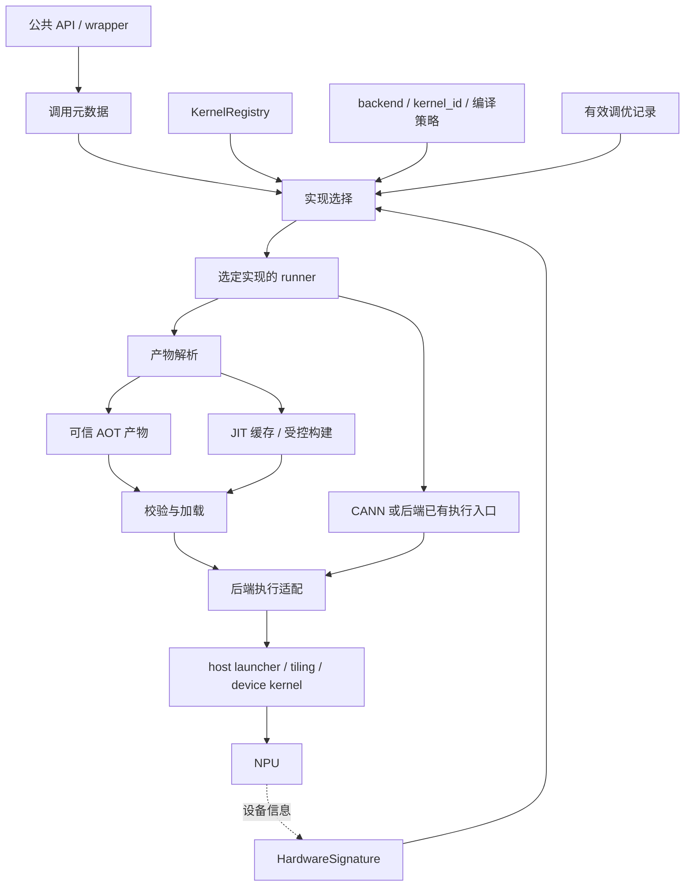
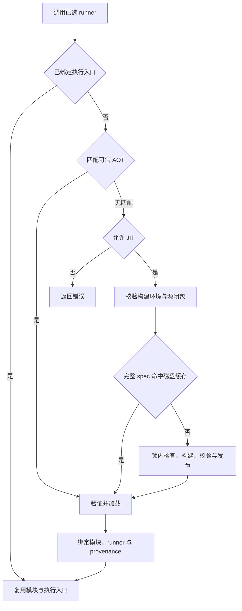
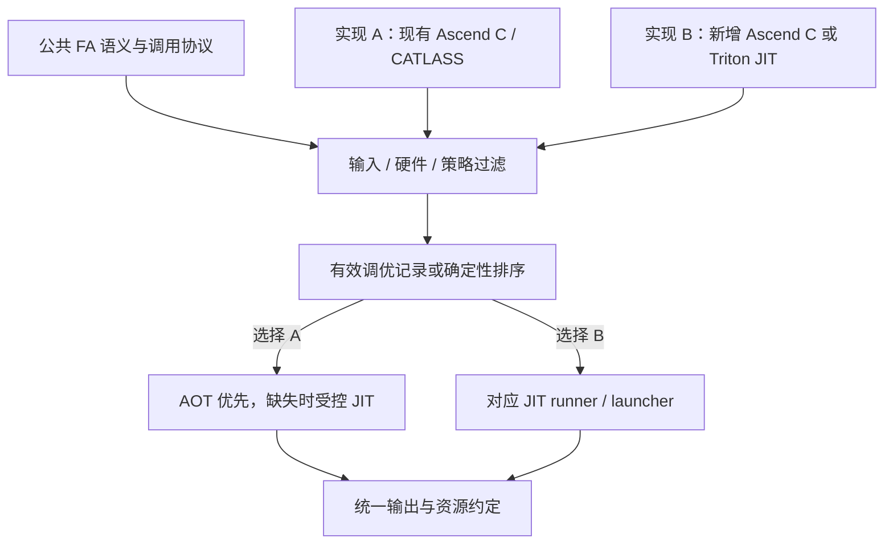

# FlashInfer Ascend 运行时与编译系统技术设计

## 1. 概述

FlashInfer Ascend 面向昇腾 NPU 提供推理算子接口、实现选择机制，以及自定义算子的构建、交付和执行能力。公共 API 在算子语义和调用方式上对标 FlashInfer，底层接入 CANN 内置算子、Ascend C/CATLASS 和 Triton 实现。

系统将算子调用划分为三个职责域：公共接口定义计算语义和调用约定；运行时根据输入、硬件和策略选择实现；所选实现负责准备可执行产物并完成设备调用。AOT 与 JIT 共享构建身份和产物契约，分别用于发布前构建和运行期受控构建。

本文规定运行时与编译系统的数据模型、模块边界、选择算法、产物生命周期和后端接入要求，并以生产 CATLASS FlashAttention 为实例列出源码路径。第 9 节中的独立 JIT FA 接入属于扩展设计；其余章节描述现有机制及实现约束。源码行号对应本文编写时的工作树。

### 1.1 设计目标

1. 对齐 FlashInfer 的接口语义与适用接口的生命周期，保留直接函数、plan/run wrapper 和 run-only wrapper 等调用方式。
2. 以逻辑算子为单位管理多个实现，使公共接口与具体实现、编译器和产物位置解耦。
3. 为 CANN、Ascend C/CATLASS、Triton 及已验证外部实现提供统一的登记和选择机制。
4. 对本仓构建的算子复用 AOT/JIT 构建流水线、缓存身份、完整性校验和加载规则。
5. 支持依据有效测量记录进行实现选择，并在缺少适用记录时给出确定、可解释的结果。
6. 保持算子支持域、native ABI、编译策略、资源生命周期和执行来源可验证。

### 1.2 实现范围

多实现选择是运行时提供的接入能力。当前内置生产登记中，同一逻辑 op 尚未接入多个 NPU 实现；部分 op 另有 reference 实现，reference 默认不参与普通自动选择。当前 CATLASS FA 仅有 Ascend C 候选，未与 CANN single-prefill 或 Triton FA 建立统一候选集合。

生产 Ascend C FA 与 MatmulBiasSiLU 已采用 AOT 优先、缺失时按策略 JIT 的产物解析机制。两者通过统一 Torch 注册与 C++ TorchNPU/ACLNN 桥执行。CANN 内置算子和现有 Triton 算子保留各自的执行适配。

接口存在、实现登记、构建成功和执行验证分别构成不同证据。本文不将其中任一状态替代其他状态；完整接口范围见 [算子覆盖说明](operator-coverage.md)。

## 2. AOT/JIT 设计依据

### 2.1 编译特化与运行期参数

推理算子的编译输入可能包含 dtype、head dimension、计算 variant、tile 配置及目标设备。多个维度的组合会扩大预编译矩阵，而具体模型通常只使用其中一部分组合。

AOT 在发布或部署准备阶段生成产物，适用于已知配置的预先交付。JIT 将部分构建工作推迟到配置明确后的加载、预热或首次调用阶段，只构建需要的编译单元，并通过缓存复用产物。该安排允许编译成本在发布阶段与部署阶段之间分配。

JIT 的主要工程价值是减少完整特化矩阵的提前构建要求、支持新增配置的增量交付，并提供一致的缓存复用机制。特化优化由源码、generator 和编译器实现，AOT 同样可以编译特化 kernel；编译时机不构成 kernel 性能优势的依据。

编译参数与运行期参数应分别建模。改变生成代码的配置属于编译身份；可由现有二进制及动态 tiling 处理的参数保留为运行期输入。不能直接用完整调用 signature 作为所有 kernel 的编译特化粒度。

当前 FA 支持的 S/T/H 变化由 host 动态 tiling 处理，FP16/BF16 组合已包含在冻结配方中。不同 shape 或 dtype 可以产生不同 InputSignature，同时复用同一冻结 spec 和 op-package。当前 JIT 补建既定契约对应的产物，不根据任意新 head_dim、mask 或 dtype 自动生成实现。

### 2.2 构建模式与实现选择的关系

实现选择确定执行哪一份算法或配置；产物解析确定如何获得该实现的可执行代码。两者采用独立身份：

| 维度 | 表达内容 | 典型字段 |
| --- | --- | --- |
| 计算语义 | 参与比较的逻辑算子及公共约定 | `op`、公共 API |
| 实现来源 | 实现所属后端或接入来源 | `backend`、来源栈 |
| 实现身份 | 可独立登记、锁定和追踪的实现 | `kernel_id` |
| 编译身份 | 源码、特化、目标、环境和选项的组合 | `JitSpec.fingerprint` |
| 登记分类 | 调度所使用的编译模式声明 | `compile_mode` |
| 执行来源 | 已绑定模块实际来自 AOT 或 JIT | `provenance.source` |

同一 kernel_id 可采用 AOT 优先、缺失时 JIT 的准备方式，无须仅因编译时机不同登记两份算法实现。反之，同一 backend 内采用不同算法或配置的实现，应具有独立 kernel_id，分别声明支持域并参与选择。

### 2.3 公共构建机制

发布侧与运行侧使用相同的构建记录、缓存存储和产物校验逻辑：

```text
AOT 发布：build_production_packages → _publish → _build_record → 校验与导出
JIT 运行：build_and_load → _build_record → 校验与加载
```

公共构建入口为 [`_build_record`](../flashinfer/jit/build.py#L61)。AOT 将已验证产物导出到交付目录并随 wheel 发布；JIT 将产物保存在本地构建缓存，供后续调用或进程复用。现有批量构建入口保留按 kernel 的缓存和产物，不合并为单次 CMake 构建或同一 vendor 包。

## 3. 总体架构

### 3.1 模块分层

| 层级 | 模块职责 | 主要位置 |
| --- | --- | --- |
| L4 公共 API | 定义语义、组织参数、构造调用元数据、管理输出及适用接口的 plan/run 生命周期 | `flashinfer/decode.py`、`flashinfer/prefill.py`、`flashinfer/norm.py`、`flashinfer/attention/catlass_prefill.py` |
| L3 实现选择 | 查询候选实现，执行支持域和策略过滤，查询调优记录，形成 DispatchDecision | `flashinfer/runtime/`、`flashinfer/tuning/` |
| L3′ 构建与产物管理 | 声明编译单元、发现 AOT、查询构建缓存、受控编译、验证和加载产物 | `flashinfer/jit/`、`flashinfer/aot/` |
| L2 后端适配 | 将公共调用转换为后端参数与执行协议，管理 native 调用、workspace、stream 和资源生命周期 | `flashinfer/cann/`、`flashinfer/jit/tensor_adapter.py`、`flashinfer/aclnn/`、`csrc/aclnn_torch_adapter/`、Triton launcher |
| L1 算子实现 | 实现 host infer/tiling、设备计算及相应 launcher | `csrc/kernels/ascendc/<op>/op_host/`、`csrc/kernels/ascendc/<op>/op_kernel/`、`flashinfer/triton/` |
| L0 硬件执行 | 执行设备计算，提供上层选型与 tiling 使用的设备特征 | 昇腾 NPU；探测模块为 `flashinfer/runtime/hardware.py` |

L3′ 为所选实现提供产物准备能力，不是每次调用的必经编译步骤。CANN 内置实现使用已安装的运行栈；当前生产 Ascend C 实现通过该层解析 AOT/JIT；Triton 可以使用其自身的 JIT launcher。

`flashinfer/jit/` 同时包含公共构建、AOT 发现及加载代码。其目录名称不限制模块只能服务 JIT。

### 3.2 组件关系



硬件探测是实现选择的输入来源。当前 [`current_hardware`](../flashinfer/runtime/hardware.py#L101) 在进程内缓存 SoC、AI Core 数及可查询的 UB 信息；未知信息保留未知值。host tiling 还可通过 CANN 平台接口获取执行所需参数。

### 3.3 依赖约束

公共 API 不根据编译目录或动态库文件名选择实现。dispatcher 仅处理候选元数据和选择策略，不探测编译器、不编译源码、不执行候选 kernel。runner 负责将选定实现与其具体准备、执行过程关联。

后端 adapter 接受已验证模块和受信任声明，完成参数与 native ABI 的转换。编译 driver 负责产生声明的输出；缓存、锁、发布、完整性校验及加载由公共构建层管理，避免各编译器重复实现。

## 4. 核心数据模型

### 4.1 语义与实现标识

`op` 标识逻辑计算及公共调用约定，是候选集合的查询键。多个公共入口可以映射到同一 op，例如 functional/out 或兼容别名；一个公共接口也可以根据语义路径映射到不同内部 op。因此，API 数量、op 数量、实现数量与二进制数量分别统计。

`kernel_id` 标识具体实现，用于登记、显式锁定、编译声明关联和执行追踪。kernel_id 不替代版本及内容校验；源码、能力或编译输入改变后，由 descriptor 与 spec 指纹识别变化。

`backend` 表达实现来源。cann、ascendc、triton 对应常用实现技术栈，external/custom 还承担来源与接入策略分类。源码语言通过 `SourceRef.language` 表达，编译器接口通过 `JitBackend.backend_id` 表达。历史 ascendc_aot/ascendc_jit 枚举保留兼容身份，新接入优先将来源与 compile_mode 分别声明。

### 4.2 调用与硬件签名

| 对象 | 主要字段 | 消费方 |
| --- | --- | --- |
| `InputSignature` | op、按 Tensor 参数顺序排列的 dtypes/shapes/layouts、physical_layouts、specializations | capability 过滤、调优查询、决策缓存 |
| `HardwareSignature` | soc_model、aicore_count、ub_size_bytes | 支持域和目标检查、调优记录匹配 |

InputSignature 是不可变的调用元数据快照，不包含 Tensor 内容或内存地址。物理格式未知时保留未知状态，不由逻辑布局或 stride 推定为 ND/NZ。语义选项由公共接口标准化为 specializations。

当前 FA 将 recipe 的完整参数校验结果写入 `tensor_contract` 特化条件，再由通用 capability 过滤消费。signature 描述本次调用，recipe 声明合法组合，二者不承担相同职责。签名定义见 [signature.py:14](../flashinfer/runtime/signature.py#L14)。

### 4.3 候选描述与登记

| 对象 | 职责与主要约束 |
| --- | --- |
| `CapabilitySpec` | 声明 dtype、shape、布局、特化和硬件支持条件；提供不支持原因，不能用优先级或测量记录覆盖不合法条件 |
| `KernelDescriptor` | 聚合 op、kernel_id、backend、capability、compile_mode、priority、runner，以及适用的源码、产物、目标、ABI、workspace 和图能力声明 |
| `KernelRegistry` | 维护实现目录；按 op 查询；内置初始化后冻结；外部或 custom 接入按各自规则执行，并更新 revision |
| `ImplementationStack` | 同一 registry 快照的来源分组视图；不另建候选事实源或来源性能分数 |
| `DispatchDecision` | 保存 kernel_id、backend、选择原因、候选/来源栈报告及 fallback_chain |

descriptor 的静态信息与进程内 runner 绑定分开，延迟绑定不改变其序列化身份。registry revision 参与决策缓存，避免登记变化后继续复用旧候选集合。

CapabilitySpec 提供通用选型条件，BuildRecipe 提供完整 Tensor 参数与构建契约。二者存在重叠约束时必须保持一致，不能分别扩张支持范围。定义见 [schema.py:689](../flashinfer/runtime/schema.py#L689)、[schema.py:914](../flashinfer/runtime/schema.py#L914) 和 [registry.py:58](../flashinfer/runtime/registry.py#L58)。

### 4.4 编译与产物模型

| 对象 | 生命周期 | 职责 |
| --- | --- | --- |
| `SourceRef` | 声明、构建 | 绑定源码语言、相对路径和摘要 |
| `BuildRecipe` | 作者声明、发布 | 描述 host/device 源码、头文件、依赖、宏、编译/链接选项、Tensor 顺序、shape/dtype 契约、输出格式和入口 |
| `ResolvedBuildRecipe` | 构建准备 | 将配方与实际依赖 revision、头文件树摘要及工具链身份绑定 |
| `JitSpec` | 声明、缓存、加载 | 形成编译单元的规范身份，关联 descriptor、特化、输入指纹、环境、选项、目标和入口 |
| `ArtifactRef` 与 manifest | 构建后、加载前 | 描述实际输出及文件清单，提供摘要、大小、目标和入口校验 |
| launch/binary ABI | 声明、绑定、执行 | 约束 native 符号、参数顺序、传递方式和二进制调用协议 |

BuildRecipe 负责表达可构建实现，JitSpec 负责形成可匹配和复用的编译身份。kernel_id 只能定位实现，不能独立判断二进制是否仍匹配当前编译输入。缓存复用必须依据完整 spec 及已验证产物。

源码声明和 spec 均不构成已编译产物存在的证据。文件型编译产物的 ArtifactRef 必须与实际文件的验证结果一致，内置能力引用按对应后端契约验收。产物校验还需确认其与可信 descriptor/spec 的绑定，不能由任意搜索到的动态库反向推定可信调用契约。

定义见 [BuildRecipe](../flashinfer/jit/recipe.py#L362)、[ResolvedBuildRecipe](../flashinfer/jit/recipe.py#L494)、[JitSpec](../flashinfer/jit/core.py#L57) 和 [ArtifactRef](../flashinfer/runtime/schema.py#L297)。

### 4.5 执行与诊断模型

runner 是公共调用与实现执行之间的可调用接口，可以是函数或有状态 callable。当前生产 Ascend C 使用 `AotKernelRunner` 完成首次产物解析，并保持模块、Tensor runner 和来源记录；CANN 或 Triton runner 可以采用不同准备过程。

loader 将可信产物转换为进程内模块，完成符号解析、目标检查及包激活。adapter 将公共参数转换为实现所需的 native ABI，并管理相关 Tensor、stream、workspace 与资源所有权。它们分别承担产物绑定和调用转换。

`RuntimeProvenance` 记录实际来源、目录、spec 指纹及必要的回落原因。候选报告和 provenance 服务于定位、复现及验收，不构成算法语义或基本选型条件。此类诊断可以独立裁剪；实现身份、支持域和 native 调用约束仍需保留。

## 5. 实现选择

### 5.1 自动选择算法

设 `C(op)` 为 registry 中属于该 op 的实现集合。普通自动选择依次执行：

1. 按 backend 策略、custom/reference 准入规则缩小候选集合。
2. 检查 CapabilitySpec 与目标 SoC，收集每个候选的拒绝原因。
3. 按编译策略排除已禁用的 JIT descriptor。
4. 在合法集合中匹配有效调优记录。
5. 有合法测量胜者时选择该实现；否则使用确定性排序。
6. 返回 DispatchDecision，不在选择阶段加载或执行实现。

当前确定性排序键为 `(tier, -priority, kernel_id)`。默认来源阶梯为 external、CANN/ACLNN、自研 AOT、自研 JIT/未声明 AOT、reference；它是配置策略，不代表性能排名。来源栈选择以各栈合法实现的最优排序键为边界，栈内继续使用同一规则。

实现见 [dispatch.py:130](../flashinfer/runtime/dispatch.py#L130)，过滤位于 [243](../flashinfer/runtime/dispatch.py#L243)，调优查询位于 [311](../flashinfer/runtime/dispatch.py#L311)，排序结果构造位于 [353](../flashinfer/runtime/dispatch.py#L353)。

### 5.2 调优记录

调优服务比较满足同一公共语义的实现或配置。记录应关联负载范围、硬件、候选身份和测量方法，运行期仅查询适用记录。记录中的胜者必须仍属于当前合法候选集合，不得恢复已被 capability 或策略排除的实现。

性能比较应明确冷构建、加载和稳态执行的度量范围。某次测量的胜者仅适用于其测试条件和候选集合，不能推广为全局最优。目前随包调优记录为空，缺少适用记录的调用使用确定性策略。

实际测量入口为 [collect_tuning_record](../flashinfer/tuning/benchmark.py#L162)，运行期查询入口为 [query_tuning_record](../flashinfer/tuning/store.py#L316)。调度路径不执行现场测量、配置搜索或自动编译候选集合。

### 5.3 显式选择

`backend` 用于筛选候选，不改变候选支持域。显式 `kernel_id` 锁定唯一实现，检查 capability 和目标，但按现有覆盖规则跳过自动选择、排序及相应 auto 策略过滤，见 [dispatch.py:202](../flashinfer/runtime/dispatch.py#L202)。

编译授权必须由产物准备层独立校验。新增 JIT runner 不能将“dispatcher 选中了该 kernel”作为运行期获准编译的依据。当前生产 AOT 优先 runner 在首次解析时执行该策略检查。

### 5.4 决策缓存与失败处理

决策缓存覆盖 InputSignature、HardwareSignature、backend/kernel_id、相关策略、registry revision 和 tuning token。缓存命中仅表示实现选择可复用，不证明对应二进制存在或已经加载。

进程外更新调优数据库或原地替换随包调优数据后，需要调用 [reload_tuning_records](../flashinfer/tuning/store.py#L53) 或重启进程，使调优查询和决策缓存失效。

`fallback_chain` 保存其他合法候选的确定性顺序。当前 FA 执行代码不会在构建或 launch 错误后逐个重试该列表。错误按所选实现的契约传播，只有其 AOT 发现结果为 missing 时才允许进入受控 JIT 分支。

## 6. 构建与产物生命周期

### 6.1 声明与构建准备

生产 Ascend C 配方位于 `csrc/recipes/`，descriptor 位于 `flashinfer/data/kernels/registry.json`，冻结声明位于 `flashinfer/data/kernels/ascendc_specs.json`。

[freeze_production_kernels](../flashinfer/aot/declarations.py#L41) 按 kernel_id 关联 descriptor 与 recipe，解析源码和依赖身份，并形成冻结 spec。该步骤不编译算子，也不根据源码自动扩大 capability、workspace 或 ABI 声明。

[build_production_packages](../flashinfer/aot/build.py#L110) 在构建前核验所选项的依赖、环境和源闭包。所有所选项完成准备后，才逐项进入公共构建与导出流程，避免后续无效配置在前序构建后才被发现。

当前 [AscendCBackend](../flashinfer/jit/backends.py#L198) 根据已解析 recipe 声明编译单元，并调用 [compile_recipe](../flashinfer/jit/ascendc.py#L102)。该 driver 生成 CMake 输入并调用 CANN 工具链。当前模板参数主要由已有源码、宏及配方提供，未形成面向任意模型配置的通用模板物化系统。

### 6.2 AOT 发布与运行期发现

AOT 使用公共构建缓存获得已验证产物，再导出 op-package。普通 wheel 构建携带当前登记的生产算子包、构建输入和 TorchNPU C++ 桥。PREBUILT 模式复用已验证算子包及匹配的预编译桥，不调用编译器。

运行期 [AotPackageIndex](../flashinfer/jit/discovery.py#L167) 默认搜索安装包内的 `flashinfer/data/op_packages/`，并可搜索 `FLASHINFER_AOT_PATHS` 指定的目录。匹配包括目标、完整 spec 和 descriptor 身份，文件内容由既有 verifier 校验。

首次 AOT 激活可共同准备同目标、可信且已随包的生产项；缺失的同组项不会额外触发编译。CANN 包按不可变 generation 管理。已激活后替换同名实现或追加 vendor 受到进程级约束，需使用新进程或在首次激活前按组准备。

### 6.3 JIT 解析与构建

[AotKernelRunner.resolve](../flashinfer/jit/runtime.py#L91) 在首次真实执行时解析产物。现有行为如下：

| 状态 | 处理 |
| --- | --- |
| 存在匹配且完整的 AOT | 加载并建立 Tensor runner |
| 无匹配 AOT，允许 JIT 且已登记 factory | 准备工具链、源码与依赖，再进入 JIT 缓存查询 |
| JIT 磁盘缓存命中 | 验证并加载缓存产物，不调用 compile |
| JIT 缓存未命中且允许编译 | 持锁二次检查、暂存构建、验证、原子发布，再加载 |
| 无匹配 AOT，策略为 DISABLED 或 CACHE_ONLY | 报 missing，不使用 JIT 缓存替代缺失的安装产物 |
| AOT 损坏、加载失败、包身份冲突或执行失败 | 保留错误，不自动转 JIT 或其他实现 |

源码入口为 [_jit_backend](../flashinfer/ascendc.py#L66) → [build_and_load](../flashinfer/jit/build.py#L109) → [_build_record](../flashinfer/jit/build.py#L61)。进程内解析锁避免同一 runner 重复绑定；构建存储锁避免同一 spec 的并发重复构建，锁内再次检查缓存。

在当前生产路径中，JIT 磁盘查询之前会核验冻结工具链、源码和外部依赖。即使命中磁盘缓存，也需要这些构建条件。AOT 命中不经过该准备步骤。

### 6.4 模块绑定与缓存边界



| 缓存对象 | 复用条件 | 不包含的保证 |
| --- | --- | --- |
| 调度决定 | 调用、硬件、策略、登记与调优版本匹配 | 不表示产物存在 |
| 构建产物 | 完整 spec 与内容验证通过 | 不表示当前进程已加载 |
| 已绑定模块与 runner | 保持原不可变 generation 与有效资源所有权 | 磁盘替换不会更新已有绑定 |
| wrapper plan | 对应接口的元数据、资源和更新契约保持兼容 | 不等同于通用编译缓存或 ACLNN executor 缓存 |

成功绑定后，后续调用复用模块和执行入口，不逐次扫描源码或重编。输出分配、Tensor 转换、host tiling、workspace 查询及实际执行仍按具体 runner 的调用契约处理。

## 7. 后端执行与导出接口

### 7.1 接入协议

| 实现来源 | 所需交付件 | 执行方式 |
| --- | --- | --- |
| CANN 内置算子 | 语义与参数适配、descriptor、capability、runner | 通过 torch_npu/CANN 已有接口执行，不由本仓重编 CANN |
| 本仓 Ascend C | op_host/op_kernel、recipe、descriptor、冻结 spec、Torch/执行适配与验证 | AOT/JIT 解析后，经本仓 TorchNPU/ACLNN 桥调用 |
| 已有 op-package | 可信 descriptor/spec、匹配 manifest/摘要/ABI、执行 adapter | 校验并加载后转换为可调用实现；匿名包路径不足以建立可信接入 |
| Triton | 源码、支持域、descriptor、launcher/runner 及相应验证 | 使用对应 Triton 执行协议，可按需要复用公共构建能力 |

参与同一公共入口的 runner 必须满足一致的计算语义、参数、输出及修改行为。native ABI 可以因后端而异，由 adapter 完成转换。仅具有相同算子名称或 Tensor shape 不构成可替换性。

### 7.2 Torch 注册与内部声明

当前生产 Ascend C API 采用统一 Torch 执行路径。`flashinfer.*` 公共函数自动注册并转发至 `torch.ops.flashinfer.*`；直接 Torch 调用可在初始化时显式注册。`enable_aclnn()` 仅执行幂等 schema 注册，不切换执行模式，也不加载或编译算子包。

公共 schema 的 PrivateUse1 回调位于 Python，负责契约校验、signature 构造、dispatch 和 runner 调用；native 参数转换与设备提交由 C++ 桥执行。

| 声明或注册 | 约束范围 |
| --- | --- |
| Torch schema / FakeTensor | 参数、返回、输出修改、PrivateUse1 实现及元数据推导 |
| KernelDescriptor / KernelRegistry | 实现身份、能力、候选管理与选择 |
| BuildRecipe / JitSpec | 编译输入、特化、缓存与加载身份 |
| CANN OpDef / op-package | infer、tiling、host API 与设备实现关联 |

这些声明可由工具协同维护，但各自具有独立验收条件。schema 注册不代表产物已加载，spec 声明不代表二进制已构建。

### 7.3 TorchNPU/ACLNN 执行

[package_tensor_runner](../flashinfer/jit/tensor_adapter.py#L32) 只接受与可信 recipe/spec 绑定的已验证模块。执行前检查有序 Tensor 参数、完整 dtype/shape 契约、NPU 设备、连续 ND 格式及输出重叠。

首次调用通过 [_native.prepare](../flashinfer/aclnn/_native.py#L73) 登记已验证 ACLNN GetWorkspaceSize 与 launch 地址，保持模块存活，并缓存 native 调用绑定。公共 Torch schema 不接受任意库路径或函数指针。

绑定完成后，Tensor 参数通过内部 `torch.ops.flashinfer_aclnn._execute` 进入 C++ adapter。内部 token 标识进程内已验证的 API 绑定，不替代逻辑 op、kernel_id 或编译 spec。

C++ adapter 使用当前 NPU stream 和 TorchNPU `OpCommand::RunOpApi` 提交 callback。callback 创建 aclTensor，调用 GetWorkspaceSize 获取 executor 与 workspace 大小，分配 workspace 并执行 ACLNN launch。Tensor、描述符及 workspace 保持有效，直至同步调用完成后释放。本仓不修改应用的全局任务队列策略。

当前桥支持 recipe 声明的有序 Tensor ABI。Python 侧不再提供独立的 ctypes Tensor/ACLNN 执行分支；scalar、attribute、optional Tensor 和 Tensor list 等 native 参数扩展仍需单独定义契约及转换。

FA 与 MatmulBiasSiLU 保持同步 eager、NOT_CAPTURABLE。FakeTensor 推导和 TorchNPU 队列接入不改变其图能力声明。

## 8. FlashAttention 调用实例

### 8.1 支持域与身份

`single_prefill_with_kv_cache_catlass` 计算 `softmax(Q @ K.T / sqrt(128)) @ V`，当前支持 Ascend950 上连续 ND Tensor，逻辑布局 NHD，隐含 batch=1。Q 为 `[S,H,128]`，K/V 为 `[T,H,128]`，S/T 为 128..512 范围内的 128 倍数，H 为 1..8；Q/K/V/out 全部 FP16 或全部 BF16，非 causal、无 mask。

```text
op          = ascendc.single_prefill_catlass
backend     = ascendc
kernel_id   = ascendc/t4/flash_attention/catlass/op_package/Ascend950
compile_mode = aot
```

该 kernel_id 表达现有实现身份，不要求每个运行期 shape 分别登记。其 recipe 与 descriptor 分别位于 [flash_attention.json:1](../csrc/recipes/flash_attention.json#L1) 和 [registry.json:132](../flashinfer/data/kernels/registry.json#L132)，冻结记录位于 [ascendc_specs.json:174](../flashinfer/data/kernels/ascendc_specs.json#L174)。

### 8.2 公共调用与签名

```python
import torch
import torch_npu
import flashinfer

for dtype in (torch.float16, torch.bfloat16):
    q = torch.randn(128, 2, 128, dtype=dtype, device="npu")
    k = torch.randn(256, 2, 128, dtype=dtype, device="npu")
    v = torch.randn(256, 2, 128, dtype=dtype, device="npu")
    output = flashinfer.single_prefill_with_kv_cache_catlass(q, k, v)
```

以 FP16 分支为例，调用签名包含四个 Tensor 的 dtype 和 shape。未传 out 时，公共实现先用输出元数据补全签名，选型成功后再分配真实输出，避免非法参数在拒绝前触发输出分配。

```text
dtypes          = ("float16", "float16", "float16", "float16")
shapes          = ((128,2,128), (256,2,128), (256,2,128), (128,2,128))
physical_layouts = ("ND", "ND", "ND", "ND")
specializations = (("tensor_contract", "supported"),)
```

### 8.3 源码调用路径

| 阶段 | 源码入口 | 行为 |
| --- | --- | --- |
| 公共 API | [catlass_prefill.py:15](../flashinfer/attention/catlass_prefill.py#L15)，Torch 转发位于 [43](../flashinfer/attention/catlass_prefill.py#L43) | 自动注册并转发 functional/out，保留 backend/kernel_id |
| Torch 注册与回调 | [_ops.py:76](../flashinfer/aclnn/_ops.py#L76)、[enable:93](../flashinfer/aclnn/_ops.py#L93)、[_attention:48](../flashinfer/aclnn/_ops.py#L48) | 定义 schema 并分发至 PrivateUse1 私有实现 |
| 参数校验 | [_single_prefill_impl:48](../flashinfer/attention/catlass_prefill.py#L48)、[tensor_contract_specialization:107](../flashinfer/ascendc.py#L107) | 校验 recipe、选项和输出别名，形成 tensor_contract |
| 签名与硬件 | [build_signature:104](../flashinfer/runtime/signature.py#L104)、[current_hardware:101](../flashinfer/runtime/hardware.py#L101) | 生成实际负载与硬件输入 |
| 实现登记 | [get_global_registry:301](../flashinfer/runtime/registry.py#L301)、[ascendc_descriptors:88](../flashinfer/ascendc.py#L88) | 首次初始化元数据并绑定 lazy runner，不编译其他算子 |
| 实现选择 | [catlass_prefill.py:93](../flashinfer/attention/catlass_prefill.py#L93) → [dispatch.py:130](../flashinfer/runtime/dispatch.py#L130) | 返回选中 kernel_id 与选择依据 |
| 输出与调用 | [catlass_prefill.py:94](../flashinfer/attention/catlass_prefill.py#L94)、[_run_selected:11](../flashinfer/attention/catlass_prefill.py#L11) | 分配或复用 out，调用 descriptor.runner |
| AOT/JIT 解析 | [AotKernelRunner.resolve:91](../flashinfer/jit/runtime.py#L91)、[AotPackageIndex.find:235](../flashinfer/jit/discovery.py#L235) | 发现、匹配并加载产物，必要时按策略 JIT |
| JIT 构建分支 | [_jit_backend:66](../flashinfer/ascendc.py#L66) → [build_and_load:109](../flashinfer/jit/build.py#L109) → [compile:255](../flashinfer/jit/backends.py#L255) → [compile_recipe:102](../flashinfer/jit/ascendc.py#L102) | 验证构建环境和输入，复用缓存或调用公共 driver |
| Tensor adapter | [package_tensor_runner:32](../flashinfer/jit/tensor_adapter.py#L32)、[TorchOpPackageRunner.__call__:60](../flashinfer/jit/tensor_adapter.py#L60) | 校验已加载模块并进行执行边界检查 |
| native 绑定 | [_native.prepare:73](../flashinfer/aclnn/_native.py#L73)，内部 Torch 入口位于 [91](../flashinfer/aclnn/_native.py#L91) | 登记可信 API 地址，复用 native 绑定 |
| TorchNPU 提交 | [adapter.cpp execute:103](../csrc/aclnn_torch_adapter/adapter.cpp#L103)、[RunOpApi:180](../csrc/aclnn_torch_adapter/adapter.cpp#L180) | 按当前 stream 与框架队列策略提交同步调用 |
| ACLNN 第一段 | [adapter.cpp:163](../csrc/aclnn_torch_adapter/adapter.cpp#L163)、[FiFlashAttentionTiling:26](../csrc/kernels/ascendc/flash_attention/op_host/flash_attention.cpp#L26) | 执行 host tiling，获得 executor 和 workspace 大小 |
| workspace 与 launch | [adapter.cpp:169](../csrc/aclnn_torch_adapter/adapter.cpp#L169)、[174](../csrc/aclnn_torch_adapter/adapter.cpp#L174) | 分配实际 workspace 并提交设备执行 |
| 设备实现 | [catlass.cpp:9](../csrc/kernels/ascendc/flash_attention/op_kernel/catlass.cpp#L9) → [FAInferTla:547](../csrc/kernels/ascendc/flash_attention/op_kernel/fai_kernel.h#L547) | 按 DTYPE_Q 实例执行 CATLASS FA，结果写入 out |

CANN 构建生成 `aclnnFiFlashAttentionGetWorkspaceSize` 与 launch host API；手写 [op_host:94](../csrc/kernels/ascendc/flash_attention/op_host/flash_attention.cpp#L94) 定义 dtype/格式、infer 和 tiling 关联。ACLNN 两段式调用均在 RunOpApi callback 中执行。

### 8.4 后续调用

完成绑定后，runner 复用已加载模块及 native API 绑定。调用仍需构造或校验输入元数据，调度决定可命中缓存；真实执行仍包括 Tensor 转换、host tiling/workspace 查询及 launch。未提供 out 时仍分配输出。

此接口未缓存 ACLNN executor 或 tiling 结果，也不要求用户先执行 plan。其编译缓存与 batch wrapper 的 plan 资源分别管理。

## 9. 独立 JIT FA 的扩展设计

### 9.1 同一实现采用 JIT 的现有路径

当前 CATLASS FA 在无匹配 AOT 时，可按同一 kernel_id 和冻结 spec 查询缓存或编译。产物来源改变后，descriptor 的 compile_mode 仍为 AOT，RuntimeProvenance.source 为 JIT。公共语义、Tensor runner 与 ACLNN 执行路径保持一致。

该路径已由现有 runner 实现，不需要为 AOT/JIT 分别登记两个算法候选。它只补建已声明且受支持的编译单元，不扩大 FA 的语义或 dtype/shape 范围。

### 9.2 新算法或新语言实现

新增 Ascend C 算法或 Triton FA 构成新的实现候选，应分配新的 kernel_id，并与现有实现建立公共语义和 runner 参数约定。扩展后的选择与准备流程为：



该图定义扩展接入关系，不表示当前已有 Triton FA 或生产纯 JIT FA。新增实现必须交付以下内容：

| 交付项 | 接入要求 |
| --- | --- |
| 公共计算契约 | 对齐输入输出、mask/layout/out、数值误差与修改行为，明确与其他候选的可替换范围 |
| descriptor 与 capability | 独立 kernel_id、来源、目标、编译分类及支持域；不得复用其他算法身份 |
| 源码与编译声明 | 提供实际实现、特化规则、依赖和可验证的编译身份 |
| runner 与 adapter | 接受公共参数约定，使用对应语言/后端的加载与执行协议 |
| 编译策略 | runner 在准备产物时独立检查是否允许编译，正确处理缓存和失败 |
| 验证与调优 | 先验证数值和生命周期，再按明确测量范围生成可用选择记录 |

Triton 实现不使用 Ascend C 的 ACLNN Tensor adapter 作为通用 launcher。两种 native ABI 的一致性由各自 runner/adapter 与共同公共契约建立。

### 9.3 对现有接入点的扩展要求

当前生产 Ascend C freezer 在 [declarations.py:74](../flashinfer/aot/declarations.py#L74) 仅接受 backend=ascendc、compile_mode=AOT；[AotKernelRunner](../flashinfer/jit/runtime.py#L35) 也限定 AOT 优先登记。新增纯 JIT 生产 descriptor 不能只修改 JSON 的 compile_mode，必须同时提供对应 runner 和登记接线。

公共 `build_and_load`、构建存储和 compiler backend 可以复用。采用已有 Triton launcher 方式时，可参考 [Triton norm 登记](../flashinfer/triton/norm.py#L29)，但仍需实现并验证 FA 本身。

当前 CATLASS 公共实现的 recipe 校验位于 [catlass_prefill.py:63](../flashinfer/attention/catlass_prefill.py#L63)。若新候选支持域不同，需要将公共语义检查与各候选的能力检查分离，使某一份 backend 配方不再决定整个公共接口的支持上限。

CANN `attention.single_prefill` 与 CATLASS `ascendc.single_prefill_catlass` 当前属于不同 op 和调用契约。通用 FA 接入须明确公共 op、参数规范化及既有 Attention ABI/provider 的适配方式，不能仅通过修改 op 字符串合并候选。本设计文档不变更现有冻结 ABI 或登记集合。

## 10. 设计约束与验证要求

### 10.1 约束

1. 未经验证的 dtype、shape、布局、目标和图能力不得通过登记或编译状态推定为已支持。
2. 当前调优记录为空时使用确定性规则，不将默认优先级解释为性能结论。
3. 生产 Ascend C JIT 受冻结工具链与源闭包约束；不提供任意新配置的自动源码生成。
4. TorchNPU 桥加载时校验 Torch/TorchNPU 构建版本与库摘要。AOT op-package 加载器尚未重新比较当前 CANN runtime 与构建时 CANN 的版本兼容性，跨版本部署需独立验证。
5. 当前 FA/MatmulBiasSiLU 的同步 eager、NOT_CAPTURABLE 与包 generation 生命周期限制保持有效。

### 10.2 验证范围

| 范围 | 验证内容 | 现有测试入口 |
| --- | --- | --- |
| 数据与选择 | signature、capability、来源分组、显式选择、策略与缓存失效 | `tests/test_signature.py`、`tests/test_dispatch.py`、`tests/test_two_level_dispatch.py` |
| 调优 | 记录准入、候选身份、过期拒绝、无显著差异与确定性回退 | `tests/test_tuning.py`、`tests/test_tuning_release.py` |
| 产物解析 | AOT 命中/缺失、JIT 授权、损坏/加载/执行错误、单次绑定 | `tests/test_aot_runtime.py` |
| 构建框架 | 通用声明、依赖、批量预检、源码变化与 AOT/JIT 构建 | `tests/test_ascendc_framework.py` |
| Torch 边界 | 导入与注册隔离、FakeTensor、CPU 拒绝、桥缺失/损坏 | `tests/test_aclnn_adapter.py` |
| 真机与交付 | 数值、双 dtype、functional/out、stream、storage offset、队列、AOT/JIT 和安装后执行 | `tests/test_aclnn_adapter_real.py`、`tests/test_flash_attention_real.py`、`python -m flashinfer selftest` |

新增独立 JIT FA 还需验证公共语义一致性、能力交集、所选实现的实际执行来源、冷构建/缓存复用，以及跨实现可比的测量方法。现有调度或合成测试不能替代新增 kernel 的真机验证。

具体执行结果由对应测试报告和日志维护，不在本设计文档中固定测试数量或一次性安装结果。总体约束见 [框架设计](framework_design.md)，详细 FA 调用说明见 [调用链文档](flash-attention-call-chain.md)，接入步骤见 [新增算子指南](adding-a-custom-operator.md)。
